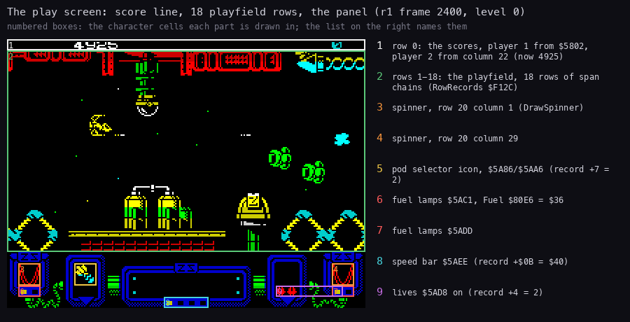
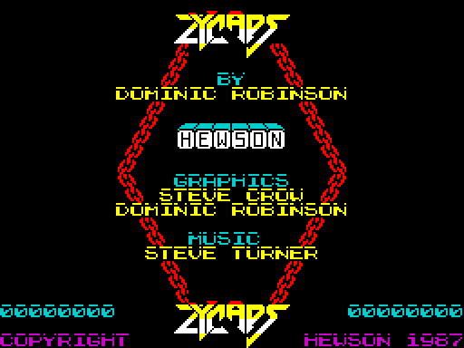
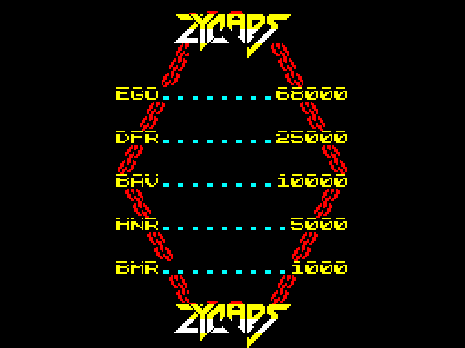
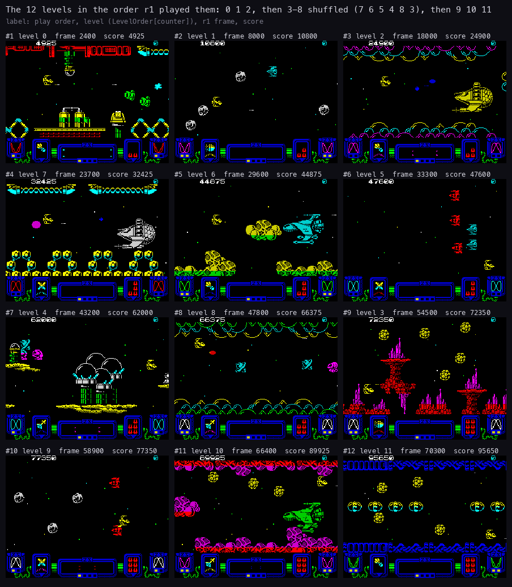
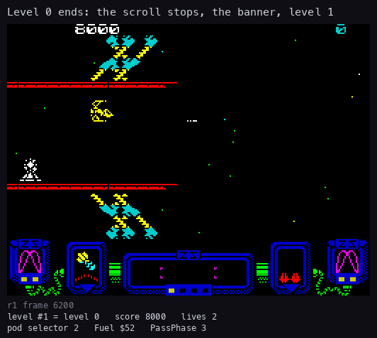
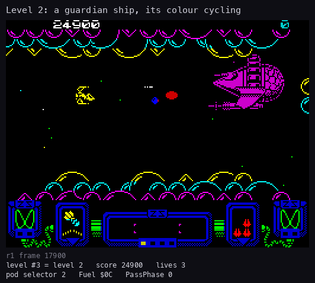

# 1. Game design

What this covers: Zynaps as a player meets it.

- the play screen (1.1) and the title pages (1.2);
- the controls in short (1.3);
- the ship, its weapons and the pods (1.4);
- scoring, lives and the high scores (1.5);
- the twelve levels, each with a screenshot (1.6);
- the end of a level (1.7) and the guardians (1.8);
- difficulty (1.9);
- what no recording reached (1.10).

Zynaps is a horizontally scrolling shoot-'em-up by Dominic Robinson, published by Hewson in 1987 for the 48K
Spectrum. The graphics are by Steve Crow and Dominic Robinson, the music by Steve Turner (the credits page, 1.2).

The names are those of `src/game/game.ann` ([Terms](README.md#terms)). The recordings it rests on:

- `r1`: all 12 levels and the wrap to the first, 75 003 frames, `tools/bot.py` with the Kempston, from
  `work/run/play-imm.szx` (play on level 0 with Invulnerable `$FFD7` = 1; WALKTHROUGH 5). Opened read-only on an
  own instance as `work/zyA/r1`:
  `re_session.py open --work work/zyA/r1 --ttd work/r1/session.ttd --port-base 14500`;
- `c1`: power-on, the load and 4000 frames of the title with no input (WALKTHROUGH 1), opened as `work/zyA/c1`
  (port base 14510);
- `c2`: level 0 from its start, 1500 frames, an honest bot game (275 points, one death);
- the menu recording `work/zyA/menu` and the pod experiment `tools/exp_pods.py` of [5](05-controls.md).

## 1.1 The play screen



How to read the figure:

- **The picture** is `r1` frame 2400, level 0, at 2x.
- **A numbered box** is the character cells one part of the screen is drawn in. The list on the right names it, with
  the address the code draws it at and the value it shows at that frame:
  1. row 0: the scores; player 1 from `$5802`, player 2 from column 22 (PrintPlayerScore `$A4AE`);
  2. rows 1-18: the playfield, 18 rows of span chains ([6.2](06-rendering.md#62-the-playfield-span-chains));
  3. and 4. the two spinners, row 20, columns 1 and 29 (DrawSpinner `$A8BE`);
  5. the pod selector icon, rows 20-21, columns 6-7 (`$5A86` / `$5AA6`, PodIconJob `$AC2C`);
  6. and 7. the fuel lamps, `$5AC1` and `$5ADD`, lit by Fuel `$80E6`;
  8. the speed bar `$5AEE`, from the speed (player record `+$0B`);
  9. the lives `$5AD8`, from the record's `+4`.
- **The point**: the screen is a playfield framed by a fixed panel. The panel shows the ship's state; the only text in
  play is the score line.

```bash
python3 tools/fig_screen.py --work work/zyA/r1 --frame 2400 --out docs/img/design/play-screen.png
```

The pod icon is at rows 20-21, columns 6-7 (`$5A86` / `$5AA6`, PodIconJob `$AC2C`); the screen agrees. The stage 2
comments said "rows 16-17"; they were corrected in the documents stage.

## 1.2 The title pages

The title alternates two pages until fire (MainLoop `$B200`):

| Credits page | High-score page |
| --- | --- |
|  |  |

How to read the pictures:

- **Left**: CreditsPage `$B095` at `c1` frame 12600. The logo twice, the credits, the two players' last scores
  (`00000000` after power-on), COPYRIGHT HEWSON 1987. The title tune (TitleTune `$B446`) plays here; keys 1-3 are read
  when it ends ([5.3](05-controls.md#53-the-title-keys-and-the-selections)).
- **Right**: HiScorePage `$B0C9` at `c1` frame 14730. The five entries of HiScoreTable `$8261`: EGO 68000,
  DFR 25000, BAV 10000, HNR 5000, BMR 1000. It stays 500 frames or until fire.
- **The point**: the title has no menu screen. The options are keys on the credits page.

```bash
python3 ../../kit/screen_shot.py --work work/zyA/c1 --out-dir docs/img/design credits=12600 hiscore=14730
```

`c1` frame 12330 is still the loading screen: the game starts at frame 12323 and clears it after its set-up
([3.5](03-build-and-load.md#35-the-stages-from-power-on-to-the-game)).

## 1.3 The controls in short

[5](05-controls.md) has them all. In short:

- five keys, P fire, L up, Symbol Shift down, A left, S right by default, redefinable with key 3;
- or a joystick: Kempston (chosen by leaving the title with Kempston fire), cursor (5-8, 0) or Sinclair (6-9, 0);
- 1 / 2 on the credits page: one or two players (two players take turns, each with a player record: Player1 `$7F9C`,
  Player2 `$7FCC`);
- 4 pauses; in the pause fire resumes and Q quits the game.

## 1.4 The ship, the weapons and the pods

- The ship flies anywhere on the playfield. It starts with the laser at level 1 and speed `$40`
  (PlayerSetup, [2.5](02-architecture.md#25-the-state)).
- Fire shoots the laser. A side weapon, once taken, fires with it ([10](10-gameplay-logic.md)).
- A wave of enemies destroyed whole leaves a **pod**. The panel's five icons are the weapons it can give: speed-up,
  laser, plasma, homing missiles, seeker. The lit icon is the selector (record `+7`).
- **Touching a pod** moves the selector to the next icon and gives 100 points.
- **Touching a pod with fire held for 8 passes** (about a third of a second) takes the lit weapon and resets the
  selector ([5.6](05-controls.md#56-the-weapon-pods-touch-to-select-hold-fire-to-take)).
- **Fuel** (`$80E6`) falls one step every 16 frames. At 0, FuelOut `$9C03` takes a laser level and a speed step.
  Pods refill it: the speed-up to `$BB`, a selector wrapped past the fifth icon to `$B4` (and 1000 points). A pod
  that scrolls away untouched halves it.
- So the game asks the player to keep collecting pods, and to choose when to hold fire on one.

## 1.5 Scoring, lives and the high scores

- Each enemy kind has a score index (its kind byte b2, low nibble) into PointsTable `$8231`:
  0, 25, 50, 75, 100, 150, 200, 250, 500, 1000, 2000, 5000. AddScore `$A489` adds the entry.
- Pods: 100 points for any pod, 1000 when the selector wraps (5.6).
- The score is 8 BCD digits (record `+0` to `+3`), printed by ScoreJob in the main loop
  ([4.2](04-game-loop.md#42-the-main-loop-in-play-jobs-only)).
- **Lives**: 2 in reserve at the start (record `+4`), shown as red marks on the panel. One more at each of
  ExtraLifeScores: 10 000, 30 000, 50 000, 70 000 and 90 000. In `r1` the lives read 2 at frame 6220 (score 8000)
  and 3 at frame 17940 (score 24 900).
- **High scores**: at the game over a score above the fifth entry takes its place, with three initials picked with
  left, right and fire ([5.5](05-controls.md#55-the-high-score-initials)).

## 1.6 The twelve levels

LevelOrder `$8003` sets the order of the twelve level records:

- levels 0, 1, 2 come first and 9, 10, 11 last;
- levels 3-8 are shuffled for each game by PlayersSetup `$AFB7` (ShuffleDraw `$B003`, Random `$8544`);
- after level 11 the game wraps to the first level (LevelDone `$B174`).

`r1`'s order is 0 1 2 7 6 5 4 8 3 9 10 11 (LevelOrder read from its memory). The bot's run wrapped to level 0 at
its frame 73 600 with 100 300 points (WALKTHROUGH 5).



How to read the figure:

- **One picture per level**, in the order `r1` played them, left to right and top to bottom.
- **The label**: the play order (#1-#12), the level (LevelOrder at the level counter, record `+6`), the `r1` frame
  and the score at that frame. Both numbers are read from the frame's memory, not assumed.
- **The point**: twelve different scenes from one engine. Three levels are open space (1, 5, 9); four have a
  guardian ship on the screen at that frame (2, 7, 6, 10).

```bash
python3 tools/fig_levelshots.py --work work/zyA/r1 --out-dir docs/img/design
```

The level records (LevelTable `$6B2D`, `src/res/levels/levels.lev.txt`) and the shots one by one:

| Order | Level | First seen (`r1`) | Shot | Scroll start | Scenery script | Fire bias | On the screen |
| ---: | ---: | ---: | --- | ---: | ---: | ---: | --- |
| 1 | 0 | 250 | [frame 2400](img/design/level-01-0.png) | `$40` | 1 | 0 | a base: towers, pipes, lattice girders |
| 2 | 1 | 6 500 | [frame 8000](img/design/level-02-1.png) | `$30` | 2 | 0 | open space, asteroids |
| 3 | 2 | 12 750 | [frame 18000](img/design/level-03-2.png) | `$30` | 3 | 0 | arches above and below, a guardian |
| 4 | 7 | 18 500 | [frame 23700](img/design/level-04-7.png) | `$40` | 11 | 15 | a chain above, hexagon blocks below, a guardian |
| 5 | 6 | 25 000 | [frame 29600](img/design/level-05-6.png) | `$30` | 10 | 20 | rock clusters, a guardian |
| 6 | 5 | 31 250 | [frame 33300](img/design/level-06-5.png) | `$30` | 9 | 10 | open space, a wave in formation |
| 7 | 4 | 38 500 | [frame 43200](img/design/level-07-4.png) | `$30` | 6 | 3 | domes on towers |
| 8 | 8 | 44 000 | [frame 47800](img/design/level-08-8.png) | `$10` | 12 | 15 | arches above and below |
| 9 | 3 | 51 500 | [frame 54500](img/design/level-09-3.png) | `$38` | 4 | 0 | red and magenta spires |
| 10 | 9 | 56 250 | [frame 58900](img/design/level-10-9.png) | `$30` | 2 | 15 | open space, asteroids |
| 11 | 10 | 61 500 | [frame 66400](img/design/level-11-10.png) | `$30` | 14 | 20 | organic walls, a guardian |
| 12 | 11 | 67 250 | [frame 70300](img/design/level-12-11.png) | `$30` | 8 | 15 | a blue band above and below, pods of eggs |

- **First seen** is the first of `r1`'s 250-frame snapshots in the level; the exact starts are in
  [10.8](10-gameplay-logic.md#108-the-twelve-levels-in-r1).
- **Scroll start** is ScrollCount's start, not a speed: the map columns built before the level opens (ReplayScroll,
  [6.4](06-rendering.md#64-the-scroll-a-new-column-every-four-passes)). In `r1` frames 6280-6370 ScrollColumn `$801C`
  goes from `$60` to `$90` while the level 1 banner is up: `$30` columns.
- **Scenery script** is the coroutine that writes the map (ScriptNumber `$81DD`). Levels 1 and 9 share script 2.
- **Fire bias** is ScriptLevelBias `$81DE`, added to the enemies' fire chance `$80E8` (1.9).
- Each level runs its wave script (`src/res/levels/levels.lev.txt`, section `scripts`) to its `levelend`.

## 1.7 A level ends



How to read the animation:

- **The picture** is `r1` frames 6200-6420, one every 4 frames.
- **Under it**: the frame; the level counter and level, the score, the lives; the pod selector, Fuel and PassPhase,
  all read from the same frame.
- **What it shows**, with the frames read from `r1`'s memory:
  - level 0's scroll stopped long before, at frame 3740 (PlayFlags `$81DA` bit 5 cleared at ScrollColumn `$7F`); the
    waves of the script went on in front of the last scenery;
  - frame 6192: the script's `levelend` sets EndPending `$7F7C` = 2;
  - frame 6200: the handler is TitleInterrupt: EndOfPlay waits 50 frames and fades the screen;
  - frame 6260: the level counter is 1 (LevelDone);
  - frames 6280-6360: the banner PREPARE FOR COMBAT / PLAYER 1 (MenuRasterInterrupt), while ReplayScroll builds the
    level's first `$30` columns;
  - frame 6370: PlayInterrupt again, level 1 (open space) with the same score, lives, selector.
- **The point**: a level ends by script, not by a boss kill. Play stops for about 180 frames between levels.

```bash
python3 tools/fig_anim.py --work work/zyA/r1 --from 6200 --to 6420 --step 4 --info play \
    --title 'Level 0 ends: the scroll stops, the banner, level 1' --out docs/img/design/level-end.gif
```

## 1.8 The guardians

The big enemies are built in the main loop by BuildBigSprite `$8F0C` (kinds `$14` up, BigEnemyHandler). `r1` builds
one 6 times, between frames 16 855 and 66 273 (WALKTHROUGH 5). The level shots show them in levels 2, 7, 6 and 10.



How to read the animation:

- **The picture** is `r1` frames 17900-18220, one every 4 frames, level 2 (the third played).
- **Under it**: the same readout as 1.7.
- **What it shows**:
  - the scroll has stopped (ScrollColumn `$801C` does not move in frames 18000-18080, where it moves 10 columns in 80
    frames on other levels);
  - the guardian sits at the right edge; balls fly between it and the ship (blue, then red);
  - its colour changes (cyan, then green): the colour cycle `$80BC` that PlayInterrupt steps once a pass;
  - the ship (yellow) holds its row and shoots.
- **The point**: a guardian is a sprite of 9 x 7 character cells (72 x 56 pixels,
  [7.9](07-objects.md#79-the-big-enemys-sprite)), drawn by the same strip code as the small enemies
  ([6.6](06-rendering.md#66-the-sprites-strips-in-paper-colour)).

```bash
python3 tools/fig_anim.py --work work/zyA/r1 --from 17900 --to 18220 --step 4 --info play \
    --title 'Level 2: a guardian ship, its colour cycling' --out docs/img/design/guardian.gif
```

The guardians' behaviour and hit points are [7](07-objects.md) and [10](10-gameplay-logic.md).

## 1.9 Difficulty

Zynaps adapts to the player's arms. WeaponRating `$9B75` runs at each score print and at each level start:

- L = the laser level + the side weapon;
- WeaponRatingValue `$80E8` = ((speed / 32 + L) x 4) AND `$F0`, + the level's bias: the enemies' chance to fire
  on their turn (EnemyFire `$A0EB`, [10.6](10-gameplay-logic.md#the-weapon-rating-and-the-enemy-fire));
- WeaponRatingMask `$80E7` = `$30` from L = 4 (instead of `$FF`): EnemyFire reads it;
- WeaponRatingLevel `$80E9` = 8 from L = 7: the waves take their other colour set.

So a well-armed, fast ship draws more fire, and the later levels (bias 10-20) fire more still. There is no difficulty
option on the title. The recordings `w1` and `w2` match the formula at every change of `$80E7` and `$80E8`
([10.6](10-gameplay-logic.md#the-weapon-rating-and-the-enemy-fire)); how much more often enemies fire was not
measured.

## 1.10 What no recording reached

- **The game over and the high-score entry**: `r1` never dies; `c2` keeps two lives (4.1 of
  [4](04-game-loop.md#41-the-state-machine)).
- **The two-player game**: every recording has one player.
- **The pause**: only the stage 2 experiment `work/f4/pause.py`.
- **Taking a weapon** was reached late: neither `c1`, `c2` nor `r1` holds fire on a pod. The pod experiment of
  [5.6](05-controls.md#56-the-weapon-pods-touch-to-select-hold-fire-to-take) takes each one from `r1`'s state at
  frame 200, and the recordings `w1` and `w2` take them in play ([10.3](10-gameplay-logic.md#103-the-five-weapons-in-flight)).
