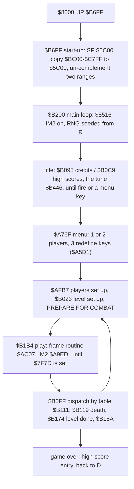

# 2. Architecture

What this covers: the machine budget, the memory map, the stages from the tape to play, the frame, the main loop,
the state. Stage 1 draft (2026-11-05): the map is from the static image and two dumps; the regions marked "stage
2" are named by their users, not yet decoded.

<!-- Figures this document needs (GUIDE.md 4.2), remove each line when it is in: -->
<!-- - the memory map (`kit/heatmap.py`, regions) -->
<!-- - the stages from power-on to play (mermaid) -->

The images and recordings it rests on ([Terms](README.md#terms)):

- `work/images/static-entry.bin`: 64K, the loading screen at `$4000`, the game `$61A8-$FFFE` as the move leaves
  it (equal to `c1`'s memory at `$8000`'s first instruction, [03](03-build-and-load.md) 3.7);
- `work/images/title.bin`: `c1` at its end (frame 16760, the title);
- `work/images/play-start.bin`: play on level 1 a few frames in (`work/explore/play-start.szx`, made from the
  title by `work/explore/menu/menu.txt`);
- `c1` (power-on to the title), the bot runs of `work/bot/` (WALKTHROUGH).

## 2.1 The machine budget

A 48K game: no paging, no AY. Sound is the beeper (`OUT ($FE)` bit 4): the title tune is a two-voice player that
runs with interrupts off ([2.4](#24-the-main-loop)); in play the sound is made inside the object loops: after each object `$8FB4` and `$9493` flip a state byte
(`$7F82`, `$7F86`) with `XOR $18`, AND it with the next byte (an enable mask) and write it to `$FE`, so the pitch
follows the work per object (stage 2: the effects). The game
never returns to BASIC: the start-up writes over the system variables (`$5C00` up). Interrupts are IM2 with the
vector table at `$FE00`.

## 2.2 The memory map

| From | To | What | Evidence |
| --- | --- | --- | --- |
| `$4000` | `$5AFF` | the screen; the bottom third plus its attributes is the HUD panel | play screens |
| `$5B00` | `$5B11` | the loader's `MoveStub` (dead after the move) | `c1` stage 4 |
| `$5C00` | `$67FF` | 3072 bytes copied from `$BC00-$C7FF` by the start-up (stage 2: what) | `$B6FF` |
| `$5C00` | | the start-up's SP top (`LD SP,$5C00`) | `$B6FF` |
| `$6800` | `$7EFF` | game data (stage 2) | |
| `$7F60` | `$7FFF` | variables: frame counters `$7F62-$7F65`, RNG `$7F71-$7F75`, `$7F7B` death timer, `$7F7C` / `$7F7D` the end-of-life codes, `$7F96` interrupt flag, `$7F98` current player, `$7F99` the current record's address, `$7F9B` players, the player records `$7F9C` / `$7FCC` (2.5) | reads and writes in play |
| `$8000` | `$8002` | `JP $B6FF`, the entry the loader jumps to | |
| `$8003` | `$8187` | variables and buffers of the subsystems (stage 2), the print cursor `$80AA` / attribute `$80AC` | |
| `$8184` | `$81C6` | the controls: fire edge `$8184` / `$8185`, Kempston flag `$8187` bit 0, the five key entries `$8188` (port high byte, mask; FIRE UP DOWN LEFT RIGHT) | `$A6B6`, `$A748` |
| `$81FA` | | 5 bytes copied into each player record at `+$15` | `$AFB7` |
| `$8234` | `$824B` | the points table, 12 BCD words (0, 25 ... 5000) | `$A489` |
| `$8261` | `$82AE` | the high-score table, 5 entries of 14 bytes (print codes, initials, BCD score) | dump, 2.5 |
| `$82EE` | `$8515` | the messages (print codes, `$FF` ends; [08](08-hud-and-text.md)) | `work/stage1/texts.txt` |
| `$8516` | `$B6FE` | code: IM2 set-up `$8516`, RNG `$8544`, the play engine, print `$A321-$A4FF`, interrupt handlers `$A512` / `$A9E4` / `$A9ED`, main loop `$B200`, title tune `$B446` | `c1` L1 routines, disassembly |
| `$B54F` | | glyphs for print codes `$80` up (8 bytes each) | `$A321` |
| `$B6FF` | `$B72E` | the start-up, used once; in play `$B700-$B9FF` is overwritten (a buffer) | `play-start.bin` |
| `$BC00` | `$C7FF` | the source of the `$5C00` copy; in play `$BC04-$DFFF` is rewritten (buffers, stage 2) | dump diff |
| `$E000` | `$E747` | data stored complemented on the tape, made plain by the start-up (stage 2) | `$B6FF` |
| `$E748` | `$EFE7` | the save of the bottom screen third and its 160 attributes (`$A979` restores, `$A98D` saves) | `$A979` |
| `$F048` | `$F107` | 192 bytes stored complemented (stage 2) | `$B6FF` |
| `$F12C` | `$F36B` | 576 bytes cleared at a level's start (stage 2) | `$8C54` |
| `$F36C` | `$F62B` | the object records, 44 bytes each (2.6) | play |
| `$F800` | `$FABF` | 95 pointers stepping by 8 (`$8C3B`), a pool (stage 2) | `$8C3B` |
| `$FB00` | `$FBFF` | a 256-byte lookup (`LD L,A`, `LD A,(HL)`; stage 2: the bit-reverse for mirrored sprites?) | `$8A12` |
| `$FDFD` | `$FDFF` | `JP handler`, the IM2 jump; `$FDFE` is switched between `$A9E4` (title), `$A9ED` (play), `$A512` (menu raster) | `$8516` |
| `$FE00` | `$FF00` | the IM2 vector table, 257 bytes of `$FD` | `$8516` |
| `$FF01` | `$FF1B` | the tune's period table | `$B446` |
| `$FF1C` | | the tune's patterns | `$B446` |
| `$FFD7` | | the developer's invulnerability flag: nonzero skips every collision death (2.5) | `$9B4C` |
| `$FFD8` | `$FFFF` | an 8-byte work cell `$FFD8` (`$8EC5`) and font glyphs (stage 2) | |

What changes between the static image and `play-start.bin` (`$61A8-$FFFF`, gaps under 16 bytes merged) is the
list above's variables and buffers, plus self-modified operands: `$9093`, `$90A5` (a saved SP: `LD ($90A5),SP`,
the sprite code runs with SP as a pointer), `$9144`, `$91C3`, `$91DF`, `$931B`, `$A576`, `$B263`, `$8A1F`.

## 2.3 The stages from the tape to play

The load is [03](03-build-and-load.md) 3.5. From `$8000`:

## 2.4 The main loop

- `$B200`: `$AFB0` (once), then the title: `$B095` draws the credits page, `$B0C9` the high-score page, the tune
  plays between them with interrupts off (the title is DI most of the time: 577 interrupts in `c1`'s 4000 title
  frames); the keys are polled only between notes, so a key must be held for about 40 frames.
- `$AFB7` initialises both player records; `$B023` sets up the current player's level.
- `$B1B4` is the play loop: it runs until `$7F7D` is nonzero. The interrupt handler `$A9ED` does the timed work
  (it writes `OUT ($FE),0` at fixed points, stage 2) and `$AC07` is the frame's game logic.
- `$B0FF` reads the end code and jumps through the table at `$B111`: `$B119` the player died (record `+5`
  incremented, lives `+4` decremented at `$B170`), `$B174` the level is done (record `+6` advances, 0-11 then
  around), `$B18A` (stage 2).

## 2.5 The state

The player record (48 bytes, P1 `$7F9C`, P2 `$7FCC`; `$7F99` points at the current one, `IX` in the death code):

| Offset | Bytes | What |
| --- | ---: | --- |
| `+$00` | 4 | the score, BCD, high byte first (the display shows 8 digits: `00010800`) |
| `+$04` | 1 | lives in reserve: 2 at the start, +1 at 10 000 points (seen in the bot run `imm2`) |
| `+$05` | 1 | deaths so far, incremented at `$B11D` |
| `+$06` | 1 | the level, 0-11 |
| `+$0D` | 8 | from the table at `$6B25` |
| `+$15` | 5 | from `$81FA` |

The two POKEs of the TAP name the same state: `$B170` `DEC (IX+4)` is the life lost, `$9B5F` the routine the
collision check calls to kill the player. The collision check at `$9B3B-$9B50` returns before the kill when the
byte at `$FFD7` is nonzero: nothing in the game writes it (one read, `$9B4C`), and it is 0 on the tape. It is a
developer switch left in the code. `POKE 65495,1` gives an invulnerable ship that still goes through scenery and
keeps scrolling; the TAP's `$9B5F` `RET` instead leaves the death started and the game stalls (the ship flashes, the
scroll stops; `work/explore/stuck.szx`).

High scores at `$8261`: 5 entries of 14 bytes, `04 row 03 08` (print at row, column 8), 3 initials, `1B 08` (message
8, the dots), `FF`, then the score in BCD (4 bytes). The tape's table: EGO 68000, DFR 25000, BAV 10000, HNR 5000,
BMR 1000. After the `imm2` run (10 800 points, initials left at the default "AAA") the entry went in third, the
rows below moved down and the row numbers (`$06 $09 $0C $0F $12`) stayed in place.

The weapons (the power-up pod and the five weapon icons in the panel) are stage 2: the panel shows them, the state
is not yet found.

## 2.6 Objects

44-byte records from `$F36C`:

| Offset | What |
| --- | --- |
| `+$00` / `+$01` | the handler |
| `+$03` / `+$04` | X: fraction, integer (one unit is about 2 pixels) |
| `+$05` / `+$06` | Y: fraction, integer (one unit is 8 pixels; the ship's top is about 8Y + 8) |
| `+$07` | the kind |
| `+$08` | bit 7: active |

Slots: `$F36C` the player's ship, `$F398` five enemies, `$F474` three linked to the player, `$F4F8` four shots,
`$F5A8`, `$F5D4`, `$F600` (stage 2). The drawing loops step through them with `ADD IY,-44` (`LD DE,$FFD4`).
