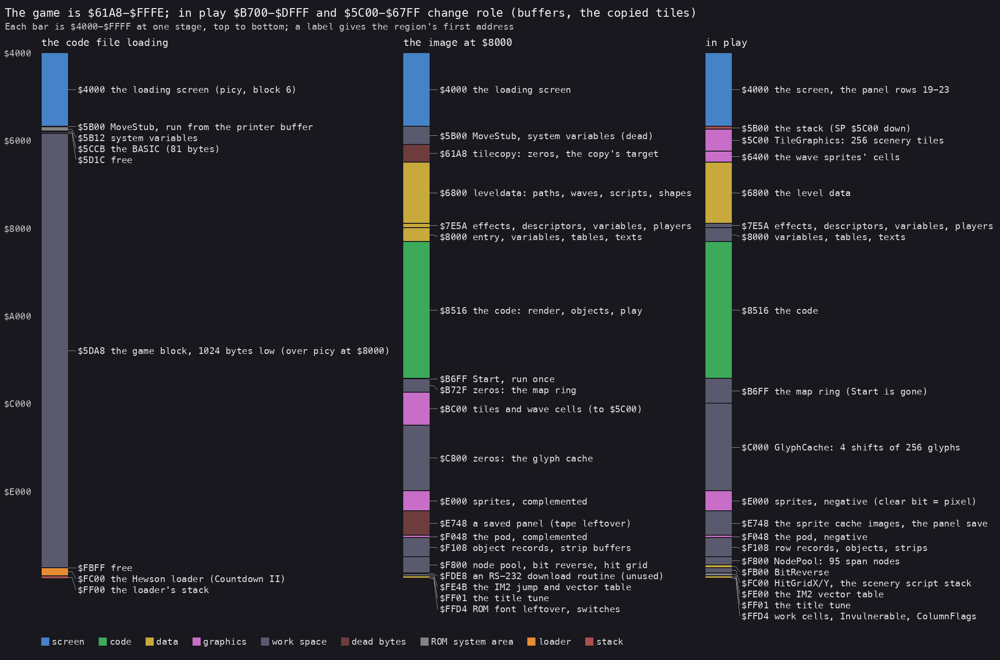
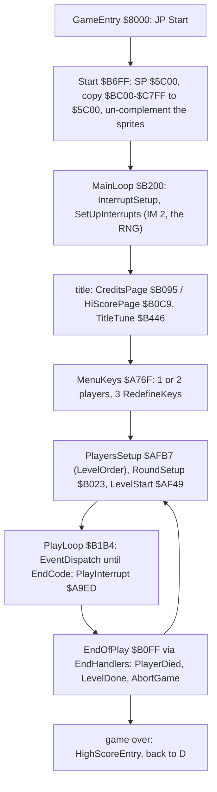
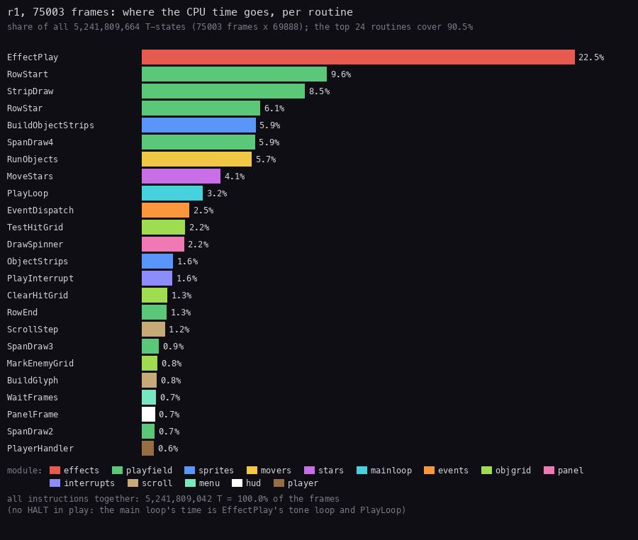
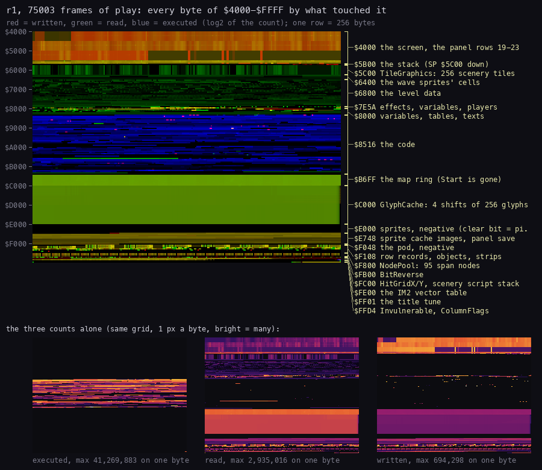
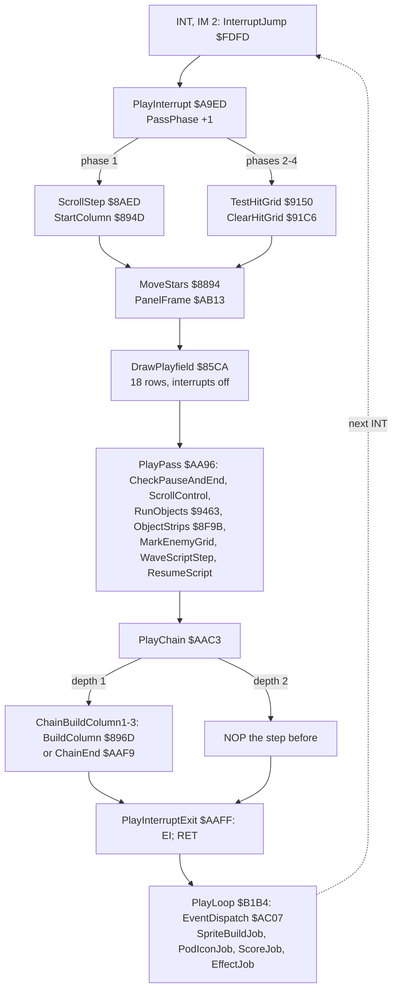

# 2. Architecture

What this covers: the machine budget, the memory map, the stages from the tape to play, the play pass, the main
loop, the state and the objects, where the CPU time goes (2.7), the memory heatmap of a whole game (2.8) and the
call graph of a pass (2.9). Stage 2 (2026-11-05): every name is the one in `src/game/game.ann`; the modules
are the files of `src/game/` ([11](11-data-reference.md) and [12](12-routine-reference.md) list every entry).

The images and recordings it rests on ([Terms](README.md#terms)):

- `work/mkgame/original.bin`: 64K, the game `$61A8-$FFFE` as the Hewson loader's move leaves it (`tools/image.py`
  from TZX block 8; equal to `c1`'s memory at `$8000`'s first instruction, [03](03-build-and-load.md) 3.7);
- `c1` (power-on to the title), `c2` (level 0 from the start, 1500 frames), `r1` (all 12 levels and the wrap, 75003
  frames, its L1 `work/r1/l1.json` for 2.7 and 2.8, the bot with `Invulnerable` set; WALKTHROUGH 5).

## 2.1 The machine budget

A 48K game: no paging, no AY. The sound is the beeper (`OUT ($FE)` bit 4), made three ways:

- the title tune: TitleTune `$B446`, a two-voice player with interrupts off ([09](09-sound.md));
- the sound effects: EffectPlay `$B30C` plays one of six effects (EffectTable `$7E5A`) in the play loop's time;
- the explosion noise: three speaker toggles, after each object slot (RunObjects `$9463`, at `$949C`: `$7F86`
  XOR `$18`, AND the mask `$7F87`), each object strip (`$7F82` / `$7F83`) and each playfield row (`$7F7E` /
  `$7F7F`); the masks are 0 (silent) except for 16 passes after an explosion or a big enemy's hit, and the pitch
  follows the pass's work ([9.5](09-sound.md#95-who-drives-the-speaker-in-a-frame-of-play)).

The game never returns to BASIC: Start writes over the system variables (`$5C00` up). Interrupts are IM 2: the
vector table VectorTable `$FE00` (257 x `$FD`) and the jump InterruptJump `$FDFD`, whose target is switched
between TitleInterrupt `$A9E4`, PlayInterrupt `$A9ED` and MenuRasterInterrupt `$A512`.

## 2.2 The memory map



How to read the figure:

- **Three bars**, each the address space `$4000-$FFFF` from the top down, at three stages:
  - the code file loading (`c1` before MoveStub);
  - the image as the game's first instruction at `$8000` finds it;
  - in play.
- **A colour** is the kind of the region (the legend): screen, code, data, graphics, work space, dead bytes, the ROM's
  system area, the loader, the stack.
- **A label** gives the region's first address and what it holds at that stage.
- **The point**: the game fills almost all of 48K. Two regions change role in play: `$5C00-$67FF` gets the copied
  tiles, and `$B700-$DFFF` becomes the map ring and the glyph cache over Start and the copy's source.

Made by `tools/memmap.py` from `tools/memmap.txt`. The image is cut into 50 modules:

| From | To | Modules | What |
| --- | --- | --- | --- |
| `$61A8` | `$67FF` | tilecopy | zeros on the tape; Start copies `$BC00-$C7FF` here (TileGraphics `$5C00`, the wave cells `$6400`) |
| `$6800` | `$7E59` | leveldata | paths, waves, enemy kinds, LevelTable `$6B2D`, the wave scripts, the scenery scripts, groups, shapes |
| `$7E5A` | `$7FFF` | effectdata, gamevars, playerdata | EffectTable, the sprite descriptors, the sprite cache, the pass and scroll variables, Player1 `$7F9C` / Player2 `$7FCC` |
| `$8000` | `$8515` | gameentry, systemvars, handlertables, controldata, scoredata, texts | GameEntry (`JP Start`), LevelOrder `$8003`, the handler tables, the key table, ScriptState, PointsTable `$8231`, HiScoreTable `$8261`, the 28 messages |
| `$8516` | `$90B4` | system, playfield, stars, scroll, levels, scenery, sprites | the renderer: span chains, the glyph cache, the scroll, the scenery coroutine, the sprite strips |
| `$90B5` | `$A320` | objgrid, waves, movers, objutil, player, weapons, enemies, objects | the hit grid, LaunchWave, the path bytecode, the ship, the weapons, the enemies, explosions and pods |
| `$A321` | `$AB12` | print, score, menu, input, options, hiscore, panel, interrupts | PrintChar and its codes, the panel, the menus, ReadControls, the high-score entry, the interrupt handlers |
| `$AB13` | `$B72E` | hud, events, wavescript, rounds, mainloop, effects, tune, icons, font, start | EventDispatch, the wave script VM, the level start, the main loop, the sounds, the glyphs, Start |
| `$B72F` | `$DFFF` | buffers | the map ring (zeros), TileSource `$BC00`, WaveCellSource `$C400`, the glyph cache `$C000-$DFFF` in play |
| `$E000` | `$F107` | graphics | the sprites (stored complemented), the sprite cache images `$E748`, PodSprite `$F048` |
| `$F108` | `$F7FF` | records | RowRecords `$F12C` (18 x 32), PlayerObject `$F36C`, EnemyObjects, the shots, StripBuffers |
| `$F800` | `$FF00` | tables | NodePool `$F800`, BitReverse `$FB00`, HitGridX / HitGridY `$FC00` / `$FD00`, ScriptStack, InterruptJump, VectorTable |
| `$FF01` | `$FFFE` | tunedata, topcells | the title tune, the ROM font leftover, Invulnerable `$FFD7`, WorkGlyph `$FFD8`, ColumnFlags `$FFE0` |

Two regions change role in play. Start (`$B6FF`, run once) copies `$BC00-$C7FF` to `$5C00-$67FF` and
complements `$E000-$E747` and `$F048-$F107`; after that `$B700-$BFFF` is the map ring and `$C000-$DFFF` the glyph
cache, so Start and the copy's source are overwritten at the first level. Two tape leftovers stay in the image and
are never run or read as such: a saved panel at `$E748-$EFE7` (in play that area is the sprite cache and the panel
save) and a ZX Interface 1 RS-232 download routine at `$FDE8-$FE4A` ([11](11-data-reference.md)).

## 2.3 The stages from the tape to play

The load is [03](03-build-and-load.md) 3.5. From `$8000`:



## 2.4 The play pass and the main loop

- **MainLoop `$B200`**: the title pages, the menu, then a game: PlayersSetup, then per life or level RoundSetup and
  PlayLoop. EndOfPlay reads EndCode `$7F7D` and jumps through EndHandlers `$B111`: PlayerDied `$B119` (TakeLife
  `$B170`), LevelDone `$B174` (the level counter `+6` advances 0-11 and wraps), AbortGame `$B18A`.
- **PlayLoop `$B1B4`** only calls EventDispatch `$AC07` until EndCode is set. The scheduler runs the highest
  requested and enabled job (EventRequests `$81C5`): the effect, the score, the sprite builds, the panel.
- **PlayInterrupt `$A9ED`** does the game. Each interrupt starts one phase (PassPhase `$7F65`, 1-4 then 0) and
  runs a chain of three `CALL BuildColumn; DI; RET` steps. BuildColumn enables interrupts while it builds glyphs, so
  a step can be interrupted by the next phase; the nested pass turns the interrupted step's `DI; RET` into
  `NOP; NOP`, and phase 1 puts them back. A game pass takes two frames: the ship, the objects (RunObjects), the
  scroll step, the playfield (one span chain per row, [06](06-rendering.md)) and the wave script (WaveScriptStep
  `$AD66`).
- **Pause** (key 4) runs inside the interrupt and stops everything; fire resumes, Q aborts.

## 2.5 The state

The player record (48 bytes, Player1 `$7F9C`, Player2 `$7FCC`; `$7F99` points at the current one):

| Offset | Bytes | What |
| --- | ---: | --- |
| `+$00` | 4 | the score, BCD, high byte first |
| `+$04` | 1 | lives in reserve: 2 at the start, +1 at each of ExtraLifeScores (10000, 30000, 50000, 70000, 90000) |
| `+$05` | 1 | deaths so far |
| `+$06` | 1 | the level counter 0-11 (LevelOrder `$8003` maps it to a level: 0 1 2, a shuffle of 3-8, 9 10 11) |
| `+$07` | 1 | the weapon selector: the pod icon the next pod lights |
| `+$08` | 1 | the side weapon (2, 3, 4) |
| `+$09` | 1 | the double plasma |
| `+$0A` | 1 | the laser level |
| `+$0B` | 1 | the speed (`$40` up, steps of `$20`) |
| `+$0D` | 35 | the checkpoint: the wave script's state (ScriptState) at the last restart point |

The weapons ([10](10-gameplay-logic.md)): a wave destroyed whole can leave a pod (PodStep `$A1FD`). Touching it
moves the selector along the panel's five icons (speed-up, laser, plasma, homing missiles, seeker); touching it
with fire held 8 passes takes the lit weapon (the table `$80F0`). Fuel `$80E6` falls one step every 16 frames; at
zero FuelOut `$9C03` sets `$5A` and takes one laser level and one speed step. The pods are the fuel scoop: taking
the speed-up refills it to `$BB`, a selector that wraps past the fifth icon to `$B4` (and 1000 points), every pod
collected gives 100 points, a pod that scrolls away halves the fuel.

Invulnerable `$FFD7`: nothing writes it and it is 0 on the tape; PlayerHit `$9B4C` returns before KillPlayer
`$9B5F` when it is not 0. It is a developer switch (`POKE 65495,1`). The TAP's `POKE` of a `RET` at `$9B5F`
instead leaves the death started and stalls the game.

High scores at HiScoreTable `$8261`: 5 entries of 14 bytes, a print string (`04 row 03 08`, the initials, `1B 08`
the dots, `FF`) and the score in BCD. On the tape: EGO 68000, DFR 25000, BAV 10000, HNR 5000, BMR 1000.

## 2.6 Objects

44-byte records from PlayerObject `$F36C` ([07](07-objects.md)):

| Offset | What |
| --- | --- |
| `+$00` / `+$01` | the sprite descriptor |
| `+$03` / `+$04` | X (bits 5-7 of `+$03`: the pixel shift) |
| `+$05` / `+$06` | Y |
| `+$07` | the kind: its handler from the handler tables |
| `+$0D` | the overlap mask from the hit grid |
| `+$0E`-`+$15` | Vx, Ax, Vy, Ay |
| `+$25` | the colour (drawn as paper: the sprites are stored complemented) |

Slots: PlayerObject `$F36C`, eight EnemyObjects `$F398`, three EnemyShots `$F474`, four LaserShots `$F4F8`, the
second plasma ball `$F5A8`, the side shot `$F5D4`, the sight `$F600`. The loops step with `ADD IY,-44`. The hit grid
(HitGridX `$FC00`, HitGridY `$FD00`) is rebuilt by the passes: MarkEnemyGrid `$90CB` (odd phases) sets bit n where
enemy slot n lies, TestHitGrid `$9150` and ClearHitGrid `$91C6` (phases 2-4) give the player's records their overlap
mask and clear it ([4.3](04-game-loop.md#43-the-play-interrupt-one-pass-four-phases)).

## 2.7 Where the time goes



How to read the figure:

- **A bar** is one routine of `src/game/game.ann`: its T-states over all of `r1` (L1, `work/r1/l1.json`), as a share
  of all the recording's T-states (75 003 frames x 69 888 = 5 241 809 664). Labels inside a routine count for it.
- **The colour** is the routine's module (the legend).
- **The top 24** routines cover 90.5 %. All instructions together are 100.0 % of the frames: the CPU never idles in
  play.
- **What it shows**:
  - EffectPlay `$B30C` (22.5 %) is the main loop's time: the beeper tone loop of the sound effects, which calls
    EventDispatch from inside its loop ([4.2](04-game-loop.md#42-the-main-loop-in-play-jobs-only)). PlayLoop (3.2 %)
    and EventDispatch (2.5 %) are the rest of it;
  - the playfield (green) is the largest group: RowStart 9.6 %, StripDraw 8.5 %, RowStar 6.1 %, SpanDraw4 5.9 % and
    the smaller handlers ([6.8](06-rendering.md#68-the-cost-of-drawing));
  - the objects: BuildObjectStrips 5.9 %, RunObjects 5.7 %, ObjectStrips 1.6 %;
  - the stars 4.1 %, the hit grid 2.2 % + 1.3 % + 0.8 %, the panel spinners 2.2 %.
- **The point**: Zynaps spends its frame drawing (about 40 %) and making sound in the gaps (about a quarter). The
  game logic proper is a small share.

```bash
python3 tools/fig_budget.py work/r1/l1.json docs/img/arch/budget.png
```

## 2.8 The memory heatmap



How to read the figure:

- **The big grid** is `$4000-$FFFF`, 256 bytes a row, `$4000` at the top left; each byte is 2 pixels wide.
- **The colour** mixes three counts over all of `r1` (log2 of each): red = written, green = read, blue = executed.
  Yellow is read and written, magenta executed and written.
- **The brackets on the right** name the regions of the "in play" bar of the memory map (2.2,
  `tools/heatmap-regions.txt`).
- **The three small grids** below are the counts alone: executed, read, written; bright = many. The maximum on one
  byte is printed under each.
- **What it shows**:
  - the code `$8516-$B6FE` is blue; the hot lines are the renderer and the object loop;
  - the glyph cache `$C000-$DFFF` is read and written all over (yellow-green): every column is built into it and every
    row read out of it;
  - the screen is red-orange: written every pass; the panel rows are written less;
  - the level data `$6800-$7E59` and the tiles `$5C00` are read (green), never written;
  - `$E000-$F107` (the sprites) is read; `$F108-$F7FF` (records, strips) read and written;
  - the map ring `$B700-$BFFF` is written by the scenery coroutine and read by RowStart.
- **The point**: the memory map of 2.2 as the game uses it. Nothing in 48K is idle in play except the leftovers.

```bash
python3 tools/fig_heatmap.py work/r1/l1.json docs/img/arch/heatmap.png --regions tools/heatmap-regions.txt
```

## 2.9 The call graph of a pass



- **The solid arrows** are one pass, in order; **the dotted arrow** is the wait for the next interrupt, spent in the
  main loop's jobs.
- RunObjects calls each object's handler through the kind tables (KindHandlers `$80FA`, [7](07-objects.md)).
- The whole pass takes two frames ([4.3](04-game-loop.md#43-the-play-interrupt-one-pass-four-phases)).
