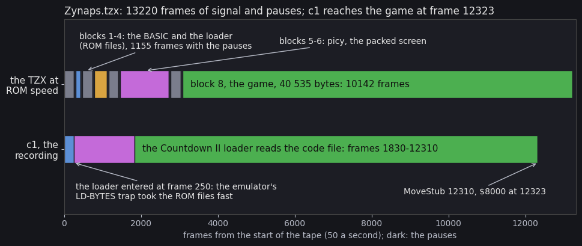
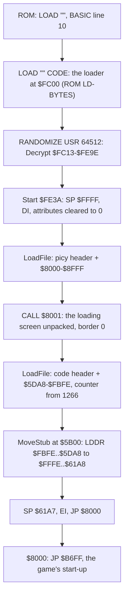

# 3. Build and load

What this covers: the tape block by block, the Hewson loader (an encrypted copy of the ROM's LD-BYTES with a
countdown of the bytes still to come), the packed loading screen, the move of the game into place, and the stages up
to the game's first instruction. The source build (3.8) is still to come.

Stage 1 draft (2026-11-05). The recordings it rests on ([Terms](README.md#terms)):

- `c1`: power-on with `orig/Zynaps.tzx.zip`'s `Zynaps.tzx`, 48K, the load (12 700 frames), then 4000 frames with
  no input (`work/c1`, WALKTHROUGH 1). The emulator's fast load took the two ROM-loaded blocks (BASIC and loader)
  in 250 frames; the Hewson loader's blocks played at signal speed (it is not the ROM routine, so the fast load
  cannot trap it). Every frame number here is a `c1` frame;
- the static decode of the blocks (`tools/tzxblocks.py`, `tools/basic_list.py`, `tools/depack_picy.py`): the
  same bytes, checked against `c1`'s memory in 3.7.

## 3.1 The tape

The reference medium is the World of Spectrum "perfect TZX" of the Hewson release (`orig/Zynaps.tzx.zip`, md5
`af3a609859672dad2c585811c12cdb97`; the TZX itself md5 `a7c8e12d565f513c01d29446cee9e54f`, SHA-1
`60511d70de1b7c916666e5b68acdc3f8de0ccad6`). Its archive-info block (`$32`) names the game, Hewson, Dominic
Robinson, 1987, the price 7.99, the loader "Hewson Countdown II", and "Perfect TZX sampled from the original
cassette by Church of the Latter-Day Speccy".

`python3 tools/tzxblocks.py list work/media/tzx/Zynaps.tzx`:

| TZX block | Kind | Name, fields | Bytes | Loads at | Pause | Plays for |
| --- | --- | --- | ---: | --- | ---: | ---: |
| 0 | `$32` archive info | | | | | |
| 1 | `$10` header | Program `zynaps`, LINE 0, length 81 | 17 (+2) | | 1005 ms | 5.09 s |
| 2 | `$10` BASIC | | 81 (+2) | PROG (`$5CCB`) | 1009 ms | 2.43 s |
| 3 | `$10` header | Bytes `loader`, start 64512 (`$FC00`), length 768 | 17 (+2) | | 1003 ms | 5.09 s |
| 4 | `$10` CODE | the loader | 768 (+2) | `$FC00-$FEFF` (ROM LD-BYTES) | 1010 ms | 6.46 s |
| 5 | `$10` header | Bytes `picy`, start 32768 (`$8000`), length 4096 | 17 (+2) | | 1010 ms | 5.08 s |
| 6 | `$10` data | the packed loading screen and its unpacker | 4096 (+2) | `$8000-$8FFF` (the Hewson loader) | 1003 ms | 25.29 s |
| 7 | `$10` header | Bytes `code`, start 23976 (`$5DA8`), length 40535 | 17 (+2) | | 996 ms | 5.10 s |
| 8 | `$10` data | the game | 40535 (+2) | `$5DA8-$FBFE`, then moved to `$61A8-$FFFE` | 0 | 202.83 s |

- Every block is a standard-speed `$10` block: ROM timings (pilot 2168, sync 667 / 735, bits 855 / 1710 T),
  8063 pilot pulses before a header and 3223 before data, flag and XOR checksum as the ROM writes them. All nine
  checksums are good. There is no turbo block, no pulse sequence, no headerless block.
- The signal, pauses included, takes 264.4 s, 13 220 frames at 50 Hz (the script's total).
- Blocks 5-8 look like ordinary ROM files but the ROM never reads them: the Hewson loader does, at the same
  timings (3.4). A copier that reads standard blocks copies the tape; the protection is only that the loader's
  code is encrypted and that the game expects the loader's move (3.6).



## 3.2 The BASIC (TZX block 2)

`python3 tools/basic_list.py work/blocks/tzx2.bin`:

```text
   10 BORDER 0: PAPER 0: INK 7: CLEAR 32767: LOAD "" CODE : RANDOMIZE USR 64512
   20 REM *************            (length word 98: runs 84 bytes past the program's end)
```

The header says LINE 0, so the program starts at its first line, 10. `LOAD "" CODE` takes the next file (the
`loader` header names `$FC00`, the BASIC gives no address), then `RANDOMIZE USR 64512` enters it at `$FC00`. Line
20 is a REM of asterisks whose length word claims 98 bytes when 17 are left: `LIST` shows it, nothing reads it.

## 3.3 The loader (TZX block 4): an XOR chain over itself

The 768 bytes at `$FC00` start with 19 plain bytes:

```text
FC00  LD BC,$028C      ; 652 bytes
      LD HL,$FC13
      LD DE,$FC14
FC09  LD A,(DE)        ; byte[i] ^= byte[i+1], the next byte still encrypted
      XOR (HL)
      LD (HL),A
      INC HL / INC DE / DEC BC / LD A,B / OR C / JR NZ,$FC09
FC13  ...              ; decrypted: JP $FE3A
```

One pass, forward, `$FC13-$FE9E`: each byte is XORed with the next one as it is on the tape. Of the 652 bytes 647
change (the five that do not are followed by a zero). `$FE9F-$FEFF` are plain: zeros and, at `$FED5-$FEFE`, 42
bytes of a ROM-like fragment (`LD A,($5C74)`, `CP 3`, `JP Z,$1C8A`, `RST $20`, `CALL $28B2`: the ROM's SAVE-ETC
`$0605` area) that the loader never runs: a leftover of the mastering, still to be confirmed against the ROM.
The decryption in Python is three lines (WALKTHROUGH 2); `work/blocks/loader1.bin` is its output, checked against
`c1`'s memory in 3.7.

The decrypted loader (names given here, the source will use them):

| Address | Name | What |
| --- | --- | --- |
| `$FC00` | `Decrypt` | the XOR chain above |
| `$FC13` | | `JP Start` |
| `$FC16-$FC19` | `CountDigits` | the four counter digits, each 8 times its value plus a sub-step (0-7) |
| `$FC1A` | `CountOn` | 0 while a header loads, 1 while data loads |
| `$FC1B-$FC1F` | `CountGlyph`, `CountScreen`, `CountTick` | the digit being drawn: glyph pointer, screen address, the edge countdown |
| `$FC21-$FC31` | `Header` | the 17 header bytes just loaded (type, name, length at `$FC2C`, start at `$FC2E`) |
| `$FC32-$FC89` | `DigitGlyphs` | 11 glyphs of 8 bytes, 0-9 and 0 again, stored inverted (dark digits on a white cell) |
| `$FC8A` | `LdBytes` | the ROM's LD-BYTES (`$0556`), moved: no border stripes, the edge routine hooked |
| `$FD1C` / `$FD20` | `LdEdge2` / `LdEdge1` | the ROM's LD-EDGE-2 / LD-EDGE-1; `LdEdge1` first jumps to `CountStep` |
| `$FD3B` | `CountStep` | the counter's work in the time of the ROM's 358 T delay loop |
| `$FE0F` | `CountSet` | the counter's start value: the block length / 32, in four decimal digits |
| `$FE3A` | `Start` | the stages, 3.5 |
| `$FE62` | `MoveStub` | 18 bytes copied to `$5B00` and run there, 3.6 |
| `$FE74` | `LoadFile` | a header into `Header`, then its data at the header's start and length; any error starts again |

### 3.3.1 What differs from the ROM

`LdBytes` is the ROM's `$0556-$05E2` byte for byte in its structure (the leader test `$0415` wait, the 256 leader
pulses, the sync pair, the flag test, the byte loop with the XOR in H) with these changes:

- the border: the ROM's `OR 2` (red during the leader) is `OR 0`, and the edge routine writes `$08` (black, MIC)
  instead of alternating colours: the border stays black for the whole load;
- the edge routine: `LdEdge1` jumps to `CountStep`, which spends the ROM's delay (`LD A,$16` ... `JR NZ`, 358 T)
  doing the counter's work instead, then joins the ROM's sampling loop (`$FD23`, the ROM's `$05ED`). Every path
  through `CountStep` is padded to the same length, so the bit timings are the ROM's and the tape is standard;
- `LoadFile` loads the header with the same routine (`A` = 0, 17 bytes into `Header`) and accepts any header; the
  data block's flag must be `$FF`.

### 3.3.2 The countdown

While a data block loads (`CountOn` = 1), the bottom left of the screen shows a four-digit counter that runs down to
zero as the block arrives: the "Countdown" of the loader's name. `CountSet` starts it at the block length / 32
(`picy` 4096 bytes: 128; `code` 40535 bytes: 1266). Every 64 calls of the edge routine (32 bits, 4 bytes) the units
digit moves one eighth of a glyph: the digits roll like an odometer, one unit per 32 bytes. The digits are drawn
right to left at `$50E4-$50E1` (row 23, columns 4-1) one per call while `CountTick` is 1-4, and their cells
`$5AE1-$5AE4` are set to `$47` (bright white) on the other calls.

## 3.4 The loading screen (TZX block 6, `picy`)

4096 bytes at `$8000`: a 9-byte header, the unpacker, three streams. `Start` calls `$8001`:

| Offset | Bytes | What |
| --- | --- | --- |
| `$8001` | `18 08` | `JR` over the header |
| `$8003` | `$009D` | the literal stream, from `$8001` (`$809E-$8C86`, 3049 bytes) |
| `$8005` | `$0C86` | the mask stream (`$8C87-$8F8D`, 775 bytes) |
| `$8007` | `$0F8D` | the flag stream (`$8F8E-$8FF9`, 108 bytes) |
| `$8009` | `$00` | the border colour |
| `$800B` | | the unpacker: `DI`, finds its own address with a `POP HL` / `JP (HL)` written to `$4000`, clears the screen, unpacks, `EI`, `RET` |

The format (`tools/depack_picy.py`): the 6912 screen bytes are written in order from `$4000`. Each flag byte covers
64 output bytes, one bit (LSB first) per 8: set, a mask byte follows in the mask stream; clear, the mask is 0. Each
mask bit (LSB first) is one output byte: set repeats the previous output byte, clear takes the next literal. The
first byte is always a literal. The three streams end exactly where the next begins and the flag stream at `$8FF9`;
`$8FFA-$8FFF` are six zeros. The unpacked screen: "ZYNAPS", "By Dominic Robinson", the ship, the Hewson logo, the
artist's mark "JMP" (`work/blocks/picy.png`).

The packer (the other direction) is not written yet: stage 2.

## 3.5 The stages from power-on to the game



- `Start` clears the attributes first: the picture is drawn under black-on-black cells and appears as the unpacker
  writes the attributes at the end.
- The game block is loaded 1024 bytes low (`$5DA8`) because the loader occupies `$FC00-$FEFF`, where the game
  ends. `MoveStub` (18 bytes at `$FE62`, run from `$5B00`, the printer buffer) moves 40535 bytes up by `$0400` with
  `LDDR`, over the loader itself, sets SP to `$61A7` and jumps to `$8000`, which holds `JP $B6FF`.
- The game image is `$61A8-$FFFE`. Its first 1625 bytes, `$61A8-$6800`, are zeros on the tape.

The stages in `c1` (`re_session.py stages`, `work/stage1/c1-stages.txt`; a stage is code run where something wrote
it after power-on):

| Stage | Entry | `c1` frame : T | Written by | Entered from | What |
| --- | --- | --- | --- | --- | --- |
| 0 | `$FC00` | 250 : 34665 | `$0802` (ROM LD-BYTES) | `$34BB` (ROM `USR`) | `Decrypt` |
| 1 | `$FC13` | 251 : 4195 | `$FC0B` (`Decrypt`) | `$FC11` | `JP Start`, the loader |
| 2 | `$8001` | 1830 : 69547 | `$FCE7` (`LdBytes`) | `$FE4E` (`Start`) | the picy unpacker |
| 3 | `$4000` | 1830 : 69680 | `$8017` | `$801A` | the unpacker's `POP HL` / `JP (HL)` probe |
| 4 | `$5B00` | 12310 : 27461 | `$FE5D` (`Start`'s `LDIR`) | `$FE5F` | `MoveStub` |
| 5 | `$8000` | 12323 : 59971 | `$5B09` (`MoveStub`'s `LDDR`) | `$5B0F` | the game: `JP $B6FF` |
| 6 | `$FDFD` | 12327 : 1834 | `$852A` (IM2 set-up) | `$85B7` | the IM2 jump, first interrupt |
| 7 | `$A9E4` | 12327 : 1844 | `$5B09` | `$FDFD` | the title's interrupt handler |

The picy file (header and data) took frames 251-1830, 31.6 s (the signal: 32.4 s with the pauses); the code file
1831-12310, 209.6 s (208.9 s). The `LDDR` of 40535 bytes takes 13 frames (12310-12323). The loading screen is
complete at frame 1831 and the counter digits run until 12310.

### 3.5.1 The game's start-up (`$B6FF`)

```text
B6FF  DI
      LD SP,$5C00
      LD HL,$BC00 / LD DE,$5C00 / LD BC,$0C00 / LDIR   ; 3072 bytes $BC00-$C7FF down to $5C00-$67FF
      CPL over $E000-$E747 (1864 bytes) and $F048-$F107 (192 bytes)   ; data stored inverted on the tape
      JP $B200                                          ; the main loop
```

The copy lands over the 1625 zero bytes and the ROM's system variables are gone from `$5C00` on: the game never
returns to BASIC. The two inverted ranges are data (stage 2 names them); storing them complemented hides them from
a casual look at the tape bytes.

## 3.6 The TAP (`orig/Zynaps.tap.zip`): a 1993 re-tape

`ZYNAPS.TAP` (md5 `b36db76ad48be73c6a8ef4278b9379ae`) with `ZYNAPS.SCR` and `ZYNAPS.POK`:

| Block | What | Bytes | Loads at |
| --- | --- | ---: | --- |
| 0, 1 | BASIC `Zynaps`, LINE 10 | 236 | PROG |
| 2, 3 | `zynaps0.c` | 3252 | `$C350` |
| 4, 5 | `zynaps1.c` | 38910 | `$6801` |

```text
    1 REM Zynaps. DRJ 3/12/93 1824
   10 POKE 23693,7: BORDER NOT PI : CLEAR 24999
   15 POKE VAL "23739", VAL "111"
   20 LOAD "zynaps0.c" CODE : RANDOMIZE USR 5e4
   30 LOAD "zynaps1.c" CODE
   40 RANDOMIZE USR 32768
   50 REM Collect icon to advance power-up; hold fire and collect to activate
```

It is not the original and not a different version: it is the same game re-taped without the Hewson loader.

- `zynaps1.c` is the TZX's game image from `$6801` to `$FFFE` byte for byte (0 of 38910 bytes differ). The 1625
  bytes it leaves out, `$61A8-$6800`, are zeros on the TZX and are overwritten by the start-up's copy (3.5.1)
  before anything reads them.
- `zynaps0.c` is a column-order RLE unpacker (`$D1 n`: n zeros; `$D4 v n`: n times v; any other byte itself)
  and its data; its output is the TZX's loading screen byte for byte (`work/blocks/tap-zynaps0.scr`).
- `CLEAR 24999` puts RAMTOP at `$61A7`, the SP the Hewson stub sets; `POKE 23739,111` (CURCHL's high byte)
  silences the "Bytes:" messages; the entry is the same `$8000`.
- "DRJ 3/12/93" is the re-taper's mark. The 1625 dropped bytes and the plain ROM loads are what the copy changes;
  the game is the same.
- `ZYNAPS.SCR` is not the loading screen: a fan picture signed "RVS M.STAWICKI".
- `ZYNAPS.POK`: "Infinite lives" `45424-45426` (`$B170`) `DD 35 04` (`DEC (IX+4)`) to `00 00 00`; "Immunity"
  `39775` (`$9B5F`) `$3E` to `$C9` (`RET`). Both name state of [02](02-architecture.md): the lives byte is `+4` of the
  player record, `$9B5F` the routine that kills the player.

## 3.7 Checked against the recording

`python3 tools/check_load.py --work work/c1` reads `c1`'s memory through the TTD session at the stage moments and
compares it with the static decode:

| Moment (`c1`) | Memory | Against | Differ |
| --- | --- | --- | ---: |
| 251 : 4195 (stage 1) | `$FC00-$FEFF` | `work/blocks/loader1.bin` (the static decrypt) | 0 |
| 1830 : 69547 (stage 2) | `$8000-$8FFF` | TZX block 6 | 0 |
| 12310 : 27461 (stage 4) | `$4000-$5AFF` | `work/blocks/picy.scr` (`depack_picy.py`) | 30, all in `$50E1-$57E4` (the counter's digits) |
| 12310 : 27461 (stage 4) | `$5DA8-$FBFE` | TZX block 8 | 0 |
| 12323 : 59971 (stage 5) | `$61A8-$FFFE` | `work/images/static-entry.bin` | 0 |

So the static decrypt, the unpacker's format, the load addresses and the move are what the machine does, and
`static-entry.bin` is the game exactly as it is entered.

## 3.8 The source build

Not started (stage 2): `src/basic.asm`, `src/loader.asm` (with the encryption applied by the build), `src/picy.asm`
and a packer for its streams, the game, and `tools/build.sh` writing the TZX's nine blocks.
