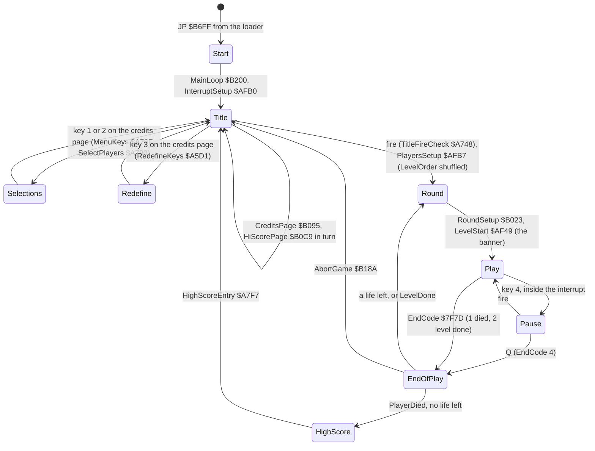
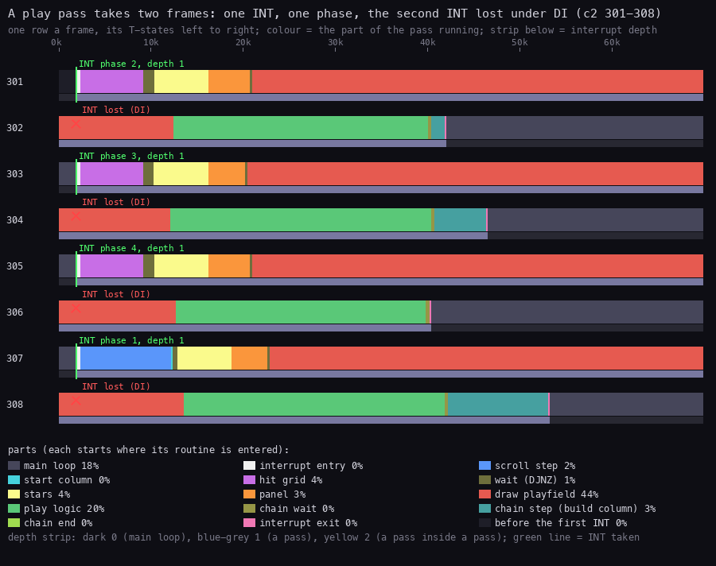
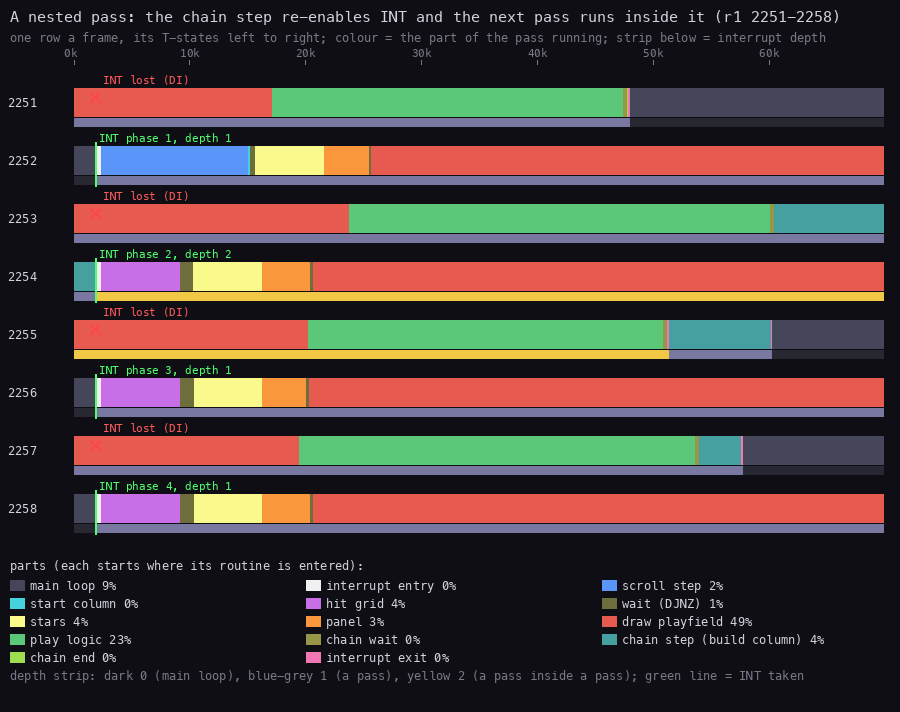

# 4. Game loop

What this covers:

- the state machine from the title to play and back (4.1);
- the main loop in play: a loop of jobs and nothing else (4.2);
- the play interrupt: one pass of the game in two frames, its four phases and its drawing chain (4.3);
- the pass counts over a whole game (4.4);
- the nested pass, when a chain step is cut by the next interrupt, and the 28 interrupt returns L1 took for
  routine entries (4.5);
- the pass against the beam (4.6);
- the pause and the end of a life or a level (4.7).

The names are those of `src/game/game.ann` ([Terms](README.md#terms)). The recordings it rests on:

- `c2`: level 0 from its start, 1500 frames, played by `tools/bot.py` (WALKTHROUGH 5). Opened read-only on an own
  instance as `work/zyA/c2`:
  `re_session.py open --work work/zyA/c2 --ttd work/c2/session.ttd --port-base 14520`. Its access trace of frames
  300-310 (`work/zyA/c2/traces/300_0-310_0.uatr`) gives the pass figure;
- `r1`: all 12 levels, 75 003 frames, the bot with Invulnerable `$FFD7` set (WALKTHROUGH 5). Opened the same way as
  `work/zyA/r1` (port base 14500). Its L1 (`work/r1/l1.json`) gives the counts; its trace of frames 2250-2260
  (`work/zyA/r1/traces/2250_0-2260_0.uatr`) gives the nested pass;
- `c1` (power-on, the load, the title with no input) and the menu recording `work/zyA/menu` (5.3) for the states
  before play;
- the code of `src/game/interrupts.asm`, `mainloop.asm`, `events.asm` and `hud.asm`;
- `work/f4/pause.py`, the pause experiment of stage 2 (cited in the comment of Pause, `src/game/mainloop.asm`).

## 4.1 The state machine



How to read the diagram:

- **A state** is a stretch of the game with its own screen and its own interrupt handler. The handler is the
  target of the IM 2 jump InterruptJump `$FDFD`:
  - TitleInterrupt `$A9E4` everywhere but in play: it only sets EffectTick `$7F96` to `$80`;
  - MenuRasterInterrupt `$A512` on the menu and banner screens: it colours each scan line (5.3);
  - PlayInterrupt `$A9ED` in play: the game itself.
- **An arrow** is a transition, labelled with the key or the routine that takes it.
- **The point**: play is one state with one handler. Everything the game does in play happens in that handler or in
  the jobs it posts. The main loop only waits for EndCode.

Witnesses:

- `c1` shows the two title pages in turn: CreditsPage at frame 12600 and HiScorePage at frame 14730
  ([1.2](01-game-design.md#12-the-title-pages)).
- The menu recording goes title, selections, title, redefine, title, play ([5.3](05-controls.md#53-the-title-keys-and-the-selections)).
- The keys 1-3 are read only on the credits page, after the tune (CreditsPage `$B095` calls MenuKeys). A game starts
  on fire on either title page.
- `r1` goes Round, Play, EndOfPlay, Round 11 times: LevelDone at each `levelend` (WALKTHROUGH 5).
- No recording reached the game over or HighScoreEntry. `r1` runs with Invulnerable set; `c2` loses one life in
  1500 frames. Both are known from the code only (`src/game/hiscore.asm`, `src/game/mainloop.asm`).

## 4.2 The main loop in play: jobs only

PlayLoop `$B1B4` prepares the play state, waits one frame with `HALT`, installs PlayInterrupt and then runs:

```text
PlayLoopPass:   CALL EventDispatch      ; $AC07: one job, the highest asked for
                LD A,(EndCode)          ; $7F7D, set by CheckPauseAndEnd inside the interrupt
                AND A
                JR NZ,PlayLoopEnd
                JR PlayLoopPass
```

- That `HALT` is the only one in play. The other `HALT`s are in the menus and in StopAndSettle `$ABF0`.
- The rest of the frame belongs to the interrupt.

EventDispatch runs the highest bit of EventRequests `$81C5` that EventMask `$81C6` allows. The bit is cleared and
its handler runs from EventHandlers `$81C7`:

| Bit | Job | Posted by | What it does |
| ---: | --- | --- | --- |
| 7 | SpriteBuildJob `$ACA6` | the wave launch | builds the shifted sprite copies of a new wave, and BuildBigSprite `$8F0C` for a guardian |
| 2 | PodIconJob `$AC2C` | PodStep `$A1FD`, PlayLoop | draws the pod selector icon on the panel (`$5A86` / `$5AA6`) |
| 1 | ScoreJob `$AC7A` | AddScore `$A489` | prints the score (PrintPlayerScore `$A4AE`) and checks the extra lives |
| 0 | EffectJob `$AC6F` | the weapons, the collisions | plays the current sound effect (EffectPlay `$B30C`) |

- Bits 3-6 are EventNone.
- EffectPlay is a tone loop on the beeper that calls EventDispatch from inside its loop. So a long effect still lets
  a higher job run.
- In `r1` EventDispatch was called 2 924 873 times: 39 calls a frame.
- Over all of `r1` EffectPlay takes 22.5 % of the CPU and PlayLoop 3.2 % ([2.7](02-architecture.md#27-where-the-time-goes)).
  That is the main loop's time: a beeper loop, not a wait.

## 4.3 The play interrupt: one pass, four phases

PlayInterrupt `$A9ED` (`src/game/interrupts.asm`) saves every register and reads PassPhase `$7F65`:

- phase 4 (a pass whose chain has not ended yet): nothing more, the registers come back (PlayInterruptRestore
  `$AB03`). In `r1` this never happened: all 36 542 entries went on to `$AA03`;
- otherwise PassCount `$7F62` +1, PassBit `$7F63` rotated, PassDepth `$7F64` +1, PassPhase +1.

Then it runs the work of the new phase:

| Phase | Start of the pass | Then | The play logic (PlayPass `$AA96`) | The chain step |
| ---: | --- | --- | --- | --- |
| 1 | ScrollStep `$8AED`, the chain reset, StartColumn `$894D`, a wait | MoveStars `$8894`, PanelFrame `$AB13`, a wait, border black, DrawPlayfield `$85CA` | CheckPauseAndEnd `$ABD5`, ScrollControl `$A9A1`, RunObjects `$9463`, ObjectStrips `$8F9B`; MarkEnemyGrid `$90CB` | ChainBuildColumn1 `$AAEA` |
| 2 | TestHitGrid `$9150`, ClearHitGrid `$91C6`, a wait | the same | the four; WaveScriptStep `$AD66`; ResumeScript `$8D45` at depth 1 | ChainBuildColumn2 `$AAEF` |
| 3 | TestHitGrid, ClearHitGrid, a wait | the same | the four; MarkEnemyGrid; ResumeScript at depth 1 | ChainBuildColumn3 `$AAF4` |
| 4 | TestHitGrid, ClearHitGrid, a wait | the same | the four only | ChainEnd `$AAF9`: PassPhase = 0 |

- "The four" are CheckPauseAndEnd, ScrollControl, RunObjects and ObjectStrips: every phase runs them.
- MarkEnemyGrid runs in the odd phases (PassPhase bit 0), WaveScriptStep in phase 2, the scenery coroutine
  (ResumeScript) in phases 2 and 3 when the pass is not nested.
- The next interrupt after ChainEnd finds phase 0 and starts phase 1: the cycle is 1, 2, 3, 4, 1. The scroll GIF of
  [6.4](06-rendering.md#64-the-scroll-a-new-column-every-four-passes) reads it in `r1` 2400-2424: 2, 3, 4, 0, 1.
- The chain pointer ChainStep `$7F66` is RunChainStep `$AAE5` + 5 per phase: `$AAEA`, `$AAEF`, `$AAF4`, `$AAF9`
  (the comment of PlayInterrupt: TTD `c2` frames 300-316).
- A chain step is `CALL BuildColumn; DI; RET`. BuildColumn `$896D` builds glyphs of the next map column into the
  glyph cache ([6.3](06-rendering.md#63-the-glyph-cache-four-shifts)). It enables interrupts while it works (`EI` at
  `$8AA2`).
- The waits are DJNZ loops (PlayInterruptWait `$AA7C`): 16 x 2 rounds with the scroll on, 16 x `$26` with it off,
  16 x 5 in phases 2-4. They hold the panel work and the playfield behind the beam (4.6).

### The pass as the CPU runs it



How to read the figure:

- **A row** is one frame of `c2`. Across: the T-states of the frame, 0 to 69 888.
- **A colour** is the part of the pass the CPU is in. A part starts where its routine is entered and lasts until the
  next part starts:
  - main loop (dark grey): everything outside the interrupt;
  - scroll step (blue) and start column: phase 1 only;
  - hit grid (violet) and the wait (olive): phases 2-4;
  - stars (yellow), panel (orange), draw playfield (red);
  - play logic (green): PlayPass;
  - chain step (teal): BuildColumn from the chain; chain end: phase 4's ChainEnd.
- **A green line with "INT phase n, depth d"** is an interrupt the CPU took, at frame T about 1 812. The phase is
  the one PlayInterrupt set. The depth is PassDepth.
- **A red cross "INT lost (DI)"** is the interrupt of the next frame. The CPU was inside DrawPlayfield with
  interrupts off, so the INT pulse passed unseen.
- **The strip under each row** is the interrupt depth: dark 0 (the main loop), blue-grey 1 (a pass).
- **The point**: one interrupt starts one pass. The pass runs to frame T 40 000-53 000 of the next frame. The
  interrupt of that next frame is lost. So a pass takes two frames and the game runs at 25 passes a second.

The parts over the eight frames (the table `fig_pass.py` prints, and the trace):

| Part | Share of 8 frames | T-states a pass |
| --- | ---: | ---: |
| draw playfield | 43.8 % | about 61 000: 90 871 to 152 255 = 61 384 in 301-302; 61 497, 61 608, 60 526 in the others |
| play logic | 19.9 % | about 27 600 |
| main loop | 18.4 % | about 26 000-30 000 |
| stars | 4.2 % | about 6 000 |
| hit grid | 3.7 % | about 7 000 (phases 2-4) |
| chain step | 3.2 % | 1 500-11 000 (phase 4 runs none) |
| panel | 3.0 % | about 4 000 |
| scroll step | 1.8 % | about 10 000 (phase 1 only) |

- From the INT to PlayInterruptExit `$AAFF` is about 110 000 T.
- The main loop gets the rest: about 30 000 T of the 139 776 of two frames, 21 %.
- In phase 1 ScrollStep runs from frame T about 2 400 to 12 200. Then StartColumn, MoveStars from about 12 900,
  PanelFrame from about 18 800, DrawPlayfield from about 22 900.
- In phases 2-4 TestHitGrid starts at frame T about 2 400. MoveStars from about 10 400, PanelFrame from about
  16 300, DrawPlayfield from about 20 500-21 000.
- PlayChain `$AAC3` runs at frame T about 40 000 of the next frame. The chain step and the exit end between frame
  T 41 900 and 53 000.

```bash
python3 tools/fig_pass.py --work work/zyA/c2 --window 300:0-310:0 --rows 301-308 \
    --title 'A play pass takes two frames: one INT, one phase, the second INT lost under DI (c2 301-308)' \
    --out docs/img/loop/pass.png
```

## 4.4 The pass counts over a whole game

From `r1`'s L1 (`work/r1/l1.json`, 75 003 frames):

| Count | Value | What it says |
| --- | ---: | --- |
| interrupts taken (`$FDFD` executed) | 38 467 | about one in two frames: the other INT is lost under DI |
| PlayInterrupt `$A9ED` | 36 542 | the passes |
| TitleInterrupt `$A9E4` | 1 089 | between levels |
| MenuRasterInterrupt `$A512` | 836 | the level banners |
| DrawPlayfield `$85CA` | 36 542 | once a pass |
| ChainEnd `$AAF9` | 9 128 | once in four passes |
| ScrollStep `$8AED` | 9 647 | phase 1, once in four passes, plus the replay of the scroll at a level start |
| BuildColumn `$896D` | 28 975 | three chain steps in four passes, plus the level start |
| the `NOP` store `$AADD` | 6 | the nested passes (4.5) |

- The passes and the interrupts agree: 36 542 + 1 089 + 836 = 38 467.
- The scroll moves 2 pixels a pass and a new map column comes every 4 passes, 8 frames
  ([6.4](06-rendering.md#64-the-scroll-a-new-column-every-four-passes)).

## 4.5 The nested pass

BuildColumn enables interrupts. When a chain step is still building glyphs at frame T 1 812 of the frame after
its pass, the next interrupt is taken inside it:

1. PlayInterrupt runs at depth 2 (PassDepth `$7F64` = 2). The next phase, the stars, the panel, the playfield and
   the play logic all run inside the step.
2. PlayChain `$AAC3` sees depth 2. It does not run its own chain step. It writes `NOP; NOP` over the `DI; RET` of
   the step before its own (the stores at `$AADD`), and leaves.
3. The interrupted step resumes in BuildColumn. When it returns, its `DI; RET` is now `NOP; NOP`, so it falls into
   the next chain step: two steps back to back, in one call.
4. Phase 1 writes `DI; RET` (`$C9F3`) back over all three steps (`$AA58-$AA63`).



How to read the figure:

- **The rows, colours, ticks and crosses** are those of the figure in 4.3, here `r1` frames 2251-2258.
- **Frame 2253**: the chain step of phase 1 (teal) starts at frame T about 60 000 and is still running when frame
  2254 begins.
- **Frame 2254**: "INT phase 2, depth 2". The yellow depth strip is a pass inside a pass. The phase-2 pass runs in
  full inside the phase-1 chain step.
- **Frame 2255**: the nested pass reaches its chain step (teal over the yellow strip) and leaves. Then the outer
  step continues (teal over the blue-grey strip) into the next step, and exits at frame T about 60 000.
- **The shares** (9 % main loop, 49 % draw playfield) differ from 4.3: the nested pass eats the main loop's time.
- **The point**: a slow chain step does not lose a pass. The next pass runs inside it, and its chain step is done by
  the interrupted one. The pass rate stays at one every two frames.

`find_event exec $AADD` on `r1` (the `NOP` store) gives every nested pass: frames 2255, 2263, 23043, 23147, 23180
and 68029. Six in 75 003 frames: the chain is almost never late.

```bash
python3 tools/fig_pass.py --work work/zyA/r1 --window 2250:0-2260:0 --rows 2251-2258 \
    --title 'A nested pass: the chain step re-enables INT and the next pass runs inside it (r1 2251-2258)' \
    --out docs/img/loop/nested.png
```

### The 28 interrupt returns L1 took for routine entries

PlayInterruptExit ends with `EI; RET` (`$AB11`). The `RET` goes back to the instruction the interrupt stopped.
L1 counts a return that does not come back to a call it saw as a jump into a new routine. So in `r1` each place
where an interrupt landed often enough became an "entry". The merge (`work/merge/merge.py`, WALKTHROUGH 6) named
these 28 addresses as labels inside their routines:

| Routine | Labels | Who was running there |
| --- | ---: | --- |
| BuildColumn `$896D` | 7: BuildColumnBack `$897E` ... GlyphBuilt `$8A59` | a chain step, interrupts on |
| ScriptMain `$8D72` | 1: ScriptMainAgain `$8D78` | the scenery coroutine, resumed by ResumeScript |
| RotateSprite `$8F5A` | 11: RotateSpriteRows `$8F5B` ... RotateLineCount `$8F6C` | BuildBigSprite in SpriteBuildJob: the main loop |
| PrintChar `$A321` | 6: PrintCharSave `$A322` ... PrintCharBold `$A366` | ScoreJob: the main loop |
| PrintBcd `$A43E` | 2: PrintBcdLeadNext `$A46B`, PrintBcdRestNext `$A482` | ScoreJob |
| PrintPlayerScore `$A4AE` | 1: PrintPlayerScoreDone `$A4D8` | ScoreJob |

- No `CALL` or `JP` reaches them: they are not entries of the program.
- They show where the interrupt cuts work: the main loop's jobs (20 of 28) and the chain step (7).
- It is an unreal-ng L1 gap (WALKTHROUGH 7), not fixed in this stage.

## 4.6 The pass against the beam

- The interrupt comes at frame T about 1 812. The beam reaches screen line 0 at frame T 14 336 and moves one line
  every 224 T.
- PlayInterrupt does the work that does not touch the playfield first: the scroll step or the hit grid, the stars,
  the panel. The panel (rows 19-23, lines 152-191) is written before the beam reaches line 152 at frame T 48 384.
- DrawPlayfield starts at frame T about 21 000, when the beam is at line 30. It writes each row behind the beam;
  the last rows are written in the next frame ahead of it.
- So frame 301 shows the old playfield and 302 the new one, with no tear: the beam figure of
  [6.5](06-rendering.md#65-drawplayfield-against-the-beam).

## 4.7 The pause and the end of a round

CheckPauseAndEnd `$ABD5` runs at the start of every PlayPass (36 542 calls in `r1`):

- key 4 (half-row `$F7FE`, bit 3) calls Pause `$B197`, inside the interrupt;
- Pause runs StopAndSettle `$ABF0`, then a loop: fire (TitleFireCheck `$A748`) returns to play, Q (half-row
  `$FBFE`, bit 0) sets EndPending `$7F7C` = 4;
- a pending end code (EndPending: 1 a life lost, 2 the level done, 4 abort) moves to EndCode `$7F7D`; the handler
  becomes TitleInterrupt and StopAndSettle silences the effect.

The pause stops the whole game: it runs in the interrupt with interrupts off. The witness is the experiment
`work/f4/pause.py` (the comment of Pause): after key 4, PassCount stayed `$4D` and the script PC `$6B96` for 400
frames; Q gave EndPending / EndCode = 4 / 4, the handler `$A9E4` and the credits page. None of the recordings of this
document pauses.

EndOfPlay `$B0FF` waits 50 frames, fades the attributes (FadeAttributes `$85AD`) and jumps through EndHandlers
`$B111`:

| Code | Handler | What |
| ---: | --- | --- |
| 1 | PlayerDied `$B119` | TakeLife `$B170`; with no life left, the game over and HighScoreEntry |
| 2 | LevelDone `$B174` | the level counter (record `+6`) +1, wrapping from 11 to 0 |
| 3, 4 | AbortGame `$B18A` | SP reset, the title pages |

`r1` ends a level 11 times this way; the level-end GIF of [1.7](01-game-design.md#17-a-level-ends) shows one.
