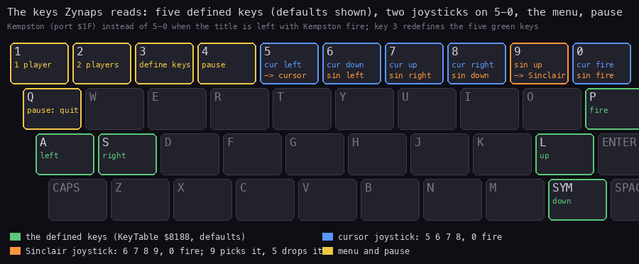
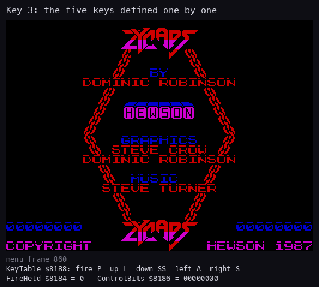
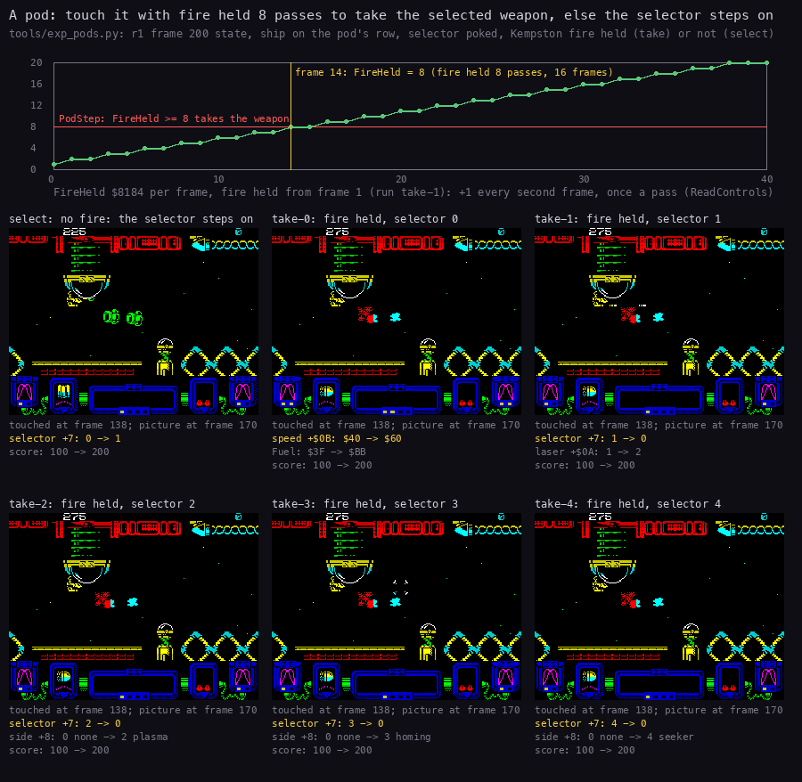
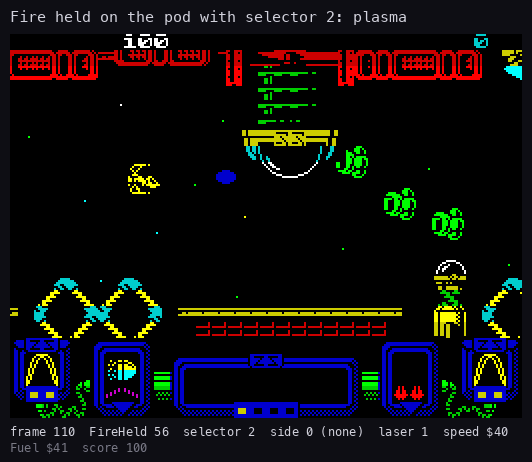

# 5. Controls

What this covers:

- the keys and joysticks the game reads, and how one routine decodes them all (5.1, 5.2);
- the title keys, the selections and the key definition, with a recording that drives them (5.3);
- the pause (5.4);
- the high-score initials (5.5);
- the weapon pods: touch to select, hold fire 8 passes to take, with an experiment (5.6).

The names are those of `src/game/game.ann`; the code is `src/game/input.asm`, `options.asm`, `menu.asm`,
`hiscore.asm` and `objects.asm` ([Terms](README.md#terms)). The recordings and experiments it rests on:

- `work/zyA/menu`: an own capture from the title, 1420 frames, with the menu keys and a key definition:
  `re_session.py capture --work work/zyA/menu --snapshot work/zyA/exp/c1-12600.szx --inputs work/zyA/exp/menu.txt
  --frames 1600 --model 48K --port-base 14540` (it stopped at 1420 frames). The snapshot is `c1` at frame 12600 (the
  credits page), saved through the TTD session of `work/zyA/c1`. The inputs (`work/zyA/exp/menu.txt`, frames from
  the start):

  | Frame | Input | What it does |
  | ---: | --- | --- |
  | 20-80 | key 1 | one player: the selections screen |
  | 480-880 | key 3, held | the key definition, taken when the credits page comes round again |
  | 910-1080 | M, Q, A, O, P, each held 10 frames, 40 frames apart | the five new keys |
  | 1180-1220 | Kempston fire | a new game, with the Kempston |

- `tools/exp_pods.py`: the pod experiment on an own live instance (5.6), from `r1` at frame 200
  (`work/zyA/exp/r1-200.szx`);
- `r1` and `c2` for the play controls (the bot plays with the Kempston);
- `work/f4/pause.py`, the pause experiment of stage 2 (cited in the comment of Pause).

## 5.1 The keys



How to read the figure:

- **A key with a coloured outline** is read by the game. Its roles are written in it, in the colour of the reader.
- **Green**: the five defined keys, the defaults of KeyTable `$8188`: P fire, L up, Symbol Shift down, A left,
  S right.
- **Blue**: the cursor joystick on 5-8 and 0.
- **Orange**: the Sinclair joystick on 6-9 and 0. Key 9 also selects it; key 5 drops back to the cursor joystick.
- **Yellow**: the title keys 1, 2, 3, the pause key 4, and Q to quit from the pause.
- **The point**: the five defined keys and one joystick are read together, every pass. The number row is reserved for
  the joysticks and the menu.

```bash
python3 tools/fig_keys.py --out docs/img/controls/keys.png
```

## 5.2 ReadControls: one routine for all devices

ReadControls `$A6B6` is called by the ship's handler PlayerHandler `$9A5B` once a pass, and by HighScoreEntry. It
builds one byte C, bit 4 fire, 3 up, 2 down, 1 left, 0 right:

1. **The five keys**: for each pair of KeyTable (the half-row port high byte, the bit mask) it reads `IN ($FE)` and
   shifts "pressed" into C. Fire comes first, so it lands in bit 4.
2. **The joystick**, by JoystickFlags `$8187`:
   - bit 0 set: the Kempston, `IN ($1F)` AND `$1F` (fire 4, up 3, down 2, left 1, right 0);
   - otherwise the number row (half-rows `$EF` and `$F7`): the cursor joystick (5 left, 6 down, 7 up, 8 right,
     0 fire), or the Sinclair joystick (6 left, 7 right, 8 down, 9 up, 0 fire) when key 9 is down or bit 1 of
     JoystickFlags is set. Key 9 sets bit 1 (sticky); key 5 clears it.
3. **The merge**: the joystick bits are ORed into C.
4. **The outputs**:
   - FireHeld `$8184`: +1 each call while fire is held, 0 when it is released;
   - FireChanged `$8185`: `$FF` when fire was pressed or released since the last call;
   - ControlBits `$8186`: the four direction bits (fire removed).

Which joystick: TitleFireCheck `$A748` is the title's fire test. It sets JoystickFlags bit 0, reads the Kempston,
and keeps the bit only if the Kempston reads exactly fire (`$10`). So the game uses the Kempston when the title is
left with Kempston fire, and the number row otherwise. The fire key of KeyTable or 0 also start the game.

Witnesses:

- The menu recording: Kempston fire at frame 1180 starts the game. JoystickFlags reads 0 at frames 100-900 and 1
  from frame 1250 on (TTD `memory_at`).
- `c2` and `r1`: the bot plays with the Kempston only; ControlBits and FireHeld follow its inputs (the comment of
  ReadControls).
- The cursor and Sinclair paths ran in no recording: they are known from the code.

## 5.3 The title keys and the selections

The title pages alternate (MainLoop `$B200`, [4.1](04-game-loop.md#41-the-state-machine)):

- CreditsPage `$B095` plays the title tune until fire or a key 1-5, then calls MenuKeys `$A76F`, then TitleFireCheck;
- HiScorePage `$B0C9` shows the table for 500 frames or until fire.

MenuKeys reads keys 1-3, so they act only on the credits page:

| Key | Routine | What |
| --- | --- | --- |
| 1 | SelectOnePlayer, SelectPlayers `$A790` | one player (`$7F9B` = 1): the SELECTIONS screen with a colour bar sweeping the chosen line, about 5 s |
| 2 | SelectTwoPlayers | two players, the same screen |
| 3 | RedefineKeys `$A5D1` | the KEYBOARD DEFINITION screen |

- The menu screens are coloured by MenuRasterInterrupt `$A512`: one attribute colour per scan line, pushed into the
  row's attribute cells as the beam passes, from run-length lists (ColoursTop, ColoursMenu, ColoursHighlight at
  `$82A7`-`$82E0`). That is how the 8 lines of one character row show 8 colours.
- RedefineKeys prints each prompt (FIRE, UP, DOWN, LEFT, RIGHT, messages 14-18) with the current key's name, waits
  for a new key (WaitKeyPress `$A65B`), prints its name and stores it.
- WaitKeyPress scans only six half-rows (KeyScanRows `$8192`: `$FE`, `$FD`, `$FB`, `$DF`, `$BF`, `$7F`). The
  number rows `$F7` (1-5) and `$EF` (6-0) cannot be defined: they belong to the joysticks and the menu.
- It waits for exactly one key down in a half-row, then for all keys up.

In the menu recording:

- key 1 at frame 20: the selections screen, frames about 60-300 (the handler `$FDFE` is MenuRasterInterrupt
  `$A512` at frame 100);
- then the hiscore page (TitleInterrupt at frame 700). Key 3, held from frame 480, does nothing there;
- the credits page comes back, its tune stops at once on the held key, and MenuKeys takes key 3: the key definition
  screen at about frame 880 (MenuRasterInterrupt again at frame 900);
- the keys M, Q, A, O, P are taken one by one (frames 910-1080);
- Kempston fire at frame 1180: the level banner at about frame 1260, play at about 1320 (PlayInterrupt `$A9ED` at
  frame 1400).



How to read the animation:

- **The picture** is the screen of the menu recording, frames 860-1340, one every 6 frames.
- **Under it**: the frame, then KeyTable `$8188` decoded into key names (fire, up, down, left, right; SS is Symbol
  Shift), FireHeld and ControlBits, read from the same frame's memory.
- **What it shows**:
  - the KEYBOARD DEFINITION screen; the lines' colours are the raster's;
  - each prompt shows the old key (DOWN SS) until the new one is pressed, then the new name; KeyTable changes in the
    same frame;
  - after RIGHT, the title, the banner and play start with fire M, up Q, down A, left O, right P.
- **The point**: the key table is five port and mask pairs, rewritten in place.

```bash
python3 tools/fig_anim.py --work work/zyA/menu --from 860 --to 1340 --step 6 --info keys \
    --title 'Key 3: the five keys defined one by one' --out docs/img/controls/redefine.gif
```

## 5.4 The pause

- Key 4 (half-row `$F7FE`, bit 3), read by CheckPauseAndEnd `$ABD5` at the start of each pass, calls Pause `$B197`.
- The pause runs inside the play interrupt: the game, the scroll and the sound stop.
- Fire (TitleFireCheck) resumes. Q (half-row `$FBFE`, bit 0) sets EndPending `$7F7C` = 4: the game is abandoned and
  the title comes back (AbortGame `$B18A`).
- Witness: `work/f4/pause.py`, [4.7](04-game-loop.md#47-the-pause-and-the-end-of-a-round). No recording of this
  document pauses.

## 5.5 The high-score initials

HighScoreEntry `$A7F7` (`src/game/hiscore.asm`) runs at the game over:

- ROLE OF HONOUR, PLAYER n; a score below the five entries gets UNRANKED for 150 frames or until fire;
- a ranked score moves the lower entries down and takes its place;
- three letters at row 13, column 13 (attribute `$59AD`), two cells apart. Each starts at A. Right and left
  (ReadControls) step it through A-Z with wrap-around, one step every 5 frames. Fire takes it and prints a dot;
- 100 steps without input (10 seconds) also take the letter.

No recording reached it: `r1` never dies, and `c2` keeps two lives. It is known from the code only.

## 5.6 The weapon pods: touch to select, hold fire to take

A wave destroyed whole can leave a pod (object kind 4, handler PodStep `$A1FD`, through the handler pointer at
`$8102`). The panel shows five weapon icons. The selector (the player record `+7`) is the lit one:

| Selector | Icon | PodActions `$80F0` | What it gives |
| ---: | --- | --- | --- |
| 0 | speed-up | PodSpeedUp `$9D4C` | Fuel `$80E6` = `$BB`; speed (`+$0B`) + `$20`, up to `$A0` |
| 1 | laser | PodLaser `$9D5D` | laser level (`+$0A`) +1, up to 3 |
| 2 | plasma | PodPlasma `$9D68` | side weapon (`+8`) = 2; a second plasma pod gives the double (`+9` = 1) |
| 3 | homing missiles | PodHoming `$9DA5` | side weapon = 3, the sight on |
| 4 | seeker | PodSeeker `$9DDD` | side weapon = 4 |

When the ship touches a pod (its hit mask `$F379` has the pod's bit), PodStep:

- **fire held 8 passes or more** (FireHeld `$8184` >= 8): the selector goes back to 0 and the selected action runs
  (CallFromTable `$91E2` through PodActions); sound 6;
- **otherwise**: the selector moves to the next icon; sound 5. Past the fifth it wraps to 0, with 1000 points
  (AddScore 9) and Fuel = `$B4`;
- **always**: 100 points (AddScore 4), the icon job (EventRequests bit 2) and the pod removed.

A pod that scrolls off the playfield untouched halves Fuel. So the pods are also the fuel: Fuel falls one step every
16 frames, and at 0 FuelOut `$9C03` takes a laser level and a speed step ([10](10-gameplay-logic.md)).

The bot of `c2` and `r1` never holds fire on a pod. Two later recordings take weapons from pods in real play: zyB's
`w1` (every weapon) and `w2` (homing missiles), made by `tools/podbot.py`
([10.2](10-gameplay-logic.md#102-pods-and-the-selector)). The experiment `tools/exp_pods.py` isolates the rule: one
pod, one action a run:

- the state is `r1` at frame 200 (level 0, Invulnerable set; a pod is born at frame 225 in slot 5, row 7);
- each run puts the ship on the pod's row, sets the selector, and holds Kempston fire from the start (`take-0` to
  `take-4`) or not at all (`select`);
- it logs FireHeld, the record's `+7` to `+$0B`, Fuel and the score every frame, and keeps the screen every 2 frames.

```bash
python3 tools/exp_pods.py --state work/zyA/exp/r1-200.szx --out work/zyA/exp/pods
```



How to read the figure:

- **The chart on top** is FireHeld `$8184` over the first 40 frames of run `take-1`, fire held from frame 1:
  - it steps +1 every second frame, once a pass;
  - the red line is PodStep's threshold 8;
  - the yellow line is frame 14, where it reaches 8: fire held 8 passes, 16 frames.
- **The six screens** are the runs at frame 170, after the touch at frame 138. Under each: what changed in the
  player record at the touch (yellow: the first change), Fuel and the score.
- **What it shows**:

  | Run | At the touch (frame 138) |
  | --- | --- |
  | `select` | selector 0 to 1; a second pod at frame 234 moves it 1 to 2 |
  | `take-0` | speed `$40` to `$60`, Fuel `$3F` to `$BB` |
  | `take-1` | laser 1 to 2, the selector back to 0 |
  | `take-2` | side weapon 2 (plasma) |
  | `take-3` | side weapon 3 (homing missiles) |
  | `take-4` | side weapon 4 (seeker) |

  In every run the score goes from 100 to 200: the 100 points of any pod. FireHeld reads 70 at the touch.
- **The point**: the same touch selects or takes. Fire held for 8 passes, about a third of a second, is the switch.

```bash
python3 tools/fig_pods.py sheet --runs work/zyA/exp/pods --out docs/img/controls/pods.png
```



How to read the animation:

- **The picture** is run `take-2`, frames 110-220, one every 2 frames.
- **Under it**: FireHeld, the selector, the side weapon, the laser, the speed, Fuel and the score of that frame.
- **What it shows**: the ship meets the pod at frame 138. The side weapon becomes 2 and the selector 0 in the same
  frame. Then the run taps fire and the plasma ball flies (the blue ball).
- **The point**: taking a weapon is immediate; the weapon is in use from the next pass.

```bash
python3 tools/fig_pods.py gif --runs work/zyA/exp/pods --run take-2 --from 110 --to 220 \
    --title 'Fire held on the pod with selector 2: plasma' --out docs/img/controls/pod-take.gif
```

Known from the experiment and the code only: the pod actions, the double plasma, and how the weapons behave in
flight. The weapons in play are [10](10-gameplay-logic.md).
