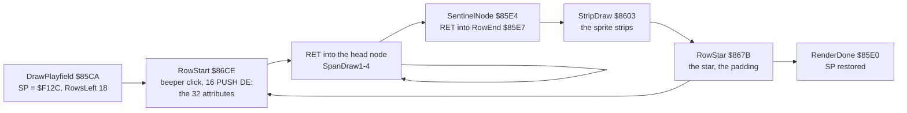
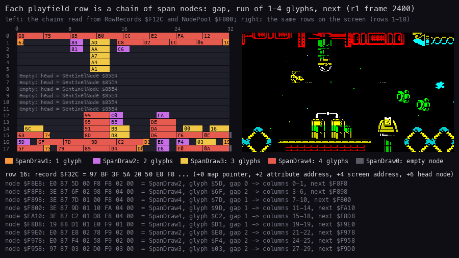
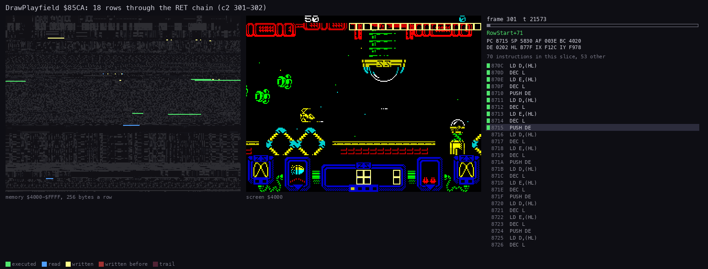
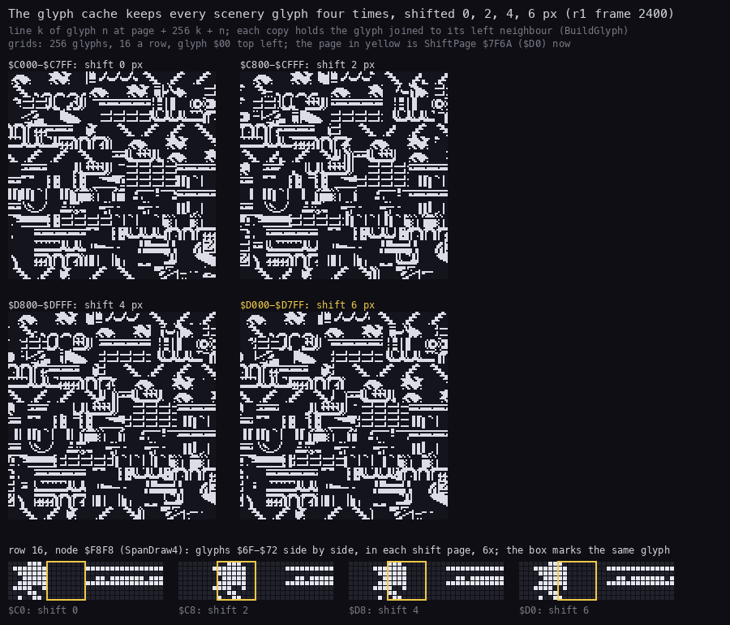
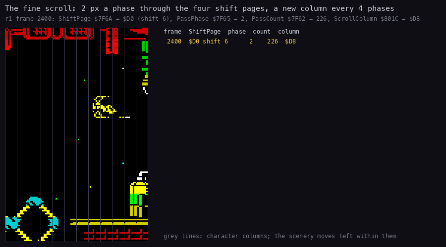
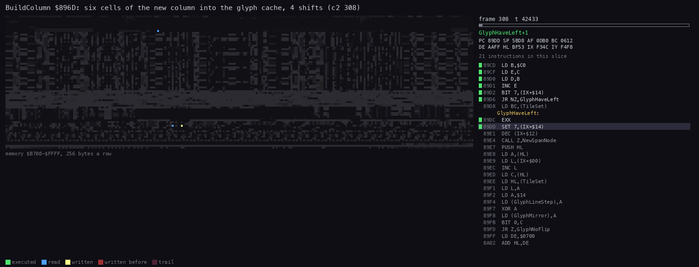
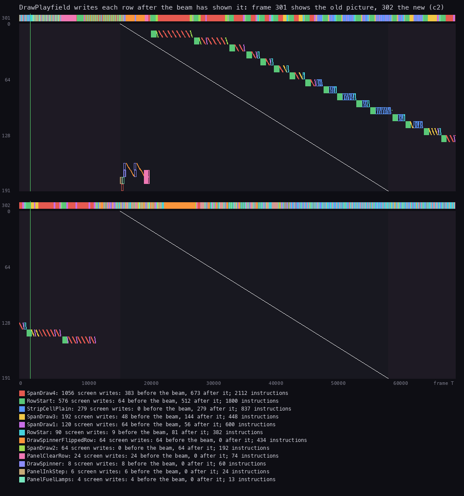
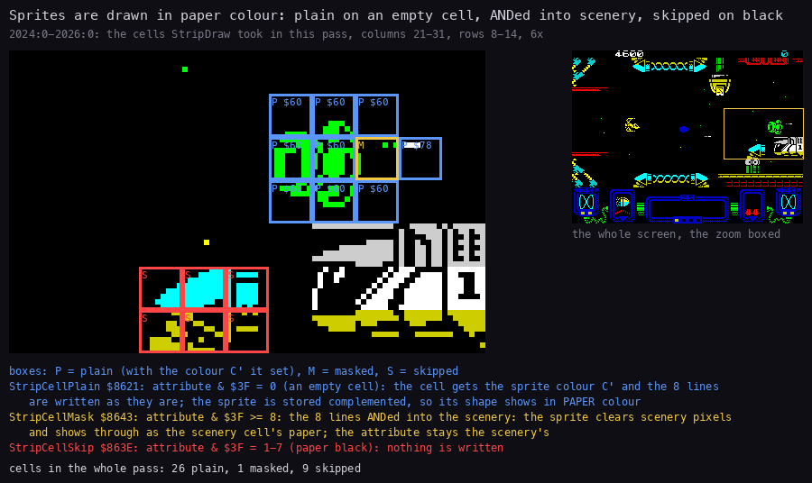
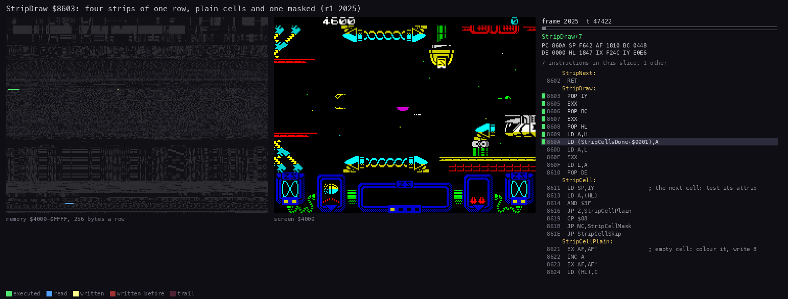

# 6. Rendering

What this covers:

- the screen and its three areas (6.1);
- the playfield as 18 chains of span nodes, drawn by a chain of `RET`s (6.2);
- the glyph cache: every scenery glyph in four shifts (6.3);
- the scroll: 2 pixels a pass, a new column every four passes, built by BuildColumn (6.4);
- DrawPlayfield against the beam: no buffer, no tear (6.5);
- the sprites: strips drawn in paper colour (6.6);
- the stars and the row toggle of the explosion noise, both per row (6.7);
- the cost of drawing over a whole game (6.8).

The names are those of `src/game/game.ann`; the renderer is `src/game/playfield.asm`, `scroll.asm`, `stars.asm` and
`sprites.asm` ([Terms](README.md#terms)). The recordings it rests on:

- `r1`: all 12 levels, 75 003 frames, the bot with Invulnerable set (WALKTHROUGH 5), opened read-only on an own
  instance as `work/zyA/r1`
  (`re_session.py open --work work/zyA/r1 --ttd work/r1/session.ttd --port-base 14500`). Frame 2400 (level 0)
  gives the structure figures; frames 2400-2424 the scroll; the traces `work/zyA/r1/traces/2024_0-2026_0.uatr` and
  `2025_47364-2025_50817.uatr` the sprite cells;
- `c2`: level 0 from its start, 1500 frames (WALKTHROUGH 5), opened as `work/zyA/c2` (port base 14520). The traces
  `301_0-303_0.uatr`, `301_20500-302_15000.uatr` and `308_42252-308_53116.uatr` give the beam figure and the
  routine animations;
- L1 of `r1` (`work/r1/l1.json`) for the costs.

## 6.1 The screen

The screen has three areas ([1.1](01-game-design.md#11-the-play-screen) names every part):

| Rows | Lines | What | Drawn by |
| --- | --- | --- | --- |
| 0 | 0-7 | the scores | PrintPlayerScore `$A4AE` from ScoreJob, player 1 from `$5802`, player 2 from column 22 |
| 1-18 | 8-151 | the playfield: scenery, sprites, stars | DrawPlayfield `$85CA`, every pass |
| 19-23 | 152-191 | the panel | PanelFrame `$AB13` (attributes only), DrawSpinner `$A8BE`, PodIconJob `$AC2C`, DrawLives `$A4EF` |

- There is no back buffer. Every byte of the playfield is written straight into the screen, once a pass.
- Nothing is erased: each pass writes every cell of every row, scenery or empty.
- The panel's bitmap is drawn once at the level start. In play only its attributes change (the fuel lamps, the
  ink-step cells, the speed bar) and the two spinners.

## 6.2 The playfield: span chains

Each playfield row is a chain of span nodes. A node names a run of 1-4 consecutive glyphs out of the glyph cache
and the number of empty columns before it.

- **The row record** (RowRecords `$F12C` + 32 x row, 18 records):
  - `+0` the map ring pointer;
  - `+2` the attribute address of column 31;
  - `+4` the screen address of the row;
  - `+6` the head node;
  - `+$15-+$17` the sprite strips of the row (6.6);
  - `+$18-+$1F` the row's star (6.7).
  Row 0's record holds attribute address `$583F` and screen address `$4020`: playfield row 0 is screen row 1.
- **The node** (8 bytes, NodePool `$F800`, 95 nodes, free list NodeFreeList `$7F68`):
  - `+0/+1` the handler: SpanDraw1-4 for a run of 1-4 glyphs, SpanDraw0 for none;
  - `+2` the first glyph;
  - `+3` the gap;
  - `+4/+5` the next node.
- **SentinelNode `$85E4`** ends every chain: its handler is RowEnd `$85E7`. An empty row's head is the sentinel.
- **The columns**: the first node's run starts at column = its gap. Each next run starts at the last column of the
  run before + the gap (the handler leaves A = E, the column after its last `LDD`).

DrawPlayfield sets SP to the first record and runs the rows as a chain of `RET`s:



- RowStart pops the record's fields, pushes the row's 32 attributes from the map ring with 16 `PUSH DE`, then sets SP
  to the head node and returns into it.
- A span handler pops its glyph and gap, copies 8 lines of its glyphs, and returns into the next node.
- RowEnd draws the strips, RowStar the star. Then the padding: a row cheaper than four glyphs waits 10 DJNZ loops
  per missing glyph, so the 18 beeper clicks of a pass are evenly spaced (6.7).



How to read the figure:

- **The left grid** is the 18 rows of `r1` frame 2400 as the records and nodes hold them, 32 columns a row.
  - A dark cell is a gap column.
  - A coloured block is one node's run, coloured by its handler (the legend): orange SpanDraw1, violet SpanDraw2,
    yellow SpanDraw3, red SpanDraw4.
  - The hex number in a block is the run's first glyph.
  - "empty: head = SentinelNode `$85E4`" is a row with no scenery (rows 6-11 here).
- **The right picture** is the playfield on the screen at the same frame (screen rows 1-18).
- **The dump below** is row 16 node by node: the bytes, the handler, the first glyph, the gap, the columns it fills,
  the next node. The columns follow the rule above: `$F8E8` gap 0 fills 0-1; `$F8F8` gap 2 fills 3-6; `$F898` gap 1
  fills 7-10.
- **The point**: the scenery is not a bitmap. It is lists of glyph runs, and the code only copies bytes.

```bash
python3 tools/fig_render.py spans --work work/zyA/r1 --frame 2400 --out docs/img/render/spans.png
```

### DrawPlayfield at work



How to read the animation:

- **The left panel** is memory `$4000-$FFFF`, 256 bytes a row: green executed, blue read, yellow written now, red
  written before, a dim trail.
- **The middle** is the screen. The cells the slice wrote are lit and boxed.
- **The right panel** is the frame, the T-state, the routine (here RowStar+21), the registers and the instructions
  of the slice.
- **What it shows**: the rows are written from the top down; in each row the attributes land first in one burst
  (RowStart's `PUSH`es), then the glyph runs left to right, then the sprites, then the star.
- **The point**: one pass of DrawPlayfield is 18 rows, each RowStart, a few span handlers, RowEnd, StripDraw, RowStar.
  It takes about 61 000 T ([4.3](04-game-loop.md#43-the-play-interrupt-one-pass-four-phases)).

```bash
python3 ../../kit/routine_anim.py --work work/zyA/c2 --window 301:20500-302:15000 --listing build/game.lst \
    --range 4000-FFFF --pictures 60 --pc 85CA-88FF \
    --title 'DrawPlayfield $85CA: 18 rows through the RET chain (c2 301-302)' --out docs/img/render/drawplayfield.gif
```

## 6.3 The glyph cache: four shifts

The glyph cache `$C000-$DFFF` holds 256 glyphs, each in four copies:

| Page | Shift | ShiftPage `$7F6A` |
| --- | --- | --- |
| `$C0` | 0 px | `$C0` |
| `$C8` | 2 px | `$C8` |
| `$D8` | 4 px | `$D8` |
| `$D0` | 6 px | `$D0` |

- Line k of glyph n is at page + 256 k + n. A span handler steps lines with `INC H` and glyphs with `INC L`.
- Each shifted copy holds the glyph joined with its left neighbour: the bits that leave on the right come in from
  the glyph on the left (BuildGlyph, `ADD HL,HL` twice per two pixels). So a run of consecutive glyphs draws a
  continuous shifted strip.
- ShiftPage is the high byte of the page to use. ScrollControl `$A9A1` steps it through a 2-bit Gray code
  (FineScrollToggle `$7F6B` XOR `$18`, then XOR into ShiftPage): `$C0`, `$C8`, `$D8`, `$D0`. That is why the pages
  are in the order 0, 2, 6, 4 in memory.
- A run of glyphs is copied with `LDI` on even lines and `LDD` back on odd lines (a zigzag), so the handler never
  resets the column between lines.



How to read the figure:

- **The four grids** are the four pages of the glyph cache at `r1` frame 2400: 256 glyphs, 16 a row, glyph `$00`
  top left. White is a set bit.
- **The yellow page title** is the page ShiftPage names at that frame (`$D0`, shift 6).
- **The strip below** is row 16's node `$F8F8` (SpanDraw4, glyphs `$6F-$72`) side by side in each page, enlarged 6x.
  The yellow box marks the same glyph in the four pages: its content moves right 2 pixels a page, and the pixels of
  its left neighbour come in.
- **The point**: the scroll is done once, when a column is built. Drawing a shifted glyph costs the same as drawing
  a plain one.

```bash
python3 tools/fig_render.py glyphs --work work/zyA/r1 --frame 2400 --row 16 --out docs/img/render/glyphs.png
```

## 6.4 The scroll: a new column every four passes

- ShiftPage changes once a pass, every 2 frames: the scenery moves 2 pixels left a pass.
- After four passes the shift is back to `$C0` and ScrollStep `$8AED` (phase 1) moves the rows one column: it
  retires the leftmost glyph of every row, frees its slot (GlyphBitmap `$FFE0-$FFFF`) and its node, and links the
  new ones. ScrollColumn `$801C` +1.
- StartColumn `$894D` reads the new map column from the map ring (`$B700-$BFFF`, 9 pages, two character rows a page)
  and marks the cells to build.
- BuildColumn `$896D`, from the three chain steps
  ([4.3](04-game-loop.md#43-the-play-interrupt-one-pass-four-phases)), builds those cells into the glyph cache.
- So the scroll speed is fixed: 2 pixels every 2 frames, 50 pixels a second.
- ScrollCount `$81DB` counts the columns scrolled. The level table's "scroll" field is its start value (`$10`-`$40`):
  ReplayScroll (`src/game/rounds.asm`) builds that many columns at the level start (and from a checkpoint), so the
  level opens with scenery already on the screen. It is not a speed.
- The scroll stops when the scroll flag (PlayFlags `$81DA` bit 5) is cleared: by the level script (`scrolloff`,
  `levelend`) or during a death (ScrollControl). Then ShiftPage only runs on to `$C0`.



How to read the animation:

- **The left picture** is the playfield's left 12 columns at `r1` frames 2400-2424, one picture a frame, 3x.
- **The grey lines** are the character columns. The scenery moves left within them.
- **The table** is one line a frame: ShiftPage `$7F6A` and its shift, PassPhase `$7F65`, PassCount `$7F62`, the map
  column ScrollColumn `$801C`. The current frame is yellow.
- **What it shows**:
  - ShiftPage changes every 2 frames: `$C0`, `$C8`, `$D8`, `$D0`;
  - PassCount +1 every 2 frames;
  - the phases run 4, 0, 1, 2, 3: the frame after ChainEnd still shows phase 0, the next pass is phase 1;
  - ScrollColumn +1 every 8 frames (`$D8` to `$DB` in 24 frames).
- **The point**: the fine scroll is one pass per 2 pixels, and the columns come every four passes.

```bash
python3 tools/fig_render.py scroll --work work/zyA/r1 --from 2400 --to 2424 --out docs/img/render/scroll.gif
```

### BuildColumn at work



How to read the animation:

- **The left panel** is memory `$B700-$FFFF`: the map ring, the glyph cache, the sprites, the records and the tables.
  Green executed, blue read, yellow written now, red written before.
- **The right panel** is the routine and its instructions (`--view none`: no screen, the screen does not change).
- **What it shows**: for each cell, the tile's 8 lines are read from the tile set (`$5C00`, below the panel's range),
  and four groups of writes land in the four pages of the glyph cache: `$C0xx`, `$C8xx`, `$D8xx`, `$D0xx`. The bit
  map `$FFE0` at the bottom is marked as slots are taken.
- **The point**: the cost of the scroll is here, in the chain step, between passes. In `c2` frame 308 it is 10 864 T
  (42 252 to 53 116).

```bash
python3 ../../kit/routine_anim.py --work work/zyA/c2 --window 308:42252-308:53116 --listing build/game.lst \
    --view none --range B700-FFFF --pictures 60 --pc 896D-8AEC \
    --title 'BuildColumn $896D: six cells of the new column into the glyph cache, 4 shifts (c2 308)' \
    --out docs/img/render/buildcolumn.gif
```

## 6.5 DrawPlayfield against the beam



How to read the figure:

- **Two panels**, frames 301 and 302 of `c2`. Across: the frame T, 0 to 69 888. Down: the screen line, 0 to 191.
- **The white diagonal** is the beam: the line the TV shows at that moment.
- **A dot** is a byte written into the screen at that T and line, coloured by the routine that wrote it (the legend
  with the counts).
- **The strip on top** of each panel is the routine running at each T.
- **What it shows**:
  - in frame 301 the panel (lines 150-191) is written at T 15 000-20 000, ahead of the beam;
  - the playfield is written from T 20 500, row by row, always to the right of the beam: the TV has already shown
    those lines in this frame;
  - the last rows (lines 128-151) are written in frame 302 at T 0-11 000, before the beam reaches them.
- **The counts**: SpanDraw4 1 056 writes, 383 before the beam and 673 after it; RowStart 576 (64 / 512);
  StripCellPlain 279 (0 / 279).
- **The point**: every playfield byte of the pass is shown first in frame 302. Frame 301 shows the whole old picture,
  302 the whole new one. Drawing straight into the screen does not tear, because the pass chases the beam.

```bash
python3 ../../kit/beam_timeline.py --work work/zyA/c2 --window 301:0-303:0 --listing build/game.lst --frames 2 \
    --title 'DrawPlayfield writes each row after the beam has shown it: frame 301 shows the old picture, 302 the new (c2)' \
    --out docs/img/render/beam-pass.png
```

## 6.6 The sprites: strips in paper colour

The objects are not drawn by the object loop. ObjectStrips `$8F9B` (with BuildObjectStrips `$8FC2`) cuts each object's sprite into
strips, one per character row it covers, and links them to the row's record (`+$15` the count, `+$16/+$17` the
list). RowEnd draws them right after the row's scenery.

- **The sprites are negative**: in play a clear bit is a sprite pixel and a set bit keeps the cell black
  (`src/game/graphics.asm`). The tape holds the images complemented; Start's `CPL` over `$E000-$E747` and
  `$F048-$F107` inverts them in place ([3.5.1](03-build-and-load.md#351-the-games-start-up-b6ff)).
- **The colour is the paper**: the strip carries C' = the object's colour (record `+$25`).
- StripDraw `$8603` looks at each cell's attribute (already written by RowStart this pass):

| Case | Attribute & `$3F` | What is written |
| --- | --- | --- |
| StripCellPlain `$8621` | 0 (an empty cell) | the attribute = C'; the 8 lines stored as they are. The ink is black, so the clear bits show in the paper colour |
| StripCellMask `$8643` | 8 or more | the 8 lines ANDed into the scenery: the sprite clears scenery pixels and shows through as the scenery's paper; the attribute stays |
| StripCellSkip `$863E` | 1-7 (paper black, ink coloured) | nothing |



How to read the figure:

- **The left picture** is the screen at `r1` frame 2026, columns 21-31 and rows 8-14, 6x.
- **A box** is a cell StripDraw took in the pass (frames 2024-2025, from the trace):
  - blue P with the colour: StripCellPlain, the attribute it set (`$60`: paper green bright);
  - yellow M: StripCellMask, ANDed into scenery;
  - red S: StripCellSkip, the cell left alone.
- **The right picture** is the whole screen with the zoom boxed.
- **The line at the bottom** counts the cells of the whole pass: 26 plain, 1 masked, 9 skipped.
- **The point**: there are no sprite masks. A sprite is a paper-coloured hole in black ink: on an empty cell it gets
  its own colour, on scenery it cuts the scenery's pixels and takes the scenery's colour, on a black-paper cell it
  is not drawn at all.

```bash
python3 tools/fig_render.py paper --work work/zyA/r1 --window 2024:0-2026:0 --zoom 21,8,11,7 \
    --out docs/img/render/paper.png
```

### StripDraw at work



How to read the animation:

- **The panels** are those of the DrawPlayfield animation (6.2), here `r1` frame 2025, T 47 364-50 817.
- **What it shows**: four strips of one row. For each cell the attribute is read, then either the colour and 8
  stores (plain), or 8 `AND`s (the masked cell near `$595B-$595D`), or nothing.
- **The point**: the three branches in the code, one cell at a time.

```bash
python3 ../../kit/routine_anim.py --work work/zyA/r1 --window 2025:47364-2025:50817 --listing build/game.lst \
    --range 4000-FFFF --pictures 60 --pc 8603-8678 \
    --title 'StripDraw $8603: four strips of one row, plain cells and one masked (r1 2025)' \
    --out docs/img/render/stripdraw.gif
```

The masked cells are rare in `r1` because the bot keeps away from the scenery. Which sprite parts the strip list
holds for each object kind is [7](07-objects.md).

## 6.7 The stars and the row toggle

Both are per row, inside DrawPlayfield.

- **The stars** (`src/game/stars.asm`): each row record holds one star (`+$18-+$1F`): a random speed, a position and
  a colour `$44-$47`. MoveStars `$8894` moves them every pass while the scroll runs. RowStar `$867B` draws the row's
  star:
  - on an empty cell: the attribute set and one dot on pixel line 3;
  - on a used cell: the dot XORed into line 3 of the scenery.
  The stars are shown only when PlayFlags `$81DA` bit 7 is set (the level script's `starson` / `starsoff`).
- **The row toggle**: RowStart toggles the beeper once a row (RowBeep `$7F7E` XOR `$18`, AND the mask `$7F7F`,
  `OUT ($FE)`). 18 toggles a pass, kept evenly spaced by the padding of RowStar.
  - The mask comes from a bit pattern PlayInterrupt shifts once a pass (SoundPattern1 `$7F80`).
  - The pattern is 0 at rest, so the toggles write 0 and nothing sounds.
  - StartExplosion and a big enemy's hit load it: for 16 passes the rows give the row part of the explosion
    noise, a buzz paced by the drawing ([9.5](09-sound.md#the-explosion-noise)). It is not an engine hum.

## 6.8 The cost of drawing

From L1 of `r1` (75 003 frames; the budget figure of [2.7](02-architecture.md#27-where-the-time-goes)):

| Routine | Share of all T-states | What |
| --- | ---: | --- |
| RowStart `$86CE` | 9.6 % | the click, the 32 attributes, the record |
| StripDraw `$8603` | 8.5 % | the sprite cells |
| RowStar `$867B` | 6.1 % | the star and the padding |
| BuildObjectStrips `$8FC2` | 5.9 % | cutting the sprites into strips |
| SpanDraw4 `$873E` | 5.9 % | runs of four glyphs |
| MoveStars `$8894` | 4.1 % | the stars |
| RowEnd `$85E7` | 1.3 % | the strip list |
| ScrollStep `$8AED` | 1.2 % | the column step |
| SpanDraw3, SpanDraw2 | 0.9 %, 0.7 % | runs of three and two glyphs |
| BuildGlyph `$89C9` | 0.8 % | the four shifted copies |

- Drawing (RowStart to SpanDraw2) is about 40 % of the machine.
- SpanDraw4 is most of the scenery: the column builder makes runs of four whenever it can.
