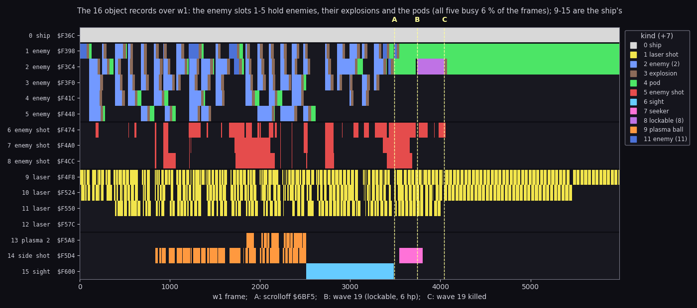
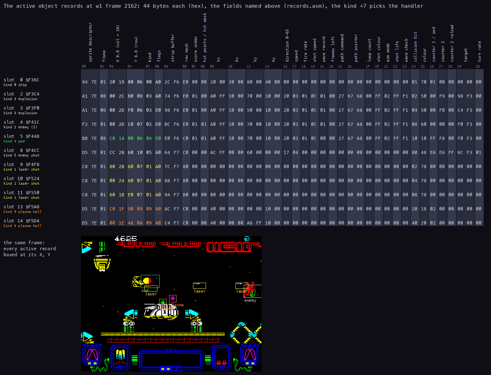
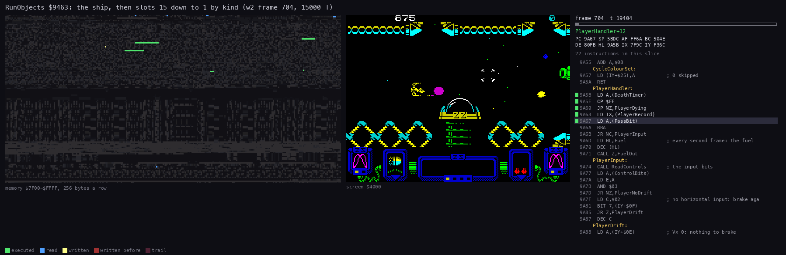
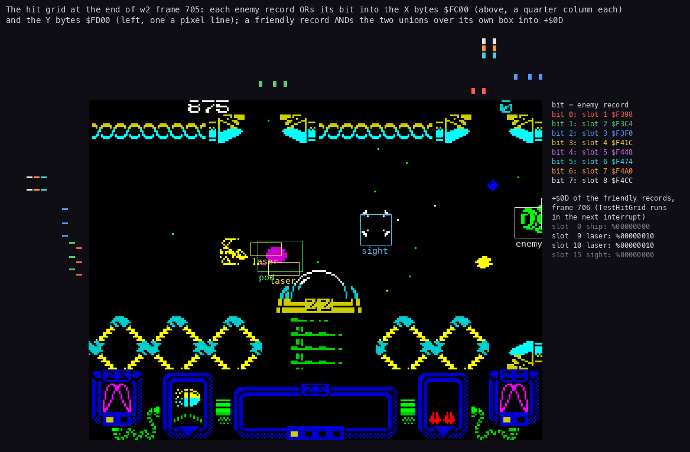
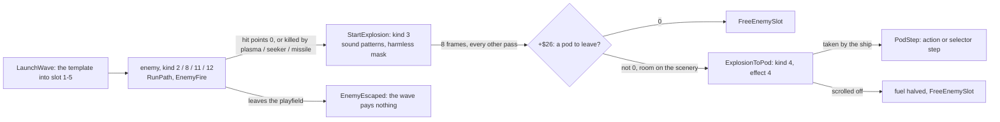
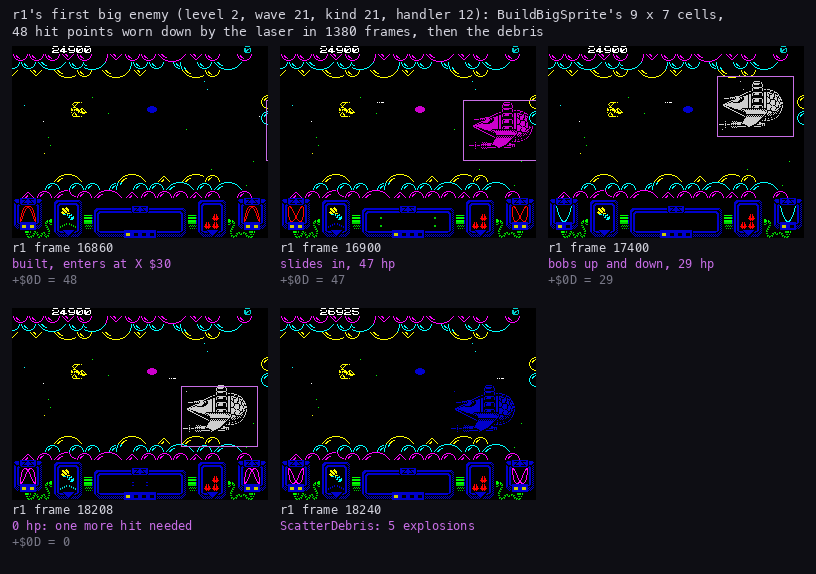

# 7. Objects

What this covers: the 16 object records and what each slot holds, the 44-byte record, the kinds and their handlers,
the pass's object loop RunObjects, the path bytecode the enemies fly by, the collision grid, the wave launcher and
the sprite cache, the life of an enemy (explosion, pod), and the big enemy's sprite.

The recordings it rests on:

| Recording | Made by | Frames | Used here for |
| --- | --- | ---: | --- |
| `work/zyB/w1` | `tools/podbot.py --plan 0,1,2,2,3,4` from `work/run/play-imm.szx` (level 0, `Invulnerable` = 1) | 5986 | every slot in use, all weapon kinds, the record sheet |
| `work/zyB/w2` | `tools/podbot.py --plan 3`, same snapshot | 7600 | the access traces of frames 704-706 (RunObjects, the hit grid) |
| `work/r1` | the long bot run (WALKTHROUGH.md) | 75001 | the big enemies |

The per-frame memory of w1 and w2 (`work/zyB/w1-frames.npz`, `w2-frames.npz`) comes from `tools/ttd_dump.py`: TTD
`memory_at` of `$7F9C-$81FF` and `$F36C-$F62B` at the end of every frame.
10 (gameplay logic) says what the weapons and the enemies do; this document says how the records carry them.

## 7.1 Sixteen records, fixed roles

Every moving thing is one of 16 records of 44 bytes (`$2C`) from `$F36C` to `$F62B` (records.asm).
Each slot has a fixed role: the code finds a free enemy record only among slots 1-5 (TakeEnemySlot `$938D`) and a
free enemy shot only among slots 6-8 (EnemyFire `$A0EB`).

| Slot | Address | Label | Holds | Kinds seen |
| ---: | --- | --- | --- | --- |
| 0 | `$F36C` | PlayerObject | the ship | 0 |
| 1-5 | `$F398`-`$F448` | EnemyObjects | enemies, then their explosions, then the pods | 2, 3, 4, 8, 11, 12 |
| 6-8 | `$F474`-`$F4CC` | EnemyShots | enemy shots (at most 3, EnemyShotsLeft `$8074`) | 5 |
| 9-12 | `$F4F8`-`$F57C` | LaserShots | the ship's laser shots | 1 |
| 13 | `$F5A8` | PlasmaBall2 | the second plasma ball of the double plasma | 9 |
| 14 | `$F5D4` | SideShot | the side weapon's shot: plasma ball, missile or seeker | 9, 10, 7 |
| 15 | `$F600` | SightObject | the homing sight | 6 |

Two record groups matter for the collisions (7.6):

- the 8 enemy records, slots 1-8, each with one bit `+$24` (slot n has bit n - 1);
- the 8 friendly records: the ship, the four lasers, the two side-weapon slots and the sight.



```sh
python3 tools/fig_objects.py slots --npz work/zyB/w1-frames.npz
```

How to read:

- One line a slot, one column a frame. The colour is the kind `+7` while `+8` bit 7 (active) is set; dark is free.
- A, B, C above the plot mark the level end of w1: A `scrolloff` (3489), B wave 19 enters (3745), C wave 19 killed
  (4044). The x label repeats them.

What it shows:

- Slots 1-5 cycle blue (enemy) → brown (explosion) → green (pod) or free: an enemy's record lives on as its
  explosion and its pod (7.8). All five were busy in 6 % of the frames.
- Slot 12 (the fourth laser) never fires: w1's laser level went no higher than 2.
- Slots 13 and 14 turn orange with the plasma (831), slot 15 cyan with the homing sight (2513), slot 14 pink with
  the seeker (3485).
- After C two pods stay parked in slots 1 and 2 to the end: the scroll is off and nothing takes them (10.6).

## 7.2 The record

Every slot has the same layout. The fields, from records.asm, movers.asm, objects.asm and their uses:

| Offset | Field | Notes |
| --- | --- | --- |
| `+0`/`+1` | the sprite descriptor | a 13-byte record: the image, the shifted-copy size, rows, width, row mask (effectdata.asm) |
| `+2` | the animation frame | explosions 1-8 (ExplosionStep) |
| `+3`/`+4` | X, 8.8 | in columns of the playfield; the screen shows columns 16-47 (`+4` - 16 = the screen column) |
| `+5`/`+6` | Y, 8.8 | in rows 0-15 of the playfield |
| `+7` | the kind | the handler (7.3) |
| `+8` | flags | bit 7 active, bit 6 fired once (EnemyFire), bit 5 on the playfield (drawn) |
| `+9`/`+$0A` | the strip buffer | the object's 12-byte strip entries (7.4) |
| `+$0B` | the row mask | `$E0`, `$C0`, `$80`: how many character rows the sprite covers |
| `+$0C` | the score index | the award AddScore pays when it dies (10.5) |
| `+$0D` | hit points (enemies) or the overlap mask (friendlies) | TestHitGrid writes the friendlies' mask (7.6) |
| `+$0E`-`+$15` | Vx, Ax, Vy, Ay | 8.8 velocities and the kind's accelerations |
| `+$16` | the direction 0-63 | SetVelocity `$98F1` |
| `+$17` | the speed | the kind byte 2's high nibble |
| `+$18` | the fire rate | 0: never fires |
| `+$19` | the shot speed | bits 0-2 the steps, bits 3-7 the speed index |
| `+$1A` | the wave record | an index into WaveRecords `$8075` |
| `+$1B` | frames left of the path command | RunPath |
| `+$1C` | the path command | RunPath |
| `+$1D`/`+$1E` | the path pointer | RunPath |
| `+$1F` | the loop count | PathOpSetLoop, PathOpLoop |
| `+$20` | the shot colour | EnemyFire |
| `+$21` | the aim mode | the kind byte 1 AND `$E3` |
| `+$22` | the shot life | EnemyFire |
| `+$23` | the wave check | compared with the descriptor's `+$0F` (EnemyGone) |
| `+$24` | the collision bit | one bit per enemy record and per friendly record |
| `+$25` | the colour | flashes (CycleColour), fades (ExplosionAdvance) |
| `+$26`/`+$27` | counters | `+$26`: the pod to leave (explosions), the bounces (plasma), the life (missile) |
| `+$28` | counter 2's reload | PathOpSetInterval |
| `+$29`/`+$2A` | the target record | homing paths, the missile, the seeker |
| `+$2B` | the turn rate | PathOpHome |



```sh
python3 tools/fig_objects.py record 2162 --npz work/zyB/w1-frames.npz
```

How to read:

- One row a record, one column a byte; the field names stand rotated above the columns, the offsets under them.
- The coloured bytes are X, Y, the kind and the flags, in the kind's colour; the screen below has each active record
  boxed at its X, Y.
- Frame 2162 has the double plasma: two plasma balls (slots 13 and 14, kind 9), three lasers, two explosions, an
  enemy, a pod and an enemy shot.

What the sheet shows:

- The ship's X `$1920` is column `$19` = 25, screen column 9; its Y `$0600` row 6.
- The collision bits `+$24`: slot 2 `$02`, slot 3 `$04`, slot 4 `$08`, slot 5 `$10`, slot 8 `$80`; the lasers `$02`,
  `$04`, `$08`; the plasma balls `$20`, `$40`. The two groups use the same bit numbers for different records.
- The explosions (slots 2 and 3) keep their enemy's fields (path, speed, wave record): StartExplosion changes only
  the kind, the descriptor, the frame, the colour and the masks.

## 7.3 Kinds and handlers

The kind `+7` indexes KindHandlers `$80FA` (handlertables.asm):

| Kind | Handler | Address | What it is |
| ---: | --- | --- | --- |
| 0 | PlayerHandler | `$9A5B` | the ship: controls, fire, fuel |
| 1 | LaserHandler | `$9E32` | a laser shot |
| 2 | EnemyHandler | `$9F88` | a common enemy |
| 3 | ExplosionStep | `$A1C8` | an explosion |
| 4 | PodStep | `$A1FD` | a weapon pod |
| 5 | EnemyShotStep | `$A263` | an enemy shot |
| 6 | SightHandler | `$9E03` | the homing sight |
| 7 | SeekerHandler | `$9F13` | the seeker |
| 8 | LockableHandler | `$9FC8` | an enemy the sight can lock |
| 9 | PlasmaHandler | `$9E67` | a plasma ball |
| 10 | MissileHandler | `$9ED7` | the homing missile |
| 11 | EnemyHandler | `$9F88` | a common enemy the seeker ignores (10.3) |
| 12 | BigEnemyHandler | `$A03E` | the big enemy |

An enemy's handler kind comes from the kinds table `$6A65`, byte 5 (src/res/levels/README.md), so many enemy kinds
of the level data share handlers 2, 8, 11 and 12.

## 7.4 RunObjects: the object half of a pass

RunObjects `$9463` (movers.asm) is called once a pass from PlayPass `$AA96`:

1. The ship, slot 0, through its handler.
2. Slots 15 down to 1 (B = 15, IY from `$F600`, step -44): an active one through KindHandlers by its kind.
3. After each slot: SlotBeep `$7F86` XOR `$18`, AND SlotBeepMask `$7F87`, `OUT ($FE)`: one speaker toggle per slot,
   the slot part of the explosion noise, silent while the mask is 0 (9.5).
4. With fewer than 8 active slots (C idle slots, C ≥ 8): a pad of (C - 7) × 128 `DJNZ` turns, so the pass takes
   about the same time with few objects as with many.
5. The hit masks of the pass cleared: `$80BB`, `$80E3`, `$80E4`, `$80E5`, `$F379` (the ship's `+$0D`) and the `+$0D`
   of the 7 friendly records from `$F4F8`.



```sh
python3 ../../kit/routine_anim.py --work work/zyB/w2 --window 704:19150-704:34400 --listing build/game.lst --out docs/img/routines/RunObjects.gif --view screen --range 7F00-FFFF --pictures 60 --delay 120 --title "RunObjects \$9463: the ship, then slots 15 down to 1 by kind (w2 frame 704, 15000 T)"
```

How to read:

- Left: the memory `$7F00-$FFFF`, 256 bytes a row: green executed, blue read, yellow written in this picture, red
  written earlier.
- Middle: the screen. Right: the listing round the instruction last run, the registers, the routine's name.
- The window is w2 frame 704 from T 19150 to 34400: RunObjects runs from T 19191 to 34184, 15000 T, about a fifth
  of the frame.

What it shows:

- The record area `$F36C-$F62B` lights row by row from the top (the sight) down, as IY walks down.
- The variables at `$7F00-$81FF` are read by every handler (the hit masks, PassBit, the player record).
- Nothing on the screen changes: RunObjects only moves records; ObjectStrips `$8F9B` and the drawing put them on
  screen later in the pass.

## 7.5 The path bytecode

An enemy flies by a path, a byte program in the level data (paths at `$6800`/`$681C`, src/res/levels/README.md).
RunPath `$94CB` runs it, one command a pass (the source's comments say "frame" for a pass, [Terms](README.md#terms)):

- `+$1D`/`+$1E` point at the next byte; `+$1C` holds the command; `+$1B` counts the passes it still runs.
- A byte with bit 7 set is a repeat count (`b & $7F`, 0 = for ever) for the command after it; without it a command
  runs one pass.
- A command's bits 0-2 pick the routine (PathOps `$8114`), bits 3-6 are its parameter P.
- A routine that returns carry is a setting: the next command runs in the same pass. No carry ends the object's
  pass.

| Command | Routine | What it does |
| ---: | --- | --- |
| 0 | PathOpAccelerate `$9529` | add or subtract the kind's accelerations (P: the flags), then move |
| 1 | PathOpSetLoop `$9591` | the loop counter `+$1F` = P |
| 2 | PathOpSetInterval `$959C` | the homing interval `+$27` = `+$28` = P |
| 3 | PathOpBounce `$95AA` | move, bouncing off the scenery |
| 4 | PathOpHomePlayer `$95FC` | home on the player, turn rate P |
| 5 | PathOpSetDirection `$9613` | direction P × 4 of 64, then move |
| 6 | PathOpHomeTarget `$9625` | home on the target, the player once it is gone |
| 7 | PathOpExtended `$9509` | P picks one of 16 routines from `$8124` |

The 16 extended routines: 0 PathOpScroll (move with the landscape), 1 PathOpStop, 2 PathOpRandomDirection,
3 PathOpLoop (back to a word target while `+$1F` counts down), 4 PathOpDriftMiddle, 5 PathOpAimPlayer,
6 PathOpScrollAlways, 7 PathOpMove, 8 PathOpHome, 9 PathOpToCentre, 10 PathOpLand, 11 PathOpRandomSpeed,
12 PathOpBounceArena, 13 PathOpDive, 14 PathOpMoveFragile, 15 PathOpWait (movers.asm, `$9640`-`$9890`).

The coordinates are 8.8: X in playfield columns (16-47 on the screen), Y in rows 0-15.
Each pass PathOpMove `$96A8` adds Vx and Vy. The pods use PathOpScroll: they move with the landscape (PodStep).
The paths as text, every byte decoded, are in `src/res/levels/levels.lev.txt` (`tools/res_levels.py`).

## 7.6 The collision grid

Zynaps does not test pairs of objects. It rebuilds a bitmap grid every other pass (objgrid.asm):

1. ClearHitGrid `$91C6` zeroes `$FC00-$FD8F`.
2. MarkEnemyGrid `$90CB` (odd phases) ORs each enemy record's bit `+$24` into the X bytes it covers, at `$FC00`
   (one byte a quarter column: index / 4 - 16 = the screen column), and the Y bytes, at `$FD00` (one byte a pixel
   line: line + 8 = the screen y).
3. TestHitGrid `$9150` (at the start of phases 2-4, so in the pass after the marking; phase 3's test finds
   the grid cleared by phase 2) ORs the X bytes and the Y bytes under each friendly
   record's box and ANDs the two unions into its `+$0D`: the set of enemies that overlap it.
4. The ship's and the active lasers' union goes into `$80BB`; each enemy handler tests its own bit there.

The weapons have masks of their own, cleared by RunObjects every pass:

| Mask | Who writes it | What the enemy handler does with its bit |
| --- | --- | --- |
| `$80BB` | the ship and the lasers (TestHitGrid) | one hit point off (EnemyHandler, LockableHandler, BigEnemyHandler) |
| `$80E5` | the plasma balls and the seeker | killed at once |
| `$80E3` | the homing missile | killed, if it is the locked one |
| `$80E4` | the sight | the lockable enemy locks (`$80E0`, `$80E2`) |
| `$F379` | the ship's `+$0D` | the pod is taken (PodStep), the enemy shot hits |

HarmlessMaskA `$80BD` and HarmlessMaskB `$80BE` hold the enemy bits that neither kill the ship nor stop a laser:
StartExplosion puts an explosion's bit into `$80BE`, ExplosionToPod moves a pod's bit into `$80BD`, FreeEnemySlot
clears both.



```sh
python3 tools/fig_objects.py --work work/zyB/w2 --npz work/zyB/w2-frames.npz grid 705
```

How to read:

- The screen of w2 frame 705 in the middle.
- Above it, the X bytes `$FC00`: one tick per set bit, at the column the byte stands for, in the colour of the bit.
  Left of it, the Y bytes `$FD00`, one tick per set bit at its pixel line.
- The legend on the right names the bits (bit n = enemy slot n + 1) and lists the friendly records' `+$0D` at
  frame 706, after TestHitGrid ran in the next interrupt.

What it shows:

- Each enemy record covers a run of X bytes and a run of Y bytes: the grid holds the boxes, not the shapes.
- Frame 705 has the grid, frame 706 has it cleared (the grid is built in odd phases): the figure reads the grid
  from 705 and the masks from 706 (TTD `memory_at`, the trace `work/zyB/w2/traces/705_0-706_0.uatr`).
- Lasers 9 and 10 have `+$0D` = `%00000010`: they overlap slot 2, the pod. LaserHandler stops only on bits 0-4
  that are in neither harmless mask, so the shots fly through the pod.

The grid routines walk the records and the grid with SP (POP is the fastest read). Each saves SP into its own final
`LD SP,$0000` and runs with interrupts on; an interrupt's pushes land in the grid, which is rebuilt the next time.

## 7.7 The wave launcher and the sprite cache

LaunchWave `$91EC` (waves.asm) starts wave A when the script asks (10.6):

1. Refused when no enemy slot is free (`$8072` = 0) or no wave record is allowed (`$8073` = 0).
2. A wave record (3 bytes at WaveRecords `$8075`, `$FF` free) is taken: the live count, the bonus byte.
3. The wave index `$6926`[A] gives the wave's data at `$6943`: the bonus byte (bits 6-7 the pod, bits 0-5 the bonus
   award), the kind, the object count, the path numbers (`$806A`).
4. The kind's 8 bytes (`$6A65`) fill the 44-byte template at `$803E`: the fire rate, the colour set (with
   WeaponRatingLevel `$80E9`), the score, the speed, the accelerations, the handler kind, the colour, the hit points.
5. Each object of the wave is the template copied into a free enemy slot (TakeEnemySlot `$938D`), with its own
   path, X (`$C0` + x / 2, the right edge) and Y (the script's row offset + y), and a start delay that grows by the
   wave's gap from object to object.

Each enemy that dies or escapes counts its wave down (EnemyGone `$994E`); the last one pays the bonus and leaves the
pod (10.5).

The sprite cache keeps the images of the kinds on screen:

- 6 records of 16 bytes at `$7EF2` (records 1-6); record 0 at `$7EE2` serves the kinds from `$14` up (the big
  enemies), uncached, its image at `$C008`.
- GetSpriteCache `$93A7` finds the record of a kind (`+$0E` = kind OR `$80`, `+$0D` the use count) or takes a free
  one (the mask `$8087`, the free-record table `$8088`).
- A new kind is queued in a ring at `$8025` (8 entries of 3 bytes) and event bit 7 is posted: SpriteBuildJob
  `$ACA6` builds the image and its pre-shifted copies in the play loop's spare time (8.6).
- EnemyGone counts the use down; at 0 the record's bit leaves `$8087`.

## 7.8 An enemy's life: explosion and pod



- StartExplosion `$A293` turns the record into kind 3 in place: the explosion animation `$7EA1` from frame 1, colour
  `$70`, and the three sound patterns of the explosion noise (9.5).
- ExplosionStep `$A1C8` runs in odd passes only: each of the 8 frames is held for `+$27` passes, drawn black (a
  flash) while held; ExplosionAdvance fades the colour one ink step an animation frame.
- The last enemy of a wave gets `+$26` = the bonus byte's bits 6-7 (EnemyGone): its explosion becomes a pod.
- ExplosionToPod `$A2D6` rounds Y to the cell and asks SceneryAt4 `$99BB` for room; none: the pod is lost.

## 7.9 The big enemy's sprite

The big enemies (kinds 20 and 21 of the level data, handler 12) are too big for the cell sprites.
BuildBigSprite `$8F0C` (sprites.asm) draws one from a one-bit cell map:

- A 7 × 9 cell image at `$C000` (72 × 56 pixels), column-major, complemented, like the cell sprites.
- A = 1: the glyphs from BigSpriteGlyphs `$66E0` with the cell map at `$8098`; otherwise the tile set from `$5CDC`
  with the map at `$80A1`.
- A clear bit of the map is a blank cell (eight `$FF` bytes, FillBlankCell `$8EFF`).
- r1 ran it 6 times, frames 16855-66273, once for each big wave (L1 of r1).



```sh
python3 tools/fig_objects.py --npz work/zyB/r1-big.npz big
```

How to read:

- Five screens of r1 (every 4 frames sampled in `work/zyB/r1-big.npz`), each titled with its frame and the hit
  points `+$0D`.
- The purple box is the big enemy's record (kind 12) at its X, Y, 72 × 56 pixels.

What it shows:

- 16860: built and entering at X `$30`, 48 hit points.
- It slides in, then bobs between Y `$2A0` and `$900` (rows 2.6 to 9).
- 18208: 0 hit points; 18240: the debris, ScatterDebris `$9BAB` filling the five enemy slots with explosions.
- One pod stayed parked at X `$2080` (column 32) the whole fight: the scroll was off.

## 7.10 Bytes that stay unexplained

- RecordsGap `$F108-$F12B`: 36 bytes before the row records that nothing reads or writes (c1, c2, r1).
- The strip entries `$F704-$F733`: four spare 12-byte entries after the enemies' (records.asm), never linked.
- SpareCacheRecord `$7F52`: a seventh sprite-cache record of the same layout, outside the search (B = 6).
- The descriptors' bytes `+2`/`+3`, `+9`, `+$0A`: in every descriptor, read by no routine found.
- FindFreeObjectSlot `$90B5`: a free-record search over all 16 slots that nothing calls.
- UnusedRet `$A1EB`: a `RET` after ExplosionStep's `JP` that no jump reaches.
