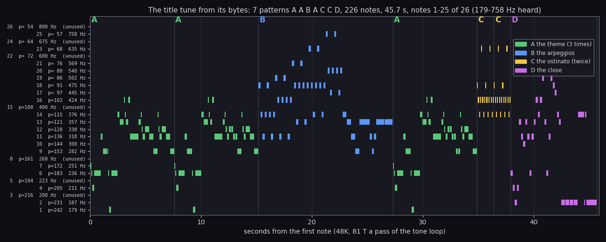
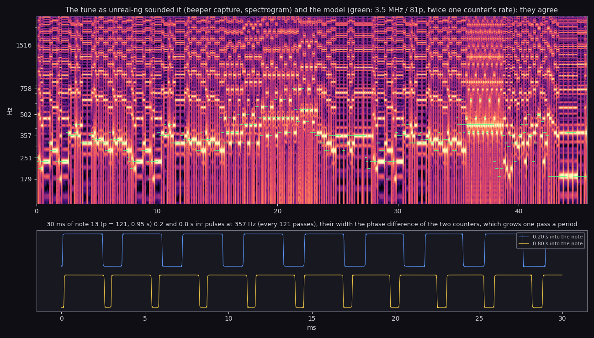
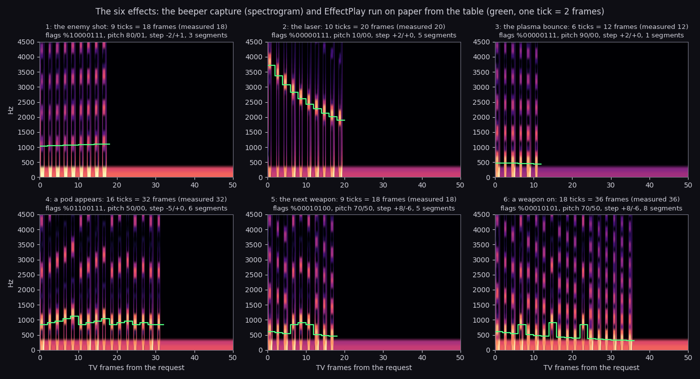
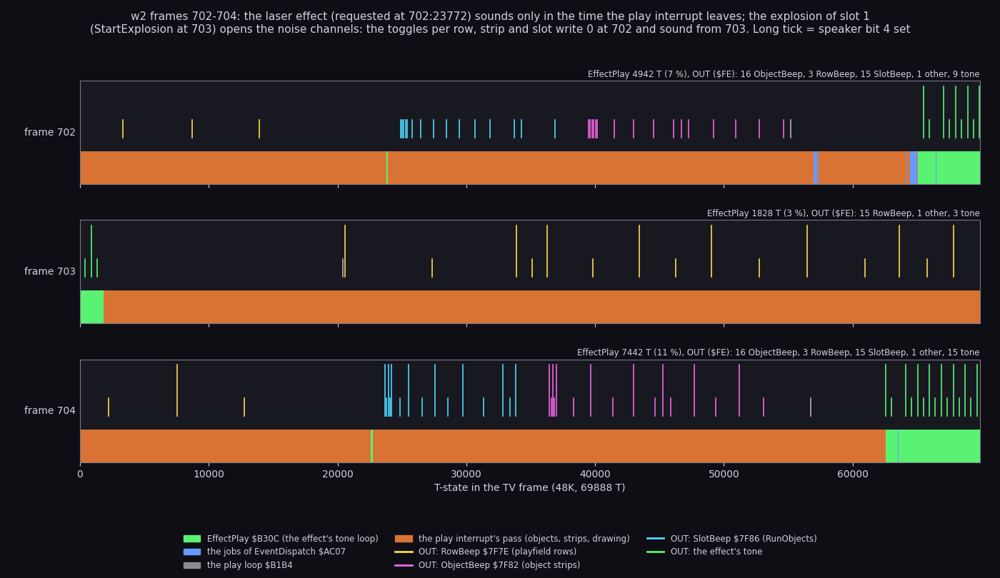

# 9. Sound

Zynaps has three sound sources, all on the beeper (port `$FE`, bit 4 the speaker, bit 3 MIC):

- **The title tune** (TitleTune `$B446`): Steve Turner's two-voice tune on the credits page, played with the
  interrupts off. One note is two square waves a pass apart: a pulse train that beats.
- **The effects** (EffectPlay `$B30C`): six effects with a priority each, played in the play loop's spare time
  between the interrupts.
- **The explosion noise:** three speaker toggles inside the play interrupt's pass (per playfield row, per object
  strip, per object slot), opened for 16 passes by three bit patterns when something explodes or a big enemy is
  hit.

The recordings and renders it rests on:

| Source | Made by | Used here for |
| --- | --- | --- |
| `work/zyB/audio/title-tune.wav` | `tools/render_audio.py --work work/zyB/rig --only tune`: `work/explore/title.szx` left alone 3000 frames on an own muted instance (port base 14770), unreal-ng's beeper capture | the tune as sounded |
| `work/zyB/audio/sfx-*.wav` | `tools/render_audio.py --work work/zyB/rig --only effects`: `work/run/play-imm.szx`, 10 frames, then the request written by hand (CurrentEffect `$7F97` = n, EffectTick `$7F96` = `$80`, EventRequests `$81C5` bit 0), 50 frames captured | the six effects as sounded |
| `work/zyB/w2` traces 701-705 | `kit/routine_anim.py --work work/zyB/w2 --window 701:0-705:0` (the w2 instance) | who writes port `$FE` in a frame of play |
| `src/res/music/titletune.tune.txt`, `src/res/effects/effects.fx.txt` | the bytes as text (`tools/res_tune.py`, `tools/res_effects.py`) | the models |

Nothing was played aloud: the instances were muted and the samples went to files.

Listen (rendered from the machine, mono MP3):

- [the title tune](audio/title-tune.mp3), 46.5 s;
- the effects: [1 the enemy shot](audio/sfx-1-enemy-shot.mp3), [2 the laser](audio/sfx-2-laser.mp3),
  [3 the plasma bounce](audio/sfx-3-plasma-bounce.mp3), [4 a pod appears](audio/sfx-4-pod-appears.mp3),
  [5 the next weapon](audio/sfx-5-next-weapon.mp3), [6 a weapon on](audio/sfx-6-weapon-on.mp3).

## 9.1 The title tune: the format

The tune is 211 bytes at `$FF01-$FFD3` (src/res/music/README.md):

- TunePeriods `$FF01`: 27 periods, note n's period p in passes of the tone loop (note 0 is 0, unused).
- TuneOrder `$FF1C`: 7 pattern pointers, A A B A C C D.
- 4 patterns: note bytes (1-26) and length commands `$C0` + n (`L<n>` in the text), each ending with `$FF`.

| Pattern | Plays | What it is |
| --- | ---: | --- |
| A | 3 times | the theme, lengths L1 to L8 |
| B | once | the climbing arpeggios, in L2 (quavers), then L10 and L8 |
| C | twice | an ostinato of 16 notes in L1 |
| D | once | the close, ending on note 2 in L10 |

226 notes in all.

## 9.2 The title tune: the player

TitleTune `$B446` (tune.asm), called by CreditsPage `$B095`:

1. `DI`. For each of the 7 patterns: read a byte.
2. Before each byte: fire (TitleFireCheck `$A748`) or a key 1-5 (half row `$F7FE`) ends the tune and the credits
   page goes on.
3. `$C0` + n: TuneDuration `$B4AE` = n × 16 (the high byte: n × 16 × 256 passes).
4. A note n: B = TunePeriods[n], C = B + 1. Two counters H and L start from B; each pass both count down, and a
   counter that reaches 0 reloads (H from B, L from C) and flips the speaker.
5. The flip: the pass ORs `$10` for each wrap, adds 8, keeps bit 4, `OUT ($FE)`, then shifts right for the next
   pass. Two wraps in one pass flip it once.

A pass (`$B486-$B49B`) is 81 T. So:

- `L1` = 16 × 256 passes × 81 T = 331776 T = 0.095 s on a 48K.
- Counter H alone would make a square wave of 3500000 / (2 × 81 p) Hz: note 1 (p = 242) 89 Hz.
- But the speaker is the XOR of two such waves, of periods p and p + 1 passes. Their edges drift apart by one pass
  a period, so the speaker gives two pulses per period of one counter: a pulse train at 3500000 / (81 p) Hz,
  twice the counter's rate, with a width that grows one pass a period and wraps (the beat).

So the notes sound at 3500000 / (81 p): note 1 at 179 Hz, note 25 (p = 57) at 758 Hz.
The stage 2 comments of tune.asm and src/res/music/README.md gave half of that (3500000 / (2 × 81 p), "89 Hz ...
400 Hz"); the measurement in 9.3 settles it, and both were corrected in the documents stage.



```sh
python3 tools/fig_tune.py --wav work/zyB/audio/title-tune.wav
```

How to read:

- One row per note number 1-26 with its period p and its pitch 3500000 / (81 p); the rows marked "(unused)" never
  sound.
- One bar per note played, from its start for its length, coloured by its pattern; the dotted lines and letters at
  the top mark each pattern's start.
- The x axis is seconds from the first note on the model's clock (81 T a pass, 3.5 MHz).

What it shows:

- A plays three times (0, 7.6 and 27.4 s), B climbs through the arpeggios to note 25, C repeats its ostinato twice
  around 35-38 s, D closes low on note 2.
- The tune uses notes 1, 2, 4, 6, 7, 9-14, 16-21, 23 and 25. Notes 3, 5, 8, 15, 22, 24 and 26 never sound.
  The stage 2 comment of tune.asm listed only 3, 15, 22, 24 as unused (now corrected); the patterns in
  titletune.tune.txt show that 5, 8 and 26 are not played either.
- The periods fall by about a semitone a step (242, 231, 216 ...), so the unused notes are gaps in a chromatic
  scale, not missing data.

## 9.3 The tune as unreal-ng sounded it



How to read:

- Top: the spectrogram of `title-tune.wav` (the beeper capture, 44100 Hz), the frequency axis marked at the model's
  pitches; the green dashes are the model's notes at 3500000 / (81 p).
- Bottom: 30 ms of the speaker signal in the longest note (note 13, p = 121, 0.95 s), 0.2 s and 0.8 s into it.

What it shows:

- The bright fundamentals sit on the green dashes: the notes sound at 3500000 / (81 p), not at half of it.
- The bottom panel: pulses every 2.8 ms (357 Hz = 3500000 / (81 × 121)), narrow at 0.2 s and wider at 0.8 s: the
  width is the phase difference of the two counters, which grows one pass a period.
- The capture holds the tune from 26.65 s to 73.15 s: 46.5 s, against 45.7 s of the model. The model counts 81 T
  a pass and runs 1.7 % fast; the `OUT ($FE)` in the pass is I/O-contended on a 48K, a likely cause that was not
  measured apart.

## 9.4 The effects

An effect is 8 bytes of EffectTable `$7E5A` (effectdata.asm, src/res/effects/effects.fx.txt):

| Byte | Meaning |
| ---: | --- |
| `+0` | pitch A |
| `+1` | its step per tick |
| `+2` | pitch B |
| `+3` | its step per tick |
| `+4` | the change of both steps at each segment's end |
| `+5` | the segments |
| `+6` | flags: bit 7 two-tone, bit 6 pitches restart each segment, bit 5 segment A one tick shorter each time, bits 4/3 step B / A reversed each segment, bits 0-2 which pitch a segment plays (one tone) |
| `+7` | the segment lengths in ticks: low nibble A, high nibble B |

The six effects:

| n | Event | Requested by | Pitch A / step | Pitch B / step | Segments | Flags | Ticks | Frames (measured) | Hz (capture) |
| ---: | --- | --- | --- | --- | ---: | --- | ---: | ---: | --- |
| 1 | an enemy shot | EnemyFire `$A0EB` | `$80` / -2 | `$01` / +1 | 3 | `%10000111` | 9 | 18 | about 1050-1100 |
| 2 | a laser shot | FireLaser `$9C1D` | `$10` / +2 | `$00` / 0 | 5 | `%00000111` | 10 | 20 | 3700 falling to 1900 |
| 3 | a plasma bounce | PlasmaHandler `$9E67` | `$90` / +2 | `$00` / 0 | 1 | `%00000111` | 6 | 12 | about 480-440 |
| 4 | a pod appears | ExplosionToPod `$A2D6` | `$50` / -5 | `$00` / 0 | 6 | `%01100111` | 16 | 32 | 830-1110, six rises |
| 5 | the next weapon | PodStep `$A224` | `$70` / +8 | `$50` / -6 | 5 | `%00010100` | 9 | 18 | 600-450 |
| 6 | a weapon on | PodStep `$A21D` | `$70` / +8 | `$50` / -6 | 8 | `%00010101` | 18 | 36 | 600 down to 300, with jumps |

Effect 0 is the stop: StopAndSettle `$ABF0` requests it at the pause and at the end of play.

### Priority and scheduling

RequestEffect `$B2F0` (effects.asm):

- A = the effect; 0 is stored as `$80`, above all.
- Taken only when A ≥ CurrentEffect `$7F97`: the effect's number is its priority. A laser (2) does not cut a
  weapon-on (6); a pod's sound (4) cuts a laser.
- Taken: CurrentEffect = A, EffectTick `$7F96` = `$80` (a new effect), event bit 0 posted.

EffectJob `$AC6F` (event bit 0) calls EffectPlay `$B30C` in the play loop's time, not the interrupt's:

1. The entry `$7E5A` + 8 (n - 1) is copied to EffectState `$7F8A-$7F90`, the lengths split into SegLenA `$7F91`
   and SegLenB `$7F92`; the pitches start from `+0` and `+2`.
2. The tone loop: `OUT` of `$18`, a count of NOP rounds (three NOPs and `DJNZ` at `$B360-$B363`, 25 T a round),
   `OUT` of `$00`, another count. About 3500000 / (25 (hA + hB) + 140) Hz; a one-tone effect uses the same pitch for both
   halves.
3. When an interrupt sets EffectTick (the play interrupt writes `$FF` at `$AA18` every pass), the loop calls
   EventDispatch: the jobs run. A job that ran (carry) ends the effect; otherwise the pitches step (one tick = 2
   frames, a pass) and, at a segment's end, the segment's changes apply.
4. The effect ends when the segments run out, or a job runs, or EffectTick = `$80` (a new request restarts it).



```sh
python3 tools/fig_effects.py
```

How to read:

- One panel per effect: the spectrogram of its capture (50 frames from the request), 0-4500 Hz.
- The green line is the model: EffectPlay's state stepped tick by tick from the table bytes, at
  3500000 / (25 (hA + hB) + 140) Hz.
- The panel title gives the table bytes, the ticks, and the length measured in the capture.

What it shows:

- All six lengths agree: the model's ticks × 2 frames = the measured frames (18, 20, 12, 32, 18, 36).
- The tone comes in bursts, one per tick: the vertical stripes. Between them the interrupt's pass holds the CPU
  (9.5).
- Effect 4's six segments restart their pitch (flag bit 6) and shorten (bit 5): six short rising chirps.
- Effects 5 and 6 share their pitches and steps; 6 has 8 segments to 5's 5 and flag bit 0 set (pitch A on even
  segments too). The jumps are the step reversals of flag bit 4.

## 9.5 Who drives the speaker in a frame of play



```sh
python3 tools/fig_beeper.py --trace work/zyB/w2/traces/701_0-705_0.uatr --frames 702,703,704
```

How to read:

- One row per TV frame, the 69888 T-states across.
- The band: the code running. Green EffectPlay, blue the jobs of EventDispatch, grey the play loop, orange the play
  interrupt's pass (the objects, the strips, the drawing).
- The ticks: every `OUT ($FE)`, coloured by its instruction: RowBeep (yellow), ObjectBeep (magenta), SlotBeep
  (cyan), the effect's tone (green). A long tick sets the speaker bit, a short one clears it.
- Above each row: EffectPlay's T-states in the frame and the count of each kind of OUT.

What it shows:

- 702: the laser's request (thin green at T 23772), then EffectPlay from T 65051 to the frame's end: 4942 T, 7 %
  of the frame. 703: 1828 T. 704: 7442 T (a new laser restarts it).
- The effect sounds only after the interrupt's pass is done, so each tick of an effect is one burst of a few ms
  per 2 frames: the stripes of 9.4.
- The pass writes port `$FE` on its own: in its first frame (702, 704) 15 SlotBeep (one per slot, RunObjects), 16
  ObjectBeep (one per object strip, ObjectStrips `$8F9B`) and 3 RowBeep; in its second (703) 15 RowBeep, one per
  playfield row the drawing finishes.
- At 702 all those writes are short: silent. At 703 slot 1 explodes (StartExplosion), and from then on about half
  the toggles are long: the explosion noise.

### The explosion noise

The three toggles write `(Beep XOR $18) AND Mask` to port `$FE`:

| Toggle | Variable | Mask | Pattern | Written in |
| --- | --- | --- | --- | --- |
| per playfield row | RowBeep `$7F7E` | RowBeepMask `$7F7F` | SoundPattern1 `$7F80` | the drawing (playfield.asm, `$86D7`) |
| per object strip | ObjectBeep `$7F82` | ObjectBeepMask `$7F83` | SoundPattern2 `$7F84` | ObjectStrips (`$8FBD`) |
| per object slot | SlotBeep `$7F86` | SlotBeepMask `$7F87` | SoundPattern3 `$7F88` | RunObjects (`$949C`) |

- Each pass the play interrupt shifts each 16-bit pattern left by one and sets the mask to `$FF` when the bit
  shifted out was 1, else 0 (`ADD HL,HL; SBC A,A`, `$AA30-$AA46`).
- A mask of 0 makes every toggle write 0: no sound. The patterns are 0 at rest.
- StartExplosion `$A293` and a big enemy's hit (BigEnemyHitSound, enemies.asm) load `$FD00`, `$EDB2`, `$D6ED`:
  16 passes of on and off for each channel, then silence.
- So the noise is three buzzes whose pitch is the timing of the code itself (the rows drawn, the strips cut, the
  slots run), switched on and off in a fixed 16-pass rhythm: `$FD00` = on 6, off 1, on 1, off 8.
- The stage 2 comments called these toggles "the in-game engine sound"; with the masks closed except after an
  explosion or a hit, they are the explosion's noise, not an engine hum (the comments are corrected).

## 9.6 What no recording reached and what stays unexplained

- The tune's 1.7 % against the model (9.3): the cause is not measured.
- EffectSpare `$7E8A`: 10 zero bytes after effect 6, room for a seventh effect and a bit; nothing reads them.
- TuneSpare `$B4A9`: `AND A; RET` and two zeros after TitleTune that no code reaches.
- The unused periods of TunePeriods: notes 3, 5, 8, 15, 22, 24, 26 (9.2).
- Effects 1-6 were rendered from a hand-written request; their callers are in the code (the table in 9.4) and
  w1/w2 show the laser's request (`$9C1D`) in the trace above. The other requests are known from the code only.
