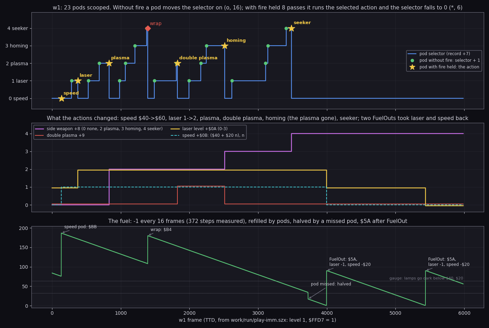
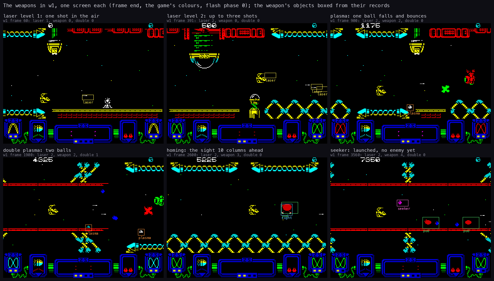
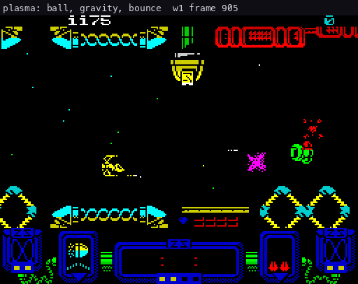
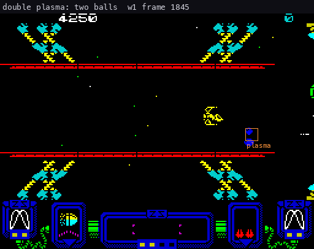
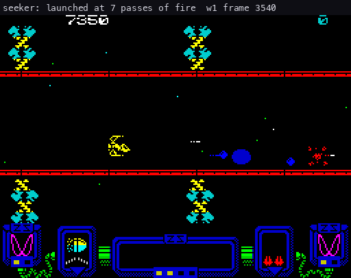
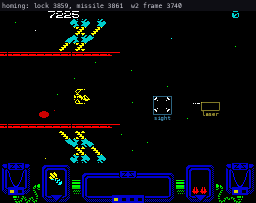
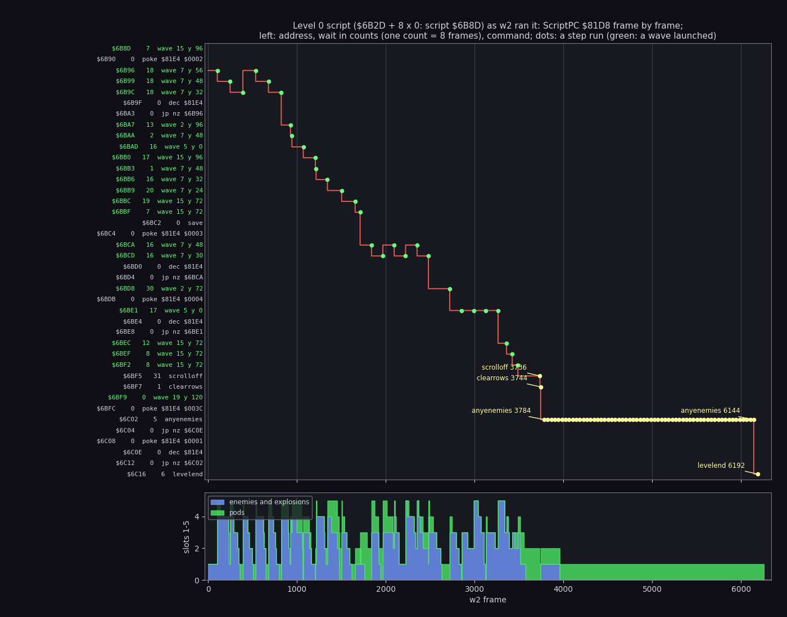
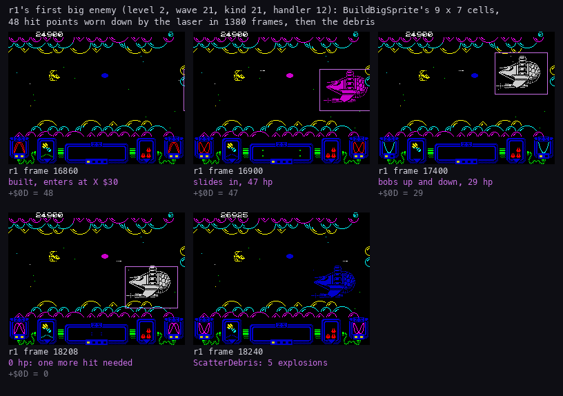
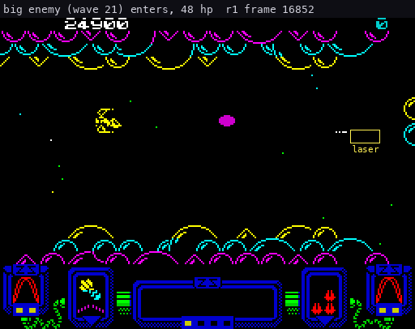
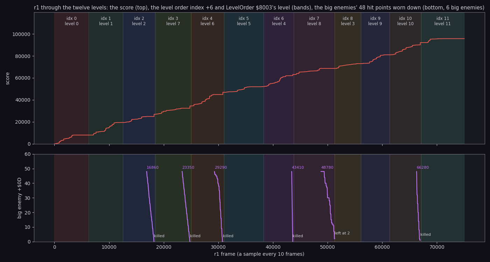

# 10. Gameplay logic

What this covers: the rules as code. The weapons and the pods that give them, the fuel, the score and the extra
lives, the enemy fire and the weapon rating, the waves and the level scripts, the lockable and the big enemies, the
level end, the death and the loop after the twelfth level.

The recordings it rests on:

| Recording | Made by | Frames | What it reached |
| --- | --- | ---: | --- |
| `work/zyB/w1` | `tools/podbot.py --plan 0,1,2,2,3,4 --record work/zyB/w1` from `work/run/play-imm.szx` (level 0, `Invulnerable` `$FFD7` = 1), port 14750 | 5986 | every pod action: speed, laser, plasma, double plasma, homing, seeker; two FuelOuts |
| `work/zyB/w2` | `tools/podbot.py --plan 3 --record work/zyB/w2`, same snapshot | 7600 | homing missiles from frame 547, a lock and a launch, the level 0 end, level 1, an extra life |
| `work/r1` | the long bot run of stage 2 (WALKTHROUGH.md), `Invulnerable` on | 75001 | all twelve levels, six big enemies, five extra lives |
| `work/run/all.tsv` | the live bot run r1 replays, `Invulnerable` on | 100000 | the wrap from level slot 11 back to slot 0 |
| `c2` | `tools/bot.py`, level 0 played honestly | 1500 | one death |

- `tools/podbot.py` scoops pods to step the selector and holds fire on the pod it wants (10.2).
- `--record` makes the run itself the recording (TTD and L1 on the instance), so no replay can drift from it.
- `tools/ttd_dump.py` read every frame of w1 and w2 by TTD `memory_at`: `work/zyB/w1-frames.npz`,
  `work/zyB/w2-frames.npz` (the player records, the variables, the 16 object records, the screen).
- r1 was read every 10 frames (`work/zyB/r1-every10.npz`) and every 4 frames over the first big enemy
  (`work/zyB/r1-big.npz`).

Frames below are TTD frames of the named recording.
Because all long runs have `Invulnerable` on, no recording but c2 shows a death: 10.11 rests on the code.

## 10.1 The player record

Each player has a record of 48 bytes, Player1 `$7F9C` and Player2 `$7FCC` (PlayerRecord `$7F99` points at the one in
play). From `+$0D` on it holds the 35-byte state of the script and the scroll, saved at each checkpoint.
The bytes the rules use:

| Offset | Field | Set by | Read by |
| --- | --- | --- | --- |
| `+0`-`+3` | the score, 4 BCD bytes, high first | AddScore `$A489` | PrintPlayerScore `$A4AE`, ScoreJob `$AC7A` |
| `+4` | the lives left (2 at the start: three ships) | ScoreJob, TakeLife | DrawLives `$A4EF` |
| `+5` | lives lost in this level | PlayerDied `$B119` | (the checkpoint) |
| `+6` | the level order index 0-11 | LevelDone `$B174` | SetLevelStart `$B062` |
| `+7` | the pod selector 0-4 | PodStep `$A1FD` | PodIconJob `$AC2C` |
| `+8` | the side weapon: 0 none, 2 plasma, 3 homing, 4 seeker | the pod actions | PlayerHandler `$9A5B` |
| `+9` | 1 = double plasma | PodPlasma `$9D68` | PlasmaFrame `$9C83` |
| `+$0A` | the laser level 0-3 | PodLaser `$9D5D`, FuelOut `$9C03` | FireLaser `$9C1D` |
| `+$0B` | the speed `$40`-`$A0` | PodSpeedUp `$9D4C`, FuelOut | the ship's mover |
| `+$0C` | the next extra life, an index into ExtraLifeScores `$800F` | ScoreJob | ScoreJob |
| `+$0D`-`+$2F` | the checkpoint: the level record, the script state and the scroll | SetLevelStart, CmdCheckpoint `$AED2` | RestoreCheckpoint `$AD56` |

w1 starts with laser 1, speed `$40`, no side weapon and the selector at 0 (frame 0).

## 10.2 Pods and the selector

A pod is what an enemy wave leaves when its last enemy is destroyed (10.6).
It flies with the landscape until the ship touches it or it scrolls off.

PodStep `$A1FD` (kind 4) runs the rule when the player's hit mask `$F379` has the pod's bit:

- **Fire held 8 passes or more** (FireHeld `$8184`): the action the selector `+7` points at runs (PodActions
  `$80F0`), the selector goes back to 0, effect 6.
- **No fire:** the selector moves on by one, effect 5. Past the fifth weapon it wraps to 0, awards 1000 points
  (AddScore 9) and sets the fuel to `$B4`.
- **Either way:** 100 points (AddScore 4) and the pod icon redrawn (event bit 2, PodIconJob).
- **Not taken:** at the edge (`+8` bit 5 clear) the pod is removed and the fuel is halved (`SRL`).

| Selector | Action | Effect on the record |
| ---: | --- | --- |
| 0 | PodSpeedUp `$9D4C` | fuel `$BB`, speed + `$20` up to `$A0` |
| 1 | PodLaser `$9D5D` | laser + 1 up to 3 |
| 2 | PodPlasma `$9D68` | side weapon 2; a second plasma pod sets `+9` (double plasma) |
| 3 | PodHoming `$9DA5` | side weapon 3, the sight on, no lock, the double plasma off |
| 4 | PodSeeker `$9DDD` | side weapon 4, the sight off |



```sh
python3 tools/fig_weapons.py course --npz work/zyB/w1-frames.npz
```

How to read:

- Top: the selector `+7`. A green dot is a pod taken without fire (the selector + 1); a star is a pod taken with
  fire held (the action named, the selector back to 0); the red diamond at 1394 is the wrap past the seeker.
- Middle: what the actions changed in the record (`+8`, `+9`, `+$0A`, `+$0B` as a step count above `$40`).
- Bottom: the fuel `$80E6`. The annotations are the refills and the drops the text names.

What w1 shows:

- 23 pods scooped: 16 steps of the selector, 6 actions and 1 wrap. The score steps agree: 21 steps of exactly 100,
  one of 1100 (the wrap, 1000 + 100) and the others where a pod and a kill met in one frame.
- The actions, in order: speed `$40`→`$60` at 135, laser 1→2 at 375, plasma at 831, double plasma at 1825, homing
  at 2513 (the double plasma off), seeker at 3485.
- The selector shows the rule plainly: from 0 the bot needs n scoops without fire, then one with fire, to take
  action n.



```sh
python3 tools/fig_weapons.py sheet --npz work/zyB/w1-frames.npz
```

How to read:

- One screen per weapon state: laser 1 (frame 60), laser 2 (391), plasma (900), double plasma (1900), homing (2600),
  seeker (3560).
- The boxes are the object records of the weapon with their kind (`+7`): laser shots (kind 1), plasma balls
  (kind 9), the sight (kind 6), the seeker (kind 7).
- The ship's laser level shows as the number of laser shots in flight: slots 9-12 (`$F4F8`-`$F57C`), one more
  per level.

## 10.3 The five weapons in flight

The side weapon runs from its frame routine (table `$80EA`, called by PlayerHandler with `+8` - 2), counting the
passes fire is held (FireHeld `$8184`).
A tap fires only the laser; holding fire releases the side weapon.

| Weapon | Frame routine | Released | Handler | What it does |
| --- | --- | --- | --- | --- |
| laser | FireLaser `$9C1D` | each press and release | LaserHandler `$9E32` (kind 1) | X + 1.25 columns a pass; 1 hit point off an enemy it overlaps; gone on scenery or at column 48 |
| plasma | PlasmaFrame `$9C83` | fire held exactly 3 passes | PlasmaHandler `$9E67` (kind 9) | falls (Y acceleration `$10`), bounces 3 times on scenery (Vy = -Vy / 2, effect 3); kills what it touches (`$80E5`) |
| double plasma | the same, second ball in `$F5A8` | when `$F5D4` is busy | PlasmaHandler | two balls at once |
| homing | HomingFrame `$9CCA` | fire with a lock (`$80E2` not 0) and `$F5D4` free | MissileHandler `$9ED7` (kind 10) | life 75 passes, homes on the locked enemy; a hit takes 4 hit points of a big enemy |
| seeker | SeekerFrame `$9CFE` | fire held exactly 7 passes | SeekerHandler `$9F13` (kind 7) | flies to the first enemy slot, kills it, then the next, then comes home |
| speed | (none) | | | the ship's step `+$0B` |

The plasma ball bouncing over the ground (w1):



```sh
python3 tools/fig_weapons.py gif plasma-bounce 905 960 --every 1 --only 9,0 --title 'plasma: ball, gravity, bounce'
```



```sh
python3 tools/fig_weapons.py gif double-plasma 1845 1935 --every 2 --only 9 --title 'double plasma: two balls'
```



```sh
python3 tools/fig_weapons.py gif seeker 3540 3800 --every 3 --only 7,2,11,5,3 --title 'seeker: launched at 7 passes of fire'
```

How to read the three GIFs:

- The screen at 2× scale, one picture every 1 to 3 frames; the caption gives the recording, the frame and the title.
- The object records of the kinds given with `--only` are boxed in their kind's colour: orange plasma (9), pink
  seeker (7), white enemy (2, 11), red enemy shot (5), brown explosion (3).

What they show:

- The plasma ball loses half its fall speed at each bounce, as the code says.
- The seeker (slot 14) leaves after 7 passes of fire and works down the enemy slots.
- The seeker's test is `CP $02` twice (SeekerHandler): kind 11 enemies share EnemyHandler but are never hunted.
  No recording shows a kind 11 enemy near a seeker, so this is known from the code only.

### The homing missile (w2)

w1 had the homing missiles for 972 frames and never locked: a lock needs a lockable enemy (kinds 8 and 12, 10.7)
under the sight, and level 0 has only one such wave, at its end.
w2 takes the homing missiles as its first action and keeps them to the level end:

- Frame 547: side weapon 3 (the selector logged by the bot).
- Frame 3744: wave 19 (kind 19, handler 8, lockable, 6 hit points) in enemy slot 1.
- Frames 3815, 3819, 3823: three laser hits, 6→5→4→3.
- Frame 3859: the lock. LockableHandler `$9FC8` finds the sight's mask `$80E4` on its bit: `$80E2` = 1 (the bit),
  `$80E0` = `$F398` (the record).
- Frame 3861: the missile, kind 10 in slot 14, life 74 (75 set by HomingFrame, one pass gone).
- Frames 3868 and 3920: hit points 2 and 1, both from the laser.
- Frame 3928: the enemy is gone and the lock is cleared.
- Frame 3941: the missile burns out (MissileFade): its life fell one a pass (74→41 in 67 frames).
- The sight stays at X `$23` the whole time: PlaceSight puts it 10 columns ahead of an old ship position.



```sh
python3 tools/fig_weapons.py gif homing-missile 3740 3945 --npz work/zyB/w2-frames.npz --every 3 --only 1,6,8,10 --title "homing: lock 3859, missile 3861"
```

How to read:

- Blue box: the sight (kind 6). Purple: the lockable enemy (kind 8). Red: the missile (kind 10). Yellow: lasers.
- The caption's frame numbers match the list above.

So the missile flew but did not make the kill: the laser did.
A missile hit (MissileHitMask `$80E3`) takes the target out at once (LockableHandler), so a hit would show as a drop
from 2 or 1 to an explosion; the recording has none. The missile's kill is known from the code only.

## 10.4 The fuel

Fuel `$80E6` is a timer: when it runs out the ship loses a laser level and a speed step.

| Event | Fuel | Address |
| --- | --- | --- |
| level start | `$5A` | SetLevelStart, rounds.asm |
| one step down | - 1 when PassBit `$7F63` bit 0 is set | PlayerHandler `$9A5B` |
| a speed pod (action 0) | `$BB` | PodSpeedUp `$9D4C` |
| the selector wrap | `$B4` | PodStep `$A1FD` |
| a pod lost off the edge | halved | PodStep, `SRL (HL)` |
| 0 reached | `$5A`, laser - 1 (not below 0), speed - `$20` (not below `$40`) | FuelOut `$9C03` |
| a life lost | FuelOut | PlayerDied `$B119` |

The timing:

- A game pass is 2 TV frames, and PassBit rotates one bit a pass (w2 frames 1000-1019: `2780 2780 2801 2801 2902`).
- Bit 0 comes round once in 8 passes, so the fuel falls 1 every 16 TV frames.
- w1: 372 steps of one, every 16 frames (the bottom panel of the course figure).
- A full speed pod (`$BB` = 187) lasts 187 × 16 = 2992 frames, about 60 s; a level start (`$5A` = 90) 1440 frames.

What w1 shows (the bottom panel):

- 135: the speed pod, `$BB`.
- 1394: the wrap, `$B4`.
- 3727: a pod scrolled off: the fuel halved, 34 → 17. (w2 halved its fuel 8 times this way, 1481-3730.)
- 3996: FuelOut. Laser 2→1, speed `$60`→`$40`, fuel `$5A`.
- 5436: FuelOut again. Laser 1→0, speed stays `$40`.
- w2 has no speed pod: its first FuelOut, at 1963, takes the laser from 1 to 0.

With laser level 0 the ship still fires one shot at a time (slot 9 keeps running after 5436 in the slot figure
of 7.2). The fuel lamps on the panel show the fuel in three states (8.3).

## 10.5 Score and extra lives

AddScore `$A489` adds award A of PointsTable `$8231` to the current player's score:

| Award | 0 | 1 | 2 | 3 | 4 | 5 | 6 | 7 | 8 | 9 | 10 | 11 |
| --- | ---: | ---: | ---: | ---: | ---: | ---: | ---: | ---: | ---: | ---: | ---: | ---: |
| Points | 0 | 25 | 50 | 75 | 100 | 150 | 200 | 250 | 500 | 1000 | 2000 | 5000 |

Who awards what:

- An enemy destroyed: its record's `+$0C` (the kind byte 2's low nibble, from the kinds table `$6A65`).
- A pod: 4 (100). The selector wrap: 9 (1000) on top.
- A wave wholly destroyed: bits 0-5 of its bonus byte + 7 (EnemyGone). Wave 20 and wave 21 (bonus `$03`) give
  award 10 (2000); wave 28 (bonus `$42`) award 9 (1000).
- An escape (EnemyEscaped, the enemy left the screen): the wave record gets bit 7 and pays no bonus, and leaves no
  pod.

The score steps in w1 and w2 agree: 25, 50 and 75 for the common enemies, 100 for the pods, 525 and 550 for a wave
bonus of 500 with a kill in the same frame, 1100 for the wrap.

The extra lives: ScoreJob (event bit 1) compares the score's byte `+1` with ExtraLifeScores `$800F` at `+$0C`.
The table is 1, 3, 5, 7, 9, then `$FF`: an extra life at 10000, 30000, 50000, 70000 and 90000, and none after.

- w2 frame 7264: a pod wraps the selector (1100 points) and the score goes 9325 → 10425: lives 2→3, `+$0C` 0→1,
  fuel `$B4`, all in the same frame.
- r1: lives 2→3 at 7620, →4 at 20460, →5 at 34770, →6 at 52050, →7 at 66560: the five entries of the table.
- The bot's run (all.tsv) reaches 100300 points at the loop and stays at 7 lives: the `$FF` holds.

## 10.6 Waves and the level scripts

A level is an 8-byte record of LevelTable (HL = `$6B2D` + 8 n): an unused byte, the script's start, PlayFlags, the
scroll count, the scenery script and ScriptLevelBias `$81DE` (src/res/levels/README.md).
SetLevelStart copies the record of LevelOrder[`+6`] (LevelOrder `$8003`) into the checkpoint, and RestoreCheckpoint
`$AD56` copies it into ScriptState `$81D7`.

### The script interpreter

WaveScriptStep `$AD66` runs in phase 2 of the play interrupt (PlayPass `$AA96`), and only while DeathTimer `$7F7B`
is `$FF` (the ship alive).

A step is a wait byte and a command:

- ScriptWaitCount `$81E1` counts up once a call; when it equals the step's wait the command runs and the counter
  starts again from 0.
- Commands with no wait run in the same call (ScriptNext).
- One count is 8 TV frames: in w2 the first wait of 18 counts runs from frame 103 to 247 (144 frames).
- `$40`-`$7F` is a jump, `$C0`-`$FF` a call, `$80`-`$BF` a wave (`wave N y Y`, LaunchWave `$91EC` with the row
  offset Y), below `$40` one of 18 commands (ScriptCommands, wavescript.asm).

The commands the twelve scripts use: `wave`, `poke` (CmdStore, on ScriptCounter `$81E4` only), `dec` and `jp nz`
(the loops), `save` (CmdCheckpoint: a death restarts from here), `scrolloff` (CmdScrollStop), `clearrows`
(CmdResetRecords), `escapefirst` (CmdEnemyEscape: the first enemy record leaves without a bonus), `anyenemies`
(CmdEnemiesLeft), `levelend` (CmdLevelEnd), `nop`.
Counted over the twelve scripts: 204 waves, 80 `poke`, 80 `jp`, 65 `dec`, 15 `anyenemies`, 12 `levelend`, 11
`save`, 9 `scrolloff`, 8 `clearrows`, 5 `escapefirst`, 2 `nop`.
Never used: commands 1, 3, 4, 6, 8, 10-13 and the call (10.13).



```sh
python3 tools/fig_levels.py script --npz work/zyB/w2-frames.npz --mem work/zyB/w2/start.bin --level 0
```

How to read:

- Left: the script `$6B8D` decoded from w2's memory, one step a row: the address, the wait in counts, the command.
  Green rows launch a wave.
- The red line is ScriptPC `$81D8` frame by frame. A dot is a step run: ScriptPC moved on, or the wait counter
  fell back to 0 on the same step (a loop).
- Yellow labels: the commands of the level end, with their frames.
- Bottom: what slots 1-5 held: enemies and their explosions (blue), pods (green).

What w2 ran:

- 103: the first wave (wave 15). Waves 7 run twice at `$6B96`/`$6B99`/`$6B9C` (the loop with `$81E4` = 2), three
  times at `$6BCA`/`$6BCD` (`$81E4` = 3), wave 5 four times at `$6BE1`.
- 3488: the last of the three waves 15.
- 3736: `scrolloff`: the landscape stops.
- 3744: `clearrows`, then wave 19 (y 120, the lockable enemy of 10.3) and `poke $81E4 $3C`.
- 3784-6144: `anyenemies` 60 times, every 40 frames (its wait of 5 counts), until `$81E4` reaches 0.
- 6192: `levelend`. The side weapon goes: `+8` 3→0.
- 6258: the level index `+6` becomes 1.

The 2400-frame wait is a rule, not a bot's slowness:

- A pod sits in an enemy record (slots 1-5), so `anyenemies` (CmdEnemiesLeft `$AF26`) counts it as an enemy.
- After `scrolloff` nothing scrolls, so a pod nobody takes never leaves.
- w2 left one pod parked (the green bar from 3960 on), so the script waited the full 60 × 40 frames.
- w1 left two pods (X `$14` and X `$1B`) after the kill of wave 19 at 4044; its level end fell after w1's end (5986).
- A player who scoops the last pod ends the level at once.

### The twelve scripts

Decoded from w2's `start.bin` by `fig_levels.decode_script` (the wave counts are static: the steps in the text,
loops not unrolled):

| Level | Script | Big enemy wave | Last wave before `levelend` |
| ---: | --- | --- | --- |
| 0 | `$6B8D` | none | 19 |
| 1 | `$6C1A` | none | 18 |
| 2 | `$6C97` | 21 | the big enemy |
| 3 | `$6D18` | none | 18 |
| 4 | `$6E50` | 28 (kind 21) | the big enemy |
| 5 | `$6FCA` | none | 17 |
| 6 | `$7068` | 20 | the big enemy |
| 7 | `$70F6` | 21 | the big enemy |
| 8 | `$7181` | 20 | the big enemy |
| 9 | `$6DC0` | none | 16 |
| 10 | `$7212` | 20 | the big enemy |
| 11 | `$6F00` | none | 10 |

- Six levels end on a big enemy (waves 20, 21, 28: kinds 20 and 21), six on a lockable wave or a common one.
- The kinds 16-19 are lockable (handler 8) with hit points `$0A`, 8, 8, 6; kind 10 also (8 hit points).
- Kind 11 has `$FF` hit points: it is never destroyed (EnemyHandler skips the count).

### The weapon rating and the enemy fire

WeaponRating `$9B75` rates the ship's arms after each score print (ScoreJob) and at the level start:

- L = laser level + side weapon (`+$0A` + `+8`).
- WeaponRatingMask `$80E7` = `$FF`, or `$30` when L ≥ 4.
- WeaponRatingValue `$80E8` = ((speed >> 5 + L) × 4) AND `$F0`, + ScriptLevelBias `$81DE`.
- WeaponRatingLevel `$80E9` = 0, or 8 when L ≥ 7. LaunchWave uses it to pick the KindColours set (`$6B15`).

EnemyFire `$A0EB` uses the first two:

- An enemy whose fire rate `+$18` is 0 never fires.
- Its first shot comes when its column `+4` equals `$80E7`: with `$30` (L ≥ 4) every enemy fires as it reaches
  column `$30`; with `$FF` never by this rule.
- Then on its turn (its bit `+$24` in PassBit) it fires when Random < `$80E8`, or when Random - `$80E8` is below its
  fire rate: about (`$80E8` + rate) / 256 a turn.
- At most 3 enemy shots fly at once (EnemyShotsLeft `$8074`, the records `$F474`-`$F4CC`).

So a better armed and faster ship draws more fire. Measured:

| Recording | Frame | `$80E7` | `$80E8` | Why |
| --- | ---: | --- | --- | --- |
| w1 | 0 | `$FF` | 0 | speed `$40`, laser 1: (2 + 1) × 4 = 12, AND `$F0` = 0 |
| w1 | 135 | `$FF` | `$10` | speed `$60`: (3 + 1) × 4 = 16 |
| w1 | 831 | `$30` | `$10` | plasma: L = 2 + 2 = 4 |
| w1 | 2513 | `$30` | `$20` | homing: L = 5, (3 + 5) × 4 = 32 |
| w1 | 4045 | `$30` | `$10` | after FuelOut: L = 4, speed `$40` |
| w2 | 547 | `$30` | `$10` | homing with laser 1: L = 4 |
| w2 | 2051 | `$FF` | `$10` | laser 0: L = 3 |
| w2 | 6367 | `$FF` | 0 | level 1, the side weapon gone: L = 0 |

- `$80E9` stayed 0 in both: L never reached 7 (laser 3 and the seeker would).
- ScriptLevelBias is 0 in level 0. r1 read it at each level start: levels 0, 1, 2 and 3 have 0, level 4 has 3,
  level 5 10, level 6 20, level 7 15, level 8 15, level 9 15, level 10 20, level 11 15.

## 10.7 The lockable and the big enemies

Two handlers take more than one hit:

- **LockableHandler `$9FC8`** (kind 8): the sight can lock it (10.3). The laser takes 1 hit point (`$80BB`); a plasma
  ball or the seeker kills it (`$80E5`); the locked missile kills it (`$80E3`).
- **BigEnemyHandler `$A03E`** (kind 12): 48 hit points (`$30`). A missile hit takes 4, a laser hit 1 (LaserHitMask),
  each with the hit sound (the three sound patterns, 9.5) and a colour flash (CycleColour). Below 0: destroyed.

The big enemy is drawn from a one-bit cell map:

- BuildBigSprite `$8F0C` builds a 7 × 9 cell image at `$C000` (72 × 56 pixels).
- With A = 1 it takes the glyphs from `$66E0` (BigSpriteGlyphs) and the map at `$8098`; otherwise the tile set at
  `$5CDC` and the map at `$80A1`.
- r1 ran it 6 times, frames 16855-66273: once for each big wave (L1 of r1).
- It moves within columns 7-55 and bobs between Y `$2A0` and `$900` (r1-big).
- When it dies, ScatterDebris `$9BAB` fills the five enemy slots with explosions round it.



The figure is in 7.8; the GIF is the same fight in motion:



```sh
python3 tools/fig_weapons.py gif big-enemy 16852 17100 --npz work/zyB/r1-big.npz --every 4 --only 1,12,3 --title "big enemy (wave 21) enters, 48 hp"
```

The first big enemy in r1:

- 16856: enters at X `$30` with 48 hit points.
- 18208: hit points 0; 18240: the debris.
- About 1380 frames from its entry to the debris (16860 to 18240 in the 4-frame samples), all laser fire: the bot
  has laser 0 by then, one shot at a time.
- A pod stayed parked at X `$2080` the whole time.

## 10.8 The twelve levels in r1



```sh
python3 tools/fig_levels.py levels --npz work/zyB/r1-every10.npz
```

How to read:

- Top: the score. Each band is one level: the order index `+6` and the level LevelOrder gives it.
- Bottom: the hit points `+$0D` of each big enemy (kind 12), from its entry (the number) to its end.

| Index | Level | Starts (r1) | Big enemy | Result |
| ---: | ---: | ---: | --- | --- |
| 0 | 0 | 0 | | |
| 1 | 1 | 6260 | | |
| 2 | 2 | 12550 | 16860-18230 | killed |
| 3 | 7 | 18410 | 23350-24790 | killed |
| 4 | 6 | 24990 | 29290-30820 | killed |
| 5 | 5 | 31010 | | |
| 6 | 4 | 38300 | 43410-43610 | killed |
| 7 | 8 | 43800 | 48780-51280 | left at 2 hit points |
| 8 | 3 | 51290 | | |
| 9 | 9 | 56060 | | |
| 10 | 10 | 61360 | 66280-66940 | killed |
| 11 | 11 | 67120 | | |

- The order of r1's game is 0 1 2 7 6 5 4 8 3 9 10 11: PlayersSetup `$AFB7` shuffles levels 3-8 for each game.
- Level 8's big enemy was alive when the level ended. Its script ends like level 0's: `wave 20`, `poke $81E4 $3C`,
  then `anyenemies` every 5 counts until no enemy is left or `$81E4` runs out. The big enemy outlived the 60 polls
  (2400 frames; it flew 48780-51280), so `levelend` came with it on screen.

## 10.9 The level end

CmdLevelEnd `$AE40` (script command 5):

1. CmdScrollStop: the scroll stops.
2. EndPending = 2: the play loop ends after this pass (CheckPauseAndEnd `$ABD5`).
3. The record's `+8` and `+9` are zeroed: the side weapon and the double plasma are lost.

LevelDone `$B174` (end code 2) then adds 1 to `+6`, wraps 12 to 0 and calls SetLevelStart.
The laser and the speed are kept: w2 keeps laser 0 and speed `$40` into level 1.

In w2 the side weapon went to 0 at 6192 and the level index to 1 at 6258 (10.6).
The banner between the levels is in [01 game design](01-game-design.md).

## 10.10 The loop after the last level (level 11)

After index 11 LevelDone wraps to 0 and the game plays LevelOrder again, from the same order:

- The bot's run (`work/run/all.tsv`): index 11 at frame 67850, index 0 at 73600 with 100300 points and 7 lives,
  then index 1 at 80050, 2 at 86350.
- The second time round the levels take about as long as the first.
- Nothing in LevelDone or SetLevelStart counts the loops: no faster waves, no new bias. The difficulty only follows
  the weapon rating (10.6).
- PlayersSetup is not called again, so the shuffle is not redone.

## 10.11 Death

KillPlayer `$9B5F` starts the death (the collision test reads `Invulnerable` `$FFD7` first, 0 in the game):

- DeathTimer `$7F7B` = `$16`: the scroll and the script stop (WaveScriptStep needs `$FF`).
- All 16 records lose `+8` bit 7 (inactive).
- ScatterDebris `$9BAB` turns the five enemy records into debris round the ship and zeroes the free enemy slots
  `$8072` (nothing new arrives).

PlayerDied `$B119` (end code 1):

1. `+5` + 1 (lives lost in this level).
2. `+8`, `+9` = 0: the side weapon and the double plasma are lost.
3. FuelOut: fuel `$5A`, laser - 1, speed - `$20`.
4. No lives left: HighScoreEntry `$A7F7`, then NextPlayer; carry when no player has a life (the game is over).
5. With lives: NextPlayer (two players: the other one plays when it has lives), one life taken.

The level restarts from the checkpoint (`save` in the script: RestoreCheckpoint `$AD56`).
Witness: c2 has the one honest death (WALKTHROUGH.md, stage 1); w1, w2 and r1 run with `Invulnerable` = 1 and have
none, so the steps above are from the code.

## 10.12 What no recording reached

- A homing missile hit (10.3): the lock and the launch are recorded, the kill is not.
- The double plasma together with the seeker, laser levels 3, speed `$80`-`$A0`, `$80E9` = 8 (L ≥ 7).
- A kind 11 enemy (invulnerable) near the seeker.
- The two-player change (NextPlayer, CurrentPlayer `$7F98` XOR 3).
- The high-score entry after the last life.

## 10.13 Bytes and code that stay unexplained

- Script commands 1 (CmdSetFlag), 3, 4 (CmdModeOn/Off), 6 (CmdNop2), 8 (CmdCopy) and 10-13 (inc, test, add,
  return), and the script call: in the interpreter, used by no script.
- The level record's byte `+0` (ScriptState `$81D7`): 0 in all twelve, never read.
- The second `CP $02` of SeekerHandler (10.3): probably meant another kind.
- FindFreeObjectSlot `$90B5`: a free-slot search over the 16 records that nothing calls.
- LifeSteps `$81C0` has 5 bytes, DrawLives reads 6: the sixth is EventRequests `$81C5`, a harmless over-read (8.10).
