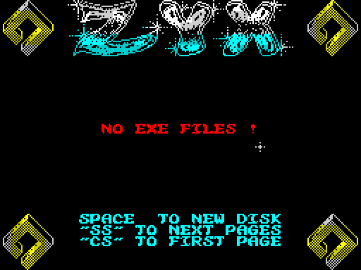
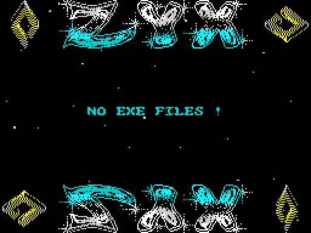
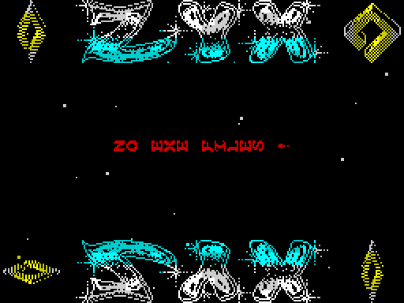
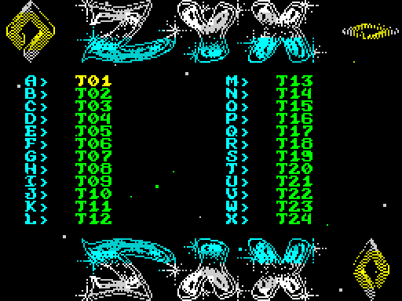
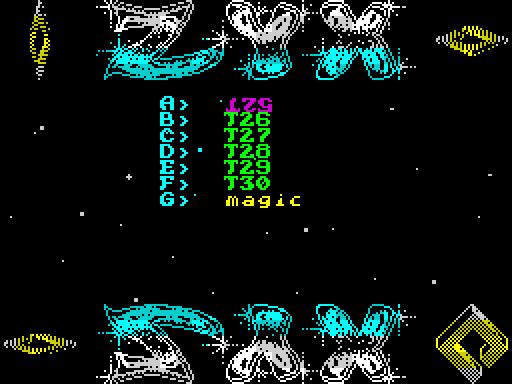
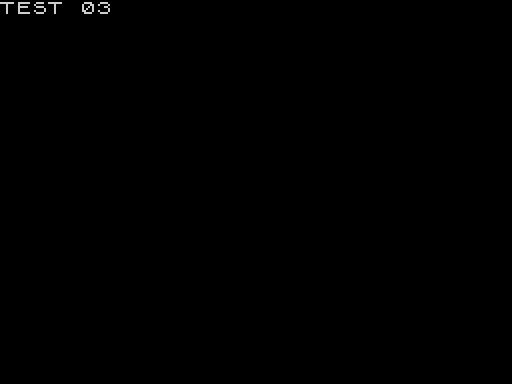

# ZYX boot: walkthrough

How the reverse was done, step by step, and which unreal-ng call answered each question. Terms:
[docs/README.md](docs/README.md). Recipes: `../recipes/`.

Every recording is a disk boot on a Pentagon 128K at the emulated drive's speed (no fast load trap); frame numbers
are the recording's.

## 0. The medium

**Which file is the original.** The inputs were the owner's 39 images (`work/candidates/owner-boots_zyx/`, 56 boot
files), an older `ZYX.SCL` and a damaged Hobeta (`owner-BOOT.zip`), and Vadim's 2010 sources with their `boot.scl`.
`tools/disk.py` (a case tool: SCL, TRD and Hobeta catalogues, bodies, BASIC listing, SCL writing) read them all.

1. Vadim's `61a8.bin`, `a600.bin` and `c000.bin` are the three pieces of his `boot.scl`'s body (15, 8 and 22
   sectors after the BASIC sector) byte for byte (`work/stage1/survey0.py`).
2. The collection index's TR-DOS file table (`index/trdos-files.tsv`, the body sha256 per file) gives that body
   (`1add29ab...`) on 42 images (`work/stage1/sha-hits.txt`, `img-vadim.txt`, `vadim-images.tsv`).
3. The 48 TOSEC "(Zyx)" compilations of 1994 (`work/stage1/zyxdisks/`, from the share's TOSEC `Compilations.zip`)
   hold ZYX's own boots: Tank and War Cars Construction Set carry exactly this body (`work/stage1/release_check.py`),
   the others its family A and family B variants.
4. None of the 56 owner variants is this body; all of them share most of its code
   ([work/stage1/variants.md](work/stage1/variants.md)). 47 of the 56 build from this case's source with only
   their own resources, music piece and constants (`tools/build.sh --all`, [variants/README.md](variants/README.md)).

So the original is Vadim's `boot.scl`, put unchanged in `orig/boot.scl`; the reasons are in
[README, the release check](README.md#the-release-check-why-this-file-is-the-original).

**The disk.** One file `boot`, B, 46 sectors: the BASIC sector, then three pieces the BASIC's loader reads itself
([doc 3, 3.1](docs/03-build-and-load.md#31-the-disk)). `tools/image.py` writes the menu's 64 K image
(`work/mkgame/original.bin`, the pieces at `$61A8` and `$A600`) and the two parts' images (`work/parts/`).

**Test disks.** The original disk has no other file, so the menu says NO EXE FILES !. `tools/mktestdisk.py` writes
`tests/disks/many.scl` (the boot, 30 BASIC programs T01-T30 each printing `TEST nn`, a 192-sector CODE file `magic`,
a 2-sector CODE file `data`: 31 names listed, more than one page) and `tests/disks/noexe.scl` (the boot and two
CODE files that are not listed).

## 1. One recording from power-on

All recordings are `re_session.py capture --disk --record-load --disk-boot-frames 100` on the case's port base
(37490), muted, with the input script in `tests/inputs/`; the sessions (`session.ttd`), the L1 builds and the
screens are in `work/stage1/cN/`. The Pentagon's 128 menu needs keys to boot TR-DOS: CAPS SHIFT + 7 (up) onto
TR-DOS, ENTER, R (RUN) and ENTER (`tests/inputs/c1.txt`, frames 0-166). The menu reads the keys on every 8th
interrupt, so every key is held 8 frames (a first c2 with 2-frame presses missed most of them).

| Recording | Disk | What it does | Frames | L1 |
| --- | --- | --- | ---: | --- |
| c1 | `orig/boot.scl` | power-on, TR-DOS, the boot; the menu idles (NO EXE FILES !) for 6000 frames, SPACE, idles | 7676 | 104-7880, 7716 interrupts |
| c2 | `tests/disks/many.scl` | SS (page 2), SS (nothing: the last page), CS (page 1), 8 8 3 8 9 7 1 4, ENTER on T03 | 4362 | |
| c3 | `tests/disks/many.scl` | SS, then F: the 6th name of page 2, T30 | 2782 | |
| c4 | `tests/disks/noexe.scl` | NO EXE FILES !, A and ENTER do nothing | 2182 | |

c1 in order (the L1 profile, `work/stage1/c1/l1.json`): TR-DOS loads `boot` and the Loader `$5D80` runs at frame
447; Start `$61A8` at 516; DrawScreen at 532-536 ([setup](docs/img/play/setup.png), frame 500 of the screens:
the logo, the rhombi, the help lines, NO EXE FILES !); the interrupt from frame 542 with the music; the rhombus phases
at 542-697 and the set-up's turns until DrawReflection at 824-890, which covers the help lines with the logo's
mirror image ([menu idle](docs/img/play/menu-idle.png), frame 1000); from frame 890 the main loop. At frame 4000 the
cursor's text is caught turned by 90 degrees ([spin](docs/img/play/name-spin.png)): the spin at Frames 50-90 of every
256. SPACE reads the catalogue again (ShowCatalogue's second call, frame 6436).

## 2. Static pass over the medium

## 3. The stages and the packers

## 4. The medium from source

## 5. Tool gaps found and fixed in unreal-ng

| Gap | Fix | unreal-ng commit |
| --- | --- | --- |

## 6. The game

Here "the game" is the menu. What the recordings showed, each against the code (`src/game`):

- **Pages.** 31 listed names make page 1 of 24 in two columns, A-L and M-X
  ([page 1](docs/img/play/page1.png), c2 frame 1500), and page 2 of 7 in one column after SS
  ([page 2](docs/img/play/page2.png), c2 frame 1750): ListCatalogue `$65C7` counts from the page's first entry, and
  ListTwoColumns `$6648` takes 24 when there are 25 or more. The yellow `magic` is the 192-sector CODE file; `data`
  (2 sectors) and the boot itself are not listed. A second SS on the last page does nothing (MorePages `$B3B9` is 0);
  CS goes back to page 1 (the check `PagePointer >= $9D01` at `$68D1`).
- **The cursor.** 8, 3 move it down, 9, 4 up, 7, 1 to the other column; its colour cycles every 4 frames
  (Interrupt `$6757`).
- **Running a file.** ENTER on T03 (c2) and F on page 2 (c3, the 6th name: T30) end with `TEST 03` and `TEST 30`
  on the screen ([launched](docs/img/play/launched.png), c2 frame 3750): RunLetter `$6A51` wrote `RUN "T03     "`
  into the BASIC's line 1 and returned to the loader ([doc 3, 3.4](docs/03-build-and-load.md#34-how-the-menu-runs-a-file)).
- **No files.** c4: NO EXE FILES !; the letter A returns at once from RunLetter (past the page's 0 files) and ENTER
  from FireKey `$6A3F`.
- **The music** plays from the first interrupt (frame 543 in c1) and is cut for a moment by every page change
  (SoundOff `$6E41` in ShowCatalogue).

## 7. Review
