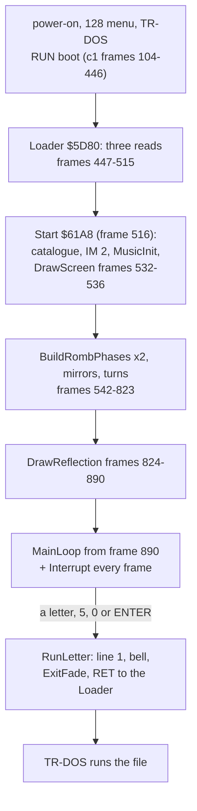
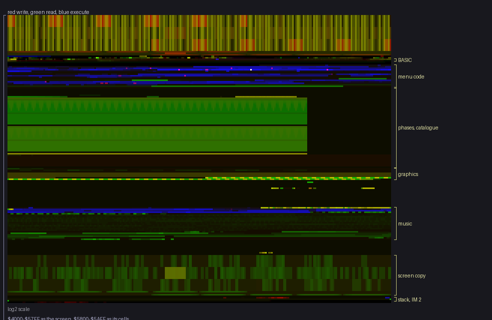

# 2. Architecture

What this covers:

- the machine budget: what the boot needs and uses;
- the memory map, loaded and built;
- the stages from the BASIC to the chosen program;
- the module map of the three `.ann` files;
- the frame: the main loop that never waits and the IM 2 interrupt, with their costs;
- the heatmap;
- what Vadim's 2010 decompilation covers and where this case differs.

The recordings it rests on: c1 (the original disk from power-on on a Pentagon 128K, TR-DOS chosen from the 128 menu,
the menu idle with NO EXE FILES !, then SPACE; L1 frames 104-7880, 557 383 670 T-states, 7716 interrupts), c2 and c3
(the test disk `tests/disks/many.scl`: pages, cursor keys, a file run), c4 (`tests/disks/noexe.scl`). Frame numbers
below are c1's ([WALKTHROUGH 1](../WALKTHROUGH.md#1-one-recording-from-power-on)). The routine costs are the L1
profile's (`work/stage1/c1/l1.json`, `routines[].profile`).

## 2.1 The machine budget

The boot needs a 48K Spectrum with TR-DOS and an AY: the code uses only `$5D3B-$FEAF` of the 48K map, no paging, and
writes the AY through ports `$FFFD`/`$BFFD` (the music, the bell, the silence). On a machine with no AY the writes go
nowhere and the menu works silent. It needs TR-DOS twice: to read the catalogue (Start, and SPACE) and to run the
chosen file (the BASIC's line 1). The case runs a Pentagon 128K (`case.json` device `ZXSPECTRUM48` for the image,
the recordings on the Pentagon): 71 680 T-states a frame, no contention.

## 2.2 The memory map

| Range | Loaded | What | Module / part |
| --- | --- | --- | --- |
| `$4000-$5AFF` | | the screen | |
| `$5C00-$5D3A` | | the ROM's and TR-DOS's variables (FRAMES `$5C78`, CHARS `$5C36`, `$5CF4`) | |
| `$5D3B-$5E3A` | sector 0 | the BASIC program and the Loader in line 4's REM | `src/basic` |
| `$61A8-$6ADC` | sectors 1-15 | the code: set-up, main loop, rhombi, stars, screen, catalogue, interrupt, keys, launcher | `src/game` |
| `$6ADD-$6BA4` | | the small tables: PhaseOrder, MenuHelp, NoFilesText, KeyTable, BootName, RombColumnOrder, RombPhaseOffsets | `src/game` |
| `$6BA5-$6E97` | | the code: twinkles, corners, glint, reflection, sound, exit fade | `src/game` |
| `$6E98-$705F` | | RombSource (200), TwinkleSprites (128), 128 zeros | `src/game` |
| `$7060-$70A7` | | zeros to the 15th sector's end | `src/game` |
| `$70A8-$75FF` | never | zeros (SoundOff reads `$7530-$753D` as "silence") | buffers |
| `$7600-$77C7` | never | the phase builder's copies and work: RombColumns, RombOffsets, RombThreshold, PhaseMask, PhaseOffset, RombWork | buffers |
| `$7800-$88FF` | never | rhombus set A: PhasesA (phases 0-8), MirrorsA (9-16), 256 bytes a phase | buffers |
| `$8A00-$9AFF` | never | rhombus set B: PhasesB, MirrorsB | buffers |
| `$9C00-$9CC7` | never | RotateBuffer | buffers |
| `$9D00-$A4FF` | never | Catalogue: track 0, sectors 0-7 | buffers |
| `$A600-$ADFF` | sectors 16-23 | Font, Logo, LogoAttributes, StarsA/B/C, Randoms, CornerColours | `src/game` graphics |
| `$AFC8-$AFCE` | never | SavedIY, SavedHLAlt, SavedSP, SavedI | equates |
| `$B3B0-$B3F4` | never | the menu's variables (MainTick, the four rhombus steps, the page and cursor state, EntryLine, the name spin) | equates |
| `$C000-$D5FF` | sectors 24-45 | ASC Sound Master (`$C000-$C477`) and the tune (`$C478-$D592`) | `src/music` |
| `$DEA8-$DEB0` | never | the twinkle's and the spin's variables | equates |
| `$E000-$FAFF` | never | ScreenCopy: the clean screen the twinkles, the glint and the spin restore from | equates |
| `$FCBC` | | the menu's stack top (grows down from `$FCBB`) | |
| `$FCFC-$FE00` | never | Im2Jump (`JP Interrupt`), Im2Table (257 bytes of `$FC`, I = `$FD`) | equates |

The loader clears `$61A8-$FEAF` before and after the menu, so every "never loaded" area starts as zeros.

## 2.3 The stages

The interrupt is on from frame 542 (its first run), so the music plays and the twinkles start while the phases are
still being built: the screen at frame 604 ([setup](img/play/setup.png)) still shows the help lines, which
DrawReflection covers at frame 824-890 with the logo's mirror image ([menu idle](img/play/menu-idle.png)). The help
lines are never seen again: the reflection is drawn into ScreenCopy too, and every page is drawn from it. BuildRombPhases
takes 8 954 321 T-states for its two calls (125 frames), DrawReflection 4 688 343.

## 2.4 The module map

| Part | Module | What | Entries |
| --- | --- | --- | --- |
| `src/basic` | basic | the BASIC lines, Loader `$5D80`, the autostart mark, the sector's tail | 9 |
| `src/game` | setup | Start `$61A8`, MainLoop `$627C` | 2 |
| | rhombi | BuildRombPhases `$62F1` and its helpers, MirrorSprite, RotateSprite, PrintRombPhase, PrintSprite, the phase tables, RombSource | 13 |
| | stars | SampleStars, MoveStars, TwinkleStar, NewRandoms, DrawTwinkle, CheckTwinkleSpot, EraseTwinkle, TwinkleSprites | 10 |
| | screen | DrawScreen `$6510`, ShowCatalogue, ListCatalogue, ListTwoColumns, PrintColumn, CursorAttrAddr, ClearFilesArea, the cursor keys | 13 |
| | font | PrintString `$6720`, MenuHelp, NoFilesText | 3 |
| | catalogue | IsBootFile, SkipDeleted, BootName | 3 |
| | interrupt | Interrupt `$6757`, RotateCursorName, ShowRotatedName, InterruptExit, CopyNameToScreen | 5 |
| | keys | ReadKeyboard `$6864`, KeyTable | 2 |
| | launcher | FireKey, RunLetter `$6A51` | 2 |
| | fade | ColourCorners, ColourCornerRows, ColourCornerColumns, ExitFade | 4 |
| | logo | LogoGlint `$6D04` and its helpers, DrawReflection, FlipSprite | 7 |
| | sound | SoundOff, PlayBell, WriteAY, ExitSound | 4 |
| | buffers | the never-loaded work space `$70A8-$A5FF` | 19 |
| | graphics | Font, Logo, LogoAttributes, StarsA, Randoms, CornerColours | 7 |
| `src/music` | player | the jump table, MusicInit `$C00B`, MusicPlay `$C00E`, MusicStop `$C011`, the channel state, the period table | 32 |
| | tune | "Disco music" by Ant P in ASC Sound Master's format (`src/res/music/disco.txt`) and the sector's tail | 9 |

## 2.5 The frame: a main loop that never waits, and the interrupt

MainLoop `$627C` has no HALT. It counts MainTick and on every 2nd pass moves StarsA and StarsB two rows, on every 4th
turns the two top rhombi one step and moves StarsC, on every 8th turns the two bottom rhombi. In c1, from frame 890
to 7879 (6990 frames), MoveStars ran 34 273 times and PrintRombPhase 11 424 times: 15 232 passes, 2.2 passes a frame.
A top rhombus makes its 32-step turn in about 59 frames, a bottom one in about 118. On a slower machine (contended
memory, a 48K) everything in the main loop runs slower; nothing in it is tied to the frame.

```mermaid
flowchart LR
    I["IM 2: Im2Jump $FCFC"] --> A["save all, HL' and IY for the ROM"]
    A --> M["CALL $C00E: the music"]
    M --> F["Frames + 1<br/>TwinkleClock + 2"]
    F --> T["TwinkleStar"]
    T --> G["LogoGlint<br/>(Frames 0-63 of 256)"]
    G --> C["every 4th: the cursor's colour"]
    C --> R["Frames 50/60/70/80/90:<br/>the name's spin"]
    R --> K["every 8th: ReadKeyboard"]
    K --> E["restore, EI, RET"]
```

The interrupt's main costs in c1 (7274 calls each unless said, inclusive T-states):

| Routine | T-states | A frame | Share of the 71 680 |
| --- | ---: | ---: | ---: |
| the music, `$C00E` | 49 741 659 | 6838 | 9.5 % |
| TwinkleStar `$6BA5` | 9 811 510 | 1349 | 1.9 % |
| ReadKeyboard `$6864` (909 calls) | 7 729 110 | 1063 | 1.5 % |
| LogoGlint `$6D04` | 4 079 700 | 561 | 0.8 % |

So the interrupt takes about a seventh of the frame; the main loop has the rest, and MoveStars alone takes 397 066 343
T-states of c1 (71 %), PrintRombPhase 99 599 773 (18 %).

## 2.6 The heatmap

`$4000-$FFFF` over c1, one row 256 bytes (`kit/heatmap.py work/stage1/c1/l1.json ... --from 4000 --to FFFF
--regions work/stage2/regions.txt`, the composite panel). The screen at the top is written and read everywhere (the
stars, the rhombi, the twinkles). The menu's code (`$61A8-$70A7`) is blue; the phase sets are the two wide green
blocks below it (read by PrintRombPhase every pass), with the catalogue under them. The graphics piece is read once
(DrawScreen, the star tables all the time). The music (`$C000`) is the player in blue and the tune read in green.
ScreenCopy (`$E000-$FAFF`) is read in spots: the twinkles' and the glint's restores. The stack and the IM 2 table
are the thin line at the bottom.

## 2.7 Vadim's decompilation and where this case differs

Vadim's `ZYXboot.mac` (M80 syntax, Russian comments, "Decompiled by Vadim (C) July 2010, (C) Unknown Author
1991-1993") covers the menu `$61A8-$705F` and lists the graphics piece's layout as equates; it assembles with
sjasmplus (after renaming five case-mismatched labels, `work/stage2/vadim.asm`) to this image's bytes exactly. Its
`61A8.MAC` is not a music player: it is a raw disassembler listing of the same piece
(`ORG 61A8H`, its code, storage and table ranges up to `$70A7`, an unresolved-symbol table), the decompilation's
first step. The decompilation has
no source for the BASIC sector or the music. This case kept its structure, renamed most labels to say what they do
(its `Z6xxx` labels are addresses, and several names were wrong or Russian-English mixtures), and corrected what the
code says otherwise: the "ZYX sprites" of its comments are the rotating rhombi (`RombSource`), the logo is four
sprites of which the Z takes two, `Fade*ATTR` paint the corner gradients rather than fade, the `PrintZYXdown` image
covers the help lines, the edge-on phase is always blank, and `SoundOff` silences the AY with zeros it reads from the
never-loaded `$7530`. Every name and the reason for each change: `work/stage2/NOTES.md`.
