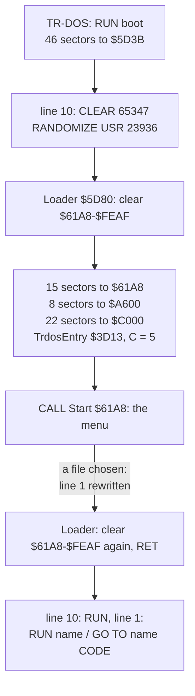
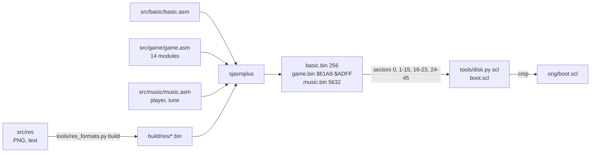

# 3. Build and load

What this covers: the disk and its one file, the BASIC program and the loader in its REM, how the three pieces reach
memory, how the menu hands the chosen file back to TR-DOS, and the source build. The recordings it rests on: c1 (the
original disk from power-on, TR-DOS chosen from the 128 menu, frames 104-7880), c2 and c3 (the test disk
`tests/disks/many.scl`, a file run), c4 (`tests/disks/noexe.scl`); all four on a Pentagon 128K with the disk read
at the emulated drive's speed ([WALKTHROUGH 1](../WALKTHROUGH.md#1-one-recording-from-power-on)).

## 3.1 The disk

`orig/boot.scl` (11 803 bytes) is an SCL image with one file:

| Name | Type | Start | Length | Sectors |
| --- | --- | ---: | ---: | ---: |
| `boot` | B (BASIC) | 180 | 180 | 46 |

For a BASIC file TR-DOS keeps the program and variables length in the start field and the program length in the
length field: here both are 180 (no variables). The 46 sectors are 11 776 bytes; only the first 180 are the BASIC
program. `tools/disk.py list orig/boot.scl` prints the catalogue, `tools/disk.py basic` lists the program.

| Sectors of `boot` | Bytes | Goes to | What | Source |
| --- | ---: | --- | --- | --- |
| 0 | 256 | `$5D3B` (PROG) | the BASIC program (180 bytes), the autostart mark, 72 leftover bytes | `src/basic` |
| 1-15 | 3840 | `$61A8-$70A7` | the menu's code and its small tables | `src/game` (modules setup to sound) |
| 16-23 | 2048 | `$A600-$ADFF` | the font, the logo, its attributes, the star tables, the corner colours | `src/game` (module graphics) |
| 24-45 | 5632 | `$C000-$D5FF` | ASC Sound Master and the tune "Disco music" by Ant P | `src/music` |

## 3.2 The BASIC program

TR-DOS loads the whole file at PROG `$5D3B` and starts the program at line 10, the line written after the autostart
mark `$80 $AA $0A $00` at `$5DEF`:

```basic
  1 RANDOMIZE USR VAL "15619": REM : RUN "        "
  2 RANDOMIZE USR VAL "15619": REM : RUN
  3 RANDOMIZE USR VAL "15616"
  4 REM (69 bytes of machine code)
 10 BORDER NOT PI: PAPER NOT PI: INK VAL "7": CLEAR VAL "65347": RANDOMIZE USR VAL "23936": RUN
```

Line 10 sets the colours and RAMTOP (`$FF43`) and calls 23936, `$5D80`: Loader, the code in line 4's REM
(`src/basic/basic.ann`). When the loader returns, line 10's `RUN` restarts the program at line 1:
`RANDOMIZE USR 15619` is TR-DOS's entry for a command in a BASIC line, and the command after the `REM :` is the one
the menu wrote there (3.4). Lines 2 and 3 are fallbacks no recording reaches. The 72 bytes after the autostart mark
are what was in memory when the file was saved (`oot27" LINE 10` reads like the end of a `SAVE "boot27" LINE 10`);
the build reproduces them.

## 3.3 The loader: how the code arrives in memory



Loader `$5D80` (24 instructions, run once in each of c1-c4):

1. `LDIR` of `$9D08` zeros over `$61A8-$FEAF`: everything the menu uses, the gaps it builds its tables in included.
2. Three reads through the TR-DOS ROM entry `$3D13` with C = 5, each starting at the track and sector in `$5CF4`
   (TR-DOS's next sector, left after the program's own load): 15 sectors to `$61A8`, 8 to `$A600`, 22 to `$C000`.
   The file is never addressed by its catalogue entry, so the boot works wherever TR-DOS put it, as long as the 46
   sectors follow each other.
3. `CALL $61A8`: the menu (doc 2). It returns only once a file is chosen, with the caller's SP that Start saved.
4. The same clear again, then `RET` to BASIC.

The pieces leave holes: `$70A8-$A5FF` (13 912 bytes) and `$AE00-$BFFF` are not loaded. Start fills the first with
the rhombus phases and the catalogue ([doc 2, 2.2](02-architecture.md#22-the-memory-map)); its variables live in the
second (`$AFC8-$AFCE`, `$B3B0-$B3F4`).

## 3.4 How the menu runs a file

The menu does not load anything itself. RunLetter `$6A51` (`src/game/launcher.asm`) writes into line 1 of the BASIC
program in memory:

| Address | Byte in the image | Written |
| --- | --- | --- |
| `$5D4C` LaunchToken | `$F7` RUN | `$F7` RUN for a BASIC file, `$EC` GO TO for a 192-sector CODE file |
| `$5D4E-$5D55` LaunchName | 8 spaces | the file's name from the catalogue |
| `$5D57` LaunchSuffix | a space | a space, or `$AF` CODE |

So line 1 becomes `RANDOMIZE USR VAL "15619": REM : RUN "T03     "` (c2), or `... GO TO "magic   " CODE` for a CODE
file of exactly 192 sectors (48K: TR-DOS's GO TO loads a snapshot saved with the Magic button). Then the menu puts
back I, HL', IY and SP, rings the bell, fades the screen, switches to IM 1 and returns to the loader. c2 ends with
`TEST 03` on the screen ([launched](img/play/launched.png)), c3 with `TEST 30`: the programs T03 and T30 of the test
disk, chosen with ENTER on the cursor and with the letter F on the second page.

## 3.5 The build

`tools/build.sh [SJASMPLUS]` rebuilds `orig/boot.scl` byte for byte:



The `.asm` files are written by `kit/mkgame.py` from the three `.ann` files (`case.json` for the menu,
`src/basic/basic.json`, `src/music/music.json`); each run checks that the assembly gives the original bytes. The SCL
writer (`tools/disk.py scl`) pads the body to whole sectors and appends the SCL checksum (the sum of every byte
before it, 32 bits): the result is identical to `orig/boot.scl` (the build prints
`build: boot.scl identical to orig/boot.scl`).

The same build makes the owner's variants: `tools/build.sh --variant NAME` copies `src/res` with the files of
`variants/NAME/` over it, sets the variant's constants in the generated top files (the music piece's address, sectors
and entries, MusicInit `$C00B` and MusicPlay `$C00E` in the original; MenuStack, Im2Table, ScreenCopy where a variant
moves them), applies its code switches, takes its music piece and, when it has one, its own BASIC sector, and compares
the boot file with the candidate image; `tools/build.sh --all` does all 56 (47 identical,
[variants/README.md](../variants/README.md)).
