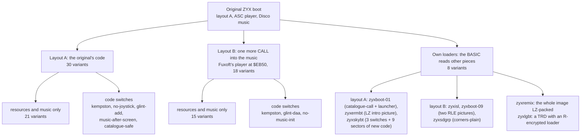
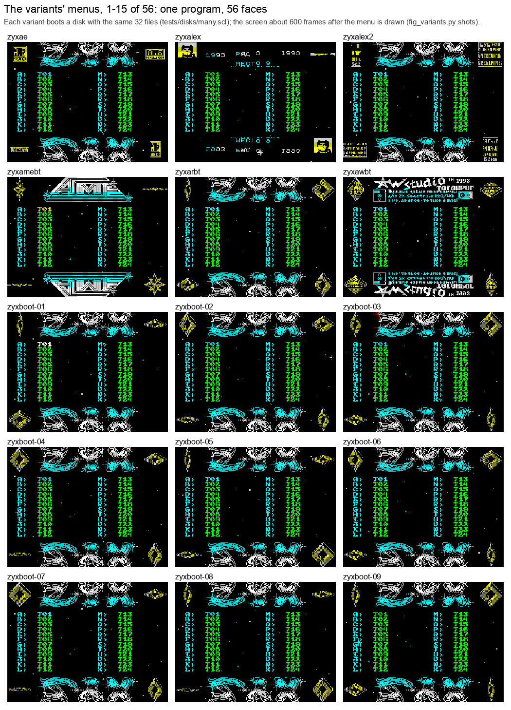
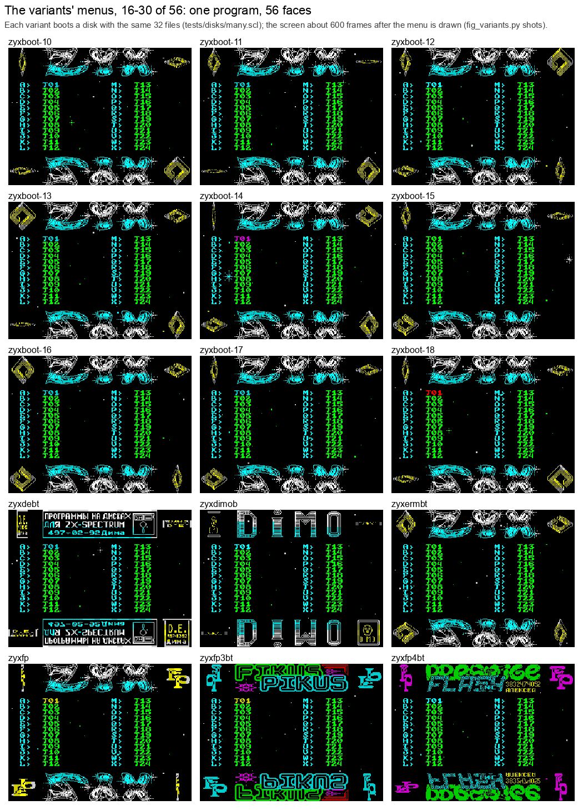
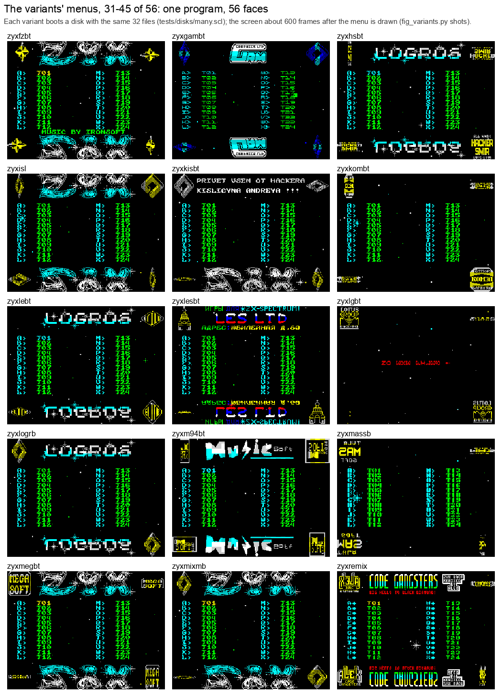
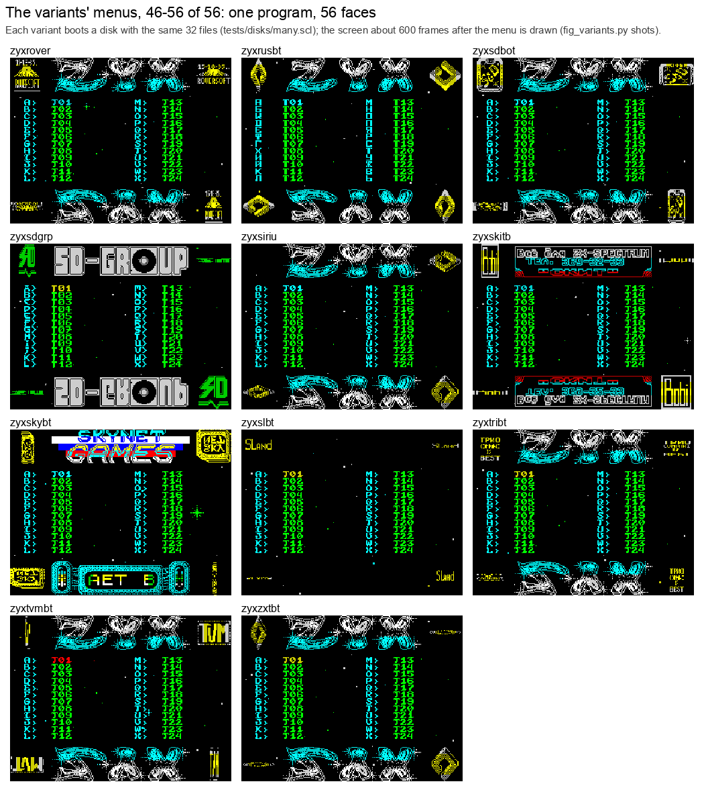
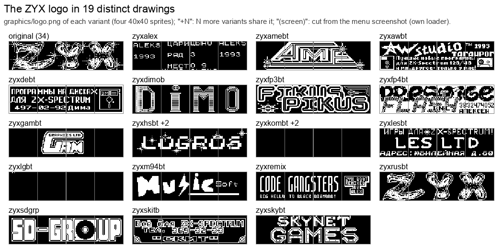
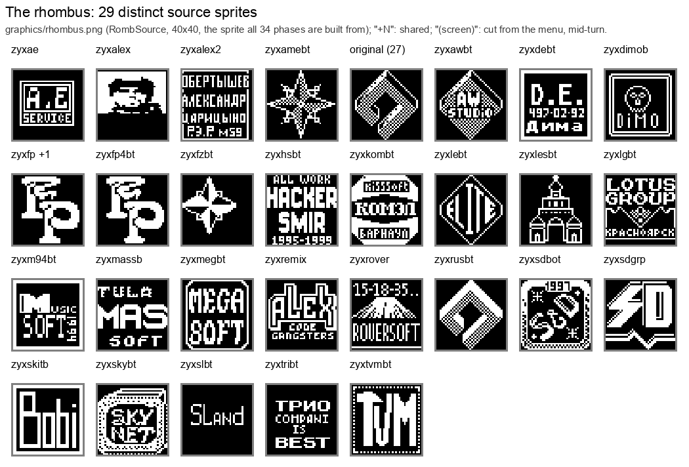
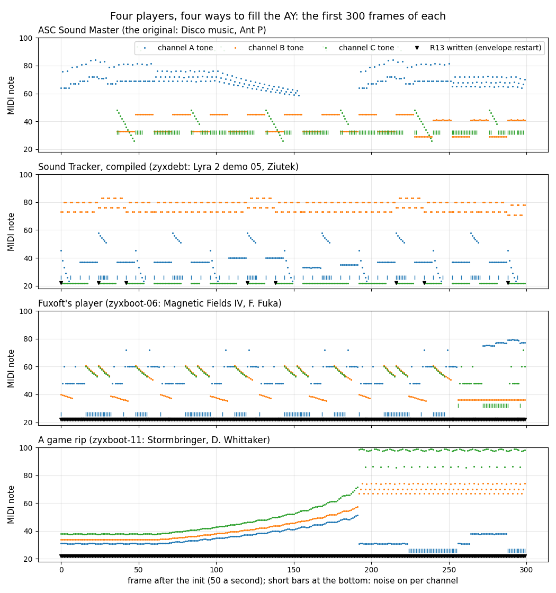

# 13. The variants

ZYX boot was copied, redrawn and re-scored for years. The owner's collection holds 56 boot files built on the same
menu program (`work/candidates/owner-boots_zyx`: 38 images, and 18 boots on `zyxboot.scl`). This document shows what
the copies changed, how each one is built from this case's source, and which tune each plays.

What this covers:

- the family: two code layouts, the code switches, the own loaders (13.1);
- all 56 in one table: who, layout, what differs, the tune, the build (13.2);
- the menus side by side (13.3), the logos and the rhombi (13.4);
- layout B and every code switch, with its asm (13.5, 13.6);
- the own loaders: pieces, parts, residue (13.7);
- the players and the tunes, with an MP3 of each distinct tune (13.8);
- the three hardest: a packed image, an encrypted loader, a rewritten menu (13.9);
- how to build and check them (13.10).

Each variant is a folder `variants/NAME` that holds only what differs from the original
([variants/README.md](../variants/README.md)); `tools/build.sh --variant NAME` builds it from `src/` plus that
folder and compares the result with the candidate file byte for byte.

**56 of 56 build identical**, and every tune is text.

## 13.1 The family



*Figure 13.1. The family tree of the 56 boots. How to read: every box below the original is a way of changing it; the
counts are variants. The point: one program; the copies differ in drawings, music, a handful of code switches and
a few parts of their own, never in a second copy of the code.*

The counts: layout A with the original's loader is 30 boots (9 of them with a code switch), layout B 18 (3 with a
switch), the own loaders 8 (zyxsdgrp, zyxisl and zyxboot-09 run layout B code, the others layout A). zyxtvmbt keeps
the original's loader (with other sector counts) and adds a routine of its own in a part, so it counts under
layout A.

## 13.2 All 56

Group: the name the variant's logo or rhombus shows (Figures 13.6 and 13.7); "-" when it keeps the original's
drawings. What differs: the resource files (same names and formats as `src/res`), the code switches (13.6) and the
moved work areas (`MenuStack`, the IM 2 table). Tune: title, author, year when the tune names one; then the player.
Identification and the readable form of each piece: `src/res/music/README.md` and 13.8.

| Variant | Group | Layout | What differs | Tune; player | Build |
| --- | --- | --- | --- | --- | --- |
| [zyxae](../variants/zyxae/README.md) | A.E. Service | B | rhombus | Tune 12 (Fuxoft); Fuxoft (F. Fuka) | identical |
| [zyxalex](../variants/zyxalex/README.md) | Aleks, Tsaritsyno market (row 3, place 9), 1993 | B | font, logo, logo colours, rhombus, IM 2 table moved | Hydrofool - In-Game (AY) (Rob Hubbard); game rip: Hydrofool (Rob Hubbard) | identical |
| [zyxalex2](../variants/zyxalex2/README.md) | A. Obertyshev, Tsaritsyno | A | rhombus | lyra4; Sound Tracker (compiled) | identical |
| [zyxamebt](../variants/zyxamebt/README.md) | AMT | B | logo, logo colours, rhombus | Tune 5 (Fuxoft); Fuxoft (F. Fuka) | identical |
| [zyxarbt](../variants/zyxarbt/README.md) | - | A | moved MenuStack | E.S.I. (Ziutek); Sound Tracker (compiled) | identical |
| [zyxawbt](../variants/zyxawbt/README.md) | A.W. Studio, Taganrog, 1993 | A | BASIC, help text, logo, rhombus | Altered Beast (Paul Hiley), 1989; game rip: Altered Beast | identical |
| [zyxboot-01](../variants/zyxboot-01/README.md) | - | A | own loader, BASIC, stars, code of its own (`parts/`), `kempston`, `catalogue-call` | Techno Project II (Heather), 1994; ASC Sound Master 1.x layout | identical |
| [zyxboot-02](../variants/zyxboot-02/README.md) | - | B | resources only | Indiana Jones 3 - Title (AY) (Frantisek Fuka); Fuxoft (F. Fuka) | identical |
| [zyxboot-03](../variants/zyxboot-03/README.md) | - | B | `kempston`, `glint-daa` | Terra Cresta (Frantisek Fuka); Fuxoft (F. Fuka) | identical |
| [zyxboot-04](../variants/zyxboot-04/README.md) | - | B | `kempston` | F.I.R.E. (a variant of the rip) (Frantisek Fuka), 1988; Fuxoft (F. Fuka) | identical |
| [zyxboot-05](../variants/zyxboot-05/README.md) | - | A | BASIC | Platoon Tunnel Network (David Whittaker); game rip: Platoon (David Whittaker) | identical |
| [zyxboot-06](../variants/zyxboot-06/README.md) | - | B | resources only | Magnetic Fields IV (Frantisek Fuka); Fuxoft (F. Fuka) | identical |
| [zyxboot-07](../variants/zyxboot-07/README.md) | - | B | resources only | E.T. Flying (Frantisek Fuka); Fuxoft (F. Fuka) | identical |
| [zyxboot-08](../variants/zyxboot-08/README.md) | - | A | BASIC | Platoon; game rip: Platoon (David Whittaker) | identical |
| [zyxboot-09](../variants/zyxboot-09/README.md) | - | B | own loader, BASIC, code of its own (`parts/`) | Feud (Frantisek Fuka); Fuxoft (F. Fuka) | identical |
| [zyxboot-10](../variants/zyxboot-10/README.md) | - | A | `no-joystick` | Fantasy World Dizzy (David Whittaker); game rip: Fantasy World Dizzy (David Whittaker) | identical |
| [zyxboot-11](../variants/zyxboot-11/README.md) | - | A | BASIC | Stormbringer Title/In-Game (David Whittaker); game rip: Stormbringer (David Whittaker) | identical |
| [zyxboot-12](../variants/zyxboot-12/README.md) | - | A | `no-joystick` | Subway Vigilante Title (Ian Sheridan); game rip: Subway Vigilante (Ian Sheridan) | identical |
| [zyxboot-13](../variants/zyxboot-13/README.md) | - | B | resources only | Magnetic Fields V (Frantisek Fuka); Fuxoft (F. Fuka) | identical |
| [zyxboot-14](../variants/zyxboot-14/README.md) | - | A | BASIC | AXEL-FORCE (OLEG KRASNOBAEV OKO); ASC Sound Master (later compilation) | identical |
| [zyxboot-15](../variants/zyxboot-15/README.md) | - | A | BASIC | GREAT COMMANDMENT (ASC + OKO (NEW EDGE)), 1993; ASC Sound Master (later compilation) | identical |
| [zyxboot-16](../variants/zyxboot-16/README.md) | - | A | BASIC | Ritm4_II (ANDREW SENDETSKI ASC), 1993; ASC Sound Master (later compilation) | identical |
| [zyxboot-17](../variants/zyxboot-17/README.md) | - | A | BASIC | RIPPED BY D.O.C. (ANDREW SENDETSKI ASC); ASC Sound Master (later compilation) | identical |
| [zyxboot-18](../variants/zyxboot-18/README.md) | - | A | BASIC | LET'S DANCE, BABY ! (ANDREW SENDETSKI ASC); ASC Sound Master (later compilation) | identical |
| [zyxdebt](../variants/zyxdebt/README.md) | Dima ("programs on disks") | A | help text, logo, rhombus | The Lyra 2 Demo 05 (Ziutek (Ethanol)), 1992; Sound Tracker (compiled) | identical |
| [zyxdimob](../variants/zyxdimob/README.md) | DIMO | B | BASIC, help text, logo, rhombus, `kempston`, `no-music-init` | Mega Apocalypse (Rob Hubbard); game rip: Mega Apocalypse | identical |
| [zyxermbt](../variants/zyxermbt/README.md) | - | A | own loader, BASIC, help text, stars, code of its own (`parts/`) | Disco music (Ant P); ASC Sound Master (the original's) | identical |
| [zyxfp](../variants/zyxfp/README.md) | FP | A | rhombus | Disco music (Ant P); ASC Sound Master (the original's) | identical |
| [zyxfp3bt](../variants/zyxfp3bt/README.md) | Fikus Pikus | A | corner colours, font, logo, logo colours, rhombus | Marauder (Dave Rogers), 1988; game rip: Marauder | identical |
| [zyxfp4bt](../variants/zyxfp4bt/README.md) | Paradise (Aleksei) | A | corner colours, logo, logo colours, rhombus, `kempston` | Part V (Ziutek of ESI); own player (Part V, Ziutek of ESI) | identical |
| [zyxfzbt](../variants/zyxfzbt/README.md) | - | A | BASIC, help text, rhombus, `music-after-screen` | FREEZERO (Ironman); Sound Tracker (compiled) | identical |
| [zyxgambt](../variants/zyxgambt/README.md) | GAM Graphics Ltd | B | corner colours, font, help text, logo, logo colours | Magnetic Fields IV (Frantisek Fuka); Fuxoft (F. Fuka) | identical |
| [zyxhsbt](../variants/zyxhsbt/README.md) | Logros; Hacker SMIR 1995-1999 | A | logo, logo colours, rhombus, `kempston`, `glint-add` | The Lyra 2 Demo 08 (Ziutek (Ethanol)), 1992; Sound Tracker (compiled) | identical |
| [zyxisl](../variants/zyxisl/README.md) | - | B | own loader, BASIC, code of its own (`parts/`) | Feud (Frantisek Fuka); Fuxoft (F. Fuka) | identical |
| [zyxkisbt](../variants/zyxkisbt/README.md) | - | B | help text | Axel F. Theme (Frantisek Fuka); Fuxoft (F. Fuka) | identical |
| [zyxkombt](../variants/zyxkombt/README.md) | KISSoft, Barnaul | A | font, logo, rhombus | lyra4; Sound Tracker (compiled) | identical |
| [zyxlebt](../variants/zyxlebt/README.md) | Logros; Elite | A | logo, logo colours, rhombus, `kempston` | The Lyra 2 Demo 08 (Ziutek (Ethanol)), 1992; Sound Tracker (compiled) | identical |
| [zyxlesbt](../variants/zyxlesbt/README.md) | LES Ltd | A | logo, logo colours, rhombus | MIKROPOL (ST COMPILE); Sound Tracker (compiled) | identical |
| [zyxlgbt](../variants/zyxlgbt/README.md) | Lotus Group | A | own loader, BASIC, logo, logo colours, rhombus, code of its own (`parts/`), moved MenuStack | E.S.I. (Ziutek); Sound Tracker (compiled) | identical |
| [zyxlogrb](../variants/zyxlogrb/README.md) | Logros | A | logo, logo colours, `kempston`, `glint-add` | The Lyra 2 Demo 08 (Ziutek (Ethanol)), 1992; Sound Tracker (compiled) | identical |
| [zyxm94bt](../variants/zyxm94bt/README.md) | Music Soft, 1994 | A | help text, logo, rhombus | Kent (Kent); Sound Tracker (compiled) | identical |
| [zyxmassb](../variants/zyxmassb/README.md) | MAS Soft, Tula | A | font, help text, logo, logo colours, rhombus | Disco music (Ant P); ASC Sound Master (the original's) | identical |
| [zyxmegbt](../variants/zyxmegbt/README.md) | Mega Soft | B | rhombus | Magnetic Fields IV (Frantisek Fuka); Fuxoft (F. Fuka) | identical |
| [zyxmixmb](../variants/zyxmixmb/README.md) | - | B | help text | Monty On The Run (Frantisek Fuka); Fuxoft (F. Fuka) | identical |
| [zyxremix](../variants/zyxremix/README.md) | Code Gangsters ("ZYX boot remixed by Alex") | A | own loader, BASIC, font, logo, logo colours, rhombus, stars, code of its own (`parts/`) | KSA (Ksa); Sound Tracker (compiled), inside the packed image | identical |
| [zyxrover](../variants/zyxrover/README.md) | Roversoft | A | help text, rhombus | Pacmania; game rip: Pac-Mania (Ben Daglish) | identical |
| [zyxrusbt](../variants/zyxrusbt/README.md) | ZYX logo redrawn | A | font, help text, logo, rhombus, moved MenuStack | E.S.I. (Ziutek); Sound Tracker (compiled) | identical |
| [zyxsdbot](../variants/zyxsdbot/README.md) | 1997 (rhombus) | B | help text, rhombus | Magnetic Fields IV (Frantisek Fuka); Fuxoft (F. Fuka) | identical |
| [zyxsdgrp](../variants/zyxsdgrp/README.md) | SD-Group | B | own loader, BASIC, font, logo, logo colours, rhombus, `corners-plain` | Where Time Dropped Dead (Frantisek Fuka); Fuxoft (F. Fuka) | identical |
| [zyxsiriu](../variants/zyxsiriu/README.md) | - | A | help text, `no-joystick` | In-Game (David Whittaker); game rip: Fantasy World Dizzy (David Whittaker) | identical |
| [zyxskitb](../variants/zyxskitb/README.md) | SKIT (Bobi) | A | help text, logo, logo colours, rhombus, stars | The Lyra 2 Demo 05 (Ziutek (Ethanol)), 1992; Sound Tracker (compiled) | identical |
| [zyxskybt](../variants/zyxskybt/README.md) | Skynet Games | A | own loader, BASIC, corner colours, help text, logo, logo colours, rhombus, code of its own (`parts/`), `sky-rotate-buffer`, `sky-stars`, `sky-screen` | Stracker (Jaroslaw Byrczynski), 1990; Sound Tracker (compiled) | identical |
| [zyxslbt](../variants/zyxslbt/README.md) | SLand | B | font, logo, rhombus | FIRE (Frantisek Fuka); Fuxoft (F. Fuka) | identical |
| [zyxtribt](../variants/zyxtribt/README.md) | Trio Company | B | rhombus | Magnetic Fields IV (Frantisek Fuka); Fuxoft (F. Fuka) | identical |
| [zyxtvmbt](../variants/zyxtvmbt/README.md) | TVM | A | rhombus, code of its own (`parts/`), `catalogue-safe` | MARK 800 (notes); Sound Tracker (compiled), LZ-packed | identical |
| [zyxzxtbt](../variants/zyxzxtbt/README.md) | - | B | help text | Fugue (Frantisek Fuka); Fuxoft (F. Fuka) | identical |

## 13.3 The menus side by side

Each variant booted (unreal-qt, Pentagon 128K, muted) a disk made of its boot file and the same 32 other files
(`tests/disks/many.scl`), so every menu lists the same catalogue; the shot is about 600 frames after the menu is drawn
(`tools/fig_variants.py shots`, then `sheets`).



*Figure 13.2. Variants 1-15. How to read: one tile a variant, its name above; the catalogue is the same in every tile,
so what changes is the variant's own: the logo (rows 0-4), the corner rhombi, the colours, the help text. The point:
the layout of the menu (logo, two columns, rhombi in the corners, reflection) stays in all 56.*



*Figure 13.3. Variants 16-30. How to read: as Figure 13.2. The point: the zyxboot-NN boots (one collection disk)
keep the ZYX logo and change the tune and the rhombus.*



*Figure 13.4. Variants 31-45. How to read: as Figure 13.2. The point: the sellers' and groups' copies put their name in
the logo and their phone or address in the help text.*



*Figure 13.5. Variants 46-56. How to read: as Figure 13.2. zyxlgbt shows the Lotus Group menu with "NO EXE FILES !":
its TRD holds only the boot. The point: even the own loaders end in the same menu.*

## 13.4 The logos and the rhombi



*Figure 13.6. Every distinct `graphics/logo.png` (four 40x40 sprites). How to read: one tile a drawing, labelled with
the first variant that has it and "+N" for the others; "(all paper)" is a logo resource with no ink. The point: the
logo is the signature: each drawing besides the original's names a seller or a group.*



*Figure 13.7. Every distinct `graphics/rhombus.png` (RombSource, the 40x40 sprite all 34 turning phases are built
from by BuildRombPhases). How to read: as Figure 13.6. The point: the rhombus is the second signature; many copies kept
the ZYX logo and put their name only here (A.E. Service, Mega Soft, Roversoft, Trio Company, TVM).*

## 13.5 Layout B

Layout B adds one CALL after the music's init. It is the 3 bytes the Fuxoft player needs (its init at `$EB53` sets
the tune, its start at `$EB50` resets the channels); every later address of the code piece moves by 3:

```asm
; src/game/setup.asm, layout A (the original)       ; layout B (tools/variants.py add_start)
  CALL MusicInit          ; $C00B                     CALL MusicInit          ; $EB53
  CALL DrawScreen                                     CALL MusicStart         ; $EB50
                                                      CALL DrawScreen         ; 3 bytes later
```

`add_start` inserts the CALL and moves every `ORG` of the code piece after Start by 3; the labels follow, so
the rest of the source is unchanged. Most B variants also move two work areas to make room for the player at
`$EB50-$F01B` and its data from `$F01C`: the stack (`MenuStack` `$BF68` for `$FCBC`) and the screen copy
(`ScreenCopy` `$C000`, `ScreenCopyHigh` `$80`). zyxalex also moves the IM 2 table (`Im2Table`, `Im2Jump`),
zyxgambt the glint's limits (`GlintEdge`, `GlintCentre`). These are `equ` values in `variant.json`, not code.

## 13.6 The code switches

A code switch is a named edit of `src/game/*.asm` that a variant lists in `variant.json` `code`
(`tools/variants.py` `CODE_SWITCHES`: a regular expression and its replacement, one or several modules). No
variant has its own copy of the code.

| Switch | Variants | What it does |
| --- | --- | --- |
| `kempston` | zyxboot-01, -03, -04, zyxdimob, zyxfp4bt, zyxhsbt, zyxlebt, zyxlogrb | reads the Kempston joystick |
| `no-joystick` | zyxboot-10, -12, zyxsiriu | the dormant joystick block is zeros |
| `glint-add` | zyxhsbt, zyxlogrb | the glint's half tested with ADD |
| `glint-daa` | zyxboot-03 | one damaged byte in LogoGlint |
| `no-music-init` | zyxdimob | the music is never initialised |
| `music-after-screen` | zyxfzbt | the music starts after DrawScreen |
| `catalogue-call` | zyxboot-01 | the catalogue read moved into a routine before Start |
| `corners-plain` | zyxsdgrp | the corners in one colour |
| `catalogue-safe` | zyxtvmbt | the catalogue read through an error trap |
| `sky-rotate-buffer`, `sky-stars`, `sky-screen` | zyxskybt | Skynet's picture, scroller and Cyrillic font (13.9) |

**kempston.** The original reads no joystick: Joystick `$68B9` loads 0 and the five `CALL C,ColumnKey` after it never
call. Eight variants read port `$1F`, so a Kempston joystick moves the cursor:

```asm
Joystick:
  IN A,($1F)              ; variant (original: LD A,$00)
  RRA
  CALL C,ColumnKey        ; right
  RRA                     ; ... left, down, up, fire as in the original
```

**no-joystick.** The 22 bytes of that block are zeros: the menu runs through 22 NOPs (`DEFS 22`).

**glint-add.** GlintHalf `$6D1F` picks the logo (even) or its reflection (odd) by bit 0 of the frame counter's high byte.
`ADD A,$01` in place of `AND $01` leaves A non-zero except when the byte is `$FF`, so the reflection glints only in
frames `$FF00-$FF3F`:

```asm
GlintHalf:
  ADD A,$01               ; variant (original: AND $01)
```

**glint-daa.** One bit off at `$6D63` in LogoGlint: `DAA` (`$27`) for `AND A` (`$A7`), likely a damaged byte. The
carry before `SBC HL,BC` is then not always clear, so the glint sometimes lands one byte off:

```asm
  LD BC,$0020
  DAA                     ; variant (original: AND A)
  SBC HL,BC
```

**no-music-init.** The two CALLs at `$61E7` (MusicInit, MusicStart in layout B) are 6 zero bytes; the game-rip player
of zyxdimob needs no init (`DEFS 6`).

**music-after-screen.** The two CALLs swapped: the tune starts after the screen is drawn:

```asm
  CALL DrawScreen         ; variant (original: CALL MusicInit first)
  CALL MusicInit
```

**catalogue-call** (zyxboot-01). The catalogue read becomes a 13-byte routine just before Start, so the code piece
starts at `$619B`. Start calls it only while the launcher's flag at `$FF14` is 0 (the launcher, `parts/launcher.ann`,
sets it when it comes back to the menu with the catalogue already read):

```asm
  ORG $619B
ReadCatalogue:
  LD DE,$0000             ; track 0, sector 0
  LD HL,Catalogue         ; $9D00
  LD BC,$0805             ; 8 sectors, C = 5: read
  CALL TrdosEntry         ; $3D13
  RET
Start:
  ...
  LD A,($FF14)            ; the launcher's flag
  OR A
  JR NZ,CatalogueRead
  CALL ReadCatalogue
  NOP
  NOP
  NOP
CatalogueRead:
```

**corners-plain** (zyxsdgrp). ColourCorners colours all four corners through ColourCornerRows with one colour, green
ink, and never reads CornerColours:

```asm
ColourCornerRows:
  LD B,$05
  LD A,$04                ; variant (original: LD DE,CornerColours)
  NOP                     ; variant (original: LD A,(DE))
```

**catalogue-safe** (zyxtvmbt). Four edits. Start inits the music first, then reads the catalogue through
ReadCatalogueSafe at `$6FE0` (in the menu's spare bytes; `variants/zyxtvmbt/parts/safe.ann`), which traps disk
errors through ERR_SP and stops the drive after the read; the second init before DrawScreen is gone; the interrupt
plays the music before it loads IY; SPACE (re-read the catalogue) goes through the same routine:

```asm
; setup.asm
  CALL MusicInit          ; variant: the music first
  DI
  CALL $6FE0              ; ReadCatalogueSafe
  DEFS 5
  ...
  DEFS 3                  ; variant: no second init
  CALL DrawScreen
; interrupt.asm
  CALL MusicPlay          ; variant: the music before IY is set
  LD IY,(SavedIY)
; keys.asm, the SPACE handler
  DI
  IM 1
  CALL $6FE0
  DI
  IM 2
  CALL ShowCatalogue
  RET
  DEFB $2D,$2D,$52,$45,$52,$45,$41,$44,$20  ; "--REREAD ": leftover text, not read
```

## 13.7 The own loaders

Eight boots replace the BASIC sector's loader: its REM code reads other pieces than the original's three (code
`$61A8` x 15, graphics `$A600` x 8, music `$C000`). Their BASIC is text (`basic.txt`, `tools/res_basic.py`: the listing,
the hidden numbers, the REM code as `code` lines with their disassembly), and `variant.json` `pieces` lists what the
loader reads, in file order; the build assembles the menu with the variant's switches, then cuts the same pieces
from the whole memory image:

| Variant | Pieces (address x sectors) | Own code (`parts/`) | Residue |
| --- | --- | --- | --- |
| zyxboot-01 | `$619B` x 16, `$A600` x 8, `$C000` x 21, `$FF14` x 1 | `launcher.ann`: a launcher at `$FF14` (its last piece runs past `$FFFF`) | 5 self-modified operands of the stars |
| zyxermbt | `$7530` x 3, `$61A8` x 15, `$A600` x 8, `$C000` x 22 | `intro.ann`: an LZ depacker that puts a loading picture on the screen (`graphics/intro-picture.png`) | 17: code operands and the ASC player's state |
| zyxisl, zyxboot-09 | `$61A8` x 15, `$A600` x 8, `$EB50` x 9, `$C350` x 21 | `pictures.ann`: two RLE screens (`$9D` escapes), each waiting for a key (`graphics/rle-picture-1.png`, `-2.png`) | none |
| zyxsdgrp | `$61A8` x 15, `$A5F8` x 9, `$EB48` x 9 | none (`corners-plain`) | none |
| zyxskybt | `$61A8` x 24, `$A600` x 8, `$BFFB` x 20 | `sky.ann`: the picture, the bars, the scroller, the set-up (13.9) | none |
| zyxremix | `$61A8` x 55 (packed) | `depack.ann`: the LZ depacker head (13.9) | 9, and 4 state files: a snapshot of the running menu |
| zyxlgbt | by track and sector (a TRD) | `loader.ann`, `stage2.ann`: the decrypted loader and its second stage (13.9) | none |
| zyxtvmbt (the original's loader, other counts) | `$61A8` x 15, `$A600` x 8, `$C000` x 8 | `safe.ann`: ReadCatalogueSafe at `$6FE0` | none |

A part is a `.ann` description of a variant's own code, assembled by `kit/mkgame.py` like the game itself
(`variants/NAME/parts/NAME.json`); the build places its binary at its address. Residue is bytes the saved file
kept from a run: zyxboot-01 and zyxermbt were saved from memory after the menu had run, so the stars'
self-modified operands hold run-time values, and zyxermbt's ASC player holds the state of a tune that had played
(`variant.json` `residue`: label+offset, bytes, why). zyxtvmbt's BASIC still reads 10 sectors of music (the
original's count) while the file holds 8: the read takes 2 sectors past the file's end.

The packed loading pictures are resources too: the variant keeps each as a 256x192 PNG in the Spectrum's colours
(`tools/res_screens.py`; each cell's attribute rides in the PNG's text chunk, so flash and same-colour cells survive),
and the build packs it again. zyxisl's and zyxboot-09's RLE packer: a run of 3 or more equal bytes, and every `$9D`
byte, is a `$9D` run of up to 256; the rest are themselves. zyxermbt's LZ packer is `tools/lzpack.py --format intro`
(4-bit lengths 3-18, 11-bit distances), run over the screen in the order PutByte writes it (a cell's 8 rows, the cells
down each column of a third, then the attributes): greedy, the farthest of the longest matches, a match starting only
where a literal or a match went or a fill starts, a fill winning an equal match. Those rules make 539 of the 547
bytes; the other 8 choices of the original packer are hints in `tools/lzpack.py` (output position, token), used only
while they still describe the bytes there. All three pack back byte for byte (`tools/res_formats.py check`).

## 13.8 The players and the tunes

The variants did not only change tunes; they changed players. Four families, all called by the same menu interrupt
(Figure 13.8):

- ASC Sound Master: the original's (kept by zyxermbt, zyxfp, zyxmassb), and two other compilations (zyxboot-14 ...
  -18 with a later command set, zyxboot-01 with an ASC 1.x module layout): 9 variants;
- Sound Tracker, compiled ("SONG BY ST COMPILE", the module at +1084): 17 variants, the Lyra 2 demos of Ziutek
  among them (zyxtvmbt's packed, zyxremix's inside its packed image, zyxlgbt's behind its encrypted loader);
- Frantisek Fuka's (Fuxoft's) player at `$EB50` (layout B): 19 variants;
- one-off players ripped with their tune from games: David Whittaker's driver in three versions (Platoon, Fantasy
  World Dizzy, Stormbringer; 6 variants with zyxremix's second piece), Ian Sheridan, Ben Daglish, Rob Hubbard
  (Hydrofool, Mega Apocalypse), Paul Hiley (Altered Beast), Dave Rogers (Marauder), and Ziutek's Part V.



*Figure 13.8. The first 300 frames of four players run by `tools/ay_render.py`: the original (ASC), zyxdebt (Sound
Tracker), zyxboot-06 (Fuxoft), zyxboot-11 (a Whittaker rip). How to read: dots are each channel's tone as a note when
it sounds; bars at the bottom mark noise; triangles mark frames that write R13 (an envelope restart). The point: four
ways of driving the AY behind one CALL a frame.*

Each tune was identified by running its own player in the Z80 simulator (`tools/ay_render.py`), fingerprinting the
AY register stream as the music index does and looking it up (`fp_exact`: the same register stream; `fp_notes`: the
same notes; the ASC compilations also name the tune in their text); the rest by a byte search of the music
collection (zxart.ee rips): zyxawbt is Altered Beast (Paul Hiley, 1989), zyxfp3bt Marauder (Dave Rogers, 1988),
zyxskybt "Stracker" (Jaroslaw Byrczynski, 1990), zyxboot-04 F.I.R.E. (Fuxoft, 1988; 59 of 87 pieces match, so a
slightly different copy).

Every tune is text, in its player's own format, with a two-way converter; every player is a shared `.ann` part in
`variants/players/KIND`, assembled identical by `kit/mkgame.py`:

| Player | Text | Converter | Variants |
| --- | --- | --- | --- |
| ASC Sound Master | `asc.txt`, `asc1.txt` | `tools/res_music.py` (the disco.txt format; `commands v2`, `layout asc1`) | zyxboot-14 ... -18, zyxboot-01 |
| Sound Tracker | `stc.txt` | `tools/res_stc.py` | 17 |
| Fuxoft | `fuxoft.txt` | `tools/res_fuxoft.py` | 19 |
| Whittaker (3 versions) | `whittaker.txt` | `tools/res_whittaker.py` | zyxboot-05, -08, -10, -11, zyxsiriu, zyxremix |
| Sheridan | `sheridan.txt` | `tools/res_sheridan.py` | zyxboot-12 |
| Daglish | `daglish.txt` | `tools/res_daglish.py` | zyxrover |
| Hubbard, Hiley, Rogers, Ziutek rips | `hydrofool.txt`, `megaapoc.txt`, `awbt.txt`, `fp3bt.txt`, `ziutek.txt` | `tools/res_rip.py` | zyxalex, zyxdimob, zyxawbt, zyxfp3bt, zyxfp4bt |

Each variant's `music/player.txt` lists the player's bytes that differ from the shared source (saved variables,
self-modified operands). The formats: `src/res/music/README.md`. Every one round-trips
(`python3 tools/res_formats.py check`).

One MP3 for each distinct tune (30 s, 22.05 kHz mono, VBR `lame -V 4`, the AY model of `tools/ay_render.py`; the original's tune,
which zyxermbt, zyxfp and zyxmassb play, is [disco-music.wav](audio/disco-music.wav) in doc 09):

| MP3 | Tune | Author | Variants |
| --- | --- | --- | --- |
| [`zyxae.mp3`](audio/variants/zyxae.mp3) | Tune 12 | Fuxoft (F. Fuka) | zyxae |
| [`zyxalex.mp3`](audio/variants/zyxalex.mp3) | Hydrofool, in-game | Rob Hubbard | zyxalex |
| [`zyxalex2.mp3`](audio/variants/zyxalex2.mp3) | The Lyra 2 Demo 04 ("lyra4") | Ziutek | zyxalex2, zyxkombt |
| [`zyxamebt.mp3`](audio/variants/zyxamebt.mp3) | Tune 5 ("ZUB") | Fuxoft (F. Fuka) | zyxamebt |
| [`zyxarbt.mp3`](audio/variants/zyxarbt.mp3) | E.S.I. | Ziutek | zyxarbt, zyxrusbt, zyxlgbt |
| [`zyxawbt.mp3`](audio/variants/zyxawbt.mp3) | Altered Beast | Paul Hiley, 1989 | zyxawbt |
| [`zyxboot-01.mp3`](audio/variants/zyxboot-01.mp3) | Techno Project II | Heather, 1994 | zyxboot-01 |
| [`zyxboot-02.mp3`](audio/variants/zyxboot-02.mp3) | Indiana Jones 3, title | Frantisek Fuka | zyxboot-02 |
| [`zyxboot-03.mp3`](audio/variants/zyxboot-03.mp3) | Terra Cresta | Frantisek Fuka | zyxboot-03 |
| [`zyxboot-04.mp3`](audio/variants/zyxboot-04.mp3) | F.I.R.E. (another copy) | Frantisek Fuka, 1988 | zyxboot-04 |
| [`zyxboot-05.mp3`](audio/variants/zyxboot-05.mp3) | Platoon, tunnel network | David Whittaker | zyxboot-05 |
| [`zyxboot-06.mp3`](audio/variants/zyxboot-06.mp3) | Magnetic Fields IV | Frantisek Fuka | zyxboot-06, zyxgambt, zyxmegbt, zyxsdbot, zyxtribt |
| [`zyxboot-07.mp3`](audio/variants/zyxboot-07.mp3) | E.T. Flying | Frantisek Fuka | zyxboot-07 |
| [`zyxboot-08.mp3`](audio/variants/zyxboot-08.mp3) | Platoon | David Whittaker | zyxboot-08 |
| [`zyxboot-09.mp3`](audio/variants/zyxboot-09.mp3) | Feud (notes) | Frantisek Fuka | zyxboot-09, zyxisl |
| [`zyxboot-10.mp3`](audio/variants/zyxboot-10.mp3) | Fantasy World Dizzy | David Whittaker | zyxboot-10 |
| [`zyxboot-11.mp3`](audio/variants/zyxboot-11.mp3) | Stormbringer | David Whittaker | zyxboot-11 |
| [`zyxboot-12.mp3`](audio/variants/zyxboot-12.mp3) | Subway Vigilante, title | Ian Sheridan | zyxboot-12 |
| [`zyxboot-13.mp3`](audio/variants/zyxboot-13.mp3) | Magnetic Fields V | Frantisek Fuka | zyxboot-13 |
| [`zyxboot-14.mp3`](audio/variants/zyxboot-14.mp3) | Axel-Force | Oleg Krasnobaev (OKO) | zyxboot-14 |
| [`zyxboot-15.mp3`](audio/variants/zyxboot-15.mp3) | Great Commandment | Roman Samoilov, 1993 (ASC + OKO) | zyxboot-15 |
| [`zyxboot-16.mp3`](audio/variants/zyxboot-16.mp3) | N.S Beat ("Ritm4_II") | Ilya Pozdnyakov, 1993 (index: ASC) | zyxboot-16 |
| [`zyxboot-17.mp3`](audio/variants/zyxboot-17.mp3) | Ripped by D.O.C. | Andrew Sendetski (ASC) | zyxboot-17 |
| [`zyxboot-18.mp3`](audio/variants/zyxboot-18.mp3) | Let's Dance, Baby! | Andrew Sendetski (ASC) | zyxboot-18 |
| [`zyxdebt.mp3`](audio/variants/zyxdebt.mp3) | The Lyra 2 Demo 05 | Ziutek (Ethanol), 1992 | zyxdebt, zyxskitb |
| [`zyxdimob.mp3`](audio/variants/zyxdimob.mp3) | Mega Apocalypse | Rob Hubbard / J.C. Brookes | zyxdimob |
| [`zyxfp3bt.mp3`](audio/variants/zyxfp3bt.mp3) | Marauder | Dave Rogers, 1988 | zyxfp3bt |
| [`zyxfp4bt.mp3`](audio/variants/zyxfp4bt.mp3) | Part V | Ziutek of ESI | zyxfp4bt |
| [`zyxfzbt.mp3`](audio/variants/zyxfzbt.mp3) | Freezero | Ironman | zyxfzbt |
| [`zyxhsbt.mp3`](audio/variants/zyxhsbt.mp3) | The Lyra 2 Demo 08 | Ziutek (Ethanol), 1992 | zyxhsbt, zyxlebt, zyxlogrb |
| [`zyxkisbt.mp3`](audio/variants/zyxkisbt.mp3) | Axel F. theme | Frantisek Fuka | zyxkisbt |
| [`zyxlesbt.mp3`](audio/variants/zyxlesbt.mp3) | Mikropol | ? (ST Compile) | zyxlesbt |
| [`zyxm94bt.mp3`](audio/variants/zyxm94bt.mp3) | Kent | Kent | zyxm94bt |
| [`zyxmixmb.mp3`](audio/variants/zyxmixmb.mp3) | Monty On The Run | Frantisek Fuka | zyxmixmb |
| [`zyxremix.mp3`](audio/variants/zyxremix.mp3) | KSA | Ksa | zyxremix |
| [`zyxrover.mp3`](audio/variants/zyxrover.mp3) | Pac-Mania | Ben Daglish | zyxrover |
| [`zyxsdgrp.mp3`](audio/variants/zyxsdgrp.mp3) | Where Time Dropped Dead | Frantisek Fuka | zyxsdgrp |
| [`zyxsiriu.mp3`](audio/variants/zyxsiriu.mp3) | Fantasy World Dizzy, in-game | David Whittaker | zyxsiriu |
| [`zyxskybt.mp3`](audio/variants/zyxskybt.mp3) | Stracker | Jaroslaw Byrczynski, 1990 | zyxskybt |
| [`zyxslbt.mp3`](audio/variants/zyxslbt.mp3) | F.I.R.E. | Frantisek Fuka | zyxslbt |
| [`zyxtvmbt.mp3`](audio/variants/zyxtvmbt.mp3) | MARK 800 (notes) | ? | zyxtvmbt |
| [`zyxzxtbt.mp3`](audio/variants/zyxzxtbt.mp3) | Fugue | Frantisek Fuka | zyxzxtbt |

## 13.9 The three hardest

- **zyxskybt** (Skynet Games). Its loader reads `$61A8` x 24, `$A600` x 8, `$BFFB` x 20 (the music: compiled Sound
  Tracker, init `$BFFB`, play `$C001`). Three code switches change the menu in place: `sky-rotate-buffer`
  (RotateSprite works in a buffer at `$60E0`, since the Cyrillic font takes `$9C00`), `sky-stars` (MoveStars keeps
  the stars off the logo and the picture through SkyStarClip `$A86D`; PrintString moves to the unused start of
  DrawReflection, `$6720` to `$6DC6`), `sky-screen` (the font base `$A884`, DrawScreen calls SkySetup `$78DD`, the
  interrupt SkyFrame `$A85C`). The 9 new sectors are `parts/sky.ann`: a 160x40 picture and the routines that draw it,
  a 32-letter Cyrillic font, bars that wave the logo's 24 pixel rows (run at `$FE0D`), and a scroller (run at
  `$A500`) whose enciphered advert must sum to `$AA` or it hangs. The picture, the font and the scroll text are
  resources (`graphics/sky-picture.png`, `graphics/font-cyrillic.png`, `texts/sky-scroll.txt`; `tools/res_variants.py`).
- **zyxremix** (Code Gangsters, "ZYX boot remixed by Alex"). The loader reads 55 sectors to `$61A8`; the first
  USR 25000 runs an LZ depacker (`parts/depack.ann`) that unpacks the whole memory `$61A8-$FFFE`. The image is the
  original menu (layout A, no switch) with its own drawings, saved while it ran: 9 residue entries (operands,
  stacks, counters) and 4 state files (the rhombus phases, the catalogue, the screen copy, the IM 2 table). Its
  music is two pieces: Whittaker's Stormbringer driver at `$C000` (only its init is called) and compiled Sound
  Tracker at `$CB20`, "KSA" by Ksa, which the interrupt plays through `$CB26`. The build packs the image with
  `tools/lzpack.py`, which gives the original stream back byte for byte with no hints: greedy, a match of 3-10
  bytes no longer than its distance, window 4094, the farthest of the longest matches, a fill (3-66 equal bytes)
  when it is longer than the best match, literal runs of up to 63 bytes. zyxtvmbt's packed music uses the same
  packer.
- **zyxlgbt** (Lotus Group, a TRD). Two layers decrypt themselves with the refresh register R (R XOR the byte XOR
  the address register XOR the counter; the key depends only on the instructions the loop runs). The BASIC's REM
  copies 256 bytes to `$9C40`; they decrypt `$9C7D-$A07C` (`parts/loader.ann`), read track 0 raw to check the last
  gap (the byte goes to `$FFFF`), then read track 5 sector 0 to `$FDE8`; that stage (`parts/stage2.ann`) decrypts
  itself and loads the menu (`$61A8` x 15, `$A600` x 8, music `$C0B7` x 24: "E.S.I." by Ziutek, Sound Tracker) and,
  later, the chosen file, decrypting it with a key from `$FFFF` and the file name's first letter. The menu is the ZYX
  code in layout A with the Lotus Group logo and rhombus. `tools/lotus.py` encrypts in the build: it runs each
  decryption loop in the simulator in lockstep, so the source stays plain, and lays out the whole 640 KB TRD with
  its own catalogue (and its stale entry and leftover sectors, kept as bytes).

## 13.10 Building and checking

```sh
tools/build.sh                      # the original: identical to orig/boot.scl
tools/build.sh --variant NAME       # one variant, compared with its candidate file
tools/build.sh --all                # all 56: "56 of 56 identical"
python3 tools/variants.py index     # variants/README.md and the own loaders' README.md
python3 tools/res_formats.py check  # every resource, tune and BASIC text round-trips
python3 tools/fig_variants.py shots|sheets|logos|audio|players   # this document's figures and WAVs
```

`tools/variants.py extract` wrote the first folders from the candidates; the own loaders' `pieces`, `parts` and
`residue` were written by hand from their loaders' REM code. A change to `src/` must keep `tools/build.sh` and all
56 identical.
