# 1. Game design

H.A.T.E. as a player meets it: what is on the screen, what the keys do, how the two vehicles drive, what lives on
the course and what it does, how lives are earned and lost, and how the game is scored. Every rule here is taken
from the technical documents (docs 4-10), which show where it lives in the code and how it was seen in the
recordings; each section links its source.

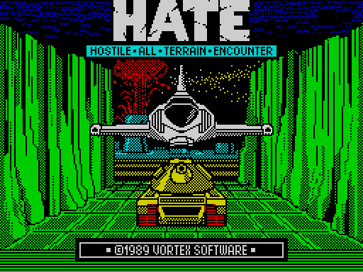

## 1.1 The game in one paragraph

**H.A.T.E. (Hostile All-Terrain Encounter)**, Vortex Software 1989, for the ZX Spectrum 48K: written by Costa
Panayi, music by Ben Daglish (the credits of the menu, [8.3](08-hud-and-text.md#83-every-string)). The player drives
a vehicle along an isometric course that scrolls diagonally across the screen. The course carries buildings, launch
pads, missiles, jets and cubes, most of which fire back. Shooting certain domes releases **pods**; flying into a pod
adds it to a **convoy** that trails the vehicle. The convoy is everything: it shields the vehicle from hits, it is
the only way through the **barrier** at the end of each course, and the pods brought through become the **lives**
of the next round. Rounds alternate between an **aircraft** and a **ground vehicle**; after ten rounds the courses
come round again, harder ([10.2](10-gameplay-logic.md#102-rounds-and-vehicles),
[10.4](10-gameplay-logic.md#104-pods-the-convoy-and-the-way-out)).

The game's text holds no story: the logo, the menu, the credits, five messages and the GAME OVER box are all the
strings it has ([8.3](08-hud-and-text.md#83-every-string)). The premise is what the name says and the screen shows.

## 1.2 The screen

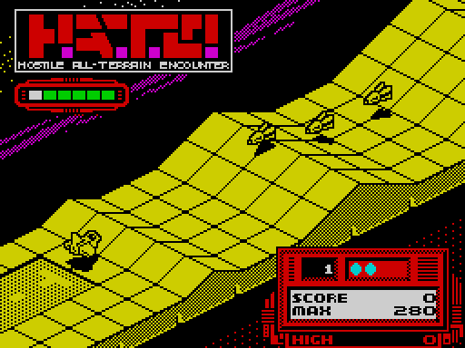

The whole screen is one fixed picture with two live areas ([8.4](08-hud-and-text.md#84-the-panel),
[6.7](06-rendering.md#67-colour)):

| Area | Where | What it shows |
| --- | --- | --- |
| **Logo** | top left | "H.A.T.E." and "HOSTILE ALL-TERRAIN ENCOUNTER", part of the screen picture |
| **Status window** | the red frame under the logo, column 2, row 6 | one thing at a time: the **shot gauge** (one bar segment for each of the five shots free to fire), or AUTO, DEMO, PAUSE!, ABORT! ([8.3](08-hud-and-text.md#83-every-string)) |
| **Playfield** | the diagonal band across the screen | the course scrolling toward the lower left, the objects and their shadows ([6](06-rendering.md)) |
| **Panel** | bottom right | the round number, the lives as up to four cyan dots, SCORE, MAX and HIGH ([8.4](08-hud-and-text.md#84-the-panel)) |

- **Round** counts 1, 2 … 10, then 11, 12 … over the laps of the ten courses.
- **SCORE** is the points of this game; its last digit is always 0.
- **MAX** is the best SCORE reached in this game: it survives the score being taken back by a retry or a fall back
  (1.8).
- **HIGH** is the best MAX since the machine was switched on; it is never reset by the game
  ([8.4](08-hud-and-text.md#84-the-panel), [10.7](10-gameplay-logic.md#107-scoring-and-the-high-score)).

The play area is drawn in ink only, one colour for the whole course, so moving objects never clash with the
course's colours ([6.7](06-rendering.md#67-colour)). Every object of types 0-13 casts a shadow on the ground under
it, which follows the slope; it shows the player where a flying thing is
([6.6](06-rendering.md#shadows)).

## 1.3 Controls and input devices

The menu offers four devices ([5.1](05-controls.md#51-the-menu), [5.3](05-controls.md#53-the-four-readers)):

| Device | Left | Right | Down | Up | Fire |
| --- | --- | --- | --- | --- | --- |
| 1 Keyboard | K | L | Q or A (below) | Q or A | any key of the bottom two rows |
| 2 Sinclair | 1 or 6 | 2 or 7 | 3 or 8 | 4 or 9 | 5 or 0 |
| 3 Kempston | stick | stick | stick | stick | button |
| 4 Protek-AGF | 5 | 8 | 6 | 7 | 0 |

All four give the game the same five signals ([5.2](05-controls.md#52-the-control-byte)). Left and right move the
vehicle across the track. What down and up do depends on the vehicle (1.4): on a joystick, **down climbs** the
aircraft (pull back, as a pilot does) and **up speeds up** the ground vehicle.

**The keyboard follows the vehicle.** Q and A swap with the round's vehicle, so that **Q is always "more"**:
climb on the aircraft, faster on the ground vehicle; A is the opposite
([5.3](05-controls.md#53-the-four-readers), [10.3](10-gameplay-logic.md#103-driving-the-two-vehicles)). The
joysticks do not swap.

Keys that work with every device, in play ([5.5](05-controls.md#55-keys-read-by-the-main-loop)):

| Keys | Effect |
| --- | --- |
| **P** | pause: a beep, PAUSE! in the status window |
| **ENTER** | ends the pause, with a beep |
| **U** and **G** together | abort the game: ABORT!, the GAME OVER box, two beeps, the menu |

U and G sit on different rows, under different hands, so an abort cannot happen by a stray press
([5.6](05-controls.md#56-design-notes)).

## 1.4 The two vehicles

The first byte of every course says which vehicle the round is played in, and it alternates: the **aircraft** in
rounds 1, 3, 5, 7, 9, the **ground vehicle** in rounds 2, 4, 6, 8, 10
([10.2](10-gameplay-logic.md#102-rounds-and-vehicles)). Both start each round in the middle of the track and move along
the course with the scroll; the player steers across, and either the height or the speed.

**The aircraft** ([10.3](10-gameplay-logic.md#103-driving-the-two-vehicles),
[7.7](07-objects.md#77-the-player-e7e9)):

- Down and up change the height, within 2 to 26. Holding the stick accelerates: the step grows from 1 to 3 a pass.
- The ground is a floor 2 above the terrain: the aircraft is lifted over a hill by itself, and comes down again only
  when the stick says so.
- A thing 8 or more above or below it passes harmlessly: hits are tested within 7 in height
  ([7.4](07-objects.md#74-moving-e15c-once-a-pass)). Climbing over a missile is a way to survive it.

**The ground vehicle**:

- It rides the terrain: its height is always the ground's, plus 2.
- Down and up change its speed along the track: down stops it (speed 0), up doubles it (speed 2), neither gives the
  normal speed 1. The change draws on a **speed reserve**: 10 at each round start, one spent for every pass of
  braking, one earned back for every pass of speeding up, at most 32. With the reserve at 0 down does nothing, at 32
  up does nothing.
- Fire with up held lobs a **shell** on an arc instead of a straight shot, every fourth pass, and the speed stays 1
  meanwhile.

**Firing**, both vehicles: a shot every other pass while fire is held, flying straight ahead along the course, 2
below the vehicle's height, for 12 passes. At most five shots are in the air; the shot gauge shows how many are free
([7.7](07-objects.md#77-the-player-e7e9), [8.3](08-hud-and-text.md#83-every-string)). To hit a dome the aircraft
has to fly at the dome's height plus 2 ([WALKTHROUGH 6.12](../WALKTHROUGH.md)).

**Walls** narrow the track (1.5). Driving into one is a **crash**: the vehicle is hit, and the whole convoy is lost
with it ([7.7](07-objects.md#77-the-player-e7e9), [7.5](07-objects.md#75-pods-and-the-convoy)).

**AUTO.** At the start of every round, and from the barrier to the end of the round, the game drives: AUTO shows in
the status window, a ticking beep sounds, the stick is not read, and the vehicle is steered to the middle of the
track and down. At a round start AUTO lasts 70 or 14 passes, set by the course
([5.4](05-controls.md#54-the-automatic-start), [10.4](10-gameplay-logic.md#104-pods-the-convoy-and-the-way-out)).

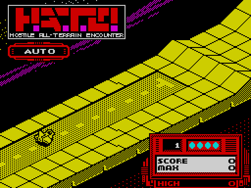

## 1.5 The course

The course is a track seen in 2:1 isometric, scrolling from the upper right toward the lower left by 2 pixels a
pass ([6.3](06-rendering.md#63-the-blit-d35e-and-the-address-list-d5b2),
[6.4](06-rendering.md#64-scrolling-d3f9-one-phase-a-pass)). It is built of square tiles; bends shift the track
sideways a tile at a time ([6.5](06-rendering.md#65-the-course)).

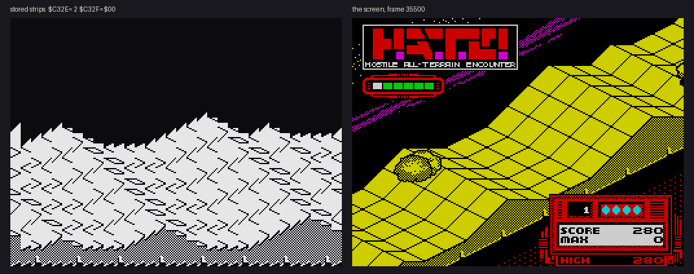

Under the picture lies a **ground profile**, one entry for every 2 units along the course
([6.5](06-rendering.md#65-the-course), [7.4](07-objects.md#74-moving-e15c-once-a-pass)):

| Feature | Effect on play |
| --- | --- |
| **Ground height** (0-31) | the terrain rises and falls smoothly between anchors; ground things sit on it, flying things cannot sink into it |
| **Walls** | two widths of narrowing: the track across is limited to `$27` or `$17` instead of the full `$47`; the player who runs into one crashes, the player's shots explode on it, enemy shots vanish |
| **The barrier** | a line across the whole track near the end of each course; it lets the player through only with a convoy (1.7) |

**Ten courses**, played in order and then again ([4.2](04-game-loop.md#42-a-game-and-a-round)). There is no loading
or pause between rounds: the next course scrolls in behind the barrier, and the round number changes 32 strips later
([10.2](10-gameplay-logic.md#102-rounds-and-vehicles), [6.5](06-rendering.md#65-the-course)).

**Colours.** Each round paints the course in its own colour: yellow, cyan, green, magenta, then again from yellow
(round 5 is yellow, round 9 yellow); green and magenta are bright
([10.2](10-gameplay-logic.md#102-rounds-and-vehicles)). The demo's courses are bright green whatever the course
(the round number does not count in the demo, `src/game/roundsetup.asm`).

## 1.6 Objects and enemies

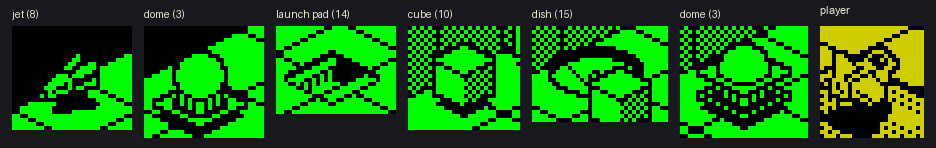

Each round places up to 16 objects of its own on the course, and they launch and fire more
([7.2](07-objects.md#72-the-slots), [7.3](07-objects.md#73-the-kinds)):

| Object | Type | What it does | Shot by the player |
| --- | --- | --- | --- |
| **Dome** | 2 | stands on the course; while it explodes it can throw out a jet | 210 points |
| **Pod dome** | 3 | the same dome, carrying a pod | 320 points, and a **pod** is left behind |
| **Missile** | 4-7 | launched by pads or placed on the course; flies by its behaviour flags (below) | 140 points |
| **Jet** | 8, 9 | flies in lines | 140 points |
| **Cube** | 10 | kills the vehicle on contact | takes 4 hits, then 180 points |
| **Pod** | 11 | collected by flying into it (1.7) | |
| **Shot** | 12 | the player's fly straight ahead; the enemy's kill the player | |
| **Launch pad** | 14 | launches missiles or jets from its own place, beside the track the player is on | indestructible |
| **Dish** | 15 | launches like a pad; only the player collides with it, and is lost | indestructible |

**How enemies behave.** Every object carries behaviour flags rather than code of its own
([7.4](07-objects.md#74-moving-e15c-once-a-pass)):

- **Fire**: a firing object shoots once it is 190 or more ahead, at random about once in 8 passes. Pads and dishes
  launch a missile or a jet; the others fire a shot back down the course toward the player. No more than 6 launched
  objects and 5 or 6 enemy shots can be in the air at once; when the slots are full, nothing is fired.
- **Steering**, every 4 passes: head toward the player's position across (the missiles that come in from the side),
  weave left and right, or turn at random; some turn round at the edge of the track.
- **Height**: follow the player's height, fly the arc of a missile, or ride a 16-step wave.
- Two missiles of types 4-5 that meet both turn round.

**What hits what** ([7.6](07-objects.md#76-hits-the-handler-table-c380)):

- **The vehicle** is lost on touching anything but a pod: a dome, a missile, a jet, a cube, an enemy shot, a pad or a
  dish. If it has followers, the last follower is lost instead and the vehicle drives on (1.7). A pad or a dish
  survives the collision; anything else explodes with the vehicle.
- **The player's shots** score on domes, missiles and jets, and count a hit on a cube. They do nothing to pads and
  dishes, and explode on walls and the barrier.
- **Enemy shots** hit only the player; on a building they simply vanish.

## 1.7 Pods, the convoy and the barrier

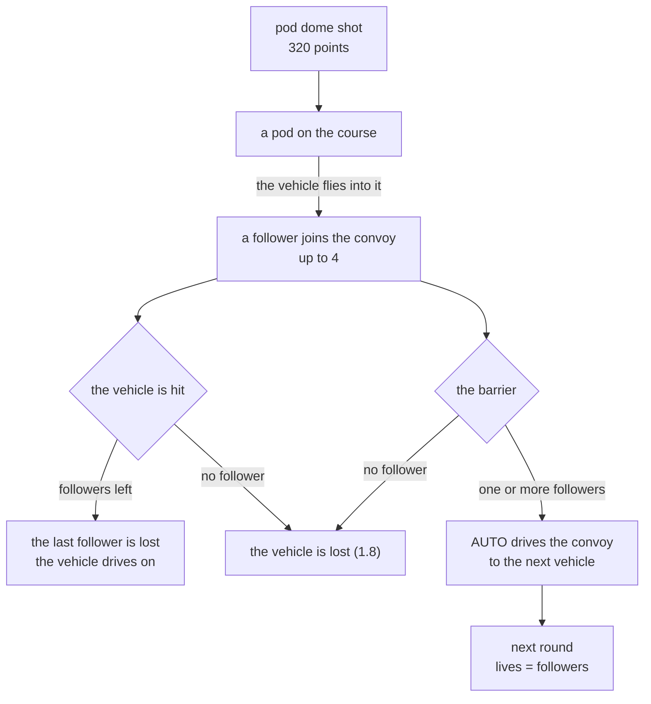

([7.5](07-objects.md#75-pods-and-the-convoy), [10.4](10-gameplay-logic.md#104-pods-the-convoy-and-the-way-out))

- **Pods.** A shot pod dome leaves a pod where it stood. Flying into it turns it into a **follower**, with a rising
  sweep. Up to four followers trail the vehicle in the order they joined, copying its moves.
- **A shield.** A hit on the vehicle costs the last follower, not the vehicle. A crash into a wall is the exception:
  it costs the vehicle and every follower at once.
- **The barrier.** Near the end of every course a barrier crosses the whole track. Reaching it with no follower is
  death; with one or more, AUTO takes over and drives the convoy to the middle of the track and down. **A round can
  only be left with at least one pod**: a player who shoots everything and collects nothing never sees round 2
  ([10.9](10-gameplay-logic.md#109-design-notes)).
- **The hand-over.** The vehicle of the next round, the other kind, waits parked in the middle of the track at the
  end of the course. The convoy lands beside it, the course scrolls on into the next one, its colour changes, and the
  round number and the lives are updated. The vehicle left behind is still on the course at the start of the next
  round ([10.2](10-gameplay-logic.md#102-rounds-and-vehicles), [7.2](07-objects.md#72-the-slots)).

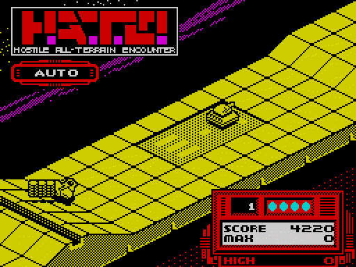

The aircraft and its three pods come down beside the parked ground vehicle under AUTO; the course turns cyan, the
round reads 2 and the panel shows 3 lives.

## 1.8 Lives and losing

A game starts with **4 lives**. After that, the lives of every round are **the followers brought through the
barrier** of the round before: 1 to 4 ([4.2](04-game-loop.md#42-a-game-and-a-round),
[10.4](10-gameplay-logic.md#104-pods-the-convoy-and-the-way-out)). The panel shows them as cyan dots.

When the vehicle is lost it explodes, a low beep sounds, and then ([4.4](04-game-loop.md#44-losing-the-vehicle),
[10.5](10-gameplay-logic.md#105-losing-a-life-falling-back-game-over)):

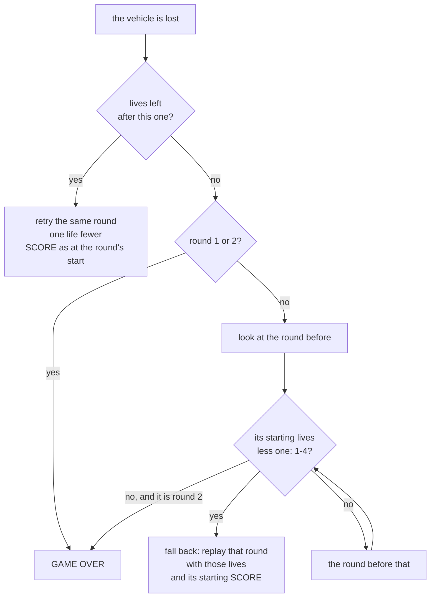

- **A retry** restarts the round from its beginning, with the course, the objects and the SCORE as they were when
  it started. The lives are one fewer, and the convoy is gone.
- **Falling back.** Running out of lives from round 3 on does not end the game at once. The game looks back at the
  rounds before, down to round 2, and replays the first whose starting lives less one are 1 to 4, with those lives
  and the SCORE it started with. Round 1 is never returned to.
- **A retry closes a round.** The lives a round "started with" are those of its last attempt: every retry
  overwrites them. A round retried down to its last life can no longer be fallen back to.
- **GAME OVER.** When no round qualifies, the GAME OVER box is shown, two beeps sound and the game returns to the
  menu. The panel may then show an earlier round's SCORE, left by the look-back; MAX keeps the best
  ([4.4](04-game-loop.md#44-losing-the-vehicle)).

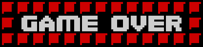

A fall back therefore costs the points earned since the round it returns to. The bot's game of
[10.1](10-gameplay-logic.md#101-the-second-recording) shows all three outcomes: round 2 retried twice, round 4 lost
on its only life and fallen back to round 3 with 2 lives, round 3 lost twice and GAME OVER, since round 2 had been
retried down to 1 life.

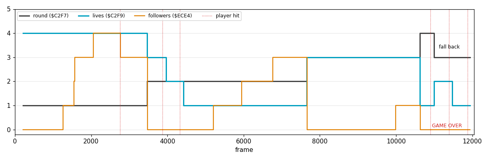

## 1.9 Scoring and the high score

| Event | Points |
| --- | --- |
| a dome shot | 210 |
| a pod dome shot (it leaves a pod) | 320 |
| a missile or a jet shot | 140 |
| a cube destroyed, on its 4th hit | 180 |

([10.7](10-gameplay-logic.md#107-scoring-and-the-high-score), [7.3](07-objects.md#73-the-kinds)). Every award is
for a target the player's shots destroy; an enemy shot that hits a building gives nothing
([7.6](07-objects.md#76-hits-the-handler-table-c380)).

- **SCORE** is set back to the round's starting value by a retry or a fall back (1.8).
- **MAX** takes SCORE at every round setup and at every loss, so it holds the best SCORE of the game even after a
  fall back has lowered SCORE.
- **HIGH** takes MAX when the menu is entered after a game; then SCORE, MAX and the round table are cleared. A demo
  leaves all three alone. HIGH lasts until the machine is reset; it is never saved
  ([8.4](08-hud-and-text.md#84-the-panel)).

## 1.10 Modes

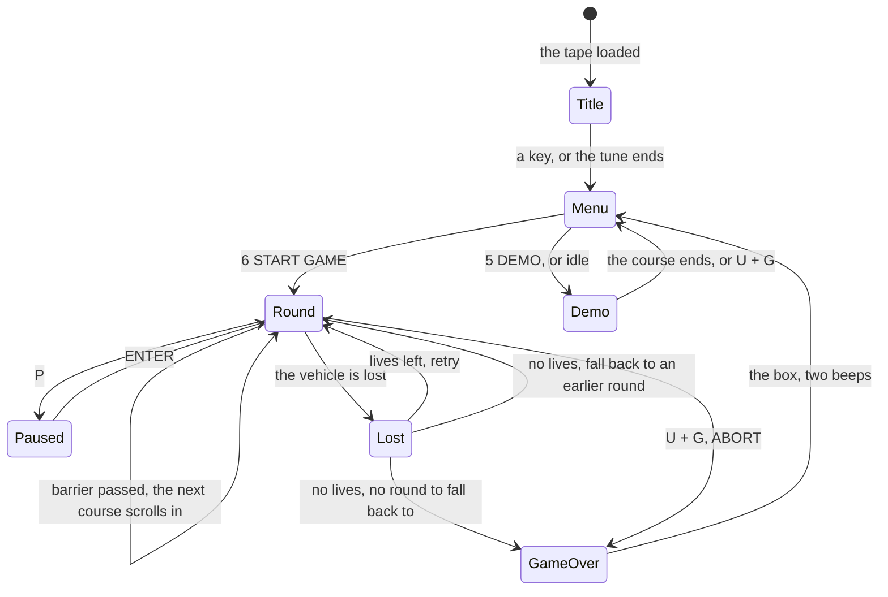

([4.1](04-game-loop.md#41-the-state-machine), [5.1](05-controls.md#51-the-menu),
[10.2](10-gameplay-logic.md#102-rounds-and-vehicles))

**Title.** After loading, the title screen plays Ben Daglish's tune until a key is pressed or the tune ends
([2.3](02-architecture.md#23-the-stages-from-tape-to-play), [9.1](09-sound.md#91-the-title-engine-at-a-glance)).

**Menu.** SELECT and six choices; the highlight bar marks the device chosen
([5.1](05-controls.md#51-the-menu)):

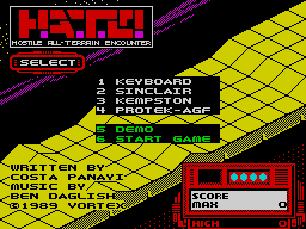

| Key | Choice |
| --- | --- |
| 1-4 | Keyboard, Sinclair, Kempston, Protek-AGF |
| 5 | DEMO |
| 6 | START GAME |

Left alone long enough, the menu starts the demo by itself. The time spent in the menu also seeds the random
numbers of the game, so no two games need play alike ([5.1](05-controls.md#51-the-menu)).

**Demo** ([10.6](10-gameplay-logic.md#106-the-demo)). One of courses 3-10, picked at random, is played with DEMO in
the status window. The vehicle drives straight ahead down the middle and never fires. A hit can destroy it, but the
demo never checks for a loss: it runs on to the end of its course and returns to the menu. U and G end it early with
ABORT! and one beep, no box ([5.5](05-controls.md#55-keys-read-by-the-main-loop)).

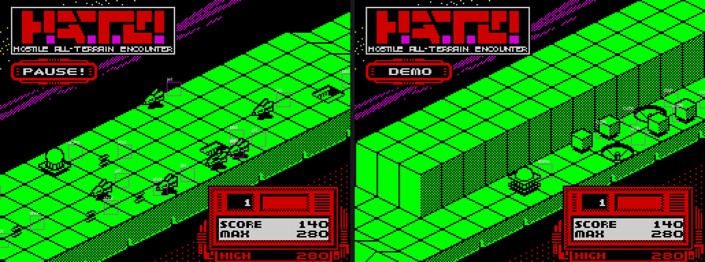

**Pause.** P stops the game until ENTER; it beeps going in and coming out
([5.5](05-controls.md#55-keys-read-by-the-main-loop)).

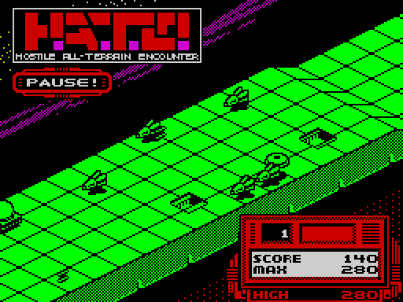

**Abort.** U and G together end the game at once, through the GAME OVER box: an aborted game is a lost game. HIGH
still takes MAX, as it stood at the last round setup or loss, when the menu is entered.

## 1.11 Rounds and difficulty

The ten courses differ in their tracks and in the mix of objects ([10.2](10-gameplay-logic.md#102-rounds-and-vehicles)):

| Round | 1 | 2 | 3 | 4 | 5 | 6 | 7 | 8 | 9 | 10 |
| --- | --- | --- | --- | --- | --- | --- | --- | --- | --- | --- |
| vehicle | aircraft | ground | aircraft | ground | aircraft | ground | aircraft | ground | aircraft | ground |
| colour | yellow | cyan | green | magenta | yellow | cyan | green | magenta | yellow | cyan |
| cubes | | | yes | | | yes | | | | yes |
| dishes | | | | yes | yes | yes | | | | yes |

Plain domes (type 2, no pod) appear from round 5 on.

**Laps.** After round 10 the courses start again from round 1, the round number reading 11, 12 and on, and the
objects are armed harder ([7.8](07-objects.md#78-harder-laps)):

- from the second lap, the missiles and jets of types 5-9 fire as well, and the launch pads launch other kinds than before;
- from the third, every dome, missile and jet fires, and every pad launches the same kind.

These are read from the code; no recording got that far.

**Pace.** The game has no frame lock: a pass takes as long as its work, about 8 passes a second, and every sound
effect stops the game while it plays. Busy screens play slower ([4.5](04-game-loop.md#45-time)).

## 1.12 Sound

All sound is the beeper ([9](09-sound.md)).

- **Title**: a two-voice tune with drums by Ben Daglish, with envelopes and noise drums
  ([9.1](09-sound.md#91-the-title-engine-at-a-glance)).
- **Play** has no music, only short effects, one a pass, by priority: a pod joining the convoy, an explosion, a hit
  that does not destroy (a shot on a wall or the barrier, a cube struck but not broken), the AUTO tick, a shot fired
  ([9.6](09-sound.md#96-effects-in-play), [10.8](10-gameplay-logic.md#108-sound-events)). A sound that loses its
  pass is dropped.
- **Fixed cues**: a rising sweep at every round setup, a low warble when the vehicle is lost, beeps for the menu,
  the device choice, the start, pause on and off, and two for GAME OVER and ABORT
  ([9.6](09-sound.md#96-effects-in-play)).

Each effect stops the game for its length: the beeper needs the CPU.

## 1.13 Design notes

- **One mechanic, four jobs.** Pods are points, a shield, the key to the barrier and the next round's lives. The
  player decides at every moment between shooting for score and flying for pods.
- **Two vehicles, one stick.** Down and up mean height on one round and speed on the next; the keyboard keeps Q as
  "more" on both, so the hand learns one rule.
- **Lives are earned, not given.** Only the first round's four lives are free. A round cleared with a single pod
  leaves a single life for the next.
- **Losing costs rounds, not the game.** The fall back sends the player back to a round that was played well, with
  its score; retrying a round to the end closes that door.
- **No break in the journey.** The courses run into each other; the next vehicle waits on the track, and the round
  changes while the picture scrolls on.
