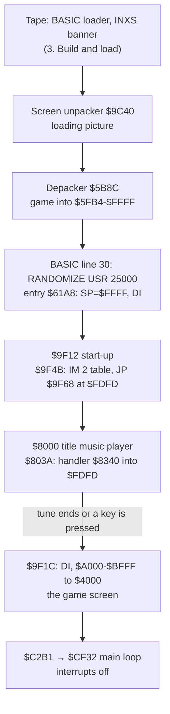
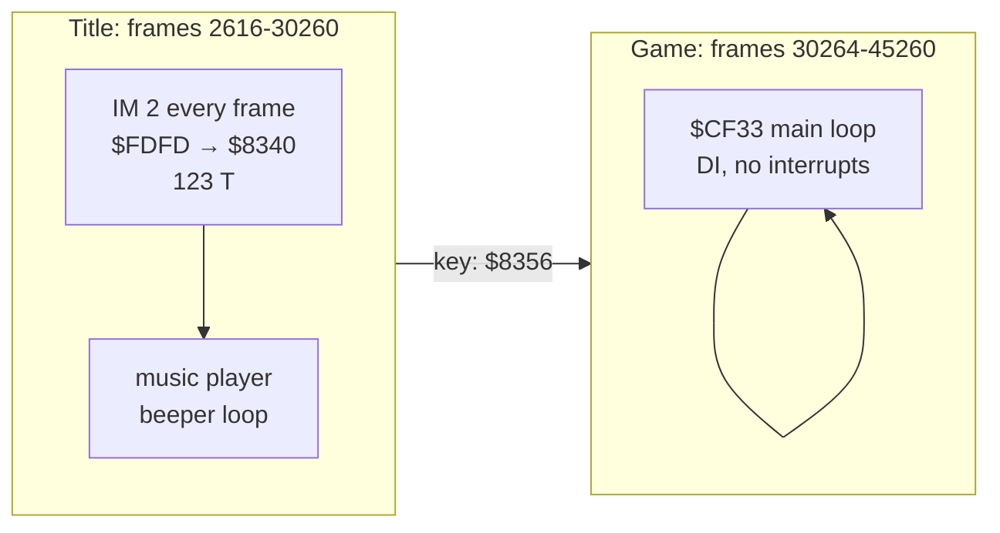
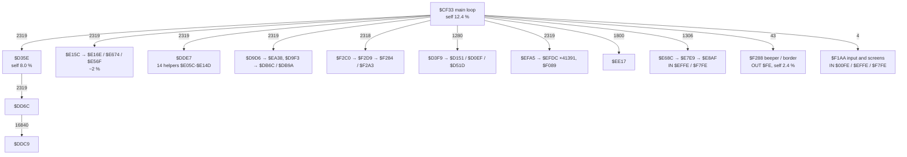
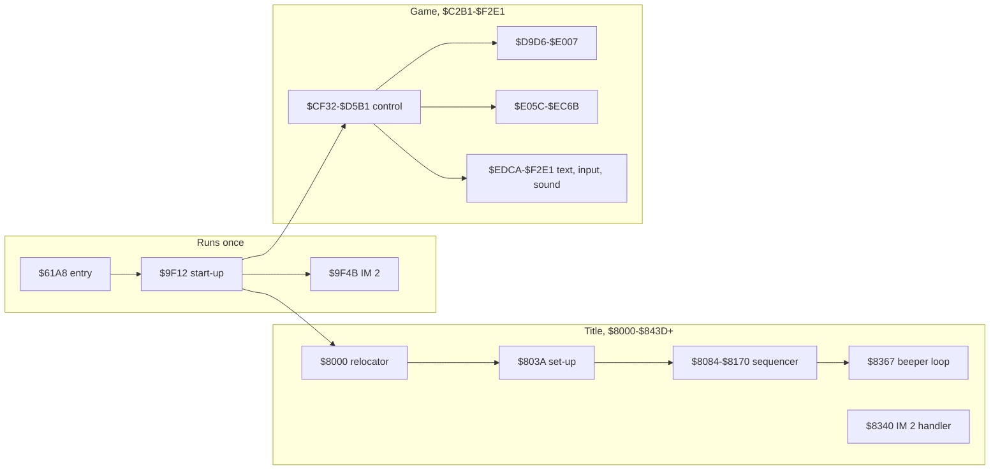

# 2. Architecture

The shape of the program: what machine it targets, where everything lives in memory, the stages it goes through
from the tape to play, how time is kept, and which parts of the code do what. Later documents take each part apart;
this one is the map they hang on.

Evidence used here:

- the code, as unpacked at the moment the game starts (frame 2613, t 53257, `work/game/start.bin`; 0 bytes differ from
  `tools/depack.py`);
- the L1 build of the recording's game window, frames 2613 to 45260 (`work/game/l1.json`). The window holds
  357 575 330 instructions and 2 980 460 285 T. It was replayed with 1 706 checkpoints and no divergence.

The recording idles 9 minutes on the title (frames 2616 to 30260) and then plays for 5 minutes (frames 30264 to
45260). Counts below come from this run.

## 2.1 The machine budget

| Resource | The game uses | Notes |
| --- | --- | --- |
| CPU | Z80 at 3.5 MHz, 69 888 T a frame | 48K timing |
| Memory | 48K: all of `$5FB4-$FFFF` | no 128K paging, no AY |
| Screen | the Spectrum's one screen at `$4000` | no second screen buffer |
| Sound | the beeper (port `$FE` bit 4) | title music and effects |
| Input | keyboard ports `$EFFE`, `$F7FE` and all rows (`$00FE`) | `$EFFE` and `$F7FE` are the rows a Sinclair joystick maps to ([5. Controls](05-controls.md)) |
| Interrupts | IM 2 during the title only | the game proper runs with interrupts off (2.4) |
| ROM | not called after the load | no ROM routine runs in the game window |

The last row: L1 lists no routine in ROM page 261 during the game window. The ROM is used only by the loaders
([3. Build and load](03-build-and-load.md)).

## 2.2 The memory map

At the moment the game starts. The depacker has just put the whole program in place; the code it ran from, at
`$5B8C`, is dead from here on.

| Range | Size | What | Lifetime |
| --- | --- | --- | --- |
| `$4000-$5AFF` | 6 912 | screen: the loading picture, later the game screen | always |
| `$5B00-$5BFF` | 256 | printer buffer; the depacker ran at `$5B8C-$5BC2` | dead after the load |
| `$5C00-$5FB3` | 948 | system variables, BASIC, the INXS banner code | not used by the game; overwritten when play starts |
| `$5FB4-$61A7` | 500 | the head of block 5: the mover that started the depacker | dead after the load |
| `$61A8-$61AE` | 7 | the entry: `LD SP,$FFFF; DI; JP $9F12` | runs once, then a data buffer |
| `$61AF-$7FFF` | 7 761 | no code ran here: data (L1 sees a font and texts at `$63DB-$63FE`; [11. Data reference](11-data-reference.md)) | always |
| `$8000-$83E1` | 994 | the title music player and its handler | title only, then a buffer |
| `$83FC-$8421` | 38 | the player's command table (handler addresses) | title only |
| `$8422-$843C` | 27 | the player's patch list (9 entries of address and byte) | title only |
| `$843D`-... | | the title tune | title only |
| `$9F12-$9F67` | 86 | start-up: IM 2 setup, the call to the player, the start of the game | runs once, then overwritten |
| `$A000-$BFFF` | 8 192 | the game screen image, copied to `$4000` when play starts | until play starts |
| `$C2B1-$F2E1` | | the game code (2.6) | always |
| `$FDFD-$FDFF` | 3 | the IM 2 jump: `JP $9F68`, during the title `JP $8340` | title only |
| `$FE00-$FF00` | 257 | the IM 2 vector table, every byte `$FD` | title only |
| ...-`$FFFF` | | the stack, from `$FFFF` down | always |

L1 confirms the reuse: its review queue flags `$61A8-$61AE`, `$8000-$83E1`, `$9F12-$9F67` and `$FDFD-$FDFF` as "code that
ran, then a block copy or the stack wrote over its opcodes". Each of these is code that ran once and was then
overwritten on purpose.

The executed code, measured. These are the ranges of bytes L1 saw executed in the game window; gaps under 64 bytes
are merged:

| Range | Bytes run | Part |
| --- | --- | --- |
| `$61A8-$61AE` | 7 | entry |
| `$8000-$83E1` | 994 | title music player |
| `$9F12-$9F67` | 86 | start-up |
| `$C2B1-$C2B3` | 3 | `JP $CF32` |
| `$CF32-$D5B1` | 1 594 | main loop, game control (`$CF32-$D29C`, `$D2E3-$D5B1`) |
| `$D9D6-$E007` | 1 505 | (`$D9D6-$DB1A`, `$DB6C-$E007`) |
| `$E05C-$EC6B` | 2 795 | (`$E05C-$E70D`, `$E756-$E847`, `$E889-$E903`, `$E94F-$E972`, `$E9C4-$EC6B`) |
| `$EDCA-$F2E1` | 1 004 | (`$EDCA-$EF47`, `$EFA5-$F0DA`, `$F1AA-$F2E1`) |
| `$FDFD-$FDFF` | 3 | the IM 2 jump |

About 8 000 bytes of the 41 036 the depacker wrote were executed. The rest is data, or code this run did not reach.
It has to be told apart before the source can be rebuilt.

## 2.3 The stages from tape to play



Frames of the recording: the entry runs at 2613, the music starts at 2616, the key that ends the title is pressed
at about 30260, and the main loop starts at 30264.

### Start-up, `$9F12`

```text
$9F12  CALL $9F4B        ; IM 2: JP $9F68 at $FDFD, $FE00-$FF00 = $FD, I = $FE, IM 2
$9F15  XOR A
$9F16  LD ($8002),A      ; the operand of the player's LD C,n: a parameter written into code
$9F19  CALL $8000        ; the title music, until it ends or a key is pressed
$9F1C  DI
$9F1D  LD HL,$A000       ; the game screen: 8 192 bytes, pixels, attributes and $5B00-$5FFF
$9F20  LD DE,$4000
$9F23  LD BC,$2000
$9F26  LDIR
$9F28  XOR A
$9F29  LD ($C2F8),A
$9F2C  JP $C2B1          ; JP $CF32
```

The IM 2 setup at `$9F4B` fills all 257 bytes `$FE00-$FF00` with `$FD` and sets I = `$FE`. Whatever the data bus holds
when the interrupt is taken, the vector read is `$FDFD`. A 3-byte `JP` sits there. This is the usual way to make IM 2 safe on a
Spectrum, where the bus value is not defined. The default target, `$9F68`, is `EI; RET`.

### The title music player, `$8000`

The player is relocatable code with self-modifying parameters. The first 58 bytes are a loader stub. It reads the
address it was called at from its own `CALL` operand (`POP HL; PUSH HL; DEC HL; LD D,(HL); DEC HL; LD E,(HL)`). It
then swaps `$58C` bytes from that address + `$3A` into `$803A`, calls `$803A`, and swaps them back. The same player and
tune can therefore sit anywhere and still run at the address they were assembled for. Here it is called as
`CALL $8000`, so the source is `$803A` itself and the swap changes nothing.

`$803A`, the player's set-up, has three steps:

1. It saves SP into the operand of a `LD SP,nn` at `$8363` (self-modifying code).
2. It reads the vector address from the I register (`$FE00` → `$FDFD`) and saves the 3 bytes there to `$83F9`. It then
   writes `JP $8340` in their place.
3. It applies a patch list of 9 (address, byte) entries at `$8422` to the player's own code.

The player then interprets the tune as a sequencer, `$8084-$8170`. Command bytes index the handler table at `$83FC`.
Most handlers write their argument into an operand somewhere in the player (`$81DE`, `$8205`, `$81BB`, `$8231`, `$827E`,
`$82E0`, `$8085`). The sound comes from loops that write port `$FE` (for one, `$8367`: border 0, beeper on, a 300-step delay).

The interrupt handler at `$8340` runs once a frame, 27 645 times in this run:

```text
$8340  DI
       EX AF,AF'
       XOR A
       IN A,($FE)        ; all keyboard rows
       CPL
       AND $1F
       JR NZ,$8356       ; a key: leave the music
       PUSH HL
       LD HL,$8244
       DEC (HL)          ; the note-length counter, an operand inside the player
       POP HL
       DEC C             ; and three registers of the interrupted code
       DEC H
       DEC L
       EX AF,AF'
       EI
       RET
$8356  DI                ; a key was pressed:
       LD DE,($83F7)     ;   put the 3 saved bytes back at the vector
       LD HL,$83F9
       LD BC,3
       LDIR
       LD SP,nn          ;   SP as $803A saved it (the operand written at $803A)
       RET               ;   return from CALL $803A to the swap-back in $8000
```

The handler also decrements C, H and L of the code it interrupted, which is always the player. This deliberate
side effect on the player's loop counters is examined in [9. Sound and music](09-sound.md). Measured with `re_session.py interrupts` (2.4), the handler costs 123 T
an entry, 0.1 % of the CPU.

The key exit unwinds the player at any depth. It throws the stack away and restores SP to the value saved at entry.
This happened once in the recording, at frame 30260.

[9. Sound and music](09-sound.md) covers the tune format and the beeper loop.

## 2.4 Time: frames and interrupts



There are two timing regimes:

- **The title** runs with IM 2. The handler is the music's clock: the note length counts down once a frame.
  `re_session.py interrupts` finds it with no address given:

  ```text
  interrupt $FDFD -> $8340: 27645 entries in 42647 frames (0.65 a frame), 123 T an entry, 0.1 % of the CPU
  ```

  The 0.65 a frame is the average over the whole window, interrupts on and off. Over the title alone it is one per
  frame (27 645 in 27 644 frames).

- **The game** runs with interrupts disabled. `$CF32` is a `DI`, no routine after frame 30260 is entered by an
  interrupt, and L1's only interrupt routine is `$FDFD`. The pace of play is the time the main loop's work takes: the
  2 319 passes of the loop in frames 30520-45010 average 6.2 frames each, about 8 passes a second. With no HALT
  waiting for the frame, the speed of the game depends on how much is on the screen.
  [4. Game loop](04-game-loop.md) measures the pass length against what is drawn.

## 2.5 The main loop

`$CF32` is entered once, at frame 30264, through `JP $C2B1` → `JP $CF32`. Its first call is `$F1AA`, which reads the
keyboard and joystick rows and calls `$F288` (beeper and border), `$EE17`, `$EEE3` and others. L1's call graph of one pass
follows, with the number of calls in the run and the share of all T-states spent in each routine's own code:



The roles below come from the measured evidence: ports, call counts and where the time goes. Each one is the subject
of a later document, which will confirm or correct it from the code.

| Routine | Called | Evidence | Role (to be confirmed in the doc named) |
| --- | --- | --- | --- |
| `$CF33` | 1 | the loop itself, 12.4 % of all T in its own code | the per-pass schedule ([4](04-game-loop.md)) |
| `$D35E` | 2 319 | 8.0 % self, calls `$DD6C`, which calls `$DDC9` ×16 840 | the heaviest worker per pass ([6](06-rendering.md)) |
| `$DDE7` | 2 319 | 14 small helpers in `$E05C-$E14D`, 660-4 300 calls each | ([7](07-objects.md)) |
| `$E15C`/`$E16E` | 2 319 | 403-instruction routine, loops back through `$E674` 40 057 times | ([7](07-objects.md), [10](10-gameplay-logic.md)) |
| `$EFA5`/`$EFDC` | 2 319 | `$EFDC` called 41 391 times, about 18 a pass | ([6](06-rendering.md)) |
| `$E68C` | 1 306 | reads `$EFFE` and `$F7FE` | the player's input in play ([5](05-controls.md)) |
| `$F1AA` | 4 | reads `$00FE`, `$EFFE`, `$F7FE`; calls `$F288` and the text routines `$EE17`, `$EEE3` | screens between games: menu, start, game over ([5](05-controls.md), [8](08-hud-and-text.md)) |
| `$F288` | 52 | writes `$00FE` and `$18FE`; 2.4 % self in 52 calls | beeper effects and border ([9](09-sound.md)) |
| `$F2C0` | 2 318 | reaches `$F2A3`, 4 ‰ self | ([9](09-sound.md)) |
| `$D3F9` | 1 280 | its branches reach `$D151` (10 times) and back to `$CF33` | game state changes: life lost, restart ([10](10-gameplay-logic.md)) |
| `$EE17` | 1 800+ | called from `$CF33`, `$F1AA`, `$D151`, `$E68C` | text or number printing ([8](08-hud-and-text.md)) |

Of all T-states in the window, the title player's code (`$8000-$83E1`) took 64.8 % and the game code (`$C2B1-$F2E1`)
35.2 %. That matches the frames: the title is 64.8 % of the window.

## 2.6 Module map



The module boundaries above are address ranges of executed code. Their names will follow from documents 4-10.

## 2.7 Design notes

What a 2026 developer would note about this architecture:

- **One program, no overlays.** The whole game is resident after the load. The only "overlay" is the title player's
  relocator, and in this build it moves nothing. It is a general-purpose music driver linked in place.
- **Code becomes buffers.** The entry, the start-up and the music player are all written over once play starts. On
  a 48K machine with a 41K program, the 1 100 bytes of run-once code are worth reusing.
- **Parameters in operands.** Both the player and the start-up pass values by writing them into the operands of
  later instructions (`$8002`, `$8085`, `$8244`, `$8364` and the handler table's targets). This is the cheapest way to hold
  a variable on a Z80, at the cost of code that cannot be in ROM and is hard to read.
- **IM 2 made safe.** The 257-byte table of `$FD` bytes and the jump at `$FDFD` give a vector that does not depend on
  the bus.
- **No frame lock in play.** The game loop does not wait for the frame, so its speed varies with the load.
  [4. Game loop](04-game-loop.md) measures how much.
