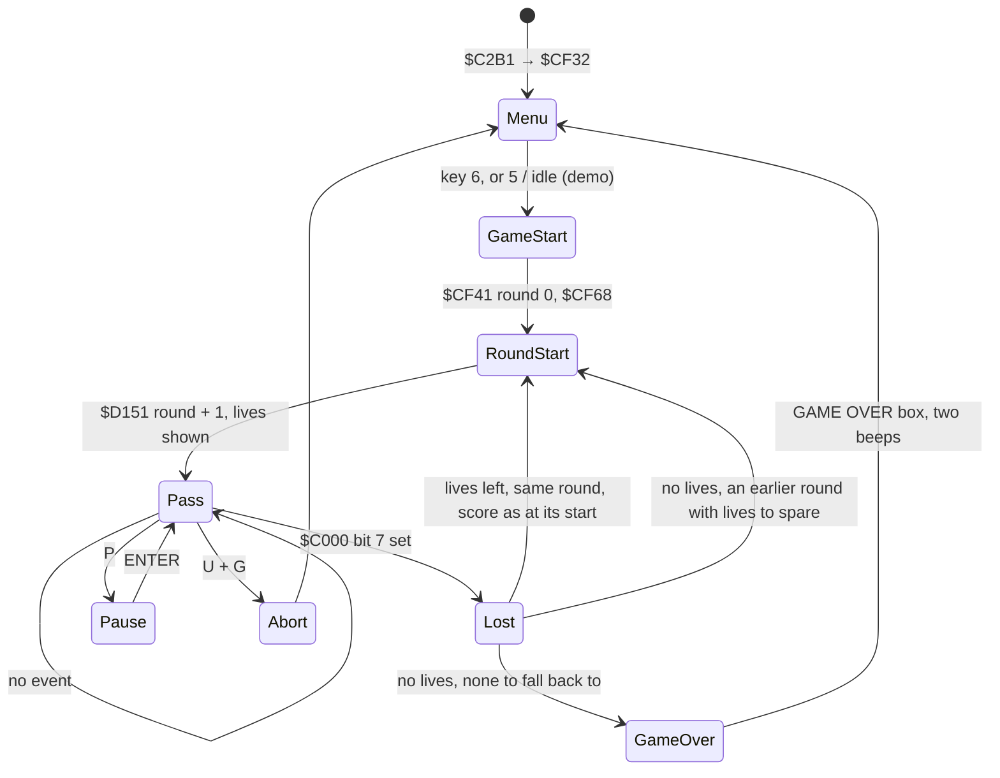
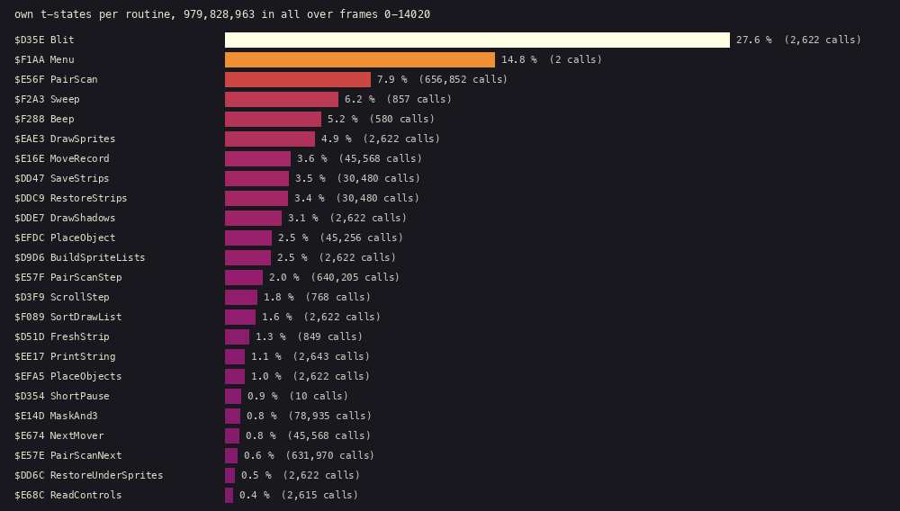

# 4. Game loop

The game's state machine: the menu, the start of a round, the pass loop that plays it, and what happens when the
vehicle is lost. All of it lives in one routine, `$CF32-$D0EC`, which never returns.

Evidence:

- the code from the start image;
- L1's call counts over the game window;
- the game's variables read back from the recording with TTD `memory_at`, every 250 frames from frame 30264.

The recording holds two games, both lost in round 1, and then the demo:

| Frames | What happens | `$C2F9` lives | SCORE / HIGH |
| --- | --- | --- | --- |
| 30264 | the menu | | |
| 30514-33764 | game 1, round 1: four lives lost | 4, 3, 2, 1 | 0 / 0, then HIGH 280 |
| 34264-40264 | game 2, round 1 | 4, 3, 2, 1 | up to 280 / 280 |
| 40514-45260 | the demo (`$F0DB` = `$FF`), with a return to the menu at 43264 | | |

## 4.1 The state machine



`$CF33` is the menu and the game start. Its first call is the menu `$F1AA` ([5.1](05-controls.md)), which returns
when a game or the demo starts. GAME OVER and ABORT both end in `JP $CF33`.

## 4.2 A game and a round

**Game start** (`$CF36`-`$CF65`):

1. It copies the first round record into SCORE (`$EF50` → `$EF49`).
2. It sets the round number `$C2F7` = 0 and clears the sound requests `$F2BF`.
3. It sets the carried lives `$ECE4` = 4.
4. It chooses the first course record: `$CF04` in a game. In the demo it picks one of records 3-10 at random
   (`$EA19`, `$CF56`: `(random AND $1C) + 8` bytes into the table).

**Round start** (`$CF68`-`$CFAA`), the same for a new round and for a retry:

1. It clears the 768-byte ground profile `$6000-$62FF` (`$CF6E`); `$D0EF` builds it in step 6.
2. It sets the first byte of the 11 object records from `$C000` (16 bytes apart) to `$8B`, and ends the list with
   `$FF` (`$CF82`).
3. It resets the scroll state `$C32E`, `$C32F`, `$C3FA` and `$D14D`.
4. It expands the course into the strip list `$CA43` (`$D4D9`, [6](06-rendering.md)).
5. It runs the course scroller `$D3F9` 128 times, 32 strips, to fill the playfield buffer before the first
   picture. L1 counted 1 280 calls of `$D3F9`: ten round starts in the window. In play the scroller runs too, once a
   pass, but entered by falling through from the blit `$D35E` (3 599 entries in all, [6.1](06-rendering.md)).
6. The last pre-roll step is the 32nd strip of the course: there `$D3F9` calls `$D151` and jumps to `$D0EF`, which
   builds the ground profile ([6.5](06-rendering.md)) and returns to the pre-roll loop: the jump is a tail call, so
   the loop ends and the pass loop `$CFAC` follows. Both happen 10 times in the window, once a round start. `$D151`:
   - saves the carried lives into the round table (`$EF4F` + 6 × round);
   - increments `$C2F7`;
   - prints the round number;
   - sets the lives `$C2F9` from `$ECE4`;
   - shows them as cyan dots ([8.4](08-hud-and-text.md));
   - sets up the round's objects from the course record (`$D1DE`-`$D294`, [7](07-objects.md)).

**The round table** `$EF4F`: 6 bytes a round, for rounds 0-10. Each holds the lives at the round's start and SCORE
at that moment (5 characters). `$EEC4` clears the records of rounds 1-10 when the menu is entered (`$F1B8`), but not when the menu follows the
demo ([8.4](08-hud-and-text.md)).

**The course records** `$CF04`: ten records of 4 bytes, the course data and a 128-byte block, `$F300` + 128 ×
(round − 1). They end with `$FFFF`. The course data are stored in the order of rounds 7, 8, 9, 10, 3, 2, 1, 6, 5,
4; the table puts them in play order. After the tenth round, `$D17D` wraps the round number to 1 and increments the lap `$C2F8`. It
also copies round 10's record (`$EF8B`) into round 0's:

| Round | 1 | 2 | 3 | 4 | 5 | 6 | 7 | 8 | 9 | 10 |
| --- | --- | --- | --- | --- | --- | --- | --- | --- | --- | --- |
| course data | `$CDB6` | `$CD5D` | `$CD0F` | `$CEAB` | `$CE5D` | `$CE0A` | `$CBC3` | `$CC17` | `$CC6C` | `$CCC0` |
| block | `$F300` | `$F380` | `$F400` | `$F480` | `$F500` | `$F580` | `$F600` | `$F680` | `$F700` | `$F780` |

## 4.3 The pass

One pass of the loop, `$CFAC`-`$D0EC` (the GAME OVER exit `$D0A5`-`$D0B9` lies inside it), in order:

| Step | Code | Runs | Work |
| --- | --- | --- | --- |
| 1 | `$CFAC` | every pass | in the demo, print " DEMO " and go straight to step 5 |
| 2 | `$CFBF`-`$CFEC` | outside the AUTO start | the shot gauge: count the free shot slots, print it ([8.3](08-hud-and-text.md)) |
| 3 | `$CFEF` | | `$C000` bit 7 set: the vehicle is lost (4.4) |
| 4 | `$D070` → `$E68C` | not in the demo | read the device, or run the AUTO start ([5](05-controls.md)) |
| 5 | `$D073` → `$E15C` | 2 319 | objects ([7](07-objects.md)) |
| 6 | `$D076` → `$EFA5` | 2 319 | objects to screen positions ([6.6](06-rendering.md)) |
| 7 | `$D079` → `$D9D6` | 2 319 | the shadow and sprite lists; the strips under them saved ([6.6](06-rendering.md)) |
| 8 | `$D07C` → `$DDE7` | 2 319 | the shadows, then the sprites (`$EAE3`), into the playfield buffer ([6.6](06-rendering.md)) |
| 9 | `$D07F` → `$D35E` | 2 319 | the playfield to the screen, the strips under the objects put back (`$DD6C`), then one scroll step `$D3F9` ([6](06-rendering.md)) |
| 10 | `$D082` → `$F2C0` | 2 318 | the requested sound effect ([9.6](09-sound.md)) |
| 11 | `$D085` | | clear the sound requests |
| 12 | `$D089`-`$D0EC` | | U+G abort, P pause ([5.5](05-controls.md)) |

The counts are L1's entries in the game window: 2 319 passes, in the two games and the demo together. `$E68C` ran 1
306 times, the passes outside the demo, and its last entry is at frame 39 896.

## 4.4 Losing the vehicle

```text
$CFEF  LD A,($C000)
       BIT 7,A
       JR Z,$D070        ; still alive
       LD HL,$8C05
       CALL $F288        ; the loss beep
       LD A,($C2F9)      ; lives
       DEC A
       LD ($ECE4),A      ; carried into the next round start
       JR NZ,$D050       ; lives left
```

**Lives left** (`$D050`): MAX is updated (`$EF17`) and the round number goes back by one. SCORE is restored from
the round table, as it was when the round started, and the round starts again (`JP $CF68`). `$D151` then
increments the round number back. The samples show this: the round stays 1 and the lives fall 4, 3, 2, 1 in both
games, SCORE goes back to 0.

**No lives left** (`$D005`):

1. The last dot is hidden (`$5A58` = `$12`), followed by a pause (`$D354`), and MAX is updated.
2. In round 1 or 2 the game is over: `$D0A5` prints the GAME OVER box, beeps twice and goes back to the menu.
3. From round 3 on, the game looks back through the round table (`$D017`-`$D04E`). It takes the round before, then
   the one before that, down to round 2, reading the lives the player had when each one started.
4. At the first round whose lives minus one is between 1 and 4, the game restarts that round. It uses that round's
   saved SCORE and those lives minus one.
5. If no round qualifies, it is GAME OVER.

So running out of lives in round 5 sends the player back to round 4 with the lives they had when it started, less
one. If they started round 4 with a single life, the game tries round 3, and so on.
The second recording (`work/p2`, played by the bot of [10](10-gameplay-logic.md)) ran this branch twice. The round
table and the player's record `$C000` at the start of every frame, read by seeking the recording (entry k holds round k + 1; the 5 characters are SCORE without
its fixed last `0`, so `812` is 8 120 points):

| Frame | Event | Round 1 | Round 2 | Round 3 | Round 4 |
| --- | --- | --- | --- | --- | --- |
| 10 630 | round 4 starts with 1 life | 4, blank | 1, `422` | 3, `812` | 1, `1108` |
| 10 895-10 919 | the vehicle is hit (bit 5 of `$C000`), its explosion runs out and the record is gone (bit 7): the last life is lost | | | | |
| 10 980 | back to round 3 with 3 − 1 = 2 lives, SCORE 8 120 (play again from 10 992) | 4 | 1 | **2**, `812` | 1 |
| 11 389-11 413 | hit and gone: 1 of the 2 lives left, the same round again | | | | |
| 11 462 | round 3 retried with 1 life (play from 11 474) | 4 | 1 | **1** | 1 |
| 11 871-11 895 | the last life lost: round 2 holds 1, 1 − 1 = 0 does not qualify: GAME OVER | | | | |

A retry runs `$D151` again, so it overwrites its round's entry with the fewer lives: the table keeps the lives of a
round's last attempt, not of its first. Round 2 had been retried down to 1 life, so it could not be fallen back to.
The look-back (`$D017`) stores each round it tries into `$C2F7` and copies that round's SCORE into `$EF49`
*before* it tests the lives (`$D032`-`$D03E`). So a round that does not qualify still leaves its traces: after the
last loss (the record gone at frame 11 895), from frame 11 939 on, the round number reads 1 and SCORE reads 4 220, round 2's starting score, instead of the
8 120 the player had. MAX was updated before the look-back (`$D00D`): it holds 11 080, the best SCORE of the game,
reached at the start of round 4 and lost in the fall back. By frame 12 500, after the GAME OVER box, HIGH reads 11 080
and MAX is cleared.

## 4.5 Time

No pass waits for the frame: there is no `HALT`, and interrupts are off from `$CF32` on ([2.4](02-architecture.md)).
A pass takes as long as its work. Over the window, the 2 319 passes in frames 30520-45010 take 6.2 frames each on
average, about 8 passes a second. Sound effects stop the game while they sound ([9.6](09-sound.md)), so a pass with
an effect is longer.

Where the t-states go over the bot's whole game (L1's own t-states per routine, `tools/heatviews.py routines`):



The blit (`Blit`, `$D35E`) is over a quarter of all the time. `$F1AA` (`Menu`) is the menu waiting for a key (two visits). Then come the
pair scan of the hit test (`PairScan` `$E56F`, entered 656 852 times: every pair of live records, every pass), the beeper
effects that stop the game while they sound (`Sweep` `$F2A3`, `Beep` `$F288`, [9.6](09-sound.md)), and the object passes
around the blit: `DrawSprites` (`$EAE3`) puts the moving objects into the playfield buffer, `SaveStrips` (`$DD47`)
first keeps the strips each object will cover, and after the blit `RestoreStrips` (`$DDC9`) puts them back
([6.6](06-rendering.md)). The names are the source's ([12. Routine reference](12-routine-reference.md)).

## 4.6 Design notes

- **One routine, no scheduler.** The game is a single loop of calls in a fixed order. Every module runs once a pass,
  and the order is the only contract between them: input, objects, playfield, screen, sound.
- **Retry = restart.** A lost life replays the round start from the same course record. Score and lives come back
  from the round table, so there is no "undo" logic, only a reload.
- **Falling back instead of game over.** The round table makes the game forgiving in a way that costs no code
  beyond a loop. Running out of lives costs rounds, not the whole game.
- **No frame lock.** The speed of play follows the work in each pass. On a 1989 game that is common, but it means
  the game runs slower when the screen is busy.
