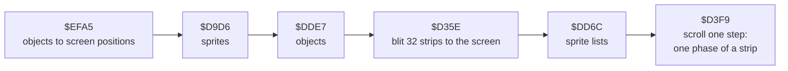
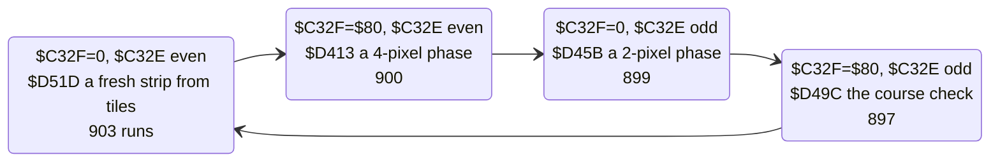

# 6. Rendering

How the isometric course gets on the screen. The game never draws in isometric. It keeps the course as 32 upright
strips, scrolls them sideways, and lets a table of screen addresses skew them into the diagonal the player sees. The
same table clips the picture against the panel and the screen edges, with no test in the drawing loop.

Evidence:

- the code from the start image;
- L1's execution counts of every path in the game window;
- memory images of the recording from TTD `memory_at`. `tools/playfield.py` re-runs the blit in Python on such an
  image. Its output matches 92 to 99 % of the play area of the real screen at frames 30700, 35500, 36000 and 38000;
  the rest is the sprites, drawn after the blit (6.6).


## 6.1 One pass, the drawing part



`$D35E`, `$DD6C` and `$D3F9` are one piece of code: the blit calls `$DD6C` and runs on into the scroller. L1 counts
3 599 entries at `$D3F9`: 2 319 by falling through from the blit, one a pass, and 1 280 calls from the round
start's pre-roll ([4.2](04-game-loop.md)).

## 6.2 The playfield buffer `$8000-$BFFF`

64 pages of 256 bytes. Each page holds two **strips**, at bytes `$00-$7F` and `$80-$FF`. A strip is one byte wide
(8 pixels) and 128 lines tall, the first byte at the bottom.

The screen shows 32 strips, one a column. For the scroll state `$C32E` (0-63) and `$C32F` (0 or `$80`):

| Column | Page | Strip |
| --- | --- | --- |
| j | `$80` + ((`$C32E` + 2j) mod 64) | the half `$C32F` |

So the 32 columns use every other page, and the scroll state picks which set of 32 and which half. Each set is the
same course moved by 2 pixels (6.4).

## 6.3 The blit `$D35E` and the address list `$D5B2`

```text
$D35E  LD ($C331),SP      ; the stack pointer, kept in a variable
       LD SP,$D5B2        ; the list of screen addresses
       ...                ; DE = the first strip: page $80 + $C32E, byte $C32F
$D378  POP HL             ; the screen address of a cell's bottom line
       LD A,(DE)
       LD (HL),A          ; one line
       INC E
       DEC H              ; the line above
       ...                ; 8 lines, then the next POP
```

The list holds 528 addresses: 17 for each even column, 16 for each odd one. Each address is the bottom line of a
character cell, and the blit writes up to 8 lines up from it. The first and last POPs of an even column write 4 lines
only, so the even columns sit half a cell (4 lines) off the odd ones.

**The skew.** Strip byte k of column j lands on line (191 − k) for the first columns. From column 9 on, each column
starts 4 lines higher than the one to its left:

| Columns | Bytes shown | Lines | Cut by |
| --- | --- | --- | --- |
| 0-8 | 36-4 up to 127 | from the bottom line 191 | the screen's bottom |
| 9-18 | 0-127 | from 191 − 4 (j − 9) | |
| 19-24 | 16-0 up to 127 | from line 135 | the panel |
| 25-31 | 0 up to 127-103 | up to line 0 | the screen's top |

A slope of 4 lines per 8 pixels is the 2:1 isometric diagonal. A strip moved 2 pixels to the left in the buffer
moves 2 pixels left and 1 line up on the screen. A sideways scroll in the buffer is therefore the diagonal scroll of
the game.

**Clipping through the ROM.** Where a strip must not show, the list holds `$0800`: 43 of its 528 entries. Writes to
the ROM are lost, so those lines go nowhere. The loop is the same 128 lines for every column, unrolled, without a
compare.

A pass copies 32 × 128 = 4 096 lines as `LD A,(DE); LD (HL),A; INC E; DEC H`, with a POP for every cell and no
address arithmetic.

## 6.4 Scrolling `$D3F9`: one phase a pass

`$D3F9` toggles `$C32F` and steps `$C32E` every second pass, so the state runs (n, 0), (n, `$80`), (n + 1, 0),
(n + 1, `$80`), (n + 2, 0)... Every pass moves the picture 2 pixels; after four passes, column j shows what column
j + 1 showed. In between, the scroller makes one new strip a pass:



With H the page of the last fresh strip (`$C3FC`), the four strips between two fresh ones are made like this:

| Pass | Writes | From | Shift | Lines |
| --- | --- | --- | --- | --- |
| `$D51D` | page H, half 0 | 8 edge bytes and 15 tiles (6.5) | | |
| `$D51D` (its tail) | page H − 2, half `$80` | H − 2's half 0, the bits entering from H | 2 pixels left (`RL C; RLA` twice) | 1 and 3 |
| `$D413` | page H − 1, half 0 | H's half 0, the bits entering from H − 2 | 4 pixels right (`RRD`) | 2 |
| `$D45B` | page H − 1, half `$80` | H's half 0, the bits entering from H − 2 | 2 pixels right (`RRA; RR C` twice) | 1 and 3 |
| `$D49C` | nothing | | | |

Each derived strip is a copy of a neighbour moved down by a line or two (an `LDIR` into the other strip), then
shifted, taking the pixels that come in from the strip on the other side. The phases are the pixels between two
fresh strips at 2, 4 and 6 pixels. The line offsets keep them on the diagonal of 6.3.

The fourth pass draws nothing. It checks the course (6.5) and counts the strips of the round in `$C3FA`.

## 6.5 The course

**Expanding a course `$D4D9`.** A course record ([4.2](04-game-loop.md)) points to the course data, one byte a
segment, ended by `$FF`. Each byte b selects a word list at `$C8EA` + 2b, ended by a zero word (the lists overlap:
a byte can start inside another's list). The words are copied, in order, into the **row list** at `$CA43`. Round 1
expands to 191 rows. `$C3F8` points to the next row, `$C3FA` counts the strips drawn.

**A row** is the address of a run of tile numbers, one per tile across the track, from the bottom of the strip up.
Round 1's 191 rows use 32 different addresses, between `$C641` and `$C8BD`. Many of them are one byte apart, as
`$C641`, `$C642`, `$C643`: the same run of tiles, starting one tile further across. That is how the track moves
sideways in a bend without a new row of graphics.

**A fresh strip `$D51D`.** It takes 15 rows from `$C3F8` on, and tile i of the strip from row i at offset i:

```text
$D54A  LD HL,($C3F8)
       LD SP,HL           ; the rows, popped
       INC HL
       INC HL
       LD ($C3F8),HL      ; one row further for the next strip
...
$D558  POP HL             ; row i
       ADD HL,BC          ; + i
       LD A,(HL)          ; the tile number
       ...                ; HL = $C400 + 8 × tile
       LDI × 8            ; 8 lines of the strip
```

Sampling row i at offset i is a diagonal through the map. That diagonal is the vertical strip of the unskewed
buffer: the course map is stored square, as rows across the track, and the isometric view is made of its
diagonals. The tiles are 8 × 8 bytes at `$C400`. The first 8 lines of the strip are an edge: tile `$C4B8` for three
strips in four, `$C4C0` for the fourth (222 of the 903 runs).

**The end of a course.** On the fourth pass, `$D49C` looks at the high byte of the row 15 ahead (`$C3F8` + `$1F`).
`$FF` means the course has run out:

- in the demo, the game goes back to the menu (`$D4C9`, once in the recording, at the end of the demo);
- otherwise, the next course record (`$CF2E` + 4, wrapping at `$FFFF` to `$CF04`) is expanded and the scroll goes
  on into it.

**The round starts 32 strips in.** When `$C3FA` reaches 32, `$D4BF` calls `$D151` and jumps into the play loop at
`$D0EF`. The pre-roll of the round start is 128 scroll steps, 32 strips: its last step is the one that starts the
round ([4.2](04-game-loop.md)). A course that follows another without a break counts as a new round the same way. That is read from the code: in
the recording only the demo reached the end of a course.

## 6.6 Objects on the playfield

After the blit, the objects are drawn over the screen. The code is in [7. Objects](07-objects.md); here are the
parts of the pass that touch the picture:

| Routine | Per pass | What it does with the picture |
| --- | --- | --- |
| `$EFA5` | 2 319 | for every object record at `$C000` (16 bytes each), the screen column and line from its course position (`+1`, `+2`) less the distance scrolled (`$D14D`, + 2 a pass); keeps the visible ones in lists sorted by depth (`+4`) |
| `$D9D6` | 2 319 | draws the visible objects from those lists; it starts the lists at `$FE64` and `$FF00` and the pointer `$F800` |
| `$DD6C` | 2 319 | after the blit, walks the same two lists |

The 1 to 8 % of the play area where `tools/playfield.py` differs from the screen is these sprites.

## 6.7 Colour

The pass does not touch the play area's attributes. L1's write counts over the window: 762 of the 768 attribute
bytes were written 1 to 24 times, by the copy from `$A000`, by `$D338` ([8.5](08-hud-and-text.md), 14 runs) and by
the menu. The other 6 were written 2 363 times: the message window at (2, 6), printed every pass of the demo
([8.3](08-hud-and-text.md)). The playfield is drawn in ink only, one colour per cell,
so the scroll never has attribute clash to manage: a cell's colour is the course's, wherever the course moves.

## 6.8 Design notes

- **Draw upright, skew by addresses.** All the geometry of the isometric view is in a 1 KB list. The drawing loop
  never computes an address; it pops them. A different slope or window would be a different list.
- **Clip by writing into the ROM.** 43 list entries point at `$0800`. A masked strip costs the same as a shown one,
  and the loop has no branch.
- **Pre-shifted phases, made one a pass.** A 2-pixel scroll needs the course at four shifts. The game keeps all
  four in the buffer and makes one new strip a pass, so the cost of shifting is spread evenly and the blit is a plain
  copy.
- **Bends for free.** A row is a pointer into a run of tiles. Pointing one byte earlier or later shifts the track
  by a tile, so a bend costs a word in the row list, not a row of graphics.
- **The map is square.** The course is stored as rows across the track; the diagonals of the map are the strips.
  The designer edits a grid; the code turns it into a view.
- **The stack as a pointer.** The blit and the tile drawer both point SP at their data and POP it, the fastest way
  to read a word on the Z80. Interrupts are off, so nothing else uses the stack meanwhile.
