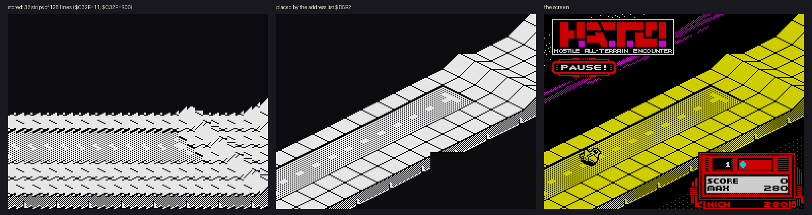
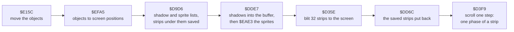
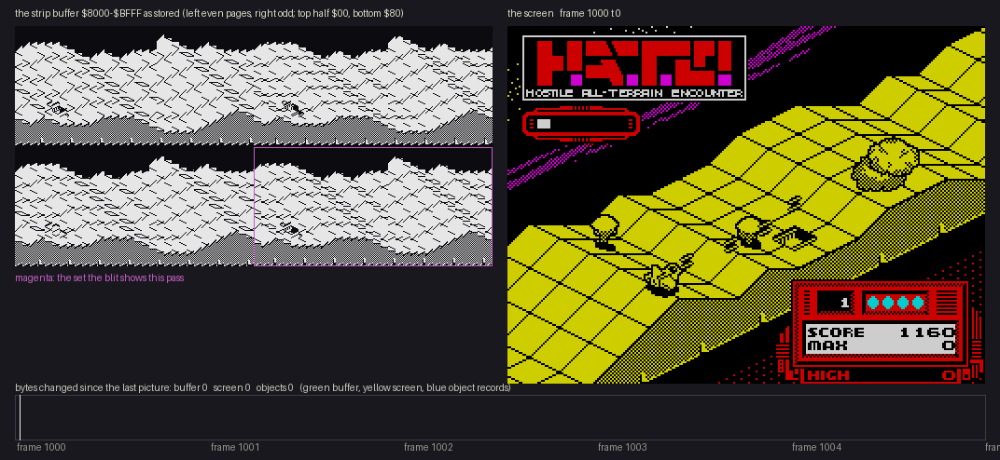
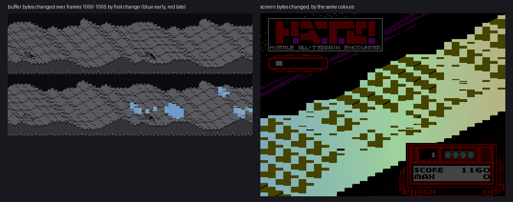
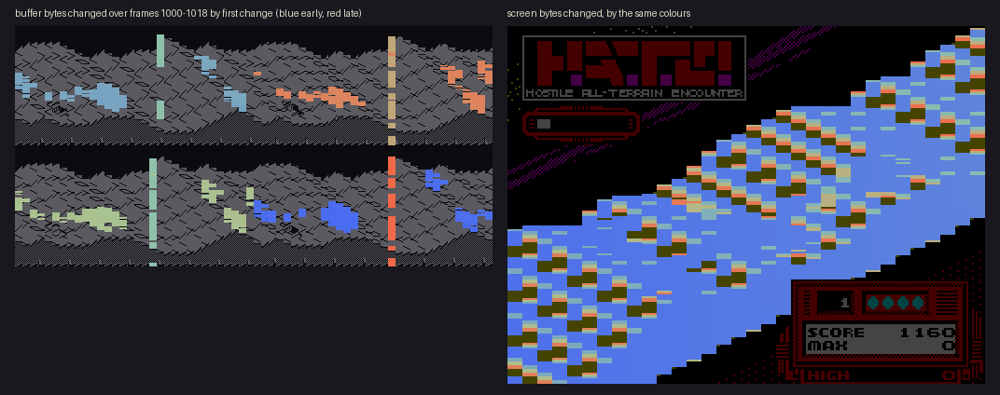
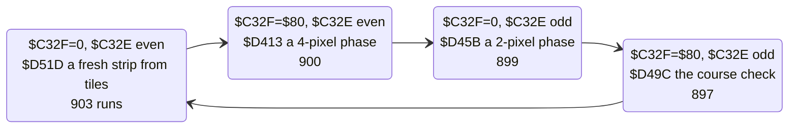
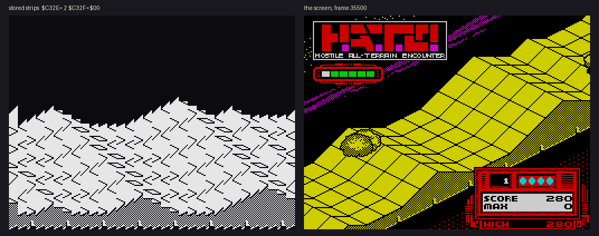
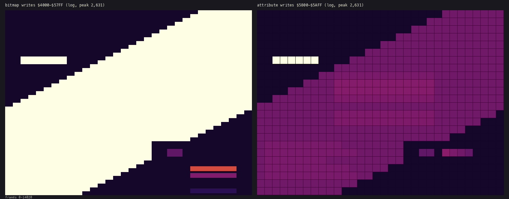

# 6. Rendering

How the isometric course gets on the screen. The game never draws in isometric. It keeps the course as 32 upright
strips, scrolls them sideways, and lets a table of screen addresses skew them into the diagonal the player sees. The
same table clips the picture against the panel and the screen edges, with no test in the drawing loop.

Evidence:

- the code from the start image;
- L1's execution counts of every path in the game window;
- memory images of the recording from TTD `memory_at`. `tools/playfield.py` re-runs the blit in Python on such an
  image. Its output matches 92 to 99 % of the play area of the real screen at frames 30700, 35500, 36000 and 38000;
  the rest is the shadows and sprites, which the pass draws into the buffer before the blit and takes out again
  after it (6.6).



## 6.1 One pass, the drawing part



The objects are drawn into the playfield buffer, not onto the screen: the blit copies them out with the course,
and `$DD6C` then takes them out of the buffer again (6.6).

`$D35E`, `$DD6C` and `$D3F9` are one piece of code: the blit calls `$DD6C` and runs on into the scroller. L1 counts
3 599 entries at `$D3F9`: 2 319 by falling through from the blit, one a pass, and 1 280 calls from the round
start's pre-roll ([4.2](04-game-loop.md)).

**One pass, as it draws.** The GIF below samples one pass of the bot's game in round 1 (frames 1000-1005,
[10.1](10-gameplay-logic.md)) every 1 750 t-states with TTD `memory_at`, the way `tools/pass_anim.py` does it.
Each byte that changed since the last picture lights up where it shows: in the strip buffer, drawn whole as
stored, and on the screen. The buffer is drawn as its four sets of 32 strips (6.2), with the set the blit shows
outlined. The bar underneath counts the changed bytes of the buffer, the screen and the object records
`$C000-$C1FF`, picture by picture:



| Frames:t-state | Changed | What it is |
| --- | --- | --- |
| 1000:0-1000:35000 | about 40 bytes of object records | the objects move (`$E15C`, `$EFA5`) |
| 1001:3600-1001:45600 | 350 bytes of the buffer, all in the outlined set (odd pages, half `$80`) | the shadows and sprites drawn into the strips (`$DDE7`, `$EAE3`) |
| 1001:47400-1003:10800 | 2 134 screen bytes, column by column from the left | the blit `$D35E`: about 103 000 t-states, 1.5 frames |
| 1003:7300-1003:28300 | 285 bytes of the buffer, at the same places | `$DD6C` puts the saved strips back |
| 1005:18000 | the buffer again | the next pass: this one took about 4.2 frames (the average over the game window is 6.2, sound effects included, [4.5](04-game-loop.md)) |

The pass draws no new strip: its scroll state was `$C32E` = `$25`, `$C32F` = `$80`, the phase that only checks the
course (6.4). The numbers are as exact as the sampling allows, 1 750 t-states. A byte written with the value it
already held does not show, so the blit counts the bytes the scroll changed (2 134 of the play area's 3 792), not
its writes.

Every byte the pass changed, coloured by the moment it first changed (blue early, red late). The screen's colours
run from the left edge to the right, the order the blit goes through the strips:



Over four passes (frames 1000-1018) the sprites land in a different set each pass, the one the next blit shows. The
upright bars are the strips the scroller rewrites, one phase a pass (6.4):



## 6.2 The playfield buffer `$8000-$BFFF`

64 pages of 256 bytes. Each page holds two **strips**, at bytes `$00-$7F` and `$80-$FF`. A strip is one byte wide
(8 pixels) and 128 lines tall, the first byte at the bottom.

The screen shows 32 strips, one a column. For the scroll state `$C32E` (0-63) and `$C32F` (0 or `$80`):

| Column | Page | Strip |
| --- | --- | --- |
| j | `$80` + ((`$C32E` + 2j) mod 64) | the half `$C32F` |

So the 32 columns use every other page, and the scroll state picks which set of 32 and which half. Each set is the
same course moved by 2 pixels (6.4).

The analyzer finds the buffer on its own: a 16 K run that the routine writing the screen (`Blit`) reads and the code
rewrites again and again (23 writes a byte at least over the bot's game, 842 reads a byte in the median) is one back
buffer claim, `$8000-$BFFF`. `Blit` copies it with plain loads, no block copy, so the detector had to learn this case
(WALKTHROUGH section 5).

## 6.3 The blit `$D35E` and the address list `$D5B2`

```text
$D35E  LD ($C331),SP      ; the stack pointer, kept in a variable
       LD SP,$D5B2        ; the list of screen addresses
       ...                ; DE = the first strip: page $80 + $C32E, byte $C32F
$D378  POP HL             ; the screen address of a cell's bottom line
       LD A,(DE)
       LD (HL),A          ; one line
       INC E
       DEC H              ; the line above
       ...                ; 8 lines, then the next POP
```

The list holds 528 addresses: 17 for each even column, 16 for each odd one. Each address is the bottom line of a
character cell, and the blit writes up to 8 lines up from it. The first and last POPs of an even column write 4 lines
only, so the even columns sit half a cell (4 lines) off the odd ones.

**The skew.** Strip byte k of column j lands on line (191 − k) for the first columns. From column 9 on, each column
starts 4 lines higher than the one to its left:

| Columns | Bytes shown | Lines | Cut by |
| --- | --- | --- | --- |
| 0-8 | 36-4 up to 127 | from the bottom line 191 | the screen's bottom |
| 9-18 | 0-127 | from 191 − 4 (j − 9) | |
| 19-24 | 16-0 up to 127 | from line 135 | the panel |
| 25-31 | 0 up to 127-103 | up to line 0 | the screen's top |

A slope of 4 lines per 8 pixels is the 2:1 isometric diagonal. A strip moved 2 pixels to the left in the buffer
moves 2 pixels left and 1 line up on the screen. A sideways scroll in the buffer is therefore the diagonal scroll of
the game.

**Clipping through the ROM.** Where a strip must not show, the list holds `$0800`: 43 of its 528 entries. Writes to
the ROM are lost, so those lines go nowhere. The loop is the same 128 lines for every column, unrolled, without a
compare.

The bot's game shows where the lost lines land. `DEC H` walks up from `$0800` and L stays `$00`, so a clipped
cell writes the 8 ROM bytes `$0800`, `$0700` ... `$0100` and nothing else. L1 counts 112 746 writes at each of
`$0500-$0800` and 86 526 at each of `$0100-$0400`: the 4-line cells (the first and last POP of an even column)
stop at `$0500`. No code reads those bytes. The analyzer claims them as ROM bytes only written, the writes lost
(WALKTHROUGH section 5).

A pass copies 32 × 128 = 4 096 lines as `LD A,(DE); LD (HL),A; INC E; DEC H`, with a POP for every cell and no
address arithmetic.

## 6.4 Scrolling `$D3F9`: one phase a pass

`$D3F9` toggles `$C32F` and steps `$C32E` every second pass, so the state runs (n, 0), (n, `$80`), (n + 1, 0),
(n + 1, `$80`), (n + 2, 0)... Every pass moves the picture 2 pixels; after four passes, column j shows what column
j + 1 showed. In between, the scroller makes one new strip a pass:



The scroll in the recording, frames 35500-35740 (game 2, the AUTO start), one picture every 3 frames, three projections
of the same moment:

1. the 32 strips as stored, unskewed (byte 0 of each strip at the bottom): the course map's diagonals side by side,
   moving sideways as the phases of 6.4 shift them;
2. the same bytes placed where the blit `$D35E` puts them, through the address list `$D5B2`
   (`tools/playfield.py`): this is the screen's isometric projection;
3. the real screen. Its play area matches 2; what differs is the shadows and sprites, in the buffer only while
   the blit copies it (6.6), and the panel at the lower right.



With H the page of the last fresh strip (`$C3FC`), the four strips between two fresh ones are made like this:

| Pass | Writes | From | Shift | Lines |
| --- | --- | --- | --- | --- |
| `$D51D` | page H, half 0 | 8 edge bytes and 15 tiles (6.5) | | |
| `$D51D` (its tail) | page H − 2, half `$80` | H − 2's half 0, the bits entering from H | 2 pixels left (`RL C; RLA` twice) | 1 and 3 |
| `$D413` | page H − 1, half 0 | H's half 0, the bits entering from H − 2 | 4 pixels right (`RRD`) | 2 |
| `$D45B` | page H − 1, half `$80` | H's half 0, the bits entering from H − 2 | 2 pixels right (`RRA; RR C` twice) | 1 and 3 |
| `$D49C` | nothing | | | |

Each derived strip is a copy of a neighbour moved down by a line or two (an `LDIR` into the other strip), then
shifted, taking the pixels that come in from the strip on the other side. The phases are the pixels between two
fresh strips at 2, 4 and 6 pixels. The line offsets keep them on the diagonal of 6.3.

The fourth pass draws nothing. It checks the course (6.5) and counts the strips of the round in `$C3FA`.

**Checked against the recording.** `tools/verify_buffer.py` rebuilds all four sets of the buffer from the course data
alone: the fresh strips of 6.5, from `src/res` and the row lists, and the three phases by the rules above. A phase
strip of a fresh strip s and the next one, s + 1, is, line by line (y counted from the bottom):

| Set | Line y of the phase strip |
| --- | --- |
| even pages, half `$80` (2 pixels) | (s[y + 1] << 2) OR (s + 1[y − 3] >> 6) |
| odd pages, half 0 (4 pixels) | (s[y + 2] << 4) OR (s + 1[y − 2] >> 4) |
| odd pages, half `$80` (6 pixels) | (s[y + 3] << 6) OR (s + 1[y − 1] >> 2) |

The tool compares the result with the buffer of the bot's game ([10.1](10-gameplay-logic.md)) at frames 1004, 3000,
5000, 7000, 9000, 10000 and 10800 (rounds 1 to 4, and the hand-over from course 1 to course 2 around frame 3000). Every
strip of the three sets the blit does not show is one of two things. Either it equals its rebuilt strip byte for
byte over lines 4-123 (the first and last lines take bits from outside the strip), or it holds a pad stamped over
the course (6.6). In the set the blit shows, the strips that differ are the pass's shadows and sprites. Only the edge
tile is not predicted: which of the two it is follows the strip count, not the course, so the tool accepts either.

## 6.5 The course

**Expanding a course `$D4D9`.** A course record ([4.2](04-game-loop.md)) points to the course data, one byte a
segment, ended by `$FF`. Each byte b selects a word list at `$C8EA` + 2b, ended by a zero word (the lists overlap:
a byte can start inside another's list). The words are copied, in order, into the **row list** at `$CA43`. Every
course expands to 178 rows (`$CA43-$CBA6`). Static rows follow them in the image (from `$CBA3`, `$C643` and
`$C655` alternating); the expansion overwrites the first two of them, so 13 are left before the end mark `$FFFF`
at `$CBC1`: 191 rows in all. `$C3F8` points to the next row, `$C3FA` counts the strips drawn.

**A row** is the address of a run of tile numbers, one per tile across the track, from the bottom of the strip up.
Round 1's 178 rows use 32 different addresses, between `$C641` and `$C8DB`. Many of them are one byte apart, as
`$C641`, `$C642`, `$C643`: the same run of tiles, starting one tile further across. That is how the track moves
sideways in a bend without a new row of graphics.

**A fresh strip `$D51D`.** It takes 15 rows from `$C3F8` on, and tile i of the strip from row i at offset i:

```text
$D54A  LD HL,($C3F8)
       LD SP,HL           ; the rows, popped
       INC HL
       INC HL
       LD ($C3F8),HL      ; one row further for the next strip
...
$D558  POP HL             ; row i
       ADD HL,BC          ; + i
       LD A,(HL)          ; the tile number
       ...                ; HL = $C400 + 8 × tile
       LDI × 8            ; 8 lines of the strip
```

Sampling row i at offset i is a diagonal through the map. That diagonal is the vertical strip of the unskewed
buffer: the course map is stored square, as rows across the track, and the isometric view is made of its
diagonals. The tiles are 8 × 8 bytes at `$C400`. The first 8 lines of the strip are an edge: tile `$C4B8` for three
strips in four, `$C4C0` for the fourth (222 of the 903 runs).

**The end of a course.** On the fourth pass, `$D49C` looks at the high byte of the row 15 ahead (`$C3F8` + `$1F`).
`$FF` means the course has run out:

- in the demo, the game goes back to the menu (`$D4C9`, once in the recording, at the end of the demo);
- otherwise, the next course record (`$CF2E` + 4, wrapping at `$FFFF` to `$CF04`) is expanded and the scroll goes
  on into it.

**The round starts 32 strips in.** When `$C3FA` reaches 32, `$D4BF` calls `$D151` (`RoundSetup`) and `$D4C2` jumps
to `$D0EF` (`BuildGroundProfile`). The jump is a tail call: `$D0EF` ends in `RET`, back to the caller of `$D3F9`,
the pre-roll loop (`$CFA6`) or the pass (`CALL $D35E` at `$D07F`). The pre-roll of the round start is 128 scroll steps, 32 strips: its last step is the one that starts the
round ([4.2](04-game-loop.md)). A course that follows another without a break counts as a new round the same way. In the first recording only the
demo reached the end of a course; the bot's recording ([10](10-gameplay-logic.md)) shows the seamless hand-over:
`$D151` ran 9 times (rounds 1-4, three retries, a fall back, the demo) but the round start `$CF68` only 6, so rounds
2, 3 and 4 began straight out of the scroll of the round before, with no pre-roll.

**The ground profile `$D0EF`.** It clears `$6000-$62FF` and builds the profile of the course that the mover reads
([7.4](07-objects.md)): one byte for every 2 units along, the ground height in bits 0-4 and the walls in bits 5-7.
Each course byte b (after the player's type) selects a list at `$C9FE` + b / 2, ended by `$FF`. Each byte of the
list is an **anchor**, written every 8 bytes from `$6008` on. Its wall bits 5-7 are also ORed into the anchor
before it, and the 7 bytes between the two anchors step the height linearly from the earlier one toward it
(the difference / 8, subtracted 7 times; the wall bits of the earlier anchor carried along). It stops at the end
of the course or of the buffer (`$6300`).

The 7 in-between bytes are 8-bit arithmetic on the whole byte. The step is (earlier height − new height) shifted
right 3 times with `SRA`, so it keeps its sign. It is subtracted from the earlier anchor, walls and all.
`tools/verify_profile.py` builds the profile this way from `src/res/course/ground-anchors.bin` and a course file. The
result equals `$6000-$62FF` of the bot's game, all 768 bytes, at frames 1004, 3000, 5000, 7000, 9000 and 10800
(rounds 1 to 4). The profile pictures of [src/res/README.md](../src/res/README.md) draw these 768 bytes.

## 6.6 Objects on the playfield

The objects are drawn into the playfield buffer `$8000-$BFFF`, before the blit, and taken out again after it. The
blit copies them to the screen with the course; the scroller then finds the buffer clean. The code that moves them
is in [7. Objects](07-objects.md); here are the parts of the pass that touch the picture, in order:

| Routine | Per pass | What it does with the picture |
| --- | --- | --- |
| `$EFA5` `PlaceObjects` | 2 319 | for every object record at `$C000` (16 bytes each), the strip column `+B`, the phase `+9` and the line `+A` from its course position (`+1`, `+2`) less the distance scrolled (`$D14D`, + 2 a pass); types 14-15 go to the list `$C99E`, the others are sorted by height and depth (`$FF00`, then `$F089`) into the draw list `$6500` |
| `$D9D6` `BuildSpriteLists` | 2 319 | stamps the pads and dishes (`$EA38`, below); then walks the draw list twice: the shadow list `$FE64` (8 bytes an object) and the sprite list `$FF00` (6 bytes); for each entry it first saves the strips the object will cover to `$F800` (`SaveStrips` `$DD47`) |
| `$DDE7` `DrawShadows` | 2 319 | ANDs each shadow of `$FE64` into the buffer, then jumps to `DrawSprites` `$EAE3`, which masks the sprites of `$FF00` in over them (AND mask, OR pixels; writes `$8011-$BFF1`) |
| `$D35E` `Blit` | 2 319 | copies the buffer, objects included, to the screen (6.3) |
| `$DD6C` `RestoreUnderSprites` | 2 319 | called by the blit: walks both lists in the order they were saved and copies the strips back from `$F800` (`RestoreStrips` `$DDC9`) |

A sprite comes from the pointer table `$C300` + `+8` ([7.1](07-objects.md)), in 4 pre-shifted frames picked by the
phase: 4 strips of 21 lines for types 0-3, 3 of 17 for 4-10, 2 of 13 for 11-13, a mask byte and a pixel byte a
line. At the edges of the window the strips that fall outside are dropped. A dying record is drawn as a type 3, its
graphic the explosion frame its counter `+8` points to (`$7C10-$7FFF`), one line lower at height 25 and two lines
lower above 25 (`$DBC3`-`$DBD4`).

On the screen a sprite comes out upside down in memory. `DrawSprites` walks a strip down the buffer column
(`INC E`, mask then pixel byte), and the blit shows that column bottom line first (6.3). So the line under a sprite
line comes from the pair 2 bytes lower. The analyzer's drawn frames show exactly that: a line step of -2 and strips
42 (21 lines) or 34 (17 lines) bytes apart. This is the layout an extractor has to follow, see WALKTHROUGH 6.14.

**A block holds four frames, the last one a strip narrower.** The frame is (phase - 1) AND 3, and the frames follow
each other at a fixed size: `$A8` bytes for types 0-3, `$66` for 4-10, `$34` for 11-13 (`SpriteBig`, `SpriteMid`,
`SpriteSmall` in `src/game/sprites.asm`). Phase 0 picks frame 3 and draws one strip fewer, so frame 3 is stored one
strip short. The block sizes in the pointer table `$C300` show it:

| Types | Strip | Frames 0-2 | Frame 3 | Block |
| --- | --- | --- | --- | --- |
| 0-3 | 21 lines, 42 bytes | 4 strips, 168 bytes | 3 strips, 126 | 630 (`$6580`, `$67F6`, `$6A6C`, `$6CE2`) |
| 4-10 | 17 lines, 34 bytes | 3 strips, 102 | 2 strips, 68 | 374 (`$72A0`-`$7878`) |
| 11-13 | 13 lines, 26 bytes | 2 strips, 52 | 1 strip, 26 | 182 (`$79EE`, `$7AA4`, `$7B5A`) |
| pads, dishes (`$EA38`) | 14 lines, 28 bytes | 4 strips, 112 | 3 strips, 84 | 420 (`$6F58`, `$70FC`) |

The explosion frames `$7C10-$7FFF` are six blocks of 168 bytes, picked by the counter `$20`-`$2C` (`$20` and `$24` both point at `$7CB8`).

**Pads and dishes are stamped, not drawn.** `$EA38` (`StampStatics`) draws the records of types 14 and 15 (list
`$C99E`) straight into the buffer, and only while their column `+B` is `$20-$23`: the last strips of the window,
at the far edge of the buffer. They are not saved or restored: they become part of the course picture and scroll with
it, like the tiles.

The buffer shows this exactly. `tools/verify_buffer.py` (6.4) explains each strip that differs from the course as a
block of `SpriteGfx1C` (the 420-byte block, 14 lines a strip) laid over the course: `AND` mask, `OR` pixels, each
strip of the block 4 lines below the one before (the slope of 6.3). The frame differs from set to set, one step
back for each 2 pixels of phase: at frame 1004 frames 0, 3, 2 and 1 in the sets of 0, 2, 4 and 6 pixels, at frame
5000 frames 3, 2, 1 and 0. So the four pre-shifted frames of a block are one picture moved by 2 pixels each, and
each set gets the frame that matches its own phase. The moments checked hold only pads (slot `$1C`).

The sprites themselves check out the same way. `tools/verify_sprites.py` finds the moment `DrawSprites` sets its
pointer `$DD68` to `$FF00`, after the shadows, to the T-state, and the moment it reaches the `$FF` that ends the
list. Between them it draws the list `$FF00` from the files in `src/res/gfx`, as the routine does (AND mask, OR
pixels, 21, 17 or 13 lines a strip, the next strip 2 rows on and 4 lines down). The whole buffer `$8000-$BFFF`
then equals the recording, in five passes of the bot's game with 8 to 15 sprites each, 151 to 295 bytes changed,
eight explosion frames among them. Every sprite address is a block of the table `$C300` plus whole frames plus
whole strips, and the strips drawn fit the frame (frame 3 one short). The 20 graphic files equal memory at the
addresses the table names. Sixteen of them were drawn in these passes: all but slot `$04`, slot `$1A` and the two
pad blocks, which are stamped, not drawn (above).

The 1 to 8 % of the play area where `tools/playfield.py` differs from the screen is these shadows and sprites.

### Shadows

Every object of types 0-13 casts a shadow on the ground under it. The first walk of `$D9D6` makes the shadow
list `$FE64`, one 8-byte entry an object: type, phase, the profile address under it, the strips, the mask offset
of a clipped left edge, and the buffer address. The line is `+A` plus the **ground height**, bits 0-4 of the profile
`$6000` (6.5), not the object's own height. A dying record fails the type compares at `$DA0B` and casts no shadow;
types 14 and up are not in the list.

`$DDE7` draws the list:

- types 0-3 and 4-10: a mask is built in `$6500` (4 strips of 17 bytes, or 3 of 11, set to `$FF`), ANDed together
  from runs of the shape tables at `$5CE0`, `$5DE8`, `$5EF0` (types 0-3) or `$5B60`, `$5BE0`, `$5C60` (4-10), at an
  offset by the phase. Each step of 2 units along moves to the next profile byte and shifts the run by the change in
  ground height, so the shadow follows the slope. The mask is then ANDed into the buffer;
- types 11-13: 4 bytes a strip from `$5B00`, `$5B20` or `$5B40` (flat, rising by 1, or more over the next profile
  byte), ANDed straight in.

The shape tables lie below the game image: the copy at `$9F1C` puts them there from `$BB00-$BFFF` with the game
screen ([2.2](02-architecture.md)). A shadow only clears pixels (AND); the sprites are then drawn over the
shadows.

## 6.7 Colour

The pass does not touch the play area's attributes. L1's write counts over the window: 762 of the 768 attribute
bytes were written 1 to 24 times, by the copy from `$A000`, by `$D338` ([8.5](08-hud-and-text.md), 14 runs) and by
the menu. The other 6 were written 2 363 times: the message window at (2, 6), printed every pass of the demo
([8.3](08-hud-and-text.md)). The playfield is drawn in ink only, one colour per cell,
so the scroll never has attribute clash to manage: a cell's colour is the course's, wherever the course moves.

Over the bot's whole game (14 020 frames, [10.1](10-gameplay-logic.md)) the writes land like this, each bitmap byte
drawn where it shows (8 × 1 pixels) and each attribute as its cell (`tools/heatviews.py screen`):



The bitmap has three kinds of bytes:

| Bytes | Writes each | What |
| --- | --- | --- |
| 3 792 | 2 623-2 626 | the play area, the blit's diagonal band: once a pass (2 622 blits), plus a few writes from outside the play loop |
| 48 | 2 631 | the status window at (2, 6) ("AUTO", "DEMO", the shot gauge), printed every pass it shows |
| 106 | 3-79 | the panel's numbers: SCORE, MAX, HIGH, the round, the lives |
| 2 198 | 1 | the rest: the copy of the screen image from `$A000` and nothing after it |

Of the attributes, 6 cells (the status window) were written 2 631 times; 491 cells of the play area 9-19
times, the course colour of each round setup and retry (`$D338`, 8.5) and the menu; 271 cells only once.

## 6.8 Design notes

- **Draw upright, skew by addresses.** All the geometry of the isometric view is in a 1 KB list. The drawing loop
  never computes an address; it pops them. A different slope or window would be a different list.
- **Clip by writing into the ROM.** 43 list entries point at `$0800`. A masked strip costs the same as a shown one,
  and the loop has no branch.
- **Pre-shifted phases, made one a pass.** A 2-pixel scroll needs the course at four shifts. The game keeps all
  four in the buffer and makes one new strip a pass, so the cost of shifting is spread evenly and the blit is a plain
  copy.
- **Bends for free.** A row is a pointer into a run of tiles. Pointing one byte earlier or later shifts the track
  by a tile, so a bend costs a word in the row list, not a row of graphics.
- **The map is square.** The course is stored as rows across the track; the diagonals of the map are the strips.
  The designer edits a grid; the code turns it into a view.
- **The stack as a pointer.** The blit and the tile drawer both point SP at their data and POP it, the fastest way
  to read a word on the Z80. Interrupts are off, so nothing else uses the stack meanwhile.
