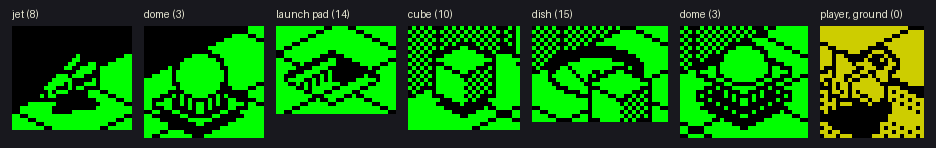
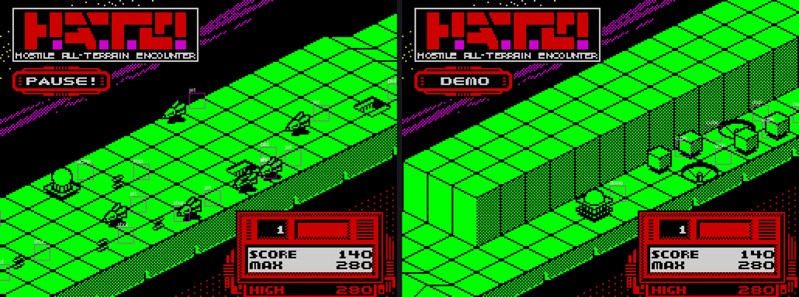

# 7. Objects

Everything that moves or can be hit is a 16-byte record in one list at `$C000`: the player, its shots, the
course's buildings and aircraft, the missiles they fire, the pods the player collects. One routine moves them all
and tests every pair for a hit. What happens on a hit is looked up in a table of handlers, one for each pair of
kinds.

Evidence:

- the code from the start image;
- L1's execution counts of each handler over the game window;
- the records read back from the recording with TTD `memory_at` (`tools/objects_shot.py`), and screens with each
  record labelled, to see which sprite a type is.

## 7.1 The record

| Byte | Meaning |
| --- | --- |
| +0 | bit 7 gone (or a free slot), bit 6 the end of the list, bit 5 hit (dying), bits 0-3 the type |
| +1, +2 | the position along the course, the same unit as the scroll distance `$D14D` (2 a pass) |
| +3 | the position across the track (the player starts at `$2C`) |
| +4 | the height |
| +5 | the direction, 0-7 |
| +6 | the speed: steps of the direction per pass |
| +7 | behaviour bits (7.4) |
| +8 | the explosion counter |
| +9-+B | the sprite's place in the strips, from `$EFA5` ([6.6](06-rendering.md)) |
| +C, +E | steps through the motion tables |
| +F | the fire timer; on cubes, the hits taken |

**Directions** (`$C340`, 4 bytes each): the step along the course and the step across.

| Dir | 0 | 1 | 2 | 3 | 4 | 5 | 6 | 7 |
| --- | --- | --- | --- | --- | --- | --- | --- | --- |
| along | +2 | +1 | 0 | −1 | −2 | −1 | 0 | +1 |
| across | 0 | −1 | −2 | −1 | 0 | +1 | +2 | +1 |

Direction 0 is the way the course scrolls. The player's shots fly in direction 0; the course's objects mostly
start in direction 4, toward the player.

**Where a record is on the screen.** The position along the course less `$D14D` is the distance ahead of the
scroll. In screen pixels, x = distance − across and the line is about 215 − distance / 2 − across / 2 − height: the
2:1 isometric projection of the strips ([6.3](06-rendering.md)). Records closer than 0 are gone; those 352 or more
ahead are not moved yet.

## 7.2 The slots

The round start (`$D1DE`-`$D294`) fills the list:

| Records | Slots | What |
| --- | --- | --- |
| `$C000` | 1 | the player, from `$C292`; its type is the first byte of the course data |
| `$C010`-`$C050` | 5 | the player's shots (`$E82F`) |
| `$C060`-`$C090` | 4 | pods released by shot domes (7.5) |
| `$C0A0` | 1 | a vehicle of the other kind, parked at position `$600` |
| `$C0B0`-`$C1A0` | 16 | the course's objects: the round's block (`$F300` + 128 × round), 8 bytes each, the rest zero |
| `$C1B0`-`$C200` | 6 | missiles and aircraft launched by the course |
| `$C210`-`$C250` | 5 | the enemy's shots |
| `$C260` | 1 | the vehicle of the round before, at position `$6C` |
| `$C270` | | `$FF`: the end of the list |

The slot counts are the limits: at most 5 shots of the player in the air, 6 launched objects, 4 pods. A launch
with no free slot does not happen.

## 7.3 The kinds

The type pairs (0-1, 2-3 ...) are the classes of the hit table (7.6). Odd and even of a pair are variants: an odd
type below 10 rides on the ground.

| Type | Seen as | Count in the 10 blocks | Behaviour |
| --- | --- | --- | --- |
| 0, 1 | the player: 0 the ground vehicle, 1 the aircraft | | 7.7 |
| 2, 3 | domes | 12 + 40 | shot by the player: 210 points (2) or 320 points and a pod (3) |
| 4-7 | missiles | 4 + 3 + 8 | launched by pads; 140 points when shot |
| 8, 9 | jets, flying in lines | 13 | 140 points |
| 10 | cubes | 14 | take 4 shots (`+F`), then 180 points; kill the player on contact |
| 11 | a pod | (released by a dome) | the player flies into it: it joins the convoy (7.5) |
| 12 | shots | | the player's fly in direction 0; others kill the player |
| 14 | launch pads | 61 | launch missiles or jets (7.4) |
| 15 | dishes | 5 | indestructible; only the player collides with them, and is lost |

The names are what the sprites look like in the recording's screens, labelled by `tools/objects_shot.py`. The
recording shows types 0, 1, 3, 4, 6, 7, 8, 10, 12, 14 and 15; the demo played rounds 8 and 10.

## 7.4 Moving: `$E15C`, once a pass

For each live record:

1. **Gone or not yet.** A distance below 0 marks it gone; 352 and more skips it.
2. **Firing.** With behaviour bit 3, at a distance of 190 or more, once in 8 passes and on a random bit: a free
   slot of `$C1B0`-`$C200` gets a template (`$C2B4` + 9k, k from the highest of behaviour bits 7-4) and the
   firer's position. L1 counts 64 launches in the window.
3. **The step.** The direction's two steps times the speed give the new position.
4. **Steering**, by behaviour bits 4-7:

   | Bit | Steering |
   | --- | --- |
   | 5 | turn round (direction + 4) at the edge of the track |
   | 4 | every 4 passes, head toward the player's position across (`$C003`) |
   | 6 | every 4 passes, the next direction of the pattern `$C3F0`: 4 5 6 5 4 3 2 3, a weave |
   | 7 | every 4 passes, turn left or right at random |

5. **Height**, by behaviour bits 0-2: follow the player's height (`$C004`, bit 0), the arc of `$C282` (bit 2, 9 up
   to 24 and down: a missile's flight) or the 16-step wave of `$C272` (bit 1).
6. **The ground.** The 768 bytes at `$6000` are the course's profile under the scroll: for every 2 units along, the
   height of the ground (bits 0-4) and the walls (bits 5-7). A record cannot sink below the ground under it, and
   the odd types below 10 sit on it. Bits 7 and 6 are walls: they limit the position across to `$17` and `$27`
   (otherwise `$47`). Bit 5 alone is a barrier across the whole track: the player's shots die on it (sound request
   bit 2), and the player passes it only with a convoy (7.5).
7. **Hits** (7.6).

The test boxes are self-modified. Before testing a record against the others, `$E555` writes its size into the
operands of six `CP n` instructions (`$E5DD`-`$E64D`), one pair for each class of the other record, and the
window's start, its own position less half the width, into `$C2EC`-`$C2F5` (`$E531`). The window is 7 plus a size
for each of the two records wide: 8 for types 0-3, 4 for 4-10, 0 for 11-13. It is centred, along and across alike:
two domes meet within 11 either way (a window 23 wide), two shots within 3. In height the window is 15 for every
pair: within 7 either way (`$E43C` puts the height less 7 in IYL). A missile 8 above or below the player passes.

## 7.5 Pods and the convoy

A shot dome of type 3 releases a pod (`$EDFE`): type 11, written into a free slot of `$C060`-`$C090` at the dome's
place, and 320 points. When the player flies into a pod (`$ECF3`), the pod becomes a **follower**: it is copied
behind the player, `$ECE4` counts it, and sound request bit 0 plays ([9.6](09-sound.md)). Up to 4 followers trail the
player (the list at `$ECE9`); `$E7B9` copies the leader's state into them every pass, and they move at the player's speed.

The followers are worth two things:

- **A shield.** When the player is hit and `$ECE4` is not 0, the last follower is lost instead (`$E262`) and the
  player flies on.
- **The next round.** When a round starts, its lives are the followers of the round before ([10](10-gameplay-logic.md)).

- **The way out.** The profile marks a barrier near the end of each course (bit 5, 7.4). The player who reaches it
  with no follower is lost (`$E4E7`); with one or more, the game takes over: `$E68B` = `$FF` starts the AUTO
  countdown of [5.4](05-controls.md), which drives the vehicle to the middle and on, and the round ends. A round
  can only be left with at least one pod picked up ([10](10-gameplay-logic.md)).

A crash into a wall loses the player and every follower at once (`$E979`).

In the first recording no pod was picked up: `$ECE4` stays 0 through both games (sampled every 250 frames). No dome was
shot by the player either: `$EDCA` ran once, for an enemy shot that vanished on a dome. The second recording, played
by `tools/autopilot.py` ([10](10-gameplay-logic.md)), picks pods up in every round it clears.

## 7.6 Hits: the handler table `$C380`

Two records hit when both are live and not already hit, and their positions along, across and in height are
within the box of 7.4. `$EBAA` then jumps through a table of 8 × 8 handlers, the row by the moving record's type
pair, the column by the other's:

| Moving \ other | 0-1 player | 2-3 domes | 4-5 | 6-7 | 8-9 | 10-11 | 12-13 shots | 14-15 |
| --- | --- | --- | --- | --- | --- | --- | --- | --- |
| **0-1 player** | both lost | both lost | both lost | both lost | both lost | cube: both lost; pod: collect | an enemy shot: lost | lost |
| **2-3 domes** | both lost | | | | | | shot: points | |
| **4-5** | both lost | | both turn | | | | shot: points | |
| **6-7** | both lost | | | | | | shot: points | |
| **8-9 jets** | both lost | | | | | | shot: points | |
| **10-11** | cube: both lost; pod: collect | | | | | | cube: a hit counted | |
| **12-13 shots** | an enemy shot: lost | points | points | points | points | cube: a hit counted | both gone | |

An empty cell is "nothing happens". "Points" are for the player's shots only (direction 0); an enemy shot hitting
a building just vanishes. The table is symmetric in effect: whichever record of a pair is moved first, the pair
gets the same result.

| Handler | Effect | Runs |
| --- | --- | --- |
| `$EBD1` | both are hit: bit 5 set, the explosion counter at 32, sound request bit 1 | 13 |
| `$EBCE` | add B × 10 points ([8.4](08-hud-and-text.md)), then `$EBD1` | 5 |
| `$EC0F` | both turn round | 93 |
| `$EC27` | the player meets a shot: its own (direction 0) is ignored | 26 |
| `$EC0B`, `$E57E` | nothing | 609 |

All 5 point awards in the window came through `$EC59`, a shot of the player on a missile or a jet: 5 × 140 = 700,
the 280 of each game and the demo's 140.

**Dying.** A hit record counts its explosion up by 2 a pass to 45, then is gone (`$E235`). A dome of type 2 hit at
34 or 40 throws out a jet (template `$C2C6`). When the record is the player and it is gone, the main loop sees bit
7 of `$C000` and the life is lost ([4.4](04-game-loop.md)).

## 7.7 The player: `$E7E9`

Read from the control byte `$C290` ([5.2](05-controls.md)):

- **Fire** (bit 4) held: a shot every other pass, from template `$C360` at the player's position + 4, 2 below its
  height. It lives 12 passes (`$E7F4`). The aircraft, holding up as well, drops a bomb instead (`$C370`, its height
  from the arc `$C282`).
- **The ground vehicle** (type 0): down and up change the height, with a counter for each that accelerates the
  climb or the drop up to 6 (`$E687`, `$E688`); the height stays within 2-26.
- **The aircraft** (type 1): down and up change the speed (`+6`): 0 while down is held, 2 while up is held, 1
  otherwise. Slowing down spends `$E7B8`, speeding up earns it back, up to 32; it is 10 at each round start.
- **Across**: left and right move the player across the track (`$E9C4`-`$EA15`; the AUTO start steers instead,
  [5.4](05-controls.md)).
- **Walls.** The walls in the profile under the player (`$5FF7` + position / 2) limit its position across. Running
  into one is a crash (`$E979`): the player is hit, moves back 2, and the convoy is lost. It did not happen in the
  recording.

## 7.8 Harder laps

After round 10 the lap `$C2F8` counts up ([4.2](04-game-loop.md)), and the round start (`$D296`) arms more of the
course:

- from lap 1, the missiles and jets of types 5-9 get behaviour bit 3: they fire;
- the launch pads' behaviour is rotated (`$18` → `$48`, `$48` → `$08`, others → `$88`), so they launch other things;
- from lap 2, the code changes its own comparisons (`$D2BE`, `$D2D8`, `$D2DC`): types 2-9 fire, and every pad
  launches the same kind.

This is read from the code; the recording never left round 1.

## 7.9 Design notes

- **One list, one loop.** Shots, missiles, buildings and pods are the same record and the same mover, with
  behaviour bits instead of code per kind. A new enemy is a template, not a routine.
- **A table of reactions.** The collision outcome is data: 8 × 8 handlers by type pair. The kinds that do not
  interact cost one jump to "nothing".
- **Pods make the lives.** The player earns the next round's lives in the current one, and the same followers
  protect them on the way: one mechanic for score, shield and progress.
- **Fixed slots, no allocation.** Every kind has its own slots; when they are full, the game simply does not spawn.
  The number of things on screen can never overflow the drawing lists.
- **Self-modified boxes.** The six compares of the hit test take the moving record's size as operands, written once
  per record instead of loaded once per pair.
