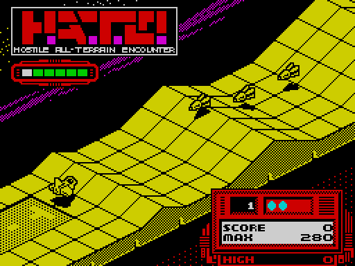
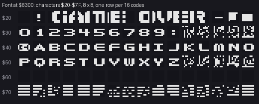

# 8. HUD and text

Everything the game writes as characters: the strings, the font, the score panel. One print routine draws all text.
A second, smaller routine draws the numbers in the panel.

Evidence: the code from the start image; screens rendered from the recording with TTD `memory_at`; a scan of the
code for `LD HL,nn; CALL $EE17`, which finds every string, and L1's executed instructions, which tell which of those
calls ran in the recording.



## 8.1 The print routine `$EE17`

A string is a list of records:

| Byte | Meaning |
| --- | --- |
| attribute + `$80` | starts a record; bit 7 marks it, bits 0-6 are the attribute of every character |
| column | 0-31 |
| row | 0-23 |
| characters | codes `$20`-`$7F`, as many as fit |

The next byte with bit 7 set starts the next record. `$FF` ends the string. One call can therefore print several
pieces in different places and colours: the menu is one string of seven records.

```text
$EE17  LD A,(HL)          ; the record's first byte
$EE18  CP $FF
       RET Z
       RES 7,A            ; the attribute, kept in A'
       EX AF,AF'
       ...                ; column, row -> screen address ($EE13) and attribute address ($EE15)
$EE50  LD A,(HL)          ; a character
       BIT 7,A
       JR NZ,$EE18        ; the next record
       ...                ; glyph = $6300 + (code - $20) * 8, 8 lines down the character cell
       ...                ; the attribute byte, then the next cell
```

The two addresses being written are kept in operands of the routine's own `LD DE,(nn)` / `LD (nn),DE` at `$EE13`
and `$EE15`, not in registers. The glyph copy uses B and DE, so the screen pointer has to be stored between
characters.

## 8.2 The font



64 glyphs at `$6300-$64FF`, for codes `$20`-`$5F`: the space, digits, capitals, a few marks and the © sign at `$40`
(`@` in the strings). Codes `$60` and up point past the font into other data and are never printed.

Some codes are not letters:

| Codes | Glyphs | Used by |
| --- | --- | --- |
| `$22`-`$2C` | the big GAME OVER, eleven cells | the GAME OVER box `$F0F5` |
| `$2E` | a red block | the frame of the GAME OVER box |
| `$2F` | one segment of a bar | the gauge in the top window (8.4) |


**Strings stored inside the font.** The glyphs of `;` `<` `=` `>` `?` (`$63D8-$63FF`) and `[` `\` `]` `^` `_`
(`$64D8-$64FF`) are never printed: no string uses those codes. Their 80 bytes hold three strings instead: the
credits at `$63D8` and `$64D8` and " AUTO " at `$64F6`. L1's review queue reports the overlap as a conflict ("claimed
font and text: they cannot both hold"). Here both claims are right: the block is a font, and its unused slots are
text.

## 8.3 Every string

| Address | Records | Printed by |
| --- | --- | --- |
| `$F140` | "SELECT" (2,6); "1 KEYBOARD", "2 SINCLAIR", "3 KEMPSTON", "4 PROTEK-AGF" (10,8-11, white); "5 DEMO", "6 START GAME" (10,13-14, green) | the menu `$F1AA` |
| `$63D8` | "WRITTEN BY", "COSTA PANAYI", "MUSIC BY" (1,17-19, attribute `$30`) | the menu |
| `$64D8` | "BEN DAGLISH", "©1989 VORTEX" (1,20-21) | the menu |
| `$64F6` | " AUTO " (2,6) | the AUTO start, `$E68C` |
| `$F0E1` | " DEMO " (2,6) | the demo, every pass of the loop |
| `$F0EB` | "PAUSE!" (2,6) | pause, `$D0D2` |
| `$F12C` | "ABORT!" (2,6) | U+G, `$D099` (not pressed in the recording: read from the code only) |
| `$F136` | six spaces (2,6) | clears the window |
| `$F0F5` | the GAME OVER box (10-22, 9-11) | game over and abort, `$D0A5` |
| `$C333` | five green cells at (3,6), then a white `/` at (2,6); before printing, `$CFD6` fills the five cells with a `/` for every one of the five records at `$C010` (16 bytes apart) whose bit 7 is set | the gauge, `$CFE9` |
| `$C2FA` | two characters (21,18) | the round number, `$D1BF` |
| `$9F2F` | "PRESS ANY KEY WHEN READY" (4,23) | `$9F0C` and `$860C`, neither of which ran in the recording: code outside the paths of this version |

All the messages of play share the window at column 2, row 6: the red frame under the logo. It shows AUTO, DEMO,
PAUSE!, ABORT! or the gauge, one at a time.

## 8.4 The panel

The panel at the bottom right is part of the screen image copied from `$A000` when play starts ([2.3](02-architecture.md)).
The game only writes the changing parts into it:

| Item | Variable | Drawn by | Where on screen |
| --- | --- | --- | --- |
| round number | `$C2F7` (1-10) and `$C2F8` (laps of the 10 rounds) as two digits at `$C2FC`-`$C2FD` | `$D19E`-`$D1BF` through `$EE17` | column 21, row 18 |
| dots | `$ECE4`, up to 4 | `$D1C8`: 4 attribute cells at `$5A58` set to `$12` (red on red: hidden), then `$ECE4` of them to `$15` (cyan) | row 18, columns 24-27 |
| SCORE | `$EF49-$EF4E`, six ASCII characters, the last always `0` | `$EE9E` | `$529D` |
| MAX | `$EF99-$EF9E` | `$EF17` | `$51BD` |
| HIGH | `$EF92-$EF97` | `$EEE3` | `$51FD` |

The round number's tens digit is `$C2F8` plus one when `$C2F7` reaches 10. A leading 0 becomes a space, so the
display counts 1, 2 … 10, 11 … over the laps.

**Numbers are text.** The score is kept as ASCII digits, not binary:

```text
$EE87  LD HL,$EF4D       ; the tens digit (the units digit at $EF4E is a fixed '0')
$EE8A  LD A,(HL)
       CP ' '
       JR NZ,$EE91
       LD A,'0'          ; a space counts as 0
$EE91  INC A
       CP '9'+1
       JR C,$EE9B
       LD (HL),'0'       ; carry into the next digit to the left
       DEC HL
       JR $EE8A
$EE9B  LD (HL),A
       DJNZ $EE87        ; B times: B tens of points
```

It adds B × 10 points one at a time. Adding and printing need no conversion, and the leading spaces stay spaces
until a carry reaches them.

**Small digits.** `$EEA4` draws a number right to left, starting at the units digit and stopping at a `.` byte
before the field. Each digit uses only lines 2-6 of its glyph (`$6302 + (code - $20) × 8`, 5 lines), so the numbers fit
the thin lines of the panel.

**MAX and HIGH.** `$EF17` compares SCORE with MAX digit by digit, as strings of the same length, and copies the
higher one into MAX. `$EEE3` does the same with MAX into HIGH. `$EEC4` clears SCORE, MAX and the per-round table
`$EF55` at the start of a game (`$F1B8`), but not HIGH. HIGH therefore lasts until the machine is reset. What MAX
means for a round is for [10. Gameplay logic](10-gameplay-logic.md).

## 8.5 Painting attribute areas `$D338`

`$D338` colours a list of character cells with the attribute in B. The list at `$D5B2` is pairs (low byte, high
byte) of **screen** addresses, ended by `$FF`. The routine turns each into the attribute cell of the same character:

| High byte | Attribute row block |
| --- | --- |
| below `$47` | skipped |
| `$47` | `$58xx` |
| `$48`-`$4F` | `$59xx` |
| `$50` and up | `$5Axx` |

The menu calls it with B = 6 (`$F1AA`). Storing the cells as screen addresses lets the list be written against
the screen layout the artist drew, and still colour the attributes.

## 8.6 Design notes

- **One print routine, one record format.** A whole screen of text is one data string. The menu, the credits and
  the messages need no code of their own.
- **ASCII score.** Counting in ASCII digits avoids binary-to-decimal conversion on a CPU without a divide. The cost
  is 5 bytes a number and a loop per 10 points.
- **The font's unused slots carry strings.** 80 bytes saved on a full 48K. It also confuses every tool that assumes
  one kind of data per byte.
