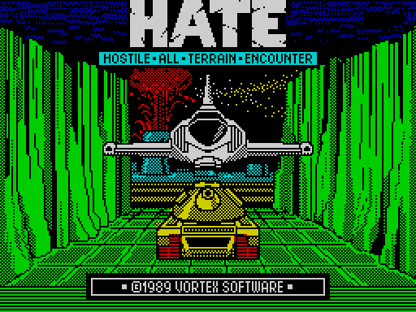
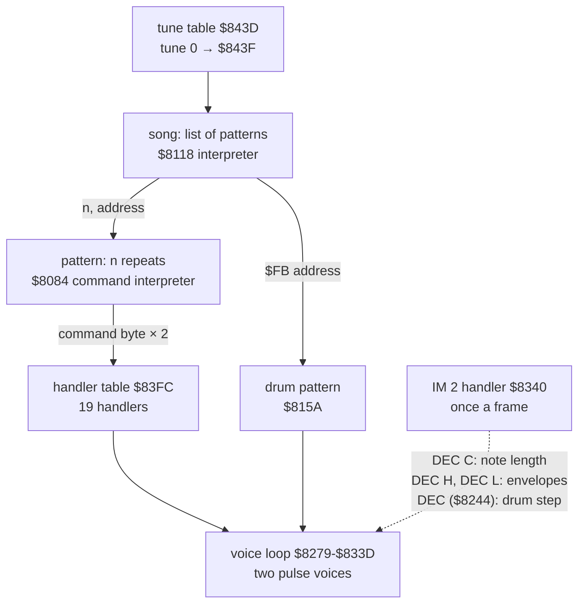

# 9. Sound and music

The beeper only. The title has a two-voice tune with drums by Ben Daglish (credited in the menu, [8.3](08-hud-and-text.md)).
In play there are short effects: one-shot beeps and sweeps that stop the game while they sound.

Evidence: the code from the start image and the counts of L1's game-window build (frames 2613-45260). The title
plays from frame 2616 until the key at frame 30260 ([2.3](02-architecture.md)).



## 9.1 The title engine at a glance



The engine keeps almost all of its state in registers and in the operands of its own instructions. This is why the
interrupt handler can drive it with three `DEC`s: the voice loop runs in the main register set, so the C, H and L
the handler decrements are the engine's timers.

## 9.2 The song level `$8118`

`$806F` picks the tune: HL = `$843D` + 2 × C, where C is the operand at `$8002` that the start-up sets to 0
([2.3](02-architecture.md)). Tune 0 starts at `$843F`. The song is a byte stream:

| Byte | Bytes after | Meaning |
| --- | --- | --- |
| `$FF` | | return to the address saved by the last `$FE` (the operand of `LD HL,nn` at `$811C`) |
| `$FE` | address | save the position after it, continue at the address: a one-level call |
| `$FD` | address | jump |
| `$FC` | | end of the tune: `$8356`, the same exit a key press takes |
| `$FB` | address | start a drum pattern (9.5) |
| n < `$FB` | address | play the pattern at the address n times |

A pattern call stores the repeat count into the operand of `LD A,n` at `$810D` and the pattern address into
`LD DE,nn` at `$810A`. It stores the song position into `LD HL,nn` at `$8115`, then enters the pattern interpreter.

The start of tune 0, decoded:

```text
$843F  01 $8467      pattern $8467 once
       FB $85A2      drums $85A2
       05 $8473      pattern $8473, 5 times
       FB $85B4      drums $85B4
       01 $84A8      ...
```

## 9.3 The pattern level `$8084`

```text
$807F  LD A,C            ; C: frames left of the current note, decremented by the interrupt
       AND A
       JP NZ,$8243       ; still sounding: back to the voice loop
$8084  LD C,5            ; the note length, an operand set by command 17
       EXX
       EX DE,HL
$8088  LD E,(HL)         ; the next command byte
       SLA E
       ...               ; JP (table $83FC + 2 × command)
```

Commands, by handler:

| Command | Handler | Effect |
| --- | --- | --- |
| 0 | `$8175` | hold: the current notes sound for one more note length |
| 1, 2 | `$8098`, `$80A4` | the start pulse width (the loudness) of voice A (`$81DE`/`$8205`) or voice B (`$81BB`/`$8231`): the operand of the `LD B,n` in the note set-up, from which the note's pre-delay and width are computed |
| 3, 4 | `$80B0`, `$80B9` | the envelope frame counter a note of voice A (`$827E`, the reload of H) or voice B (`$82E0`, of L) starts with |
| 5-8 | `$80C2`-`$80D4` | the envelope mode of voice A (B = 1 or 0) or voice B (C = 1 or 0) |
| 9 | `$8109` | end of pattern: count down the repeats (`$810E`), restart the pattern (`$810B`) or go back to the song (`$8116`) |
| 10 | `$819B` | a note on both voices: two period bytes |
| 11 | `$81EE` | a note on voice A only |
| 12 | `$821A` | a note on voice B only |
| 13-15 | `$80DA`-`$80ED` | silence one or both voices (the `OUT` value operands `$82D0`, `$8332` set to 0) |
| 16 | `$8101` | change the drum pattern from inside a pattern (`$815E`) |
| 17 | `$80F5` | the note length: the operand of `LD C,n` at `$8085` |
| 18 | `$817A` | a long note: hold for n note lengths (counter at `$817B`) |

Every argument goes into the operand of some later instruction. The player has hardly a variable of its own.

## 9.4 The voices `$8279-$833D`

Two voices, D and E, each a down-counter of the note's period:

```text
$82C5  DEC D
       JP NZ,$82DB
       LD D,$A6          ; reload: the period, an operand written by the note command
       LD B,$15          ; pre-delay, operand $82CC
$82CD  DJNZ $82CD
       LD A,$18          ; the beeper on (the border stays black)
       OUT ($FE),A
       LD B,$17          ; the pulse width, operand $82D4
$82D5  DJNZ $82D5
       LD A,0
       OUT ($FE),A       ; off
```

Voice E is the same at `$8327-$833D`. Each voice is a train of short pulses. The pulse width sets the loudness and
the period sets the pitch.

**Envelopes.** H and L count frames for voice A and B (the interrupt decrements them). When one reaches 0, the
voice's envelope steps (`$82A3`, `$8305`): the pulse width operand decreases by one and the pre-delay increases by
one, so the note gets quieter at the same pitch. When the width runs out, the voice is silenced (`$82D0` = 0).
Registers B and C of the pattern's register set hold each voice's envelope mode, checked at every envelope tick
(`$8280`, `$82E2`): 0 decays the note, 1 holds it, and 2 and 3 alternate, switching the voice on and off on each
tick, a stutter. A note command starts mode 3 when the mode is not 0 (`$819B`).

## 9.5 Drums `$8243`

The drum timer is the operand of `LD A,5` at `$8243`. The interrupt decrements it (`$834B`: `DEC ($8244)`), so
it counts frames. At 0 it is reloaded from `$824B` (the first byte of the drum pattern, 5 for `$85A2`). The next byte
of the pattern then picks a sound:

| Byte | Routine | Sound |
| --- | --- | --- |
| 0 | | rest |
| 1 | | loop to the pattern's start (`$8257`) |
| 2 | `$8367` | a click: the beeper held on for 300 loop steps |
| 3 | `$837F` | noise: 150 pulses whose levels and lengths come from the **ROM's bytes from `$0064`** |
| 4 | `$839A` | a rising tone, half-period 50 down to 1 |
| 5 | `$83C6` | a rising tone, period 200 down to 124 in steps of 4 |
| 6 | `$83B0` | a falling tone, period 180 up in steps of 4 until it wraps at 256 |

The drum pattern `$85A2`: speed 5, then `02 00 00 02 03 00 02 00 00 00 02 00 03 02 00 00 01`. That is clicks (2)
and noise (3) over a loop of 16 steps, one step every 5 frames (10 steps a second). While a drum sounds the voices
stop: a drum is a loop of its own, a few milliseconds long.

**Noise from the ROM.** `$837F` reads 300 bytes of ROM code from `$0064` as random numbers. ROM code is
irregular enough to sound like noise and costs no table.

## 9.6 Effects in play

Play has no music. There are two effect routines and one request byte.

**`$F288`, a two-tone beep.** HL = length (H × 256 steps) and pitch (L). Two square waves, with half-periods of
256 − L and 257 − L steps (counters D and E count up to the wrap), are XORed into one output. Their slow beating gives the beep a warble.

**`$F2A3`, a sweep.** Four bytes: step, cycles per tone, start half-period, number of tones. Each tone is shorter
than the last by the step, so the pitch rises.

**Requests: `$F2BF`.** Game code sets a bit; once a pass the main loop calls `$F2C0`, which plays the effect of the
lowest set bit, then clears the byte (`$D086`). One effect a pass, by priority:

| Bit | Table entry (`$F2E2` + 5 × bit) | Set at | In the recording |
| --- | --- | --- | --- |
| 0 | sweep 2, 4, `$50`, `$1E` | `$ED33`, `$ED79` | not set |
| 1 | sweep `$0A`, 3, `$14`, 6 | `$EBF4`, `$E4EF`, `$E997` | 13 times, all at `$EBF4` |
| 2 | sweep `$32`, 5, `$1E`, 3 | `$E4AD`, `$EC9E`, `$ECD4` | not set |
| 3 | beep `$0414` | `$E6A5`, the AUTO start ([5.4](05-controls.md)) | 560 times |
| 4 | sweep 2, 4, `$42`, `$0A` | `$E8AA`, a shot fired | 26 times |

The game events behind bits 0-2 are named in [10. Gameplay logic](10-gameplay-logic.md).

**The round sound.** One effect is not in the request table: the round setup plays the record `$F2FB` (record 5 of
`$F2E2`, one past the five the request bits reach) through `$F2D9`, at `$D31A`: sweep 8, 4, 3, `$64`. It sounds at
every round setup, 10 times in the first recording.

**Direct beeps.** Some sounds call `$F288` directly:

| Call | HL | When |
| --- | --- | --- |
| `$F1D9` | `$465A` | the menu appears |
| `$F271` | `$04B4` | a device is chosen in the menu |
| `$F24C` | `$1E9C` | the game or the demo starts from the menu |
| `$D0CC`, `$D0E0` | `$0F3C` | pause on and off |
| `$CFF6` | `$8C05` | `$C000` bit 7 set (`$CFEF`), before the outcome of the round is decided ([10](10-gameplay-logic.md)) |
| `$D0AB`, `$D0B1` | `$C814` | GAME OVER, ABORT |

Every effect stops the game for its length: the beeper needs the CPU, and play runs without interrupts
([2.4](02-architecture.md)). This is one reason the passes of the play loop vary in length.

## 9.7 Design notes

- **The interrupt as the music's clock.** The tune keeps time at 50 Hz however long the voice loop's iterations
  are, and the loop needs no timing of its own. Three `DEC`s on the loop's own registers cost 123 T a frame.
- **Volume by pulse width.** A 1-bit output can be made quieter by narrowing its pulses. The envelope is a width
  that shrinks frame by frame.
- **Everything in operands.** Periods, widths, the note length, counters and addresses are all written into
  instructions. Reading a register-free, variable-free engine like this needs the recording: L1's SMC map shows which
  operands are written, and how often.
- **Effects by priority, one a pass.** A request byte lets any part of the game ask for a sound without knowing
  what else is sounding. A sound that loses its slot is simply dropped.
