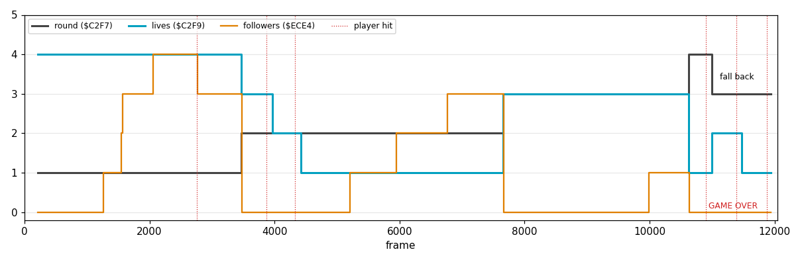
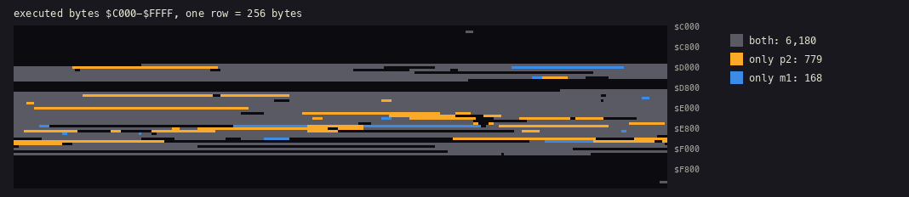
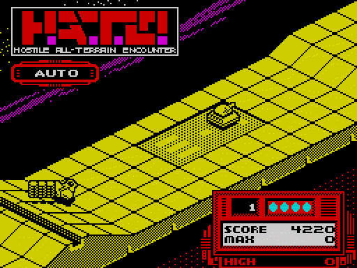
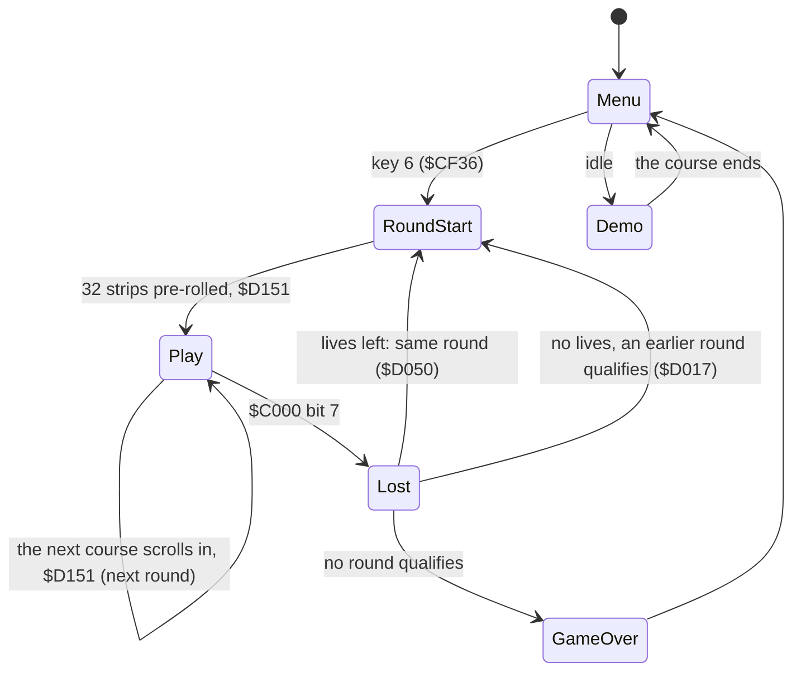
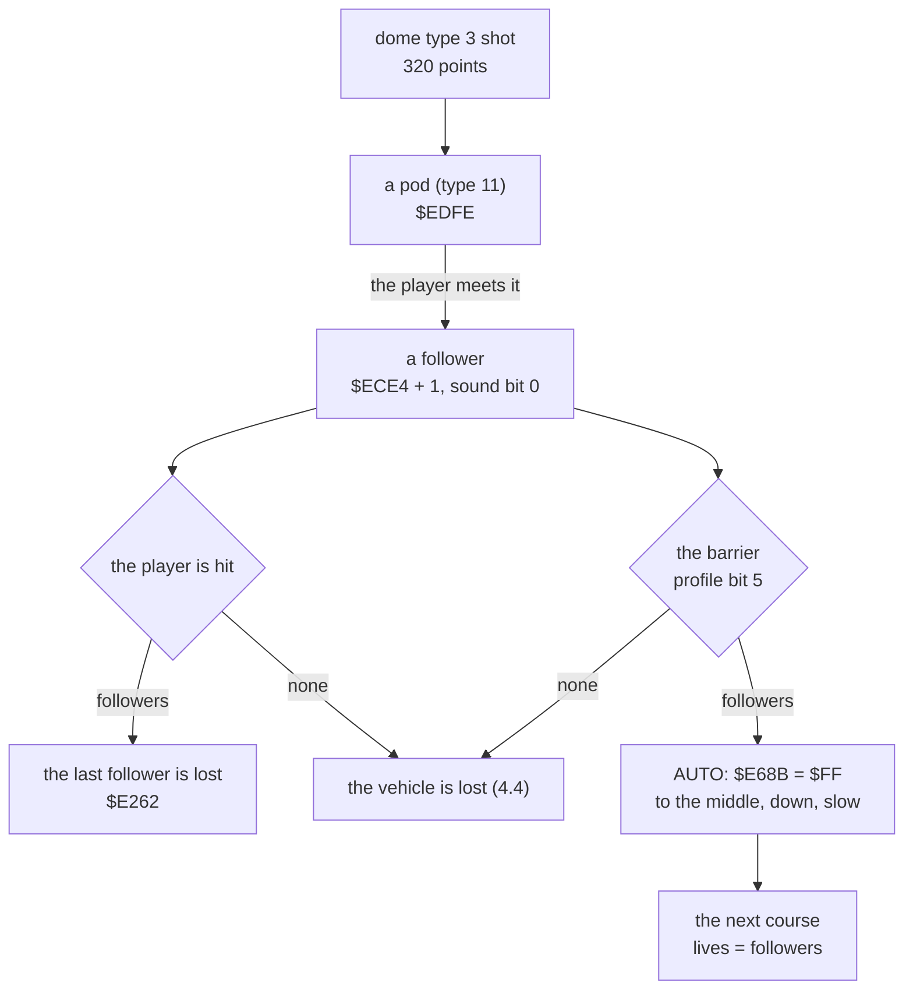

# 10. Gameplay logic

The rules the player meets: two vehicles that take turns, pods that become a convoy, a barrier that only a convoy
gets through, lives earned in the round before, a game over that first tries to send the player back. The
mechanisms are in docs 4-9; this document puts them together as a game and shows them happening.

Evidence:

- the code from the start image;
- the first recording (`work/c2`; its L1 builds `work/game`, the game window, and `work/m1`, all of it; the demo and two short games, [4](04-game-loop.md)), which never left round 1;
- a **second recording** (`work/p2`), a whole game played by a bot that reaches round 4, falls back and ends in
  GAME OVER (10.1), with its L1 counts (`work/p2/l1.json`);
- memory read back from that recording at chosen frames by seeking (`tools/roundtable.py`, `tools/objects_shot.py`,
  `tools/screen_anim.py`).

## 10.1 The second recording

Random play and the demo never pick up a pod, so they never leave round 1. `tools/autopilot.py` plays instead:
every 3 frames it reads the object list at `$C000` ([7](07-objects.md)), the wall profile under the player and the
scroll, predicts where every threat will be over the next 14 passes from its direction, speed and behaviour bits,
and steers the Kempston stick toward a pod or a dome to shoot, away from what would hit. The emulator is deterministic, so
the same inputs replay the same game; the decisions depend only on memory. From round 4 it is told to give up
(`--give-up 4`), to spend the lives where the fall back of [4.4](04-game-loop.md) can be seen.



| Frames | Round | What happened |
| --- | --- | --- |
| 210-3 468 | 1, aircraft | 4 lives; 4 pods picked up, one follower lost to a hit; the barrier passed with 3 |
| 3 480-7 659 | 2, ground vehicle | 3 lives; two lives lost to missiles from the side; cleared on the last life with 3 followers |
| 7 671-10 623 | 3, aircraft | 3 lives; 1 pod, kept to the barrier |
| 10 635-10 896 | 4, ground vehicle | 1 life, given up |
| 10 983 | 3 | fall back: 3 − 1 = 2 lives, SCORE back to 8 120 |
| 11 388, 11 871 | 3 | both lives lost; no round left to fall back to: GAME OVER |

L1 over the 14 020 frames confirms the story by counts: 9 round setups (`$D151`), of which only 6 through the round
start `$CF68` (the game, the demo, 3 retries, 1 fall back); 5 losses (`$CFF6`), 2 of them with no lives left
(`$D005`) and 1 GAME OVER (`$D0A5`).

**What the bot's game reached.** The code it ran against the first recording, byte by byte over `$C000-$FFFF`
(`tools/heatviews.py coverage`):



779 bytes of code ran only in the bot's game, and the runs name what it reached:

| Code | What |
| --- | --- |
| `$D017-$D04F` | the look-back of the fall back (4.4) |
| `$D4CF-$D4D8` | the next course expanded at a course end (6.5) |
| `$E4C6-$E4E6` | the barrier (10.4) |
| `$E6F1-$E6FE` | AUTO setting the followers' speed |
| `$E773-$E788` | the Kempston reader (the bot's device) |
| `$E7BE-$E7E8` | the convoy copied behind the player |
| `$E848-$E888` | the shell of the ground vehicle |
| `$E904-$E97E` | the ground vehicle's own branch of the player routine |
| `$ECAC-$ECE3` | a cube hit by a shot |
| `$ECF3-$ED3A`, `$EDE3-$EE12` | a pod picked up; a pod released by a dome |

168 bytes ran only in the first recording: the pause and abort keys (`$D0C3-$D0EE`), the other input readers it
tried (`$E756-$E772`, `$E789-$E7B6`) and an enemy shot vanishing on a dome (`$EDD0-$EDE2`, [7.5](07-objects.md)).

## 10.2 Rounds and vehicles

A game is 10 courses, played in order and then again as harder laps ([7.8](07-objects.md)). The first byte of
each course is the player's type, and it alternates: **type 0, the aircraft**, in rounds 1, 3, 5, 7, 9; **type 1,
the ground vehicle**, in rounds 2, 4, 6, 8, 10. The mix of buildings and enemies grows with the round (the object
blocks at `$F300` + 128 × (round − 1)): cubes appear in rounds 3, 6 and 10, dishes in 4, 5, 6 and 10, plain domes (type 2)
in 5, 7 and 9.

**The hand-over.** The vehicle of the next round waits at the end of the course: the record `$C0A0`, of the other
type, parked at position `$600` in the middle of the track ([7.2](07-objects.md)). The convoy is driven to it by the
AUTO countdown (10.4), and the course scrolls on into the next one with no break ([6.5](06-rendering.md)): 32 strips
into the new course, `$D151` makes it the next round. It takes the lives from the followers, swaps the player's
type, sets up the new objects and falls into the attribute painter `$D338` ([8.5](08-hud-and-text.md)) with the
course colour `$D320`-`$D337`: ink 6 − ((round − 1) AND 3), bright below 5; in the demo the subtracted value is one smaller, and RoundSetup leaves the round number at 0 there, so the demo is always bright green (ink 4). The rounds cycle
yellow, cyan, green, magenta.



Frames 3 280-3 540: the aircraft and its three pods come down beside the parked ground vehicle under AUTO; the
course turns cyan, the round reads 2 and the panel shows 3 lives.



## 10.3 Driving the two vehicles

The player's record is moved by `$E7E9` from the control byte `$C290` ([5.2](05-controls.md)); left and right move
it across (`$C003`) on both vehicles. Down and up mean different things:

**The aircraft** (type 0) changes height. Each direction has a counter that grows while it is held, up to 6
(`$E687`, `$E688`), and the step is (counter + 1) / 2, so a held stick accelerates from 1 to 3 a pass:

```text
$E8BA  LD A,($C004)      ; the height
       LD ($C2F6),A      ; the new height, worked on below
       ...               ; down held: + ($E687 + 1) / 2, at most 26
       ...               ; up held:   - ($E688 + 1) / 2, at least 2
$E8FF  LD ($C2F6),A
```

`$C2F6` is the new height of the record being moved. The terrain then has its say (`$E400`-`$E43B`): the highest
ground under the record, from bits 0-4 of the profile, plus 2, is a floor. A flying record is raised to it if it
is lower; a ground record (an odd type below 10) is set to it whatever it was. `$E65F` writes the result into
`+4`. So the aircraft cannot fly into a hill: it climbs over it, and comes back down only when the stick says so.

**The ground vehicle** (type 1) is one of the ground records: its height is the terrain's. Down and up change its
speed (`$C006`) through the reserve `$E7B8` (10 at each round start, [7.7](07-objects.md)): down gives speed 0
and spends one of the reserve, up gives speed 2 and earns one back, up to 32. With the reserve at 0 down does
nothing, at 32 up does nothing: the speed stays 1, as with neither held. Fire held with up keeps the speed at 1
(`$E90D`). Holding fire and up
together, it lobs a shell (`$C370`, on an arc from `$C282`) instead of a shot, every fourth pass. In the bot's
game it lobbed one (`$E855`, once).

**Q and A follow the vehicle** ([5.3](05-controls.md)). On the keyboard, Q means up when bit 0 of `$C000` is set
and down when it is clear. With the vehicles above that is one rule: **Q is "climb" on the aircraft and "faster"
on the ground vehicle, A the opposite**, in every round. The joysticks keep their directions, so on a stick "down"
climbs the aircraft, as a pilot pulls back.

**Fire.** A shot every other pass while fire is held, at most 5 in the air, each living 12 passes and flying 2
below the vehicle's height ([7.7](07-objects.md)). The bot fired 734 (`$E8AA`).

## 10.4 Pods, the convoy and the way out



- **Pods.** A dome of type 3, shot, leaves a pod. Meeting it makes a follower: the convoy trails the player, up to 4,
  and copies its moves every pass (`$E7B9`). Two entries do it, one for each order in which the pair is moved
  (`$ED33`, `$ED79`); in the bot's game the 10 pods released (`$EDFE`) gave 8 followers.
- **A shield.** A hit on the player with followers costs the last follower, not the vehicle. In round 1 one
  missile did that at frame 2 754: the followers went 4 → 3, the lives stayed 4.
- **The barrier.** Near the end of each course the wall profile has bit 5 set (`$E4C3`-`$E4F2`,
  [7.4](07-objects.md)). A player who reaches it gets `$E68B` = `$FF` first (`$E4DC`), followers or not, which
  starts the AUTO countdown. Then, with no follower, it is hit (`$E4E7`, sound bit 1) and lost; with one or more
  it passes, and AUTO flies the convoy home. Types 2-10 on the barrier are neither moved nor hit tested in that
  pass (`$E4CF` → `$E674`). Player shots die on it as they do on a wall
  (sound bit 2, `$E4AD`: 68 times in the bot's game, barrier and walls together). There is no other way out of a
  round: **a round can only be left with at least one pod**.
- **AUTO** (`$E68C`) also runs for 70 or 14 passes at a round start ([5.4](05-controls.md)). While it counts down,
  the device is not read. Each pass it moves the player 2 across toward `$2C`, the middle, and sets the new height
  `$C2F6` to the height − 1 (down to 2), easing back up by (6 − count) / 2 over the last 6 passes. The speed is 0
  while the reserve `$E7B8` lasts, then 1, and the followers (`$C066` + 16 × k) get the same speed.
- **Lives.** The followers are the lives of the next round: `$D151` copies `$ECE4` into the lives `$C2F9`. The bot's
  rounds started with 4, 3, 3 and 1 lives: the 4 of a new game, then the 3, 3 and 1 followers it brought through the
  barriers.

## 10.5 Losing a life, falling back, GAME OVER

The mechanism is in [4.4](04-game-loop.md); the bot's game shows all three outcomes:

- **a life left**: round 2 lost twice (frames 3 873 and 4 329), restarted each time with one life fewer and the
  SCORE it started with;
- **no life left, an earlier round qualifies**: round 4 lost with its only life; round 3 had started with 3, so
  the game went back to it with 2 and its starting SCORE;
- **no round qualifies**: round 3 lost twice; round 2's entry held 1 (the lives of its last retry, which overwrote
  the first), 1 − 1 = 0: GAME OVER.

A fall back therefore costs the SCORE earned since the round it returns to, and the retries of a round use up its
chance to be returned to. MAX keeps the best SCORE either way (10.7).

## 10.6 The demo

The demo plays a random course of rounds 3-10 ([4.2](04-game-loop.md)) with no input at all: the pass jumps from
`$CFAC` straight to the objects (step 5 of [4.3](04-game-loop.md)), past the shot gauge, the loss check and the
device; it clears the speed `$C006` every pass and prints " DEMO ". The control byte stays 0. At the end of
the bot's recording the demo's vehicle sat in the middle of the track (`$2C`) at height 2 and the scroll went on
(`$D14D` + 4 every 6 frames): it drives straight ahead and fires nothing. A hit can destroy it, but nothing checks: the
loss test is skipped, so the demo runs on to the end of its course, where `$D4C9` returns to the menu
([6.5](06-rendering.md)).

## 10.7 Scoring and the high score

| Event | Points | Code | In the bot's game |
| --- | --- | --- | --- |
| a dome of type 2 shot | 210 | `$EBCE`, B = 21 | |
| a dome of type 3 shot (it leaves a pod) | 320 | `$EBCE`, B = 32 | 10 pods released |
| a missile or a jet shot | 140 | `$EC59` (the shot moving into it) or `$EC3F` (it moving into the shot) → `$EBCE`, B = 14 | 59: 39 by `$EC59`, 20 by `$EC3F` |
| a cube destroyed (the 4th hit; hits 1-3 sound bit 2) | 180 | `$ECC4` → `$EBCE`, B = 18 | 1 cube, 3 hits before it |
| all point awards | | `$EBCE` | 70 = 10 + 59 + 1 (L1 calls of `$EBCE` by caller) |

SCORE is six ASCII digits with a fixed last `0` ([8.4](08-hud-and-text.md)): the 5 stored characters count tens.
MAX is updated from SCORE (`$EF17`) at every round setup outside the demo and at every loss, so a fall back cannot
lower it; HIGH takes MAX when the menu is entered, before it waits for a key (`$EEE3` from `$F1B5`; then `$EEC4`
clears SCORE, MAX and the round table, `$F1B8`; both are skipped when the menu follows the demo, `$F1AF`), and lasts
until the machine is reset.
In the bot's game MAX reached 11 080 at the start of round 4; after GAME OVER HIGH read 11 080 though the panel's
SCORE had gone back to 4 220 ([4.4](04-game-loop.md)).

## 10.8 Sound events

The request bits of [9.6](09-sound.md), by what sets them:

| Bit | Event | Code | In the bot's game |
| --- | --- | --- | --- |
| 0 | a pod joins the convoy | `$ED33`, `$ED79` | 8 |
| 1 | an explosion: a pair hit each other; the player lost at the barrier; a crash into a wall | `$EBF4`, `$E4EF`, `$E997` | 76, 0, 0 |
| 2 | a hit that does not destroy: a shot on the barrier or a wall; a cube struck but not broken | `$E4AD`, `$EC9E`, `$ECD4` | 68, 0, 3 |
| 3 | AUTO running | `$E6A5` | 568 |
| 4 | a shot fired | `$E8AA` | 734 |

## 10.9 Design notes

- **Two vehicles, one record.** The aircraft and the ground vehicle differ by one bit of the type, and the terrain
  rule that makes odd types ride the ground is the one the buildings use. The second vehicle cost a branch in the
  player routine.
- **The keys follow the meaning.** Swapping Q and A per vehicle keeps Q as "more" (higher, faster) on both, with one
  `BIT 0` in the keyboard reader.
- **Progress needs the convoy.** Pods are score, shield, the key to the barrier and the next round's lives at once.
  A player who shoots everything but collects nothing never sees round 2.
- **No loading between rounds.** The next course scrolls in behind the barrier, and the round number changes 32
  strips later; the vehicle of the next round is just another record parked at the end.
- **A forgiving game over, cheaply.** The fall back reuses the round table written at each round setup. Because a
  retry overwrites its round's entry, repeated deaths in a round also close it as a place to return to.
