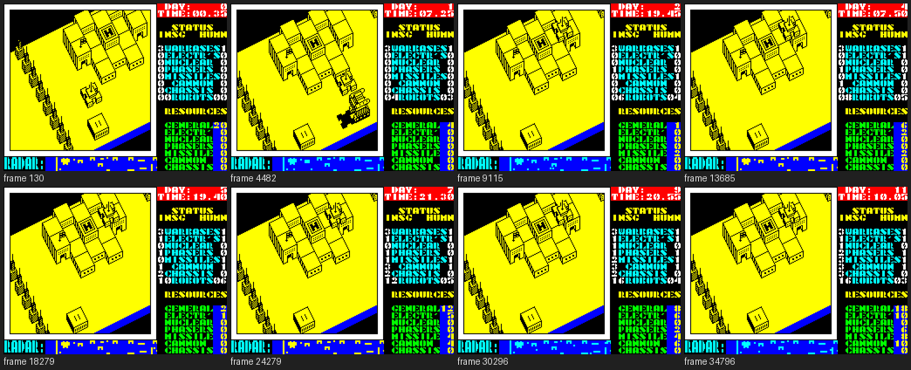

# Nether Earth: walkthrough

How the reverse was done, step by step, and which unreal-ng call answered each question. Terms:
[docs/README.md](docs/README.md). Recipes: `../recipes/`.

Every recording is named with its load (ROM speed or the fast LD-BYTES trap) beside every frame number.

## 0. The medium

Seven tapes on the shelf (WDC14Tb-3 `Consoles/ZX Spectrum/Games/Nether Earth`, the ZX-Uno card's TOSEC set). The
TOSEC one named "(Argus Press Software)" turned out to be a crack: its BASIC is a REM with "CRACKED BY BILL
GILBERT'87" and the game is one 42240-byte block (`kit/tapblocks.py list`). The World of Spectrum TZX
(`NETHEART.TZX` in `NetherEarth_ZXt.zip`) and the Mind Games España TAP are the same five standard blocks byte for
byte: that is the master, `orig/NETHER.TZX` and `orig/NETHER.TAP`.

```text
  0  header Program "N.EARTH" length 381 LINE 0 vars 381
  1  381 bytes   the BASIC: a line whose length word says 65535 (LIST shows nothing), LOAD "" CODE 64730, RANDOMIZE USR 64730
  2  header Bytes "N1" length 180 start 63800 ($F938), loaded at 64730 ($FCDA) instead
  3  180 bytes   N1 at $FCDA-$FD8D: a relocated ROM LD-BYTES, its edge routines at $FD69 / $FD6D
  4  48361 bytes the game, headerless: $4000-$FCE8, the screen included; entry $A600 (pushed as N1's return)
total 264.7 s at ROM speed (13258 48K frames)
```

The other copies (Leshij, AGAS, Mihal Soft, VS'93, Ziberov Oleg, Nikiforov, Voronin/Prokofiev, the Presto
compilation, the HGFX/esxDOS port) are Russian rereleases and ports: none is the original.

## 1. One recording from power-on

**Used:** `re_session.py capture --record-load` at ROM speed (no LD-BYTES trap), 48K, a Kempston card.

The first capture played seeded random keys after the load and picked "5..LOAD SAVED GAME": "LOADING ERROR!" and a
"PRESS RECORD AND PLAY" save prompt filled the run, so the recording was dropped (`work/load`, kept for the load
alone). The second (`work/play`, 16514 frames: the load to frame 12660, the menu, 3754 frames of play) plays
`tests/inputs/kempston-play.txt`: 2 (Kempston), 0 (start), then seeded moves and fire. It reaches the game: the
ship flies round the base, the clock runs into day 1 (`work/play/screens.png`). The play is shallow (no robot
built, no fight): a second recording with a bot is the next one doc 10 needs.

`re_session.py stages` on the first recording:

| Stage | Entry | Frame | What |
| --- | --- | --- | --- |
| 0 | `$FCDA` | 253 | N1, entered by the BASIC's USR 64730 (written by the ROM's LD-BYTES `$0802`: loaded at `$FCDA`, not at the header's `$F938`) |
| 1 | `$A600` | 12660 | the game, entered by N1's RET to the pushed `$A600` after the 48361-byte block; the block's last 15 bytes (`$FCDA-$FCE8`) land over N1's own start, code that has already run (its store is `$FD3B`, past them) |

**Interrupts** (`re_session.py interrupts`, `explain`): the start-up `$A600` fills the IM 2 table `$FE00-$FF00`
with `$FD` and puts `JP` at `$FDFD`; the handler is whatever that jump names. `$D59C` while the start-up runs (37
entries), `$C4FD` in the menu (144), `$D566` in play (3672: one a frame). The ROM `$0038` (171) runs only during the
load. `re_session.py stages` lists `$FDFD`, `$D59C`, `$C199`, `$D566` as stages: they are those handler swaps and the
menu, not new code (no block arrives after the load: every write the stages name is N1's store `$FD3B`).

## 2. Static pass over the medium

**The block's screen part.** The game block starts at `$4000`, so its first 6912 bytes load into the screen: noise,
with zero attributes, black on black, while the tape plays. An access trace of the start-up (`analysis trace`,
frames 12660-12900, 1.8 M instructions) shows every one of those bytes written first, by the screen clear at
`$D0C5` / `$D0C7`, and never read before: they are dead. They are not random either: `$4000-$5AFF` is the game's
own `$C350-$DE4F`, byte for byte (a mastering leftover: the save started 6912 bytes early, or the screen held a copy
of the code). The source keeps them as that copy: `tools/build.sh` prefixes the assembled `$5B00-$FCE8` with its own
`$C350-$DE4F`, nothing is typed twice.

**The first cut.** `kit/mkgame.py` on `case.json` (`lo` `$5B00`, the `work/game` build of the play recording from
frame 12661): 10378 code bytes (5954 instructions, 3117 of them ran), 254 entries, assembled identical to the image.
`src/basic.asm` and `src/loader.asm` are written by hand from the blocks; `tools/build.sh` gives `orig/NETHER.TAP`
byte for byte.

## 3. The stages and the packers

## 4. The medium from source

## 5. Tool gaps found and fixed in unreal-ng

| Gap | Fix | unreal-ng commit |
| --- | --- | --- |

## 6. The game

**The bot.** Random play never builds a robot, so the menus, the robot AI and the fights stay out of every
recording. `tools/bot.py` plays from the menu snapshot (`work/play/start.szx`) on a Kempston stick and decides
only from memory, so the same run replays the same game:

- **Selecting the stick and starting.** Key `2` picks Kempston, key `0` starts.
- **Building a robot.** The ship flies to the pad of its own warbase (`Buildings` type 0, (22,5)) and sinks to
  altitude 15. `ConstructionMenu` opens; the bot reads the open menu from `Handler` = `StartInterrupt`.
  - It moves `MenuCursor` and sets `MenuParts` part by part. Each press is held until the byte changes: a move is
    followed by a 10-frame pause, and a short press inside it is lost.
  - It chooses START ROBOT (column 1) and leaves with fire held. Without the climb the ship sinks to 15 again and
    the menu reopens.
- **Giving an order.** The ship follows the new robot (`$DA00` record: `+$00` the map cell) and sinks onto its top
  (`+$09` + `+$0D`). There `RobotMenu` opens; the bot reads the open menu from the record's `+$0A` = 1.
  - `ListMenu` lists highlight an item with attribute `$4E` every 3 rows from the attribute of item 0. Down moves to
    the next item, fire chooses.
  - GIVE ORDERS, then SEARCH & CAPTURE or SEARCH & DESTROY, then the target. The order lands in `+$0B`: 0 stop,
    1 advance, 2 retreat, 3-5 destroy robots / factories / warbases, 6-8 capture neutral factories / enemy
    factories / enemy warbases.
  - Destroying a factory or a warbase needs nuclear (`+$07` bit 6). Without a target the order falls back to 0
    (robot 2 below).
- **The plan.** The bot goes round `PLAN`: two cheap capturers, then fighters, then capturers of enemy factories.
  A robot is built when `Resources` pays for it: each part takes its own resource first, the general one for the
  rest (`PartCosts`).

**The deep recording.** `bot.py play --record --frames 36000 --work work/deep`, on port base 9310. Base + 200 =
10000 is the usual ZRCP port: an earlier run on base 9800 collided there with another instance's ZRCP server on
127.0.0.1. The recording covers 36046 frames, 11 game days. The L1 build gives 190 routines and 274 million
instructions; `session.ttd` is 59 MB.

`work/deep/play.log`:

- Seven robots were built: `$09` bipod + cannon twice, `$1A` tracks + cannon + missiles, `$89` with electronics,
  `$19` bipod + cannon + missiles, `$B2` tracks + missiles + phasers + electronics, and `$BC` in slot 2, freed by a
  death.
- Each robot was given its order: capture neutral factories twice, destroy robots three times, capture enemy
  factories twice.
- Factories of four kinds were captured: from day 4 on, electronics, missiles, cannon and phasers grow every
  morning.
- Robots died in fights: our count goes 6, 5, 6, 4, 3. The enemy ends with 16 robots.
- The general resource grows by 5 a day.

ConstructionMenu installs its handler before it resets MenuCursor and MenuParts. `land_on_warbase` therefore waits
for the reset cursor (2, 0, 0) before it chooses parts; a part chosen earlier is lost.



**Inline strings.** `PrintInline` (`$D42D`) prints the bytes after its CALL:

| Byte | Meaning |
| --- | --- |
| 0 | the end |
| 1 Y X | a position |
| 2 A | an attribute |
| 3 | the next line |
| 4 N | a setting |
| anything else | a character |

The static walk read the strings that no recording printed as code (`LD BC,$1704`...). mkgame now takes
`@inline $D42D`: no walk goes past such a call. With `work/deep` among the read builds, all 41 strings are data.
The code is 8913 bytes (4833 instructions, 4259 of them ran), down from 9611. The tape still builds byte for byte.

## 7. Review
