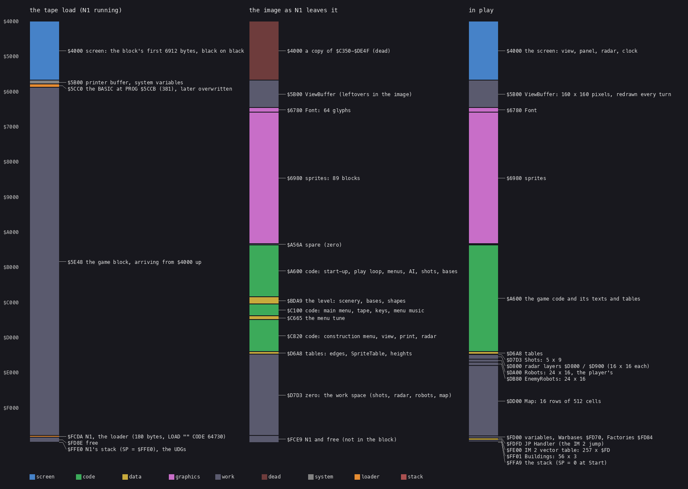
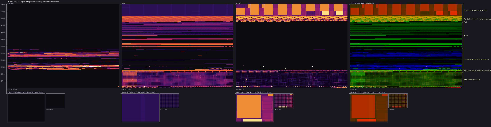
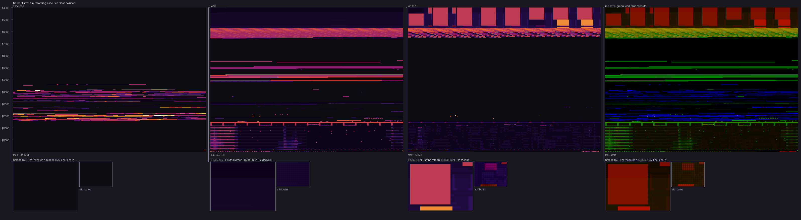
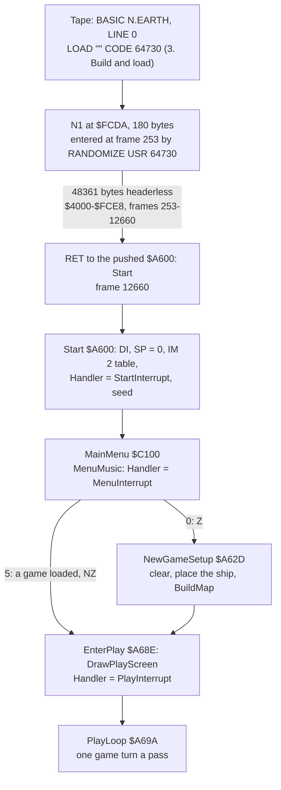
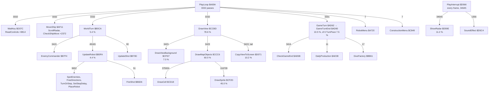

# 2. Architecture

This document gives the shape of the program: the machine it targets, where everything lives in memory, the stages
from the tape to play, how time is kept, and which parts of the code do what. Later documents take each part apart;
this one is the map they hang on.

The recordings it rests on ([Terms](README.md#terms)):

- `play`: power-on, the tape load, the menu, and 3 673 frames of random play (from frame 12841), 16 514 frames in all. Blocks 0-3 were
  fast-loaded; N1 loaded block 4 at signal speed ([3.3](03-build-and-load.md#33-the-load-step-by-step)). Its L1
  build (`work/play/l1.json`) holds 153 513 858 instructions and 1 154 130 431 T;
- `game`: the L1 build of `play` from the game's entry, frame 12661 (`work/game`). It is the base of the first
  disassembly (WALKTHROUGH 2) and of `img/heatmap-game.png`;
- `deep`: the bot's game from the menu snapshot of `play`, 36 046 frames, 11 game days (WALKTHROUGH 6). Its L1
  build (`work/deep/l1.json`) holds 273 755 750 instructions and 2 519 182 516 T, 190 routines. It was replayed
  with 1 442 checkpoints and no divergence. Every count and share below comes from this build unless named.

## 2.1 The machine budget

| Resource | The game uses | Notes |
| --- | --- | --- |
| CPU | Z80 at 3.5 MHz, 69 888 T a frame | 48K timing |
| Memory | 48K: `$5B00-$FFFF`, the printer buffer and the system variables included | no 128K paging, no AY |
| Screen | the one screen at `$4000` | the view is drawn into a back buffer at `$5B00` and copied (2.2) |
| Sound | the beeper, `OUT ($FE)` only | the menu tune, the effects inside the play interrupt, the nuclear rumble ([9](09-sound.md)) |
| Input | the keyboard, a Kempston stick (port `$1F`) or an Interface 2 stick (keyboard rows `$EFFE` / `$F7FE`), chosen in the menu | all fill one byte, `Input` `$FD0C` ([5](05-controls.md)) |
| Interrupts | IM 2, one handler at a time through `JP` at `$FDFD` | 2.4 |
| ROM | KEY-SCAN `$028E` and the key table `$0205` (menu, redefine keys); SA-BYTES `$04D0` and LD-BYTES `$0562` (save, load); ROM bytes read as noise | no ROM code runs in play |

The ports L1 saw in `deep`:

- **reads**: the eight keyboard half-rows, port `$E7FE` (the menu's number keys, `MenuInterrupt` `$C4FD`) and
  `$001F`, the Kempston stick;
- **writes**: only port `$FE`, with three high bytes, from `OUT (C)`.

The one ROM routine L1 lists in `deep` is `$028E`, entered 5 times, all in the main menu. In play no ROM code runs at
all. The ROM is read as data: `SoundEffect` `$D5C4` and `NuclearRumble` `$BAEE` send ROM bytes to the speaker as
noise ([9](09-sound.md)).

## 2.2 The memory map



The figure is drawn by `python3 tools/memmap.py` from `tools/memmap.txt`. Every row names its witness: the tape
blocks, `src/loader.asm`, the entries and `@equ` lines of `src/game/game.ann`, WALKTHROUGH 2. In play:

| Range | Size | What | Lifetime |
| --- | ---: | --- | --- |
| `$4000-$5AFF` | 6 912 | the screen. As loaded it holds a copy of `$C350-$DE4F`, black on black; the start-up clears it before anything reads it ([3.4](03-build-and-load.md#34-the-game-block-and-its-screen-part)) | the play screen: view, panel, clock, radar |
| `$5B00-$677F` | 3 200 | `ViewBuffer`: 160 lines of 20 bytes, the view's back buffer ([6.2](06-rendering.md#62-the-view-buffer-5b00-677f)) | cleared and redrawn every turn; it also holds the save checksum and the nuclear flash's attribute backup at those times |
| `$6780-$697F` | 512 | `Font`: 64 glyphs, codes `$20-$5F` ([8](08-hud-and-text.md)) | constant |
| `$6980-$A569` | 15 338 | the sprites: 89 blocks, most pictures in two (an even and an odd column) ([6.5](06-rendering.md#65-sprites)) | constant |
| `$A56A-$A5FF` | 150 | zeros | unused |
| `$A600-$BDA8` | 6 057 | code: the start-up, the play loop, the robot menus, the game turn, the ship, the world turn and AI, the enemy, the nuclear blast, the bases | 2.6 |
| `$BDA9-$C0FF` | 855 | the level: scenery lists, base lists, the shape table and shapes ([7.5](07-objects.md#75-the-map)); zeros from `$C08D` | read once a new game by `BuildMap` `$BC6F` |
| `$C100-$C664` | 1 381 | code: the main menu, load and save, redefine keys, the menu music player | 2.6 |
| `$C665-$C81F` | 443 | the menu tune ([9](09-sound.md)) | constant |
| `$C820-$D6A7` | 3 720 | code: the construction menu, the view, the panel, printing, the controls, the interrupts, the radar | 2.6 |
| `$D6A8-$D7D2` | 299 | tables: the edge strips, the part sprites, `SpriteTable` `$D6E8`, part and terrain heights | constant |
| `$D7D3-$D7FF` | 45 | `Shots`: 5 records of 9 bytes ([7.4](07-objects.md#74-shots)) | play |
| `$D800-$D9FF` | 512 | the radar pictures `RadarOwn` `$D800` and `RadarEnemy` `$D900` ([6.7](06-rendering.md#67-the-radar)) | play; `$D92B-$D9FF` is the save staging area |
| `$DA00-$DCFF` | 768 | `Robots`: 48 records of 16 bytes, 24 the player's, then 24 the enemy's from `$DB80` ([7.2](07-objects.md#72-robots)) | play |
| `$DD00-$FCFF` | 8 192 | `Map`: 16 rows of 512 cells ([7.5](07-objects.md#75-the-map)) | built at every new game |
| `$FD00-$FDFC` | 253 | the variables (`@equ`): the seed, the ship, the clock, the counts, the resources, the capture points `$FD70-$FDFB` | play |
| `$FDFD-$FDFF` | 3 | `JP Handler`: the IM 2 jump, `Handler` `$FDFE` | from `Start` on |
| `$FE00-$FF00` | 257 | the IM 2 vector table, all `$FD` | from `Start` on |
| `$FF01-$FFA8` | 168 | `Buildings`: 56 records of 3 bytes ([7.6](07-objects.md#76-buildings-and-capture-points)) | play |
| `$FFA9-$FFFF` | 87 | the stack: `Start` sets SP = 0 | always |

The game block ends at `$FCE8` ([3.4](03-build-and-load.md#34-the-game-block-and-its-screen-part)). Everything past it is
work space that `Start` and `NewGameSetup` `$A62D` set up, so the image holds no initial value for any variable,
except the seed, which `Start` writes. The saved game (`$D92B-$FDFB`, [3.6](03-build-and-load.md#36-the-saved-game))
is exactly the world: the shots and buildings staged into the radar's tail, the robots, the map and the variables.

**Where the time and the accesses go.** The heat map of the `deep` recording, `$4000-$FFFF`, with the play regions
of 512 bytes and more:



It is drawn by `python3 ../kit/heatmap.py` on `work/deep/l1.json` with `--from 4000 --regions
tools/regions-play.txt`; `tools/memmap.py --regions-out` writes that regions file from `tools/memmap.txt`. And the
same for the first flight, `game`:



Both show the same picture:

- execution only in `$A600-$D6A7`, densest in the view code `$CCBD-$D0B8`;
- reads spread over the sprites `$6980-$A569`, every turn;
- writes concentrated in the view buffer `$5B00-$677F`, the screen and the radar;
- the map `$DD00-$FCFF` read cell by cell by the view walk, written only where something moves.

## 2.3 The stages from tape to play



| Stage | Entry | `play` frame | Witness |
| --- | --- | --- | --- |
| the BASIC | PROG `$5CCB` | in place by 250 | TTD `memory_at` (`tools/load_stages.py`) |
| N1 | `$FCDA` | 253 | `re_session.py stages` (WALKTHROUGH 1) |
| the game | `$A600` | 12660 | `re_session.py stages`; N1's `RET` |
| the main menu | `$C100` | 12660-12841; the tune 12667-12814 | L1: `MenuInterrupt` 144 entries |
| play | `$A69A` | 12841-16514 | L1: `PlayLoop` first at 12841, `PlayInterrupt` 3 672 entries from 12842 |

`re_session.py stages` also lists `$FDFD`, `$D59C`, `$C199` and `$D566` as stages. They are the handler swaps and
the menu, not new code: no block arrives after the load, and every write the stages name is N1's store `$FD3B`
(WALKTHROUGH 1).

### Start-up, `$A600`

```text
$A600  DI
       LD SP,$0000          ; the stack from $FFFF down
       LD HL,$FE00          ; 257 bytes of $FD at $FE00-$FF00
       ...
       LD A,$C3
       LD ($FDFD),A         ; JP at $FDFD: every vector lands on Handler
       LD HL,StartInterrupt ; EI; RET
       LD (Handler),HL
       LD A,$FE
       LD I,A
       IM 2
       EI
       LD HL,$3039
       LD (RandomSeed),HL   ; the seed $FD00-$FD03 = $39,$30,$39,$30
       LD (RandomSeed+2),HL
       CALL MainMenu        ; Z: a new game, NZ: a saved game loaded
```

The IM 2 table makes the vector `$FDFD` whatever the data bus holds. A 3-byte `JP` sits there, and its operand,
`Handler` `$FDFE`, is the only thing the game changes to switch the interrupt's work. `Start` is entered again from
four places ([4.2](04-game-loop.md#42-the-states)):

- the abort key (`CheckGameKeys` `$A70D`);
- the end of a game (`GameOverWait` `$AEEA`);
- a loading error (`LoadError` `$C282`);
- N1's `RET`, the first time.

Every entry rebuilds the table and sets the same seed.

## 2.4 Time: frames and interrupts

The game runs with interrupts on everywhere except inside the tape routines, and the handler changes with the state:

| Handler | Address | Installed by | Work a frame | `play` entries | `deep` entries |
| --- | --- | --- | --- | ---: | ---: |
| `StartInterrupt` | `$D59C` | `Start`, `GameStop` `$AF00`, `ConstructionMenu` `$C849`, `SaveGame` `$C28D`, the end of `MenuMusic` | `EI; RET` | 37 | 1 380 |
| `MenuInterrupt` | `$C4FD` | `MenuMusic` `$C4A7` | the menu tune's drum, bass and lead events, the title colours, the number-key test ([9](09-sound.md)) | 144 | 21 |
| `PlayInterrupt` | `$D566` | `EnterPlay` `$A68E`, the end of `ConstructionMenu` | `TurnFrames` `$FD34` + 1; one radar picture by turns (`ShowRadar` `$D59E`, 8 134 T); the running sound effect (`SoundEffect` `$D5C4`) | 3 672 | 34 645 |
| ROM `$0038` | | the ROM, before `Start` | the ROM's keyboard scan | 171 (the load only) | 0 |

In `deep` the interrupts took 36 046 entries, one a frame, 8 371 T an entry on average: 12.0 % of all the CPU. Of
that the radar is the bulk: `ShowRadar` is 11.2 % of all T on its own ([6.7](06-rendering.md#67-the-radar)). In
`play`, `$FDFD` was entered 3 853 times at 8 054 T an entry. No interrupt arrived while N1 loaded the game block: N1
runs with `DI`.

**The frame does not pace the drawing; a counter does.** The main loop is not synchronised with the beam. The play
interrupt counts frames into `TurnFrames`, and the end of each game turn waits until the count reaches 10, then
clears it (`TurnPace` `$AE1D`). A turn is therefore at least 10 frames (200 ms). The drawing takes about 8.3 of them,
so the wait is short and the turn rate is fixed at 5 a second ([4.5](04-game-loop.md#45-time)).

## 2.5 The main loop

`PlayLoop` `$A69A` is a fall-through from `Start` → `NewGameSetup` → `EnterPlay`, entered once a game. L1's calls
of one game turn, with the counts in `deep` (3 332 passes of `PlayLoop`, the last one cut off by the end of the
recording; 3 414 game turns, 83 of them run by the robot menu's `ListMenu`) and each routine's share of all T, inclusive:



The shares add up to more than 100 % because they are inclusive. The interrupts that land inside a routine count in
its share: `DrawView`'s 78.6 % includes about one interrupt a frame of its 8.3 frames. The roles in short:

| Routine | Calls | Share | Role (the doc) |
| --- | ---: | ---: | --- |
| `WaitKey` `$D37C` | 3 332 | 0.3 % | read the controls into `Input`; the pause ([5](05-controls.md)) |
| `MoveShip` `$AF11` | 3 332 | 0.3 % | the ship, the view's column, the radar window ([5.3](05-controls.md#53-in-play-the-ship-and-the-game-keys)) |
| `WorldTurn` `$B0CA` | 3 415 | 5.4 % | the enemy commander, the 48 robot slots, the 5 shots ([7.1](07-objects.md#71-the-world-turn)) |
| `DrawView` `$CCBD` | 3 423 | 78.6 % | clear the view buffer, walk the 32 x 16 cells back to front, copy to the screen ([6.1](06-rendering.md#61-one-view-as-it-is-drawn)) |
| `GameTurn` `$AD62` | 3 414 | 10.5 % | the random step, the clock, the production, the game end, the captures, the frame pacing ([4.3](04-game-loop.md#43-the-turn)) |
| `RobotMenu` `$A720` | 7 | 3.5 % | the robot menu; turns run inside it ([5.5](05-controls.md#55-the-robot-menu-and-its-submenus)) |
| `ConstructionMenu` `$C849` | 7 | 3.7 % | the construction menu; the world stands still ([5.4](05-controls.md#54-the-construction-menu)) |
| `PlayInterrupt` `$D566` | 34 645 | 12.0 % with the other handlers | the radar picture, the frame counter, the sound effect |

`DrawView` was entered 3 423 times: 3 332 from `PlayLoop`, 83 from `ListMenu` `$ACD7` and 8 from `DrawPlayScreen`
`$D0CA` (7 after the construction menus, 1 at `EnterPlay`). L1 files the `PlayLoop` calls under `NewGameSetup`,
because `PlayLoop` is a fall-through label inside it, not a routine of its own. A turn's average cost is 578 128 T,
8.27 frames, interrupts inside included.

## 2.6 Module map

`src/game/game.ann` declares one module, `main`, so the source is one file in address order (`main.asm`,
[3.7](03-build-and-load.md#37-the-source-build)). The code still falls into areas by address; each was read by one region agent
(`work/ann/r1.md` - `r5.md`, `d1.md`) and is taken apart in the doc named:

| Range | Area | Main entries | Docs |
| --- | --- | --- | --- |
| `$5B00-$A5FF` | view buffer, font, sprites | `ViewBuffer`, `Font`, 89 sprite blocks | 6, 8 |
| `$A600-$A71F` | start-up and the play loop | `Start`, `NewGameSetup` `$A62D`, `EnterPlay` `$A68E`, `PlayLoop` `$A69A` | 2.3, 4 |
| `$A720-$AD61` | the robot menu and its submenus | `RobotMenu` `$A720`, `OrdersMenu` `$A971`, `SetOrder` `$ABC8`, `ListMenu` `$ACD7` | 5.5 |
| `$AD62-$AF10` | the game turn | `GameTurn` `$AD62`, `GameTurnEnd` `$AD90`, `DailyProduction` `$AE38`, `CheckGameEnd` `$AE6B`, `GameStop` `$AF00` | 4, 10 |
| `$AF11-$B0C9` | the ship and its height probes | `MoveShip` `$AF11`, `ScrollRadar` `$AFE6`, `CheckShipMove` `$B052` | 5.3 |
| `$B0CA-$B7F3` | the world turn: robots and shots | `WorldTurn` `$B0CA`, `UpdateRobot` `$B0FA`, `SteerByOrder` `$B222`, `SpotEnemies` `$B626`, `FireShot` `$B6D6`, `MoveShot` `$B724` | 7, 10 |
| `$B7F4-$BB08` | the enemy and the nuclear blast | `EnemyCommander` `$B7F4`, `$B99F`, `NuclearFlash` `$BA87` | 10 |
| `$BB09-$BDA8` | bases and the map build | `CountBases` `$BB09`, `GiveFactory` `$BB61`, `GiveWarbase` `$BB86`, `BuildMap` `$BC6F` | 7.5, 7.6 |
| `$BDA9-$C0FF` | the level | `SceneryWest` `$BDA9`, `BaseListWest` `$BF46`, `ShapeTable` `$BF9C` | 7.5 |
| `$C100-$C4A6` | the main menu, tape, keys | `MainMenu` `$C100`, `LoadGameBlocks` `$C21E`, `SaveGame` `$C28D`, `RedefineKeys` `$C34A` | 3.6, 5.2 |
| `$C4A7-$C848` | the menu music and the title colours | `MenuMusic` `$C4A7`, `MenuInterrupt` `$C4FD`, the tune `$C665`, `TitleColourCycle` `$C820` | 9 |
| `$C849-$CCBC` | the construction menu | `ConstructionMenu` `$C849`, `StartRobot` `$CB52`, `PlaceRobot` `$CC7C` | 5.4 |
| `$CCBD-$D0B8` | the view | `DrawView` `$CCBD`, `DrawMapObjects` `$CCC6`, `DrawSprite` `$CF2D`, `CopyViewToScreen` `$D071` | 6 |
| `$D0B9-$D37B` | the play screen and the panel | `DrawPlayScreen` `$D0CA`, `UpdateStatusPanel` `$D293`, `Random` `$D358` | 6.8, 8 |
| `$D37C-$D3E4` | the controls | `WaitKey` `$D37C`, `ReadControls` `$D38A`, `KeyTable` `$D3CC` | 5 |
| `$D3E5-$D565` | printing | `PrintInline` `$D42D`, `PrintChar` `$D4B1`, `PrintBigChar` `$D4DA` | 8 |
| `$D566-$D6A7` | the interrupts and the radar | `PlayInterrupt` `$D566`, `ShowRadar` `$D59E`, `SoundEffect` `$D5C4`, `BuildRadar` `$D5F8` | 2.4, 6.7, 9 |
| `$D6A8-$D7D2` | tables | `SpriteTable` `$D6E8`, `PartHeights` `$D7B4`, `TerrainHeights` `$D7BC` | 6, 7 |

The annotations hold 257 routines (`c`), 303 data entries (`b`, `w`, `t`, `s`) and 43 variables past the image
(`@equ`). Of the image's bytes, 8 913 are code: 4 833 instructions, 4 259 of which ran in a recording (WALKTHROUGH 6).

## 2.7 Self-modifying code

Every write into a code entry in `deep` (L1 `byte_counts`, `$A600-$D6A7` against the `c` entries of `game.ann`)
is an operand that serves as a variable:

| Operand | In | Writes | What it holds |
| --- | --- | ---: | --- |
| `$CF3F` | `DrawSprite` `$CF2D` (`SUB n`) | 118 205 | the height of the stack drawn so far: a robot's parts go up one by one ([6.6](06-rendering.md#66-robots-parts-stacked)) |
| `$CFAF` | `DrawSprite` (`LD A,n`) | 130 215 | the bytes to skip on the left of a sprite cut by the view's edge |
| `$D038`, `$D041` | `FillViewCorner` `$D026` | 37 664 each | the fill and skip counts of the corner's staircase bands, reset to 10 and moved by 2 |
| `$D371` | `Random` `$D358` (`LD L,n`) | 43 256 | the index left by the last call |
| `$C4D0`, `$C4D2`, `$C4D6`, `$C4ED`, `$C4EF`, `$C4F3` | `LeadStep` / `BassStep` | 1-2 | the menu tune's periods, pulse values and widths ([9](09-sound.md)) |

The interrupt jump changes too: `Handler` `$FDFE` is the operand of the `JP` at `$FDFD`, written at every state
change (2.4). No code is moved or generated, and no instruction byte other than these operands is written.

## 2.8 Design notes

- **One full redraw a turn.** The view is rebuilt from the map every turn into a back buffer and copied whole. There
  are no dirty rectangles and no scrolling; this costs 79 % of the CPU and sets the game's pace
  ([6.9](06-rendering.md#69-design-notes)).
- **The map is the object index.** Robots, buildings and shots mark their cells (bit 6), and every search walks the
  map, not a list ([7](07-objects.md)).
- **One handler slot.** The state machine's states differ mainly in what the `JP` at `$FDFD` points to: nothing,
  the music, or the radar and the turn counter.
- **The radar is the interrupt's job.** Two 16 x 16-byte pictures are shown on alternate frames, which colours the
  two sides at the price of 12 % of the CPU.
- **The world lives in one contiguous block.** Everything a game needs, `$D92B-$FDFB` after two small tables are
  staged into it, is saved and loaded as one tape block.
