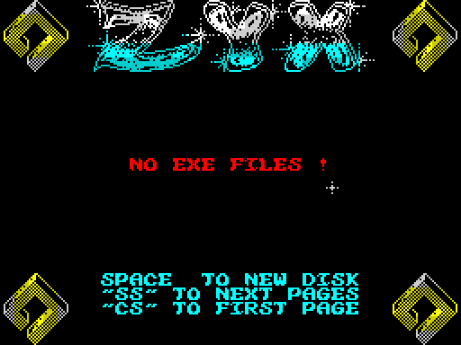
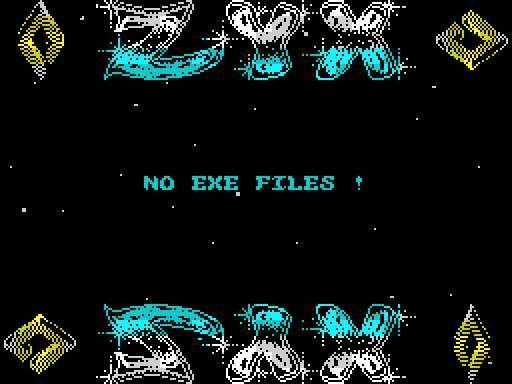
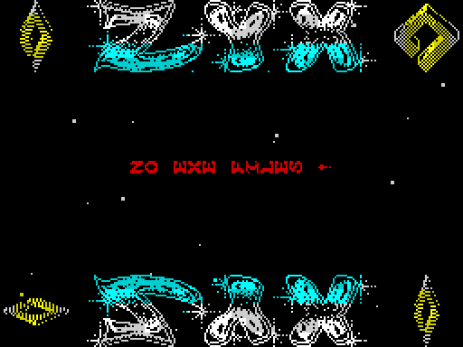
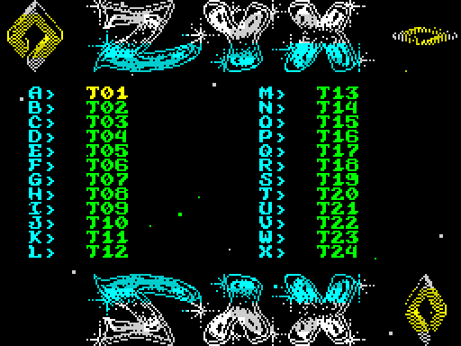
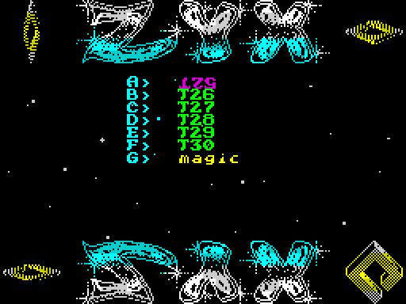
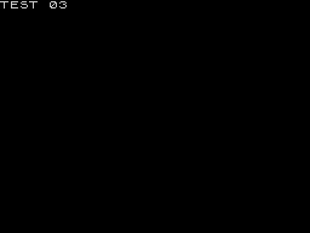

# ZYX boot: walkthrough

How the reverse was done, step by step, and which unreal-ng call answered each question. Terms:
[docs/README.md](docs/README.md). Recipes: `../recipes/`.

Every recording is a disk boot on a Pentagon 128K at the emulated drive's speed (no fast load trap); frame numbers
are the recording's.

## 0. The medium

**Which file is the original.** The inputs were the owner's 39 images (`work/candidates/owner-boots_zyx/`, 56 boot
files), an older `ZYX.SCL` and a damaged Hobeta (`owner-BOOT.zip`), and Vadim's 2010 sources with their `boot.scl`.
`tools/disk.py` (a case tool: SCL, TRD and Hobeta catalogues, bodies, BASIC listing, SCL writing) read them all.

1. Vadim's `61a8.bin`, `a600.bin` and `c000.bin` are the three pieces of his `boot.scl`'s body (15, 8 and 22
   sectors after the BASIC sector) byte for byte (`work/stage1/survey0.py`).
2. The collection index's TR-DOS file table (`index/trdos-files.tsv`, the body sha256 per file) gives that body
   (`1add29ab...`) on 42 images (`work/stage1/sha-hits.txt`, `img-vadim.txt`, `vadim-images.tsv`).
3. The 48 TOSEC "(Zyx)" compilations of 1994 (`work/stage1/zyxdisks/`, from the share's TOSEC `Compilations.zip`)
   hold ZYX's own boots: Tank and War Cars Construction Set carry exactly this body (`work/stage1/release_check.py`),
   the others its family A and family B variants.
4. None of the 56 owner variants is this body; all of them share most of its code
   ([work/stage1/variants.md](work/stage1/variants.md)). All 56 build from this case's source with only their
   own resources, music, constants, code switches and parts (`tools/build.sh --all`, section 6.4,
   [variants/README.md](variants/README.md)).

So the original is Vadim's `boot.scl`, put unchanged in `orig/boot.scl`; the reasons are in
[README, the release check](README.md#the-release-check-why-this-file-is-the-original).

**The disk.** One file `boot`, B, 46 sectors: the BASIC sector, then three pieces the BASIC's loader reads itself
([doc 3, 3.1](docs/03-build-and-load.md#31-the-disk)). `tools/image.py` writes the menu's 64 K image
(`work/mkgame/original.bin`, the pieces at `$61A8` and `$A600`) and the two parts' images (`work/parts/`).

**Test disks.** The original disk has no other file, so the menu says NO EXE FILES !. `tools/mktestdisk.py` writes
`tests/disks/many.scl` (the boot, 30 BASIC programs T01-T30 each printing `TEST nn`, a 192-sector CODE file `magic`,
a 2-sector CODE file `data`: 31 names listed, more than one page), `tests/disks/noexe.scl` (the boot and two
CODE files that are not listed) and `tests/disks/deep.scl` (the boot, T01-T52 with T05 a deleted entry, `magic`: 52
names listed, three pages).

## 1. One recording from power-on

All recordings are `re_session.py capture --disk --record-load --disk-boot-frames 100` (section 6.0), muted, with the
input script in `tests/inputs/`; the sessions (`session.ttd`), the L1 builds and the screens are in `work/stage1/cN/`.
The Pentagon's 128 menu needs keys to boot TR-DOS: CAPS SHIFT + 7 (up) onto TR-DOS, ENTER, R (RUN) and ENTER
(`tests/inputs/c1.txt`, script frames 0-166). The menu reads the keys on every 8th interrupt, so every key is held 8
frames (a first c2 with 2-frame presses missed most of them).

**How frames are counted.** A frame number in this case is the recording's own: the one the L1 profile, TTD
`memory_at` and the kit's animations use (frame 0 is the power-on). The capture starts recording the inputs at a
later frame (`capture.json` `start`: c1 104, c2 and c3 106, c4 109, c5 and c6 101), and two things count from that
start instead: the input scripts' frames and the screen files `work/stage1/cN/screens/NNNNNN.scr`. So the screen file
`000500.scr` of c1 is recording frame 604, and a key at script frame 1666 of c2 is pressed at recording frame 1772.
Checked with TTD `memory_at` on c6: `000500.scr` matches the screen memory of frame 602 closest (80 bytes differ,
the stars move every pass) and not frame 500 (black, the loader still reading). Earlier versions of this file gave the
screen files' numbers as frames.

| Recording | Disk | What it does | Frames | Start |
| --- | --- | --- | ---: | ---: |
| c1 | `orig/boot.scl` | power-on, TR-DOS, the boot; the menu idles (NO EXE FILES !) for 6000 frames, SPACE, idles | 7676 | 104 |
| c2 | `tests/disks/many.scl` | SS (page 2), SS (nothing: the last page), CS (page 1), 8 8 3 8 9 7 1 4, ENTER on T03 | 4362 | 106 |
| c3 | `tests/disks/many.scl` | SS, then F: the 6th name of page 2, T30 | 2782 | 106 |
| c4 | `tests/disks/noexe.scl` | NO EXE FILES !, A and ENTER do nothing | 2182 | 109 |
| c5 | `tests/disks/deep.scl` | SS, SS (page 3), then D: `magic`, GO TO "magic" CODE | 3090 | 101 |
| c6 | `orig/boot.scl` | the menu idles to the tune's third tune loop | 16566 | 101 |

c1 in order (the L1 profile, `work/stage1/c1/l1.json`, frames 104-7880, 7716 interrupts): TR-DOS loads `boot` and the
Loader `$5D80` runs at frame 447; Start `$61A8` at 516; DrawScreen at 532-536 ([setup](docs/img/play/setup.png),
frame 604: the logo, the rhombi, the help lines, NO EXE FILES !); the interrupt from frame 542 with the music; the
rhombus phases at 542-697 and the set-up's turns until DrawReflection at 824-890, which covers the help lines with the
logo's mirror image ([menu idle](docs/img/play/menu-idle.png), frame 1104); from frame 890 the main loop. At frame
4104 the cursor's text is caught upside down ([spin](docs/img/play/name-spin.png)): the spin at Frames 50-90 of every
256 turns it a quarter at a time. SPACE reads the catalogue again (ShowCatalogue's second call, frame 6436).







## 2. Static pass over the medium

## 3. The stages and the packers

## 4. The medium from source

## 5. Tool gaps found and fixed in unreal-ng

| Gap | Fix | unreal-ng commit |
| --- | --- | --- |

## 6. The game

Here "the game" is the menu.

### 6.0 The recordings

Every recording keeps its session. Reopen one from the case folder after `. work/env.sh`, and read it with TTD
`memory_at`:

```bash
python3 $RS open --work W --ttd work/stage1/cN/session.ttd --port-base B
```

 The writers reopened c1
and c2 (zbA, into `work/docs/zbA/c1`, `c2`) and c3 (zbB, into `work/docs/zbB/c3`); they made no new recording. c5 and c6
were made at the integration for what no recording had shown (zbB's list).

| Recording | Command (from the case folder, `. work/env.sh`) | Session |
| --- | --- | --- |
| c1 | `python3 $RS capture --work work/stage1/c1 --media orig/boot.scl --disk --record-load --disk-boot-frames 100 --inputs tests/inputs/c1.txt --model PENTAGON --ranges 4000-FFFF --port-base 37490` | `work/stage1/c1/session.ttd` |
| c2 | the same with `--work work/stage1/c2 --media tests/disks/many.scl --inputs tests/inputs/c2.txt` | `work/stage1/c2/session.ttd` |
| c3 | the same with `--work work/stage1/c3 --media tests/disks/many.scl --inputs tests/inputs/c3.txt` | `work/stage1/c3/session.ttd` |
| c4 | the same with `--work work/stage1/c4 --media tests/disks/noexe.scl --inputs tests/inputs/c4.txt` | `work/stage1/c4/session.ttd` |
| c5 | `python3 tools/mktestdisk.py`, then the same with `--work work/stage1/c5 --media tests/disks/deep.scl --inputs tests/inputs/c5.txt --port-base 37440` | `work/stage1/c5/session.ttd` |
| c6 | the same with `--work work/stage1/c6 --media orig/boot.scl --inputs tests/inputs/c6.txt --port-base 37440` | `work/stage1/c6/session.ttd` |

What c5 and c6 showed (TTD `memory_at`, `work/docs/integrate/mem.py` and `changes.py`):

- c5: page 1 lists T04 then T06 (T05's first byte `$01` at `$9D50`, frame 1500); page 2 drawn by frame 1883, page 3
  by 2185 (T50, T51, T52, `magic`); D runs RunLetter at frame 2490, and line 1 at `$5D4C` reads `$EC "magic   " $AF`
  (GO TO "magic" CODE) at frame 2513. The test file is zeros, so TR-DOS's load resets the machine (the 128 menu by
  frame 2851). Doc 7, 7.2 and 7.5; doc 10, 10.6.
- c6: PositionOp's operand `$C195` becomes 1 (position 0 started) at frames 544, 8249 and 16013, and 2 at 580 and 8345:
  the tune loops are 7705 and 7764 frames apart when sampled at T 0, position 0 lasts 36 frames the first time and
  96 the second. Doc 9, 9.8.

The variants' menus (doc 13) are not recordings: `tools/fig_variants.py shots` boots each variant on its own
instance (`--port-base 37460`, muted) and reads the screen from the running machine (`work/docs/zbV/figs/shots.json`
holds each shot's frame).

### 6.1 The screenshots

Each is a screen file of its recording, drawn at 2 x (`work/stage1/cN/screens/`); the frame is the recording's.

| Screenshot | Recording | Frame | Screen file | Linked from |
| --- | --- | ---: | --- | --- |
| [setup.png](docs/img/play/setup.png) | c1 | 604 | `000500.scr` | doc 2, this file |
| [menu-idle.png](docs/img/play/menu-idle.png) | c1 | 1104 | `001000.scr` | docs 2, 7, this file |
| [name-spin.png](docs/img/play/name-spin.png) | c1 | 4104 | `004000.scr` | doc 8, this file |
| [page1.png](docs/img/play/page1.png) | c2 | 1606 | `001500.scr` | this file |
| [page2.png](docs/img/play/page2.png) | c2 | 1856 | `001750.scr` | this file |
| [launched.png](docs/img/play/launched.png) | c2 | 3856 | `003750.scr` | docs 3, 10, this file |
| [screens.png](docs/img/overview/screens.png) | c1, c2 | in its caption | | docs 1, 6 |

`work/docs/integrate/scrmatch.py PNG DIR` finds the screen file a screenshot shows (0 pixels differ for all six).

### 6.2 What the recordings showed

What the recordings showed, each against the code (`src/main`):

- **Pages.** 31 listed names make page 1 of 24 in two columns, A-L and M-X
  ([page 1](docs/img/play/page1.png), c2 frame 1606), and page 2 of 7 in one column after SS
  ([page 2](docs/img/play/page2.png), c2 frame 1856): ListCatalogue `$65C7` counts from the page's first entry, and
  ListTwoColumns `$6648` takes 24 when there are 25 or more. The yellow `magic` is the 192-sector CODE file; `data`
  (2 sectors) and the boot itself are not listed. A second SS on the last page does nothing (MorePages `$B3B9` is 0);
  CS goes back to page 1 (the check `PagePointer >= $9D01` at `$68D1`). c5 reaches a third page and skips a deleted
  entry.
- **The cursor.** 8, 3 move it down, 9, 4 up, 7, 1 to the other column; its colour cycles every 4 frames
  (Interrupt `$6757`).
- **Running a file.** ENTER on T03 (c2) and F on page 2 (c3, the 6th name: T30) end with `TEST 03` and `TEST 30`
  on the screen ([launched](docs/img/play/launched.png), c2 frame 3856): RunLetter `$6A51` wrote `RUN "T03     "`
  into the BASIC's line 1 and returned to the loader at `$5DB7` ([doc 3, 3.4](docs/03-build-and-load.md#34-how-the-menu-runs-a-file)).
  D on page 3 of c5 writes `GO TO "magic" CODE`.
- **No files.** c4: NO EXE FILES !; the letter A returns at once from RunLetter (past the page's 0 files) and ENTER
  from FireKey `$6A3F`.
- **The music** plays from the first interrupt (frame 543 in c1) and is cut for a moment by every page change
  (SoundOff `$6E41` in ShowCatalogue); c6 plays it into its third tune loop.







### 6.3 The animations

Every animation, with the command in its caption; the frames are the recording's (`--work` names the reopened copy).

| Animation | Document | Recording | Frames |
| --- | --- | --- | --- |
| [play/stars.gif](docs/img/play/stars.gif) | docs 1 (1.3), 6 (6.4) | c1 | 1300-1430, every 2nd |
| [play/cursor.gif](docs/img/play/cursor.gif) | docs 1 (1.3), 5 (5.4) | c2 | 3195-3680, every 5th |
| [play/glint.gif](docs/img/play/glint.gif) | doc 6 (6.6) | c1 | 1055-1112, every 2nd |
| [play/name-spin.gif](docs/img/play/name-spin.gif) | doc 8 (8.5) | c1 | 1104-1148, every 2nd |
| [play/page-change.gif](docs/img/play/page-change.gif) | doc 7 (7.5) | c3 | 1870-1892, every frame |
| [play/launch.gif](docs/img/play/launch.gif) | doc 10 (10.6) | c3 | 2178-2296, every 2nd |
| [routines/MainLoop.gif](docs/img/routines/MainLoop.gif) | docs 4 (4.4), 12 | c1 | 1300:12000-1301:30000 |
| [routines/Interrupt.gif](docs/img/routines/Interrupt.gif) | docs 4 (4.5), 12 | c1 | 1105:71600-1106:62000 |
| [routines/ReadKeyboard.gif](docs/img/routines/ReadKeyboard.gif) | docs 5 (5.1), 12 | c2 | 3203:14900-3203:20130 |
| [routines/DrawReflection.gif](docs/img/routines/DrawReflection.gif) | docs 6 (6.2), 12 | c1 | 823-891 |
| [routines/BuildRombPhases.gif](docs/img/routines/BuildRombPhases.gif) | docs 6 (6.3), 12 | c1 | 570:60000-581:40000 |
| [routines/ShowCatalogue.gif](docs/img/routines/ShowCatalogue.gif) | docs 7 (7.5), 12 | c3 | 1879:16200-1888:0 |
| [routines/PrintString.gif](docs/img/routines/PrintString.gif) | docs 8 (8.1), 12 | c1 | 533:11300-534:30900 |
| [routines/PlayFrame.gif](docs/img/routines/PlayFrame.gif) | docs 9 (9.4), 12 | c3 | 973:150-973:13000 |
| [routines/WriteAY.gif](docs/img/routines/WriteAY.gif) | docs 9 (9.7), 12 | c3 | 973:13000-1009:13000, one picture a frame |
| [routines/RunLetter.gif](docs/img/routines/RunLetter.gif) | docs 10 (10.2), 12 | c3 | 2182:9000-2182:15800 |
| [routines/ExitFade.gif](docs/img/routines/ExitFade.gif) | docs 10 (10.5), 12 | c3 | 2182:15700-2205:0 |

`F:T` is frame F at T-state T of the frame.

### 6.4 Building the variants

The 56 variants of doc 13 build from this case's source; a folder `variants/NAME/` holds only what differs
([variants/README.md](variants/README.md), [doc 13, 13.10](docs/13-variants.md#1310-building-and-checking)):

```bash
tools/build.sh [SJASMPLUS] --variant NAME   # variants/NAME over src/res, compared with its candidate image
tools/build.sh [SJASMPLUS] --all            # every variant, one line each; the last line: variants: 56 of 56 identical
python3 tools/res_formats.py check          # every editable file of src/res and of the variants round-trips
python3 tools/variants.py index             # variants/README.md and the own loaders' README.md
```

- `--variant NAME` assembles the menu with the variant's constants (`variant.json` `equ`), layout B's extra CALL
  (`"start": true`), its code switches (`"code"`, `tools/variants.py` `CODE_SWITCHES`) and its parts (`"parts"`),
  over `src/res` with the variant's own resource files laid on top, builds its music piece (`tools/variants_music.py`)
  and its BASIC (`basic.txt`), cuts the pieces its loader reads (`"pieces"`) and compares the body with the
  candidate's file byte for byte (`build/variants/NAME/`).
- `--all` does that for every folder; at the integration (2026-11-12) it printed `variants: 56 of 56 identical`
  (`work/docs/integrate-build.txt`).
- `python3 tools/variants.py extract` wrote the folders from the candidates (`work/candidates/owner-boots_zyx/`);
  zyxlgbt's TRD goes through `tools/lotus.py`, zyxremix's and zyxtvmbt's packed parts through `tools/lzpack.py`.

## 7. Review
