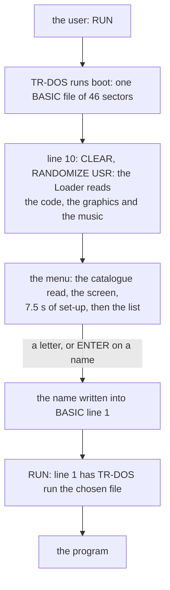
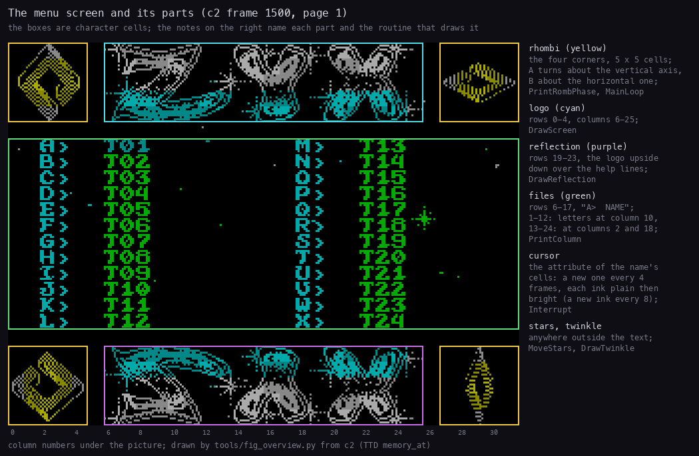
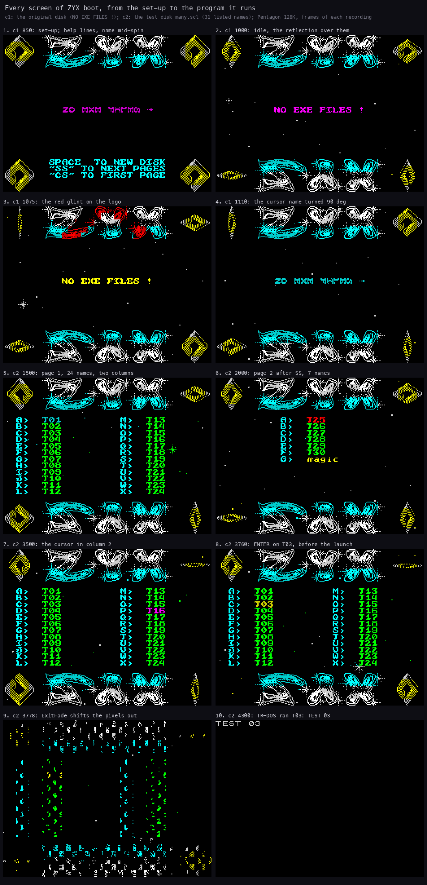
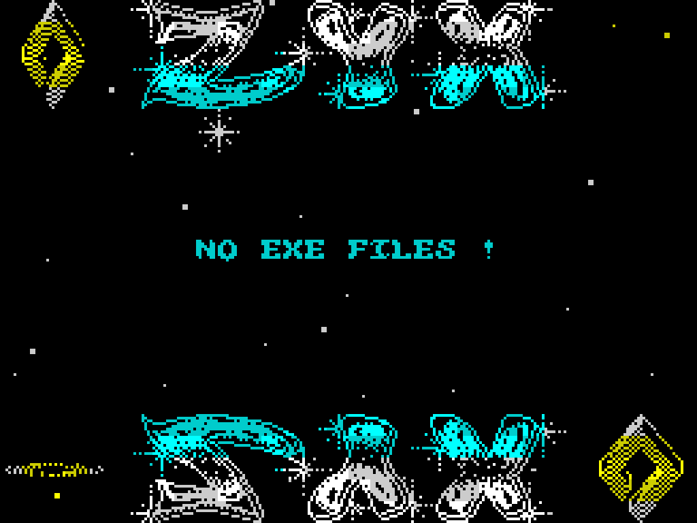
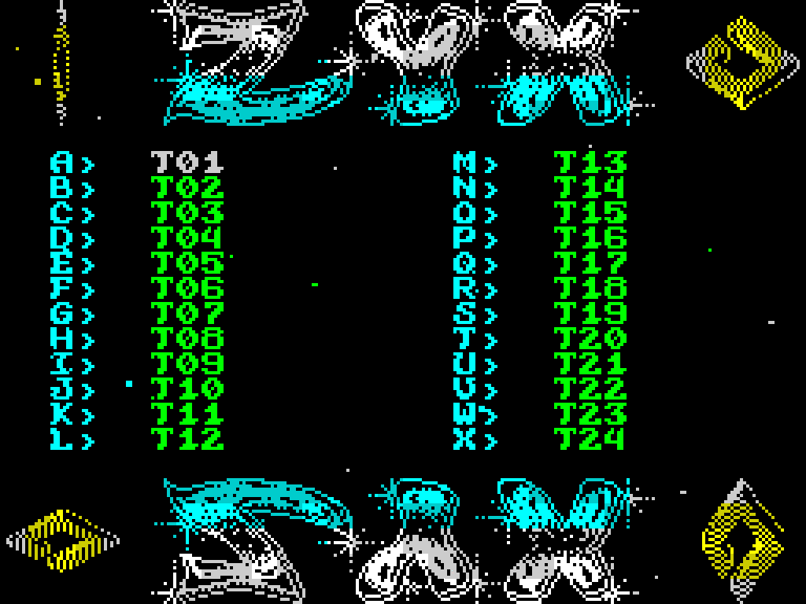

# 1. What you see

What this covers:

- what ZYX boot is for and how a disk uses it (1.1);
- the screen and its parts (1.2);
- every screen from power-on to the program it runs: the set-up, the menu idle, the pages, the cursor, NO EXE FILES !,
  the launch (1.3);
- what the user can do (1.4), what is known only from the code (1.5) and the point (1.6).

The recordings (WALKTHROUGH 1, Pentagon 128K, the disk booted from power-on), reopened on this writer's own instance
(port base 37440, muted):

| Recording | Disk | What happens |
| --- | --- | --- |
| c1 | `orig/boot.scl`: only `boot` | NO EXE FILES !; SPACE at frame 6430 |
| c2 | `tests/disks/many.scl`: `boot`, 30 BASIC programs T01-T30, `magic` (CODE, 192 sectors), `data` (CODE, 2 sectors) | SS, SS, CS, the cursor keys, ENTER on T03 |
| c3 | the same | SS, then F on page 2: T30 |
| c5 | `tests/disks/deep.scl`: `boot`, T01-T52 (T05 deleted), `magic` | SS, SS (page 3), then D: `magic` |

The point: c1 is the disk as found, an empty menu; c2 and c3 fill it with 31 listable names, enough for two pages;
c5 has 52, three pages.

## 1.1 What the boot is for

A TR-DOS disk's `boot` is the file TR-DOS runs when the user types `RUN` with no name (or picks "boot" from a
shell). Disk compilers of the 1990s put a menu there: the disk's programs are listed, a key runs one. ZYX boot is
such a menu: 3.75 K of code and tables, 2 K of graphics and a 5.5 K player and tune, a show around the list: a turning rhombus in each corner, a star
field, a logo with its reflection, music.

How a disk uses it:

The menu lists two kinds of file: BASIC programs, and CODE files of exactly 192 sectors (48 K, a memory image such as
`magic` on the test disk). It never lists itself. Everything else on the disk (screens, data, short CODE) is left out
([doc 7, 7.2](07-catalogue-and-menu.md#72-which-files-are-listed)). To run a file it writes the name into the
BASIC's line 1 and returns; BASIC goes on with `RUN`, and line 1 has TR-DOS load the file
([doc 3, 3.4](03-build-and-load.md#34-how-the-menu-runs-a-file), [doc 10](10-launcher-and-notes.md)).

Worked example, c2: the user presses ENTER on T03 at frame 3763. The menu writes the name `T03` into line 1, rings
the bell, fades the screen out (frames 3763-3785) and returns. The Loader clears its memory again (to about frame
3796), BASIC runs line 1, and TR-DOS loads T03, which prints `TEST 03` (on the screen by frame 3865: the first pixel
row of the text, `$4100`, is still zero at frame 3860).

The point: the menu is a front end to TR-DOS's own `RUN "name"`. It adds a list and a key per file, and leaves the
loading to TR-DOS.

## 1.2 The screen and its parts

*c2 frame 1500 (page 1), dimmed, with each part outlined and named. Made with `python3 tools/fig_overview.py --c1
work/docs/zbA/c1 --c2 work/docs/zbA/c2` (both figures of this document; the moments are kept in
`work/docs/figcache/`).*

How to read it:

- Yellow: the four rhombi in the corners, 5 x 5 cells each, turning (set A about the vertical axis, set B about the
  horizontal one; [doc 6, 6.3](06-graphics.md#63-the-rhombi-34-phases-from-one-sprite)).
- Cyan: the ZYX logo, rows 0-4, columns 6-25; purple: its reflection, rows 19-23.
- Green: the list, rows 6-17: up to 12 names in one column, 13-24 in two.
- The notes on the right: the cursor (the colour of a name, cycling), the stars and the twinkle (anywhere outside the
  text), and the routine that draws each part.

The point: the list is a band of 12 rows framed by the logo and its mirror image; the corners and the stars are pure
decoration and never collide with a name, because a star puts back what it covers
([doc 6, 6.4](06-graphics.md#64-the-star-field)).

## 1.3 Every screen, in order

*Ten moments of c1 and c2, read with TTD `memory_at` at the start (T 0) of each named frame; from
`tools/fig_overview.py` (the command under the layout figure).*

How to read it, picture by picture:

1. **The set-up** (c1 850). DrawScreen has drawn the screen at frames 532-536: the logo, the rhombi in phase 0, the
   help lines (SPACE, SS, CS; the quote prints as a wave in the menu's font), NO EXE FILES !. The rhombi do not turn
   yet: the phases are built (by frame 697), and the program is now drawing the reflection (DrawReflection's
   FlipSprites, frames 824-888); the main loop has not started ([doc 4, 4.3](04-program-cycle.md#43-the-set-up)). The
   text is caught mid-spin.
2. **The menu idle** (c1 1000). From frame 890 the reflection covers the help lines for good; the stars fall, the
   rhombi turn; NO EXE FILES ! in the cursor's colour.
3. **The glint** (c1 1075). Two red diagonals cross the logo or its reflection in turn, one of them every 256 frames
   (each one every 512) ([doc 6, 6.6](06-graphics.md#66-the-glint)). Here the twinkle shows too, left of the text.
4. **The spin** (c1 1110). Every letter of the cursor's text lies on its side: four quarter turns every 256 frames
   ([doc 8, 8.5](08-font-and-text.md#85-the-name-spin)).
5. **Page 1** (c2 1500). 24 of the 31 names in two columns, A-L and M-X, BASIC in green.
6. **Page 2** (c2 2000), after SS: the 7 names left, in one column A-G; `magic`, the CODE file, in yellow; the cursor
   on T25 in red.
7. **The cursor** (c2 3500), moved to the second column: T16 in magenta.
8. **Before the launch** (c2 3760): the cursor on T03, ENTER held.
9. **The fade** (c2 3778): ExitFade shifts every pixel row out of its bytes, alternately in and out, until the screen
   is black.
10. **The program** (c2 4300): TR-DOS has run T03, which prints `TEST 03`.

The point: the user sees the full screen at frame 536 (10.7 s after power-on, most of it TR-DOS reading the disk),
and the menu reads the keys from frame 549, as soon as the interrupt runs; it only looks finished at frame 890: the
7 s between are the rhombus and reflection set-up, and a key pressed then acts at once.

The menu idle in motion:

*c1 frames 1300-1430, every 2nd frame. Made with `python3 ../../kit/screen_anim.py --work work/docs/zbA/c1 --from 1300
--to 1430 --step 2 --scale 4 --delay 80 --hold 1000 docs/img/play/stars.gif`.*

How to read it:

- The near stars (2 x 2 pixels) fall about 2 rows a frame, the far ones (1 pixel) a quarter as fast.
- The top rhombi turn twice as fast as the bottom ones: a top turn takes about 58 frames (1.2 s), a bottom one about
  117 (2.3 s; [doc 4, 4.7](04-program-cycle.md#47-timers-and-delays)).

The point: everything that moves in the idle menu is decoration; the list itself never changes until a key is
pressed.

The cursor in motion:

*c2 frames 3195-3680, every 5th frame. Made with `python3 ../../kit/screen_anim.py --work work/docs/zbA/c2 --from 3195
--to 3680 --step 5 --scale 4 --delay 100 --hold 1500 docs/img/play/cursor.gif`.*

How to read it:

- The cursor is the colour of one name, a new ink every 4 frames (2 to 7, each plain then bright).
- It moves down, up and to the other column with the digit keys; the name it leaves returns to green.

The point: the cursor is attributes only; the names are never redrawn to move it ([doc 5, 5.4](05-keys.md#54-the-cursor)).

### NO EXE FILES !

When the disk has no listable file (c1), ListCatalogue prints NO EXE FILES ! at row 11, column 9, and makes it the
"cursor": 14 cells that change colour and spin like a name. The letters, the digits and ENTER do nothing then;
SPACE reads a new disk, and CS and SS have no other page to go to
([doc 7, 7.7](07-catalogue-and-menu.md#77-no-exe-files-)).

Witness: c1 SPACE at frame 6430 reads the catalogue again and redraws the same text (ShowCatalogue at 6436, stage-1
L1).

## 1.4 What the user can do

| Key | What | Details |
| --- | --- | --- |
| A-X | run the file with that letter on this page | [doc 5, 5.2](05-keys.md#52-the-letter-keys) |
| 3, 8 / 4, 9 | the cursor down / up | [doc 5, 5.3](05-keys.md#53-the-digit-rows-two-sinclair-joysticks) |
| 1, 2, 6, 7 | the cursor to the other column | the same |
| 5, 0, ENTER | run the file under the cursor | the same |
| SS | the next page (24 names a page) | [doc 5, 5.6](05-keys.md#56-space-cs-and-ss-a-new-disk-and-the-pages) |
| CS | the first page | the same |
| SPACE | read the catalogue again: a new disk | the same |

The point: three ways to the same end: a letter, the cursor with ENTER, or the cursor with a Sinclair joystick. Keys
are read every 8th frame, so a held key repeats 6 times a second.

## 1.5 Known only from the code

- A disk with more than 72 listable files (four pages): c5 shows page 3 (drawn by frame 2185, T50-T52 and `magic`);
  that SS goes on past it page by page is read from the code ([doc 7, 7.5](07-catalogue-and-menu.md#75-the-pages)).
- A key pressed during the set-up (frames 549-890): the interrupt reads it, and what a launch then does is read from
  the code; no recording presses one.
- The screen on a machine other than a Pentagon: the decoration's speed depends on the CPU's
  ([doc 4, 4.7](04-program-cycle.md#47-timers-and-delays)); not recorded.

## 1.6 The point

ZYX boot is a disk menu dressed as a demo: one screen with a logo, its reflection, four turning rhombi, a star field,
a twinkle, a glint and music, and a band of up to 24 names in the middle. The user picks a name with its letter or a
cursor and the menu hands the name to TR-DOS; nothing else on the disk is touched.
