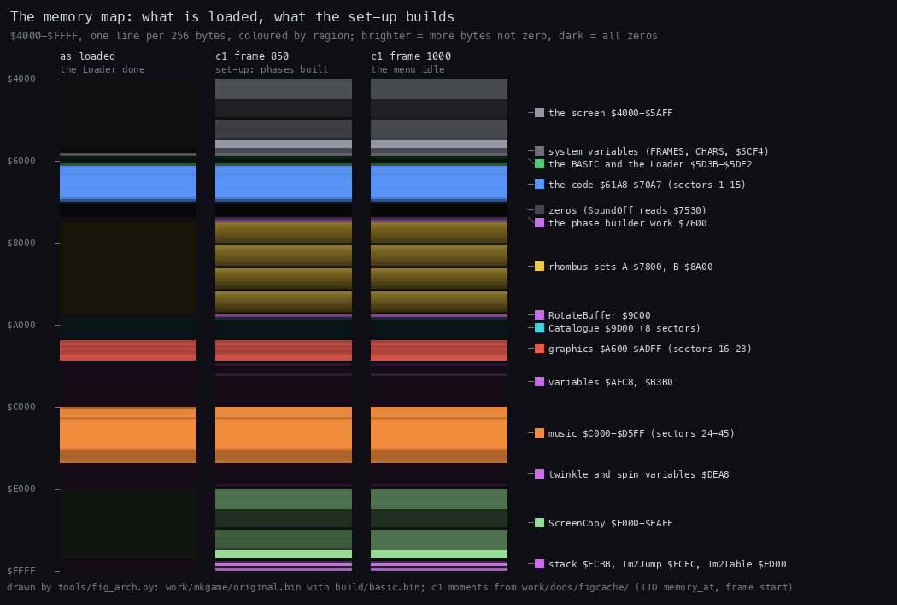
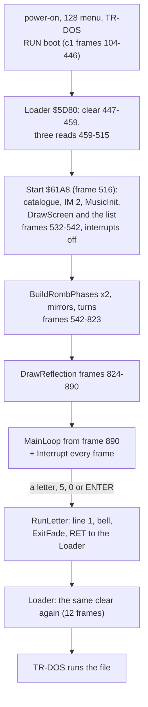
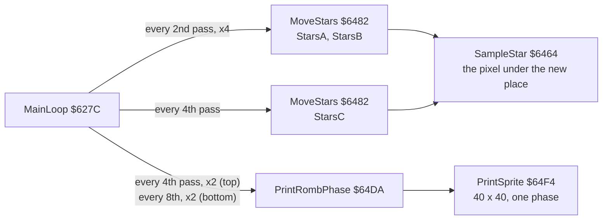
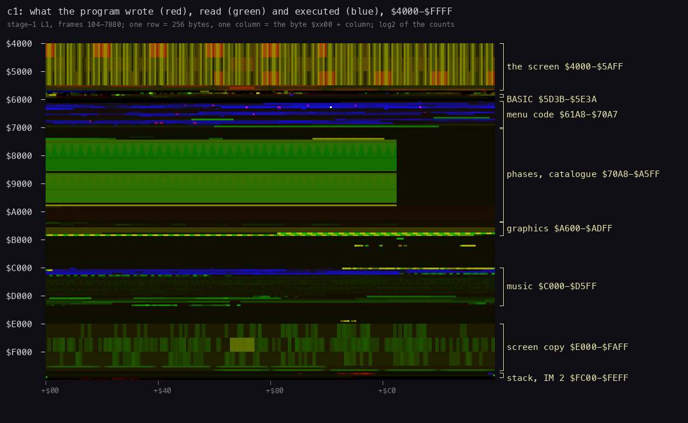

# 2. Architecture

What this covers:

- the machine budget: what the boot needs and uses;
- the memory map, loaded and built;
- the stages from the BASIC to the chosen program;
- the module map of the three `.ann` files;
- the frame: the main loop that never waits and the IM 2 interrupt, with their costs;
- the heatmap;
- what Vadim's 2010 decompilation covers and where this case differs.

The recordings it rests on: c1 (the original disk from power-on on a Pentagon 128K, TR-DOS chosen from the 128 menu,
the menu idle with NO EXE FILES !, then SPACE; L1 frames 104-7880, 557 383 670 T-states, 7716 interrupts), c2 and c3
(the test disk `tests/disks/many.scl`: pages, cursor keys, a file run), c4 (`tests/disks/noexe.scl`), c5
(`tests/disks/deep.scl`: three pages, a CODE file run). Frame numbers
below are c1's ([WALKTHROUGH 1](../WALKTHROUGH.md#1-one-recording-from-power-on)). The routine costs are the L1
profile's (`work/stage1/c1/l1.json`, `routines[].profile`).

## 2.1 The machine budget

The boot needs a 48K Spectrum with TR-DOS and an AY: the code uses only `$5D3B-$FEAF` of the 48K map, no paging, and
selects an AY register at port `$FFFD` and writes its value at `$BFFD` (the menu's own WriteAY `$6E50`: the bell, the
silence) or at `$BEFD` (the player's WriteAY `$C15F`, whose `OUTD` decrements B from `$BF` before the write; the AY
decodes both as its data port). On a machine with no AY the writes go nowhere and the menu works silent. It needs
TR-DOS to load its own pieces (the Loader's three reads), to read the catalogue (Start, and SPACE) and to run the
chosen file (the BASIC's line 1). The case runs a Pentagon 128K (`case.json` device `ZXSPECTRUM48` for the image,
the recordings on the Pentagon): 71 680 T-states a frame, no contention.

## 2.2 The memory map

*`$4000-$FFFF`, one line per 256 bytes, coloured by region, brighter where more bytes are not zero. Left: the image
the Loader leaves (`work/mkgame/original.bin`) with the 184 bytes TR-DOS loads at `$5D3B`; middle and right: c1 at
frames 850 and 1000 (TTD `memory_at`, the frame's start, cached in `work/docs/figcache/`). Made with `python3
tools/fig_arch.py`.*

How to read it:

- As loaded, only four bands hold bytes: the BASIC, the code at `$61A8`, the graphics at `$A600` and the music at
  `$C000`. Everything else is the Loader's zeros.
- By frame 850 the set-up has filled the yellow phase sets (`$7800`, `$8A00`), the catalogue (`$9D00`, almost all zeros
  on c1's one-file disk), ScreenCopy (`$E000`), the stack and the IM 2 table at the top; the screen is drawn.
- Frame 1000 (the idle menu) looks the same: after the set-up the menu only rewrites what it has already built.

The point: the disk carries 11.25 K (45 sectors: the code, the graphics, the music); the set-up builds the rest in the gaps: the
two phase sets (8.5 K), ScreenCopy (6.75 K), the catalogue (2 K) and the IM 2 table.

| Range | Loaded | What | Module / part |
| --- | --- | --- | --- |
| `$4000-$5AFF` | | the screen | |
| `$5C00-$5D3A` | | the ROM's and TR-DOS's variables (FRAMES `$5C78`, CHARS `$5C36`, `$5CF4`) | |
| `$5D3B-$5DF2` | sector 0 (184 of its 256 bytes, by TR-DOS) | the BASIC program, the Loader in line 4's REM, the autostart mark | `src/basic` |
| `$61A8-$6ADC` | sectors 1-15 | the code: set-up, main loop, rhombi, stars, screen, catalogue, interrupt, keys, launcher | `src/main` |
| `$6ADD-$6BA4` | | the small tables: PhaseOrder, MenuHelp, NoFilesText, KeyTable, BootName, RombColumnOrder, RombPhaseOffsets | `src/main` |
| `$6BA5-$6E97` | | the code: twinkles, corners, glint, reflection, sound, exit fade | `src/main` |
| `$6E98-$705F` | | RombSource (200), TwinkleSprites (128), 128 zeros | `src/main` |
| `$7060-$70A7` | | zeros to the 15th sector's end | `src/main` |
| `$70A8-$75FF` | never | zeros (SoundOff reads `$7530-$753D` as "silence") | buffers |
| `$7600-$77C7` | never | the phase builder's copies and work: RombColumns, RombOffsets, RombThreshold, PhaseMask, PhaseOffset, RombWork | buffers |
| `$7800-$88FF` | never | rhombus set A: PhasesA (phases 0-8), MirrorsA (9-16), 256 bytes a phase | buffers |
| `$8A00-$9AFF` | never | rhombus set B: PhasesB, MirrorsB | buffers |
| `$9C00-$9CC7` | never | RotateBuffer | buffers |
| `$9D00-$A4FF` | never | Catalogue: track 0, sectors 0-7 | buffers |
| `$A600-$ADFF` | sectors 16-23 | Font, Logo, LogoAttributes, StarsA/B/C, Randoms, CornerColours | `src/main` graphics |
| `$AFC8-$AFCE` | never | SavedIY, SavedHLAlt, SavedSP, SavedI | equates |
| `$B3B0-$B3F4` | never | the menu's variables (MainTick, the four rhombus steps, the page and cursor state, EntryLine, the name spin) | equates |
| `$C000-$D5FF` | sectors 24-45 | ASC Sound Master (`$C000-$C477`) and the tune (`$C478-$D592`) | `src/music` |
| `$DEA8-$DEB0` | never | the twinkle's and the spin's variables | equates |
| `$E000-$FAFF` | never | ScreenCopy: the clean screen the twinkles, the glint and the spin restore from | equates |
| `$FCBC` | | the menu's stack top (grows down from `$FCBB`) | |
| `$FCFC-$FE00` | never | Im2Jump (`JP Interrupt`), Im2Table (257 bytes of `$FC`, I = `$FD`) | equates |

The loader clears `$61A8-$FEAF` before and after the menu, so every "never loaded" area starts as zeros.

## 2.3 The stages

The first interrupt comes at the end of frame 542 (its work, the first MusicPlay, in 543), so the music plays, the
twinkles start and the keys are read (from frame 549) while the phases are still being built: the screen at frame 704
([setup](img/play/setup.png)) still shows the help lines, which DrawReflection covers at frame 824-890 with the logo's mirror image ([menu
idle](img/play/menu-idle.png)). The help lines are never seen again: the reflection is drawn into ScreenCopy too, and
every page is drawn from it. BuildRombPhases takes 8 954 321 T-states for its two calls (125 frames), DrawReflection 4
688 343.

## 2.4 The module map

Each module of `src/main` is split over several `ORG`s: `main.ann` keeps the image's order, and a module's routines
lie where the original put them. The ranges are those of the `.ann` entries, each to the next entry of another module.

| Part | Module | Ranges | What | Entries |
| --- | --- | --- | --- | --- |
| `src/basic` | basic | `$5D3B-$5E3A` | the BASIC lines, Loader `$5D80`, the autostart mark, the sector's tail | 9 |
| `src/main` | setup | `$61A8-$62F0` | Start `$61A8`, MainLoop `$627C` | 2 |
| | rhombi | `$62F1-$645D`, `$64DA-$650F`, `$6ADD-$6AFC`, `$6B74-$6BA4`, `$6E98-$6F5F` | BuildRombPhases `$62F1` and its helpers, MirrorSprite, RotateSprite, PrintRombPhase, PrintSprite, the phase tables, RombSource | 13 |
| | stars | `$645E-$64D9`, `$6BA5-$6CA1`, `$6F60-$70A7` | SampleStars, MoveStars, TwinkleStar, NewRandoms, DrawTwinkle, CheckTwinkleSpot, EraseTwinkle, TwinkleSprites | 10 |
| | screen | `$6510-$671F`, `$6848-$6863`, `$6930-$6A3E` | DrawScreen `$6510`, ShowCatalogue, ListCatalogue, ListTwoColumns, PrintColumn, CursorAttrAddr, ClearFilesArea, the cursor keys | 13 |
| | font | `$6720-$6736`, `$6AFD-$6B52` | PrintString `$6720`, MenuHelp, NoFilesText | 3 |
| | catalogue | `$6737-$6756`, `$6B6B-$6B73` | IsBootFile, SkipDeleted, BootName | 3 |
| | interrupt | `$6757-$6847`, `$6CA2-$6CBE` | Interrupt `$6757`, RotateCursorName, ShowRotatedName, InterruptExit, CopyNameToScreen | 5 |
| | keys | `$6864-$692F`, `$6B53-$6B6A` | ReadKeyboard `$6864`, KeyTable | 2 |
| | launcher | `$6A3F-$6ADC` | FireKey, RunLetter `$6A51` | 2 |
| | fade | `$6CBF-$6D03`, `$6E72-$6E97` | ColourCorners, ColourCornerRows, ColourCornerColumns, ExitFade | 4 |
| | logo | `$6D04-$6E40` | LogoGlint `$6D04` and its helpers, DrawReflection, FlipSprite | 7 |
| | sound | `$6E41-$6E71` | SoundOff, PlayBell, WriteAY, ExitSound | 4 |
| | buffers | `$70A8-$A5FF` | the never-loaded work space | 19 |
| | graphics | `$A600-$ADFF` | Font, Logo, LogoAttributes, StarsA, Randoms, CornerColours | 7 |
| `src/music` | player | `$C000-$C477` | the jump table, MusicInit `$C00B`, MusicPlay `$C00E`, MusicStop `$C011`, the channel state, the period table | 32 |
| | tune | `$C478-$D5FF` | "Disco music" by Ant P in ASC Sound Master's format (`src/res/music/disco.txt`) and the sector's tail | 9 |

The variables above `$ADFF` (`$AFC8-$AFCE`, `$B3B0-$B3F4`, `$DEA8-$DEB0`), ScreenCopy, the stack and the IM 2 table
are equates of `main.ann`, not part of any module's bytes (2.2).

## 2.5 The frame: a main loop that never waits, and the interrupt

MainLoop `$627C` has no HALT. It counts MainTick and on every 2nd pass moves StarsA and StarsB two rows, on every 4th
turns the two top rhombi one step and moves StarsC, on every 8th turns the two bottom rhombi. In c1, from frame 890
to 7879 (6990 frames), MoveStars ran 34 273 times and PrintRombPhase 11 424 times: 15 232 passes, 2.2 passes a frame.
A top rhombus makes its 32-step turn in about 58 frames, a bottom one in about 117 (at the idle window's 2.2 passes a
frame, c1 1000-6000; [doc 4, 4.7](04-program-cycle.md#47-timers-and-delays)). On a slower machine (contended
memory, a 48K) everything in the main loop runs slower; nothing in it is tied to the frame.

```mermaid
flowchart LR
    I["IM 2: Im2Jump $FCFC<br/>(interrupts off until the EI)"] --> A["save all, HL' and IY for the ROM"]
    A --> M["CALL $C00E: the music"]
    M --> F["Frames + 1<br/>TwinkleClock + 2"]
    F --> T["TwinkleStar"]
    T --> G["LogoGlint<br/>(Frames 0-52 of 256)"]
    G --> C["every 4th: the cursor's colour"]
    C --> R["Frames 50/60/70/80/90:<br/>the name's spin"]
    R --> K["every 8th: ReadKeyboard"]
    K --> E["restore, EI, RET"]
```

The interrupt's main costs in c1 (7274 calls each unless said, inclusive T-states except ReadKeyboard's):

| Routine | T-states | A frame | Share of the 71 680 |
| --- | ---: | ---: | ---: |
| the music, `$C00E` | 49 741 659 | 6838 | 9.5 % |
| TwinkleStar `$6BA5` | 9 811 510 | 1349 | 1.9 % |
| ReadKeyboard `$6864` (909 calls, own T) | 3 334 347 | 458 | 0.64 % |
| LogoGlint `$6D04` | 4 079 700 | 561 | 0.8 % |

ReadKeyboard's own T is 3668 a call; its inclusive 7 729 110 adds the one SPACE of c1 (the TR-DOS read and
ShowCatalogue, about 4.4 M T), which runs inside the handler.

So the interrupt takes about a seventh of the frame and the main loop has the rest. In own T-states over the idle
window (c1 1000-6000, `work/docs/zbA/idle/l1.json`), MoveStars takes 44.8 % of the CPU, SampleStar (which it calls)
22.2 % and PrintSprite (the rhombi) 16.6 %: about 85 % for the stars and the rhombi together. The inclusive counts
(MoveStars 397 066 343 T over c1) are larger, because they include the interrupts that land inside each routine.

The main loop's calls:

Where the time goes, routine by routine and coloured by module, is the frame budget of
[doc 4, 4.6](04-program-cycle.md#46-the-cost-per-frame) (`img/loop/budget.png`).

## 2.6 The heatmap

*`$4000-$FFFF` over c1, one row 256 bytes, the address on the left every `$1000`, the regions of
`work/stage2/regions.txt` on the right. The composite panel of `kit/heatmap.py` over `work/stage1/c1/l1.json` (red
written, green read, blue executed, log2 of the counts), made with `python3 tools/fig_arch.py` (all three figures of
`img/arch/`).*

How to read it: the screen at the top is written and read everywhere (the
stars, the rhombi, the twinkles). The menu's code (`$61A8-$70A7`) is blue; the phase sets are the two wide green
blocks below it (read by PrintRombPhase every pass), with the catalogue under them. The graphics piece is read once
(DrawScreen, the star tables all the time). The music (`$C000`) is the player in blue and the tune read in green.
ScreenCopy (`$E000-$FAFF`) is read in spots: the twinkles' and the glint's restores. The stack and the IM 2 table
are the thin line at the bottom.

The point: execution (blue) lives in two bands, the menu's code at `$6000-$70FF` and the player at `$C000-$C4FF`;
everything else is data, and the heaviest data are the screen and the phase sets, which the main loop reads and writes
every pass.

## 2.7 Vadim's decompilation and where this case differs

Vadim's `ZYXboot.mac` (M80 syntax, Russian comments; its line 6 reads `;(C) Unkown Autor 1991-1993` [sic]) covers the
menu `$61A8-$705F` and lists the graphics piece's layout as equates; it assembles with sjasmplus (after converting
its M80 directives and the `.` and `?` in its labels to sjasmplus syntax, `work/stage2/vadim.asm`) to this image's
bytes exactly. Its
`61A8.MAC` is not a music player: it is a raw disassembler listing of the same piece
(`ORG 61A8H`, its code, storage and table ranges up to `$70A7`, an unresolved-symbol table), the decompilation's
first step. The decompilation has
no source for the BASIC sector or the music. This case kept its structure, renamed most labels to say what they do
(its `Z6xxx` labels are addresses, and several names were wrong or Russian-English mixtures), and corrected what the
code says otherwise: the "ZYX sprites" of its comments are the rotating rhombi (`RombSource`), the logo is four
sprites of which the Z takes two, `Fade*ATTR` paint the corner gradients rather than fade, the `PrintZYXdown` image
covers the help lines, the edge-on phase is always blank, and `SoundOff` silences the AY with zeros it reads from the
never-loaded `$7530`. Every name and the reason for each change: `work/stage2/NOTES.md`.
