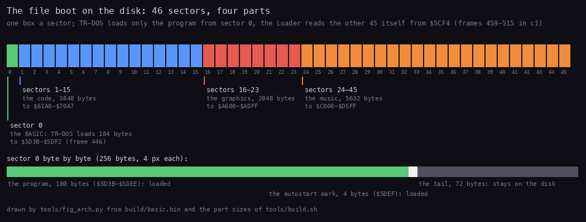
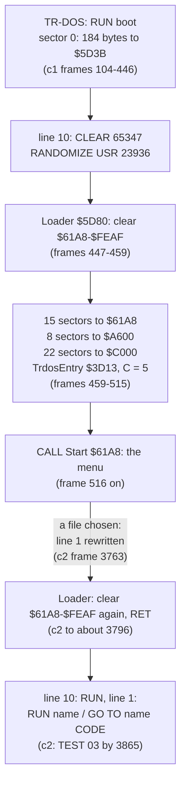
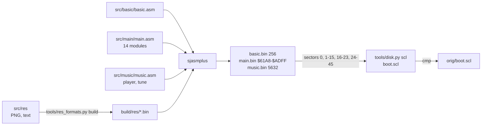

# 3. Build and load

What this covers: the disk and its one file, the BASIC program and the loader in its REM, how the three pieces reach
memory, how the menu hands the chosen file back to TR-DOS, and the source build. The recordings it rests on: c1 (the
original disk from power-on, TR-DOS chosen from the 128 menu, frames 104-7880), c2 and c3 (the test disk
`tests/disks/many.scl`, a file run), c4 (`tests/disks/noexe.scl`), c5 (`tests/disks/deep.scl`: a CODE file run); all on
a Pentagon 128K with the disk read at the emulated drive's speed ([WALKTHROUGH
1](../WALKTHROUGH.md#1-one-recording-from-power-on)).

## 3.1 The disk

`orig/boot.scl` (11 803 bytes) is an SCL image with one file:

| Name | Type | Start | Length | Sectors |
| --- | --- | ---: | ---: | ---: |
| `boot` | B (BASIC) | 180 | 180 | 46 |

For a BASIC file TR-DOS keeps the program and variables length in the start field and the program length in the
length field: here both are 180 (no variables). The 46 sectors are 11 776 bytes; only the first 180 are the BASIC
program. `tools/disk.py list orig/boot.scl` prints the catalogue, `tools/disk.py basic` lists the program.



*The 46 sectors of `boot`, one box a sector, and sector 0 byte by byte. Made with `python3 tools/fig_arch.py` (from
`build/basic.bin` and the part sizes).*

How to read it:

- Green, sector 0: the only part TR-DOS loads, and only its first 184 bytes (the program and the autostart mark).
- Blue, red, orange: the code, the graphics and the music, which the Loader reads itself, in order, from the sector
  TR-DOS stopped at.
- Grey: the 72 bytes left in sector 0 after the mark; nothing reads them.

| Sectors of `boot` | Bytes | Goes to | What | Source |
| --- | ---: | --- | --- | --- |
| 0 | 256 | `$5D3B-$5DF2` (PROG), by TR-DOS | the BASIC program (180 bytes) and the autostart mark (4); the 72 leftover bytes stay on the disk | `src/basic` |
| 1-15 | 3840 | `$61A8-$70A7` | the menu's code and its small tables | `src/main` (modules setup to sound) |
| 16-23 | 2048 | `$A600-$ADFF` | the font, the logo, its attributes, the star tables, the corner colours | `src/main` (module graphics) |
| 24-45 | 5632 | `$C000-$D5FF` | ASC Sound Master and the tune "Disco music" by Ant P | `src/music` |

## 3.2 The BASIC program

TR-DOS loads only the program and its autostart mark, the 184 bytes `$5D3B-$5DF2`, from sector 0, and leaves its
next-sector variable `$5CF4` at the sector after it. It starts the program at line 10, the line written in the
autostart mark `$80 $AA $0A $00` at `$5DEF`:

```basic
  1 RANDOMIZE USR VAL "15619": REM : RUN "        "
  2 RANDOMIZE USR VAL "15619": REM : RUN
  3 RANDOMIZE USR VAL "15616"
  4 REM (69 bytes of machine code)
 10 BORDER NOT PI: PAPER NOT PI: INK VAL "7": CLEAR VAL "65347": RANDOMIZE USR VAL "23936": RUN
```

Line 10 sets the colours and RAMTOP (`$FF43`) and calls 23936, `$5D80`: Loader, the code in line 4's REM
(`src/basic/basic.ann`). When the loader returns, line 10's `RUN` restarts the program at line 1:
`RANDOMIZE USR 15619` is TR-DOS's entry for a command in a BASIC line, and the command after the `REM :` is the one
the menu wrote there (3.4). Lines 2 and 3 are fallbacks no recording reaches (what they do is read from TR-DOS's
documented entries, not run):

- line 2, `RANDOMIZE USR 15619: REM : RUN`, is TR-DOS's `RUN` with no name, which runs `boot` again: reached only if
  line 1's command returns to BASIC;
- line 3, `RANDOMIZE USR 15616` (`$3D00`), enters TR-DOS's own command line, `A>`.

The 72 bytes after the autostart mark
are what was in memory when the file was saved (`oot27" LINE 10` reads like the end of a `SAVE "boot27" LINE 10`);
they stay on the disk, and the build reproduces them because the file holds them.

Witness: c1 frame 446 T 0, just before the Loader: `$5CF4` = `01 01` (track 1, sector 1: the sector after `boot`'s
sector 0), and `$5E07-$5E3A` are zeros, not the tail's bytes (`3D 00 0D 80 CA F3 5E 06 ...`, `spare/basic-tail.bin`
+`$14`); `$5DF0-$5E06` hold BASIC's edit line and the calculator's workspace.

## 3.3 The loader: how the code arrives in memory



Loader `$5D80` (24 instructions, run once in each of c1-c6):

1. `LDIR` of `$9D08` zeros over `$61A8-$FEAF`: everything the menu uses, the gaps it builds its tables in included.
2. Three reads through the TR-DOS ROM entry `$3D13` with C = 5, each starting at the track and sector in `$5CF4`
   (TR-DOS's next sector, left after the program's own load): 15 sectors to `$61A8`, 8 to `$A600`, 22 to `$C000`.
   The file is never addressed by its catalogue entry, so the boot works wherever TR-DOS put it, as long as the 46
   sectors follow each other.
3. `CALL $61A8`: the menu (doc 2). It returns only once a file is chosen, with the caller's SP that Start saved.
4. The same clear again, then `RET` to BASIC.

```text
loader:
    zero $61A8-$FEAF                         # $9D08 bytes
    read(15 sectors from (TrdosNextSector)) -> $61A8
    read( 8 sectors from (TrdosNextSector)) -> $A600
    read(22 sectors from (TrdosNextSector)) -> $C000
    Start()                                  # returns once line 1 is rewritten
    zero $61A8-$FEAF
    return to BASIC                          # line 10 goes on with RUN
```

```text
5D80  LD HL,MenuStart        ; $61A8
5D83  LD DE,$61A9
5D86  LD BC,$9D07
5D89  LD (HL),$00
5D8B  LDIR                   ; $61A8-$FEAF = 0
5D8D  LD HL,MenuStart        ; the code
5D90  LD DE,(TrdosNextSector) ; $5CF4: the sector after the last one read
5D94  LD BC,$0F05            ; 15 sectors, function 5: read
5D97  CALL TrdosEntry        ; $3D13
5D9A  LD HL,MenuGraphics     ; $A600: 8 sectors, the same way
...
5DA7  LD HL,MusicPiece       ; $C000: 22 sectors
...
5DB4  CALL MenuStart         ; the menu
5DB7  LD HL,MenuStart        ; the same clear again
...
5DC4  RET
```

Worked example, c1: TR-DOS leaves `$5CF4` = `01 01` (track 1, sector 1). The first read takes sectors 1-15 of the file,
which on this disk are track 1 sectors 1-15, and leaves `$5CF4` at track 2, sector 0 (16 sectors a track); the second
read starts there, and so on. The Loader's clear costs 844 427 T (frames 447-459, 11.8 frames); TrdosEntry's first call
is at frame 459, and Start runs at 516.

The stages, static decode against the recordings:

| Stage | The code says | The recordings show |
| --- | --- | --- |
| TR-DOS's load | the file is 46 sectors, the program 180 bytes | only `$5D3B-$5DF2` is loaded; `$5CF4` = `01 01` at c1 frame 446 |
| the clear | `LDIR` of `$9D08` bytes | c1 frames 447-459 (844 427 T) |
| the three reads | 15, 8 and 22 sectors from `$5CF4` | c1 frames 459-515 (TrdosEntry's first call at 459) |
| the menu | Start, returns once a file is chosen | c1 frame 516 on; c2 returns after ENTER at 3763 |
| the second clear | the same `LDIR` | c2 to about frame 3796 (`$FE00` = `$FC` at 3794, `$00` at 3797) |
| line 1 runs | `RUN "name"` or `GO TO "name" CODE` | c2 `TEST 03` by 3865, c3 `TEST 30`; c5 line 1 reads `GO TO "magic   " CODE` at frame 2513 |

The error path. Nothing in the Loader tests what `$3D13` returns: the three `CALL TrdosEntry` at `$5D97`, `$5DA4`
and `$5DB1` are each followed at once by the next step. The same holds for Start's catalogue read (`$61C2`) and SPACE's
(`$690B`). A read that fails is handled by TR-DOS itself, through its own prompt and the BASIC error path, and never
comes back to the boot as a result it could test. Known only from the code: no recording reads a bad disk.

The original has no packer and no cipher: the three pieces are stored as they run, so there is nothing to unpack and
no unpacking animation. The variants that pack their pieces are in [doc 13, 13.9](13-variants.md#139-the-three-hardest).

The pieces leave holes: `$70A8-$A5FF` (13 656 bytes) and `$AE00-$BFFF` are not loaded. Start fills the first with
the rhombus phases and the catalogue ([doc 2, 2.2](02-architecture.md#22-the-memory-map)); its variables live in the
second (`$AFC8-$AFCE`, `$B3B0-$B3F4`).

## 3.4 How the menu runs a file

The menu does not load anything itself. RunLetter `$6A51` (`src/main/launcher.asm`) writes into line 1 of the BASIC
program in memory:

| Address | Byte in the image | Written |
| --- | --- | --- |
| `$5D4C` LaunchToken | `$F7` RUN | `$F7` RUN for a BASIC file, `$EC` GO TO for a 192-sector CODE file |
| `$5D4E-$5D55` LaunchName | 8 spaces | the file's name from the catalogue |
| `$5D57` LaunchSuffix | a space | a space, or `$AF` CODE |

So line 1 becomes `RANDOMIZE USR VAL "15619": REM : RUN "T03     "` (c2), or `... GO TO "magic   " CODE` for a CODE
file of exactly 192 sectors (48K: TR-DOS's GO TO loads a snapshot saved with the Magic button). Then the menu puts
back Frames = 0, I, HL', IY, SP and CHARS = `$3C00` (the ROM font; the menu had pointed it at its own), rings the
bell, fades the screen, switches to IM 1 and returns to the loader. All of this runs inside the interrupt handler
(the key that launches is read there), so no interrupt comes until the `EI` at `$6ADB`. c2 ends with
`TEST 03` on the screen ([launched](img/play/launched.png)), c3 with `TEST 30`: the programs T03 and T30 of the test
disk, chosen with ENTER on the cursor and with the letter F on the second page.

## 3.5 The build

`tools/build.sh [SJASMPLUS]` rebuilds `orig/boot.scl` byte for byte:



The inputs:

| Input | Becomes | By |
| --- | --- | --- |
| `src/basic/basic.ann`, `src/basic/basic.json` | `src/basic/basic.asm`, `basic-module.asm` | `kit/mkgame.py` |
| `src/main/main.ann`, `case.json` | `src/main/main.asm` and its 14 module files | `kit/mkgame.py` |
| `src/music/music.ann`, `src/music/music.json` | `src/music/music.asm`, `player.asm`, `tune.asm` | `kit/mkgame.py` |
| `src/res/basic/*.txt` | `build/res/basic/launch-lines.bin`, `line-ten.bin` | `tools/res_formats.py build` |
| `src/res/graphics/*.png` | `build/res/graphics/font.bin`, `logo.bin`, `rhombus.bin`, `twinkle.bin` | the same |
| `src/res/tables/*.txt`, `src/res/texts/*.txt` | `build/res/tables/*.bin`, `build/res/texts/*.bin` | the same |
| `src/res/music/disco.txt` | `build/res/music/disco.bin` | the same |
| `src/res/spare/*.bin` | the sectors' tails, as they are | `INCBIN` |
| the three `.asm`, `build/res` | `build/basic.bin` (256 bytes), `main.bin` (`$61A8-$ADFF`), `music.bin` (5632 bytes) | sjasmplus |
| the three `.bin` | `build/boot.body` (46 sectors), `build/boot.scl` | `tools/build.sh`, `tools/disk.py scl` |

The `.asm` files are written by `kit/mkgame.py` from the three `.ann` files (`case.json` for the menu,
`src/basic/basic.json`, `src/music/music.json`); each run checks that the assembly gives the original bytes. The SCL
writer (`tools/disk.py scl`) pads the body to whole sectors and appends the SCL checksum (the sum of every byte
before it, 32 bits): the result is identical to `orig/boot.scl` (the build prints
`build: boot.scl identical to orig/boot.scl`).

The same build makes the owner's variants: `tools/build.sh --variant NAME` copies `src/res` with the files of
`variants/NAME/` over it, sets the variant's constants in the generated top files (the music piece's address, sectors
and entries, MusicInit `$C00B` and MusicPlay `$C00E` in the original; MenuStack, Im2Table, ScreenCopy where a variant
moves them), applies its code switches, takes its music piece and, when it has one, its own BASIC sector, and compares
the boot file with the candidate image; `tools/build.sh --all` does all 56, and all 56 build identical
([variants/README.md](../variants/README.md)).
