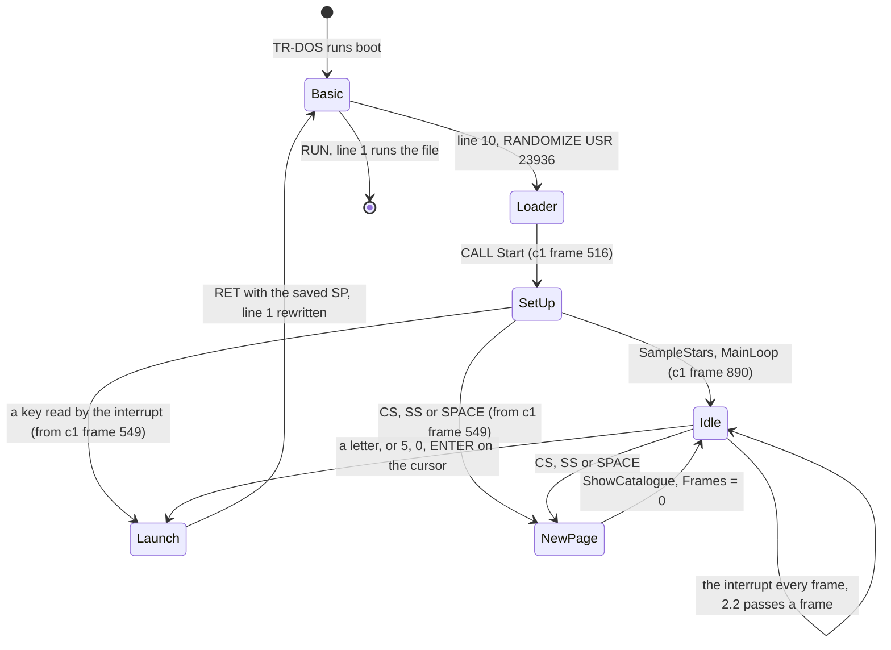
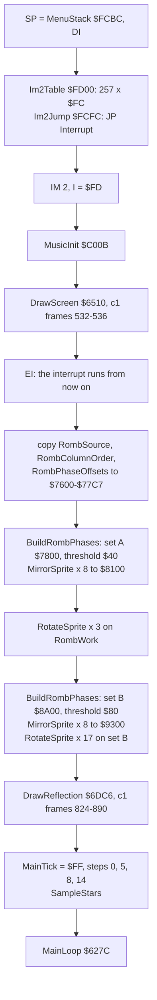
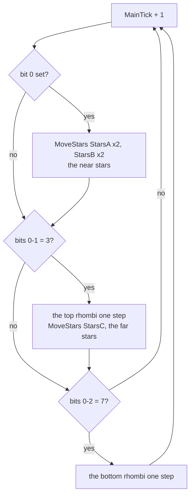
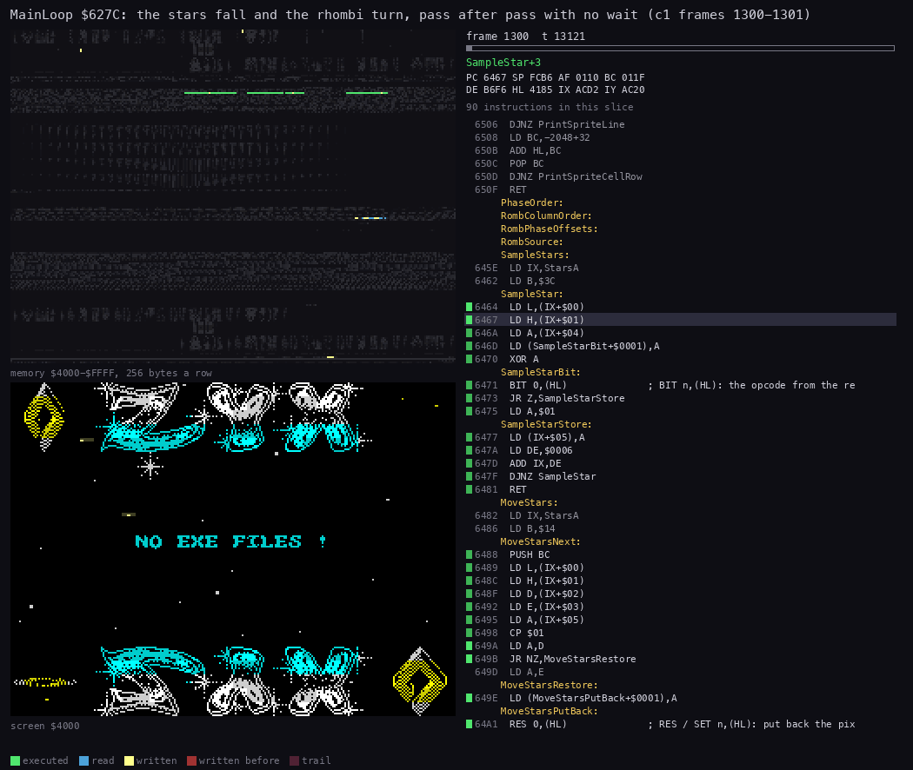
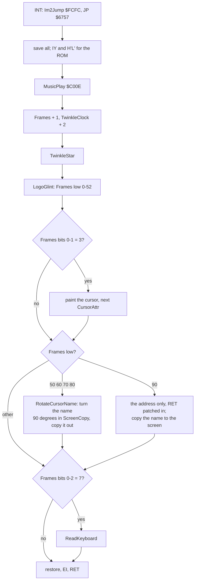
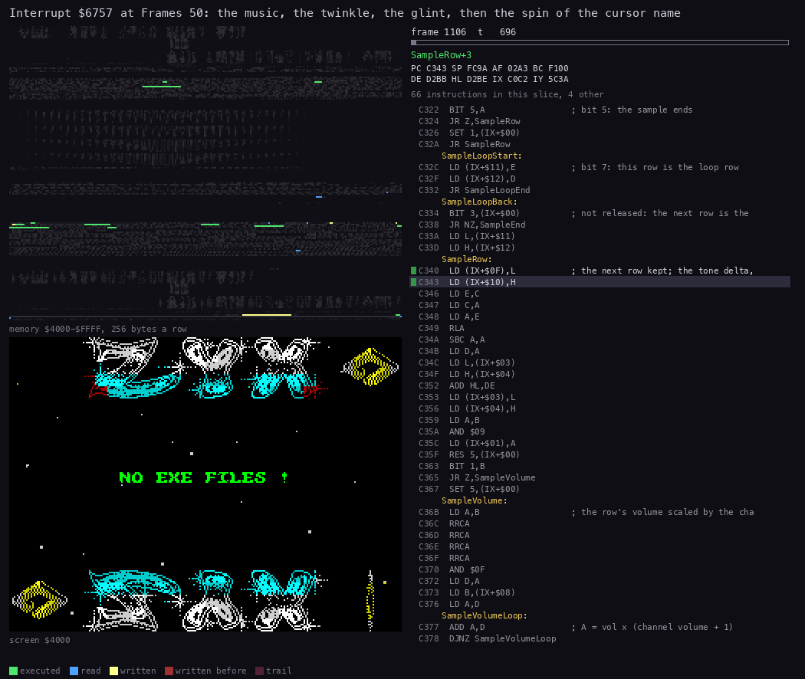
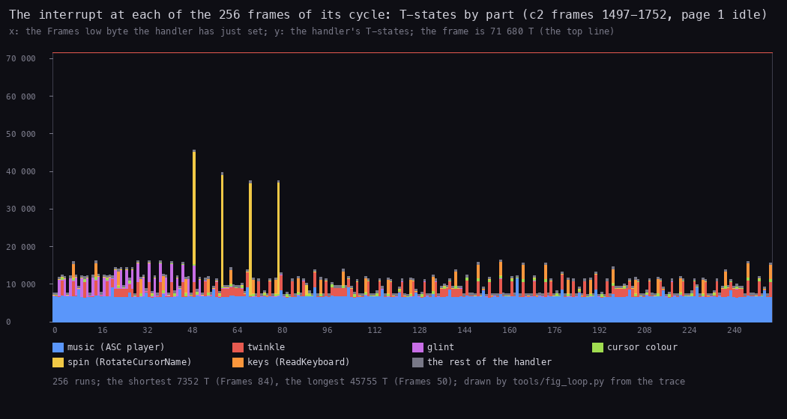
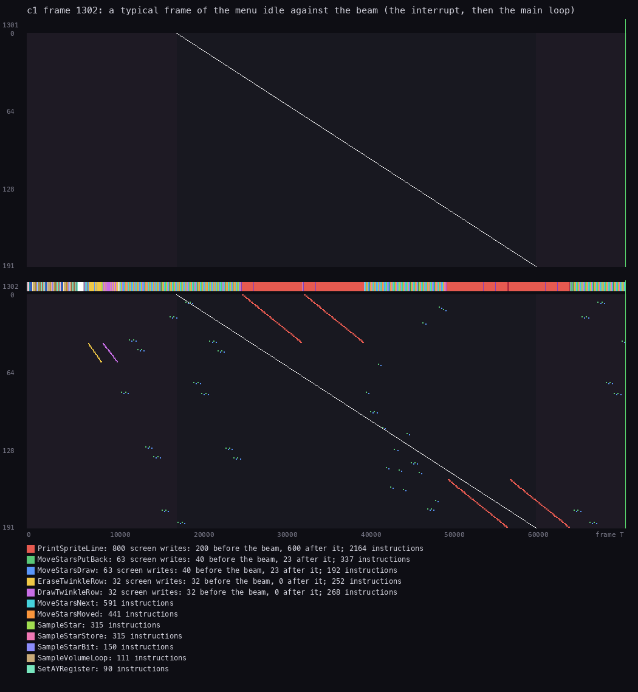
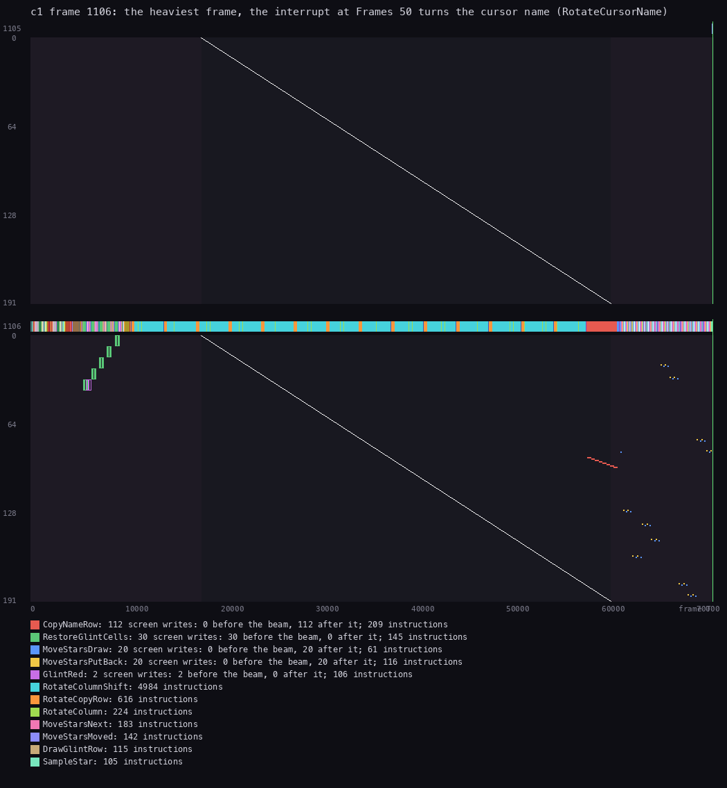
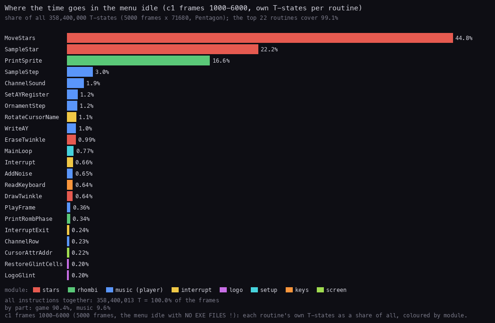

# 4. The program cycle

What this covers:

- the shape of the program, from the BASIC line that calls it to the file it hands back to TR-DOS (4.1);
- the entry: what Start saves and why (4.2);
- the set-up: the catalogue read, the IM 2 vector table, the screen, the rhombus phases, the reflection (4.3);
- the main loop, which never waits, and its cycle of 8 passes (4.4);
- the IM 2 handler line by line, and what it does on which frame of its 256-frame cycle (4.5);
- the cost per frame against the beam, and where the time goes (4.6);
- every timer of the menu (4.7), what is known only from the code (4.8) and the point (4.9).

The names are those of `src/main/main.ann`. Vadim's 2010 decompilation (`work/stage1/ZYXboot.utf8.mac`) reads this
part well and is used here: his `Interrupt`, `tick0`, `Timer5C78` and `UDEAC` are Interrupt, MainTick, Frames and
TwinkleClock. One reading differs: his comment at `CALL Z6D04` in the handler says "PrintRombs"; the routine
(LogoGlint `$6D04` here) only writes attributes of the logo rows 0-4 or 19-23, and the rhombi are printed by the
main loop (4.4; the writes of c1 frames 1106-1110 in [doc 6, 6.8](06-graphics.md#68-screencopy-the-clean-screen)).

The recordings (WALKTHROUGH 1; Pentagon 128K, the disk booted from power-on), reopened on this writer's own
instance (port base 37440, muted):

| Recording | Disk | Used for |
| --- | --- | --- |
| c1 | `orig/boot.scl` (only `boot`: NO EXE FILES !) | the stages and their frames (stage-1 L1 `work/stage1/c1/l1.json`), the idle window 1000-6000 (its own L1 `work/docs/zbA/idle/l1.json`), the traces of frames 1106 (the heaviest frame) and 1300-1310 (the passes) |
| c2 | `tests/disks/many.scl` (31 listed names) | the trace of frames 1497-1752: one whole 256-frame cycle of the handler, page 1 idle |

The point: c1 has the least on the screen (one short text, no list), so its idle frames show the menu's own cost;
c2 adds a list and a cursor on an 8-letter name.

Times are T-states. A trace gives the T at which each instruction starts, counted in its frame. The handler's first
instruction runs about 5 T before the recording's frame boundary (it shows as T 71 675 of the frame before), so the work
of "frame N's interrupt" is at the start of frame N. TTD `memory_at` with a frame alone gives the memory at the frame's
start (T 0), when that frame's handler has only just begun (Frames not yet counted). A **frame** is 1/50 s, 71 680 T on
the Pentagon; a **pass** is one run of MainLoop `$627C`.

## 4.1 The shape of the program

ZYX boot is a disk menu. It runs once, from the BASIC's `RANDOMIZE USR` to the moment a file is chosen; then it puts
the file's name into the BASIC and returns. In between there are three phases: the set-up (7.5 s on c1), the idle
menu (as long as the user likes), and the launch.



The program's stages in c1, from the stage-1 L1 (`first_frame` and `last_frame` of each routine):

| c1 frames | Stage | Routine | What the screen shows |
| --- | --- | --- | --- |
| 447-459 | the BASIC's loader clears `$61A8-$FEAF` | Loader `$5D80` | TR-DOS's screen |
| 459-515 | the loader reads the three pieces | Loader, TrdosEntry `$3D13` | unchanged |
| 516-531 | the catalogue read (8 sectors of track 0) | Start `$61A8` | unchanged |
| 532-536 | the screen | DrawScreen `$6510` | the logo, the rhombi, the help lines, NO EXE FILES ! |
| 542-697 | the 34 rhombus phases | BuildRombPhases `$62F1` (twice) | the twinkle, the glint and the music start: the interrupt is on; the keys are read from 549 |
| 605-888 | the mirrors and the turns | MirrorSprite `$63D6`, RotateSprite `$6422` | unchanged |
| 824-890 | the reflection | DrawReflection `$6DC6` | the help lines vanish under the logo's mirror image |
| 890-7879 | the idle menu | MainLoop `$627C`, Interrupt `$6757` | the stars fall, the rhombi turn |

The point: the user waits 7.5 s (frames 516-890) before the stars move. Most of it is the phase builder and the 28
calls of RotateSprite, work that could have been done once and stored on the disk. The keys work long before that:
the interrupt runs ReadKeyboard from c1 frame 549 (c2: 558), so a letter, ENTER, SPACE, CS or SS acts during the
set-up. What a launch in mid-set-up does is known only from the code (4.8).

## 4.2 The BASIC and the entry

TR-DOS loads the file `boot` and runs line 10 ([doc 3, 3.2](03-build-and-load.md#32-the-basic-program)):
`CLEAR 65347` and `RANDOMIZE USR 23936`. 23936 is Loader `$5D80` in line 4's REM. It reads the code to `$61A8`, the
graphics to `$A600` and the music to `$C000`, then calls Start
([doc 3, 3.3](03-build-and-load.md#33-the-loader-how-the-code-arrives-in-memory)). Start is the menu's only entry. It
returns to the Loader only when a file has been chosen.

What Start keeps, and why:

| Saved | Where | Why |
| --- | --- | --- |
| IY | SavedIY `$AFC8` | the ROM and TR-DOS reach the system variables through IY = `$5C3A`; the handler and PrintString put it back before they call the ROM |
| H'L' | SavedHLAlt `$AFCA` | BASIC needs H'L' unchanged when a USR routine returns; the same two routines put it back |
| SP | SavedSP `$AFCC` | the launcher returns to the Loader by putting this SP back, wherever the menu's stack stands ([doc 10, 10.4](10-launcher-and-notes.md#104-what-is-put-back)) |
| I | SavedI `$AFCE` | the I register as BASIC had it, put back before IM 1 |

The point: the menu borrows the machine and gives back what BASIC needs: IY, H'L', SP, I and IM 1, and at the launch
also CHARS = `$3C00` (the ROM font; the menu had pointed CHARS at its own font) and FRAMES = 0
([doc 10, 10.4](10-launcher-and-notes.md#104-what-is-put-back)). The rest
of RAM from `$61A8` up is the menu's own.

```text
start:
    SavedIY = IY; SavedHLAlt = H'L'; SavedSP = SP; SavedI = I
    trdos(read, track 0, sector 0, 8 sectors) -> Catalogue     # still IM 1
    SP = MenuStack; DI
    fill Im2Table with $FC; Im2Jump = JP Interrupt; IM 2; I = $FD
    MusicInit(); DrawScreen()                                  # interrupts off
    EI
    build the rhombus phases; DrawReflection()
    MainTick = $FF; the four rhombus steps = 0, 5, 8, 14
    SampleStars()
    MainLoop()                                                 # never returns
```

```text
61A8  LD (SavedIY),IY        ; the ROM's IY
61AC  EXX
61AD  LD (SavedHLAlt),HL     ; and its H'L'
61B0  LD (SavedSP),SP        ; the way back to the Loader
61B4  LD A,I
61B6  LD (SavedI),A
61B9  LD DE,$0000            ; track 0, sector 0
61BC  LD HL,Catalogue        ; $9D00
61BF  LD BC,$0805            ; 8 sectors, TR-DOS function 5: read
61C2  CALL TrdosEntry        ; $3D13, still in IM 1
```

The catalogue is read while the ROM's IM 1 is still on, because TR-DOS needs the ROM's interrupt state for the disk
(the same holds for SPACE, [doc 5, 5.6](05-keys.md#56-space-cs-and-ss-a-new-disk-and-the-pages);
[doc 7, 7.1](07-catalogue-and-menu.md#71-reading-the-catalogue)).

Witness: c1, Start's single entry at frame 516; the catalogue is at `$9D00` by frame 532, when MusicInit runs (L1).

## 4.3 The set-up

After the catalogue, Start switches to its own stack and IM 2, draws the screen with interrupts off, and builds the
rhombi with interrupts on:



### The IM 2 vector table

In IM 2 the Z80 forms the handler's address from I (the high byte) and the byte on the data bus (the low byte). On a
Spectrum nothing drives the bus during the interrupt acknowledge, so the byte is usually `$FF` but may be anything.
The usual answer, used here, is a table of 257 equal bytes, so that any byte gives the same address.

```text
61C5  LD SP,MenuStack        ; $FCBC
61C8  DI
61C9  LD HL,Im2Table         ; $FD00
61CC  LD DE,Im2Table+1
61CF  LD BC,$0100            ; 256 more: $FD00-$FE00, 257 bytes
61D2  LD (HL),Im2Jump>>8     ; $FC
61D4  LDIR
61D6  LD HL,Interrupt        ; $6757
61D9  LD (Im2Jump+1),HL
61DC  LD A,$C3               ; JP
61DE  LD (Im2Jump),A         ; $FCFC: JP Interrupt
61E1  IM 2
61E3  LD A,Im2Table>>8
61E5  LD I,A                 ; $FD
61E7  CALL MusicInit
61EA  CALL DrawScreen
61ED  EI
```

Worked example, the bus byte `$FF` (what the Pentagon gives):

1. The CPU reads the word at I x 256 + `$FF` = `$FDFF`: the bytes at `$FDFF` and `$FE00`, both `$FC`. The word is
   `$FCFC`.
2. It jumps to `$FCFC`, where Start wrote `$C3 $57 $67`: `JP $6757`.
3. Interrupt `$6757` runs. Any other bus byte `xx` reads `$FDxx` and `$FDxx+1`, both inside the table, and ends the
   same way.

The point: 257 bytes and a 3-byte jump make the menu safe on any machine, whatever the bus holds. Witness: c1, 7275
interrupts from frame 542 to 7879, every one entering `$6757` (stage-1 L1).

### The screen, the phases, the reflection

DrawScreen runs between the `DI` at `$61C8` and the `EI` at `$61ED`, so the first interrupt comes after it (c1
frame 542). Then, with the interrupt playing the music and drawing the twinkle, Start builds the 34 rhombus phases
([doc 6, 6.3](06-graphics.md#63-the-rhombi-34-phases-from-one-sprite)) and the reflection
([doc 6, 6.2](06-graphics.md#62-the-reflection-the-logo-upside-down)).

| Step (c1, stage-1 L1) | Calls | T-states each, with the interrupts inside | Frames |
| --- | ---: | ---: | --- |
| BuildRombPhases `$62F1` | 2 | 4 477 000 | 542-697 |
| MirrorSprite `$63D6` (16 here, 4 in FlipSprite) | 20 | 69 080 | 605-888 |
| RotateSprite `$6422` (3 + 17 here, 8 in FlipSprite) | 28 | 517 844 | 613-887 |
| DrawReflection `$6DC6` (with its 4 FlipSprites) | 1 | 4 688 343 | 824-890 |

The point: the four steps take 8.95 M + 1.38 M + 14.50 M + 4.69 M T (the FlipSprites counted in both of the last
two), about 25 M T or 7 s of the 7.5 s set-up. RotateSprite alone is 14.5 M T: 28 turns of a 40 x 40 sprite, one
bit at a time ([doc 6, 6.3](06-graphics.md#63-the-rhombi-34-phases-from-one-sprite)).

The last lines of Start set the four rhombi's steps apart (0, 5, 8 and 14, so that the four never show the same
phase), set MainTick to `$FF` (the first pass makes it 0) and read the pixels under the 60 star records (SampleStars)
before the first star moves.

## 4.4 The main loop

MainLoop `$627C` has no HALT and looks at no frame counter. Each pass adds 1 to MainTick `$B3B0` and tests its low
bits:

```text
pass:
    MainTick = MainTick + 1
    if MainTick bit 0 = 1:                    # every 2nd pass
        MoveStars(StarsA); MoveStars(StarsA)
        MoveStars(StarsB); MoveStars(StarsB)
    if MainTick bits 0-1 = 3:                 # every 4th pass
        PrintRombPhase(top left,  set A, PhaseTopLeft)
        PrintRombPhase(top right, set B, PhaseTopRight)
        MoveStars(StarsC)
    if MainTick bits 0-2 = 7:                 # every 8th pass
        PrintRombPhase(bottom left,  set B, PhaseBottomLeft)
        PrintRombPhase(bottom right, set A, PhaseBottomRight)
    goto pass
```

```text
627C  LD A,(MainTick)
627F  INC A
6280  LD (MainTick),A
6283  LD A,(MainTick)
6286  AND $01
6288  CP $01
628A  JR NZ,MainEvery4
628C  LD HL,StarsA
628F  LD (MoveStars+$0002),HL  ; MoveStars' own LD IX,nn: the table
6292  CALL MoveStars
6295  CALL MoveStars
...                            ; StarsB the same
62A4  LD A,(MainTick)          ; MainEvery4
62A7  AND $03
62A9  CP $03
62AB  JR NZ,MainEvery8
62AD  LD HL,Screen             ; top left
62B0  LD DE,PhasesA
62B3  LD BC,PhaseTopLeft
62B6  CALL PrintRombPhase
...                            ; top right (Screen+27, PhasesB), then StarsC
62CE  LD A,(MainTick)          ; MainEvery8
62D1  AND $07
62D3  CP $07
62D5  JR NZ,MainLoop
62D7  LD HL,Screen+4192        ; bottom left
62DA  LD DE,PhasesB
...                            ; bottom right (Screen+4219, PhasesA)
62EF  JR MainLoop
```

MoveStars takes its table from its own `LD IX,nn` at `$6482`. MainLoop writes the operand before the calls: a
self-modifying parameter in place of a register.



The 8 passes of one cycle, measured on c1 frames 1300-1310 (trace `work/docs/zbA/c1/traces/1300_0-1310_0.uatr`;
each pass's length less the interrupts that fell inside it; the cycles repeated to within 600 T):

| MainTick bits 0-2 | Work | T-states |
| --- | --- | ---: |
| 0, 2, 4, 6 | the tick only | 147 |
| 1, 5 | 4 x MoveStars | 39 100 - 39 700 |
| 3 | 4 x MoveStars, the two top rhombi, StarsC | 63 300 - 63 400 |
| 7 | 4 x MoveStars, all four rhombi, StarsC | 78 350 - 78 450 |

The point: a cycle of 8 passes costs about 4 x 147 + 2 x 39 400 + 63 300 + 78 400 = 221 100 T, 3.1 frames of CPU,
3.6 frames once the interrupts are counted. Worked example, the idle window c1 1000-6000: MoveStars ran 24 703 times
(18 calls in 8 passes) and PrintRombPhase 8234 times (6 in 8). 24 703 / 18 x 8 = 10 979 passes in 5000 frames:
**2.2 passes a frame**.



*MainLoop `$627C` over c1 frames 1300-1301 (frame 1300 T 12 000 to frame 1301 T 30 000), 80 pictures. Left above:
memory `$4000-$FFFF`, lit by age; left below: the screen; right: the listing at the PC. Made with `python3
../../kit/routine_anim.py --work work/docs/zbA/c1 --window 1300:12000-1301:30000 --listing work/docs/zbA/all.lst
--view screen --pc 627C-62F0,645E-6509 --range 4000-FFFF --pictures 80 --out docs/img/routines/MainLoop.gif`
(`all.lst` is `build/main.lst` and `build/music.lst` together, so the music's code is named).*

How to read it:

- The dots that move down a row at a time are the stars. MoveStars puts back the pixel under each one, moves it a
  row and sets the new pixel; the lit lines in the map are the star tables `$AC84-$ADEB`.
- The rhombus corners light up when PrintRombPhase copies a phase over them.
- The jump to the music's code at `$C000` in the middle is the interrupt, which lands wherever the loop is.

The point: the loop draws as fast as the CPU allows. On a slower machine (a 48K with contended memory) the stars fall
and the rhombi turn more slowly (known only from the code, 4.8), while the music, the twinkle and the cursor, which the
interrupt drives, keep their speed.

## 4.5 The interrupt

Interrupt `$6757` runs once a frame. It saves every register (the main loop may be anywhere), puts back IY and H'L'
for the ROM, and then:

```text
interrupt:
    save AF BC DE HL IX IY and AF' BC' DE' HL'
    H'L' = SavedHLAlt; IY = SavedIY            # for the ROM, which the keys may call
    MusicPlay()                                 # $C00E, one tick of the ASC player (doc 9)
    Frames = Frames + 1                         # the ROM's FRAMES $5C78, 16 bits
    TwinkleClock = TwinkleClock + 2
    TwinkleStar()                               # doc 6, 6.5
    LogoGlint()                                 # draws on Frames low 0-52 only, doc 6, 6.6
    if Frames bits 0-1 = 3:                     # every 4th frame
        paint the cursor's cells with CursorAttr, step CursorAttr      # doc 5, 5.4
    low = Frames low byte
    if low in (50, 60, 70, 80): turn the cursor's name 90 degrees and show it   # doc 8, 8.5
    if low = 90: show the name (turned 360 degrees: as it was)
    if Frames bits 0-2 = 7: ReadKeyboard()      # every 8th frame, doc 5
    restore everything, EI, RET
```

```text
6757  PUSH IY
...                            ; IX HL DE BC AF, EXX, HL' DE' BC'
6763  LD HL,(SavedHLAlt)
6766  EXX
6767  EX AF,AF'
6768  PUSH AF
6769  LD IY,(SavedIY)
676D  CALL MusicPlay           ; $C00E
6770  LD HL,(Frames)
6773  INC HL
6774  LD (Frames),HL
6777  LD A,(TwinkleClock)
677A  ADD A,$02
677C  LD (TwinkleClock),A
677F  CALL TwinkleStar
6782  CALL LogoGlint
6785  LD A,(Frames)
6788  AND $03
678A  CP $03
678C  JR NZ,CheckSpin
678E  CALL CursorAttrAddr      ; HL = the cursor's first attribute
6791  LD DE,(CursorLength)     ; E = cells, D = CursorAttr
6795  LD B,E
6796  LD (HL),D                ; PaintCursor
6797  INC HL
6798  DJNZ PaintCursor
...                            ; the next CursorAttr (doc 5, 5.4)
67AF  LD A,(Frames)            ; CheckSpin
67B2  CP $32                   ; 50
67B4  JR NZ,CheckSpinMore
...                            ; RotateCursorName (doc 8, 8.5)
680E  CP $3C                   ; CheckSpinMore: 60
6810  JR Z,RotateCursorName
6812  CP $46                   ; 70
6814  JR Z,RotateCursorName
6816  CP $50                   ; 80
6818  JR Z,RotateCursorName
681A  CP $5A                   ; 90
681C  JR NZ,InterruptExit
681E  LD A,$C9                 ; RET over SpinCharacters
6820  LD (SpinCharacters),A
6823  CALL RotateCursorName    ; only the address now
6826  LD A,$3A                 ; LD A,(nn) back
6828  LD (SpinCharacters),A
682B  JR ShowRotatedName
682D  LD A,(Frames)            ; InterruptExit
6830  AND $07
6832  CP $07
6834  CALL Z,ReadKeyboard
...                            ; the registers back
6846  EI
6847  RET
```



Two patches of its own code keep the handler short. At Frames 90 it writes `$C9` (RET) over the `LD A,(RotateLength)`
at SpinCharacters `$67D8`, so that RotateCursorName only works out the name's address in ScreenCopy and returns;
then it writes `$3A` back and copies the name to the screen. And RotateCursorName points CursorAttrAddr's own
`LD DE,(nn)` at RotateRow for one call ([doc 8, 8.5](08-font-and-text.md#85-the-name-spin)).



*Interrupt `$6757` in c1 frame 1106, the run that sets Frames to `$0232` (low byte 50): from frame 1105 T 71 600 (the
handler starts at T 71 675) to frame 1106 T 62 000, 80 pictures. Left above: memory `$4000-$FFFF`; left below: the
screen; right: the listing at the PC. Made with `python3 ../../kit/routine_anim.py --work work/docs/zbA/c1 --window
1105:71600-1106:62000 --listing work/docs/zbA/all.lst --view screen --pc
6757-6863,6848-6862,6BA5-6DC5,6CA2-6CBE,C000-C477 --range 4000-FFFF --pictures 80 --out
docs/img/routines/Interrupt.gif`.*

How to read it:

- The first pictures: the music player at `$C000` (its tables and the tune at `$C3CA-$D592` light up in the map).
- Then TwinkleStar and LogoGlint: three red cells step across the logo's attributes at `$5800`.
- The rest: RotateCursorName turns NO EXE FILES ! a character at a time in ScreenCopy (the writes at `$E000-$F7FF`
  in the map); CopyNameToScreen copies the 14 turned cells to the screen at the very end.

The point: on most frames the handler is short, the music and a few cells. Four frames in 256 it turns the cursor's
name, and for a 14-cell name that takes most of the frame.

### The 256-frame cycle

Everything in the handler is timed by Frames' low byte, which ShowCatalogue sets to 0 when it draws a page. So the
handler's work repeats every 256 frames (5.12 s), and its length depends on where in that cycle it is:



*The handler's T-states at each Frames low byte, split by part (the PC ranges in the script), from the trace of c2
frames 1497-1752 (page 1 idle, the cursor on an 8-letter name; `work/docs/zbA/c2/traces/1496_71000-1753_0.uatr`).
Made with `python3 tools/fig_loop.py work/docs/zbA/c2/traces/1496_71000-1753_0.uatr`.*

How to read it:

- The blue base of every bar is the music: 6549-11 593 T, 6938 T on average.
- The red steps are the twinkle: about 4 000 T on the frames that draw (every 4th, while a twinkle shows), about
  100 T on the others.
- The purple steps on the even frames 2-52 are the glint (26 steps), 4 488 T each; Frames 0 paints the two corner
  cells.
- The four tall yellow bars are the spin at 50, 60, 70 and 80: 29 740-29 773 T for 8 letters. The bar at 90 is the
  copy only (2 539 T).
- The orange tops every 8th frame are the keys: 3 668 T when no key is held.

The handler's own frame of work, by part, over the whole cycle:

| Part | T-states over 256 frames | A frame on average | The frames it runs on |
| --- | ---: | ---: | --- |
| the music | 1 776 125 | 6 938 | all |
| the twinkle | 339 134 | 1 325 | all (draws on 1 in 4) |
| the spin | 144 914 | 566 | 50, 60, 70, 80, 90 |
| the glint | 138 596 | 541 | 0-63 (draws on the even ones 2-52) |
| the keys | 117 376 | 459 | 32 (bits 0-2 = 7) |
| the cursor's colour | 54 195 | 212 | 64 (bits 0-1 = 3) |
| saving and restoring, the tests | 118 418 | 463 | all |
| the whole handler | 2 688 758 | 10 503 | shortest 7 352 (Frames 84), longest 45 755 (Frames 50) |

The point: two thirds of the handler is the music. The interrupt's other work is spread over the cycle so that only
the four spin frames are heavy; the main loop, which has no deadline, absorbs them.

### Where interrupts are off

| Where | How long | Why |
| --- | --- | --- |
| Start `$61C8-$61ED` | DrawScreen, c1 frames 532-536 | the IM 2 table is built and DrawScreen draws the screen it saves as ScreenCopy |
| DrawReflection `$6DDE-$6E33` | about 78 000 T, more than a frame | the handler's twinkle and glint restore from ScreenCopy: they must not read a half-printed copy |
| the handler itself `$6757-$6847` | 7 352-45 755 T a frame; SPACE and the launch much longer | the IM 2 acknowledge clears IFF, and the only `EI` is at `$6846` |
| SPACE, in ReadKeyboard `$68F4-$6914`, inside the handler | the TR-DOS read and ShowCatalogue, several frames | the `DI` at `$6908` and `$690E` only guard against TR-DOS's own `EI`: `IM 1` around the read, then `IM 2` again |
| the launch, inside the handler (FireKey and RunLetter are called only from ReadKeyboard) | line 1, PlayBell, ExitFade: c2 frames 3763-3785 (ExitFade 1 564 652 T) | interrupts come back on at RunLetter's `IM 1`, `EI` (`$6AD9`, `$6ADB`) for BASIC ([doc 10, 10.4](10-launcher-and-notes.md#104-what-is-put-back)) |

The point: the menu runs with interrupts on except where the handler would read a buffer that is being written, and
everything the keys start runs inside the handler itself, with no interrupt: a new disk's catalogue and the whole
launch. Witnesses: DrawReflection's DI section is longer than a frame, so c1 loses two interrupts (the ones due at the
ends of frames 888 and 889): Frames stays `$015A` from frame 888 T 10 000 to frame 891 T 0, and is `$015B` at 891
T 10 000. And c2's last interrupt is at frame 3763: the bell and the fade that follow run inside it.

## 4.6 The cost per frame

A typical frame and the heaviest one against the beam:



*c1 frame 1302 (frame 1301 T 71 600 to frame 1302 T 71 600): the routines along the frame's T-states (the coloured
bar) and every screen write at its line against the beam (the diagonal). Made with `python3
../../kit/beam_timeline.py --work work/docs/zbA/c1 --window 1301:71600-1302:71600 --listing work/docs/zbA/all.lst
--machine pentagon --out docs/img/loop/beam-typical.png`.*

How to read it:

- The block at the start is the music (about 6 900 T), then the twinkle's erase and draw: two short diagonals,
  written before the beam reaches their lines.
- The rest is the main loop. The long diagonals are PrintSprite copying a rhombus phase (40 lines each); the scattered
  dots are the stars put back and drawn.
- Some rhombus lines are written after the beam has passed them, some before: a rhombus may show half its old and
  half its new phase for one frame. Nothing in the menu waits for the beam.



*c1 frame 1106, the same command with `--window 1105:71600-1106:71600` and `--out docs/img/loop/beam-spin.png`.*

How to read it:

- After the music comes the glint (GlintRed and RestoreGlintCells), then the long run of RotateColumnShift: the spin,
  from T 9 944 to about T 58 400, with no screen write until CopyNameRow puts the name on the screen in one burst
  (lines 88-95).
- The handler ends near T 62 000: the main loop gets only the last 10 000 T of this frame.

The point: the spin runs ahead of the beam into the visible area without harm, because it turns the name in
ScreenCopy and copies it out in one burst at the end: the screen never shows a half-turned name.

Where the time goes over the whole idle menu:



*Own T-states per routine over c1 frames 1000-6000 (5000 frames, 358 400 013 T), coloured by module. Made with
`python3 ../../kit/fig_budget.py work/docs/zbA/idle/l1.json docs/img/loop/budget.png --ann src/main/main.ann --ann
src/music/music.ann,range=C000-D5FF --top 22` over the L1 of the window, built with
`python3 $RS build --work work/docs/zbA/c1 --from-frame 1000 --to-frame 6000 --into work/docs/zbA/idle`.*

How to read it:

- The stars take two thirds of the machine: MoveStars 44.8 % and SampleStar 22.2 %, which MoveStars calls for each
  star's new pixel.
- PrintSprite (the rhombi) takes 16.6 %; the music player's routines 9.6 % together.
- RotateCursorName, the spin, is 1.1 %: heavy on its four frames, cheap over the cycle. ReadKeyboard is 0.64 %.

The point: the menu is a star-field demo with a file list. About 85 % of the CPU draws stars and rhombi (MoveStars,
SampleStar, PrintSprite, MainLoop and PrintRombPhase's own T; the footer's "game 90.4 %" is everything but the music,
the handler's work included), and a frame has room for 2.2 passes of it.

## 4.7 Timers and delays

Every speed of the menu, from the code and measured:

| What | Driven by | Rate | Witness |
| --- | --- | --- | --- |
| the music | the interrupt, every frame | 50 ticks a second | c1: MusicPlay 7274 calls in 7275 interrupts |
| the keys | the interrupt, Frames bits 0-2 = 7 | every 8 frames: 6.25 reads a second; a held key repeats at that rate; from the first interrupts of the set-up | c1: ReadKeyboard 909 calls in 7275 interrupts, the first at frame 549 |
| the cursor's colour | the interrupt, Frames bits 0-1 = 3 | a new attribute every 4 frames; a round of 12 in 48 frames | c2 frames 1500-1556, CursorAttr `$B3BF` ([doc 5, 5.4](05-keys.md#54-the-cursor)) |
| the glint | Frames low 0-52 | the corner cells at 0, then 26 steps on the even frames 2-52, once every 256 frames; the top logo and the reflection in turn (each every 512) | c1 frames 1055-1112 ([doc 6, 6.6](06-graphics.md#66-the-glint)) |
| the name's spin | Frames low 50, 60, 70, 80, 90 | a quarter turn every 10 frames, once every 256 frames (5.12 s) | c1 frames 1106-1146 ([doc 8, 8.5](08-font-and-text.md#85-the-name-spin)) |
| the twinkle | TwinkleClock `$DEAC`, + 2 a frame | 8 pictures over 31 frames (one every 4, the clock 0 to `$3E`), then 8 frames held by TwinklePause and erased: 39 frames, 16 DrawTwinkle calls a twinkle (5000 / 39 x 16 = 2051) | c1 idle: DrawTwinkle 2053 calls in 5000 frames ([doc 6, 6.5](06-graphics.md#65-the-twinkle)) |
| the near stars | the main loop, every 2nd pass | 1 row a pass: a screen (192 rows) in about 87 frames, 1.7 s | c1 idle, 2.2 passes a frame |
| the far stars | the main loop, every 4th pass | 1 row in 4 passes: a screen in about 349 frames, 7 s | the same |
| a top rhombus's turn | the main loop, every 4th pass | 32 steps in 128 passes: about 58 frames, 1.2 s | the same |
| a bottom rhombus's turn | the main loop, every 8th pass | 32 steps in 256 passes: about 117 frames, 2.3 s | the same |

The point: the rows driven by the interrupt keep their speed on every machine; the rows driven by the main loop change
with the CPU's speed and with what the interrupt leaves of each frame.

## 4.8 Known only from the code

- The bus byte: every recording runs on a Pentagon, where the byte is `$FF`. That any other byte works is read from
  the 257-byte table, not seen.
- The `IM 1` path of the launch and of SPACE: seen in c2 (the launch at frame 3785) and c1 (SPACE at frame 6430), but
  whether TR-DOS lets an interrupt in during its read is not visible in the traces taken here.
- A 48K with contended memory: the main loop's speed there is inferred from the cost table, not measured.
- A key pressed during the set-up (frames 549-890): the handler reads it, and a launch would run RunLetter with the
  phase build or DrawReflection interrupted; read from the code only, no recording presses a key then.

## 4.9 The point

The program is a one-shot set-up and then two independent clocks: a main loop with no wait that draws the stars and
the rhombi as fast as it can, and an interrupt handler that does everything with a fixed rate (music, keys, cursor,
twinkle, glint, spin) on a 256-frame schedule keyed to Frames. The two never wait for each other; ScreenCopy keeps the
handler's effects and the main loop's moving pixels from erasing each other's work.
