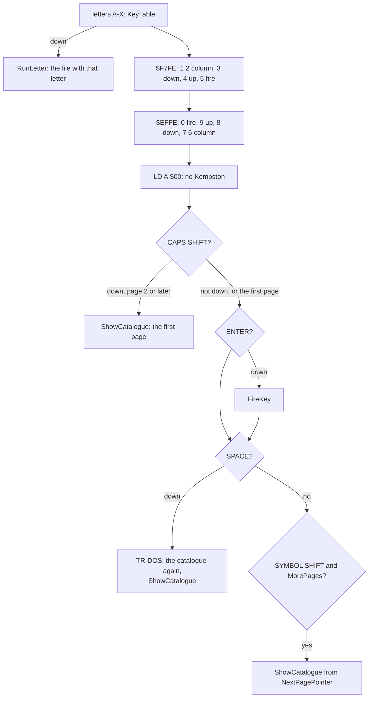
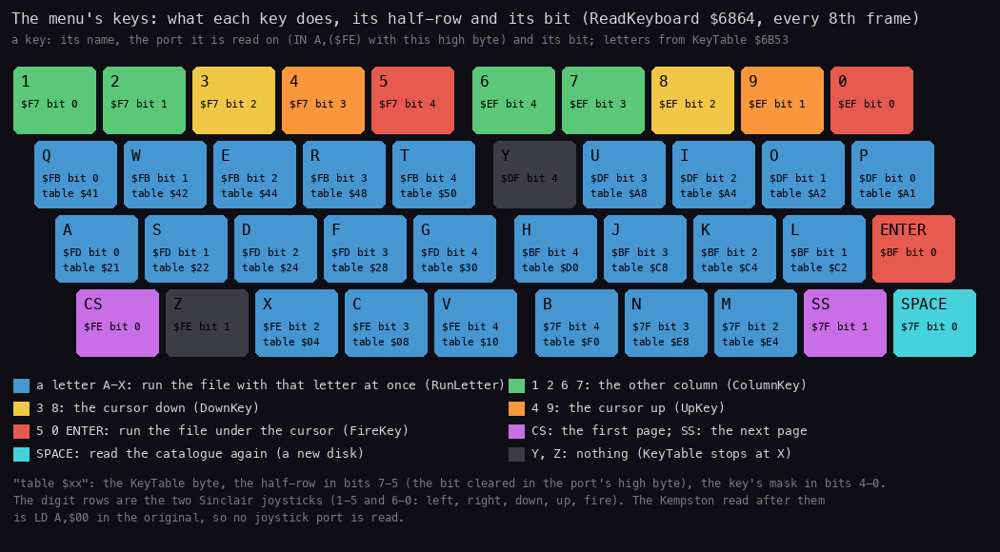
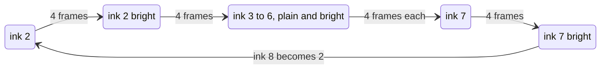
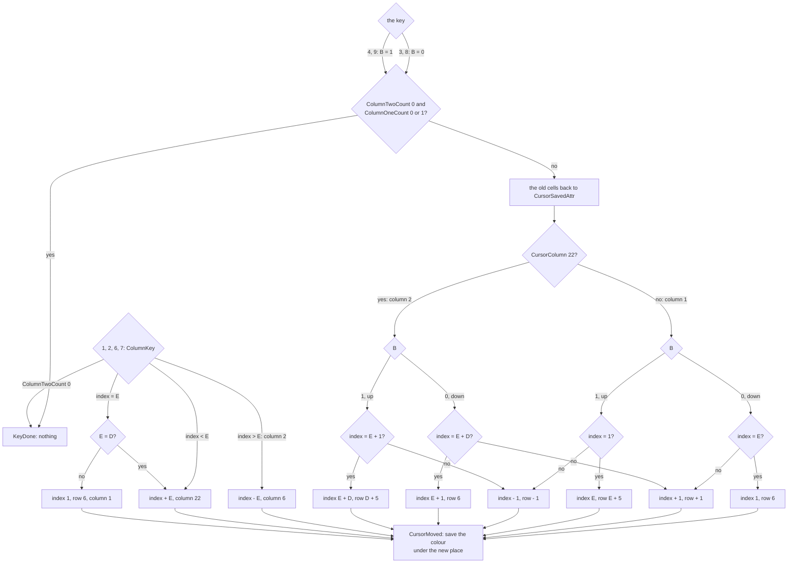
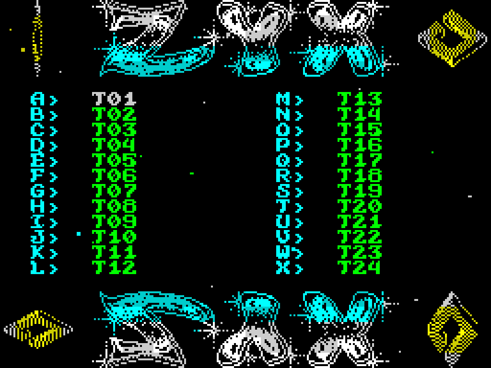
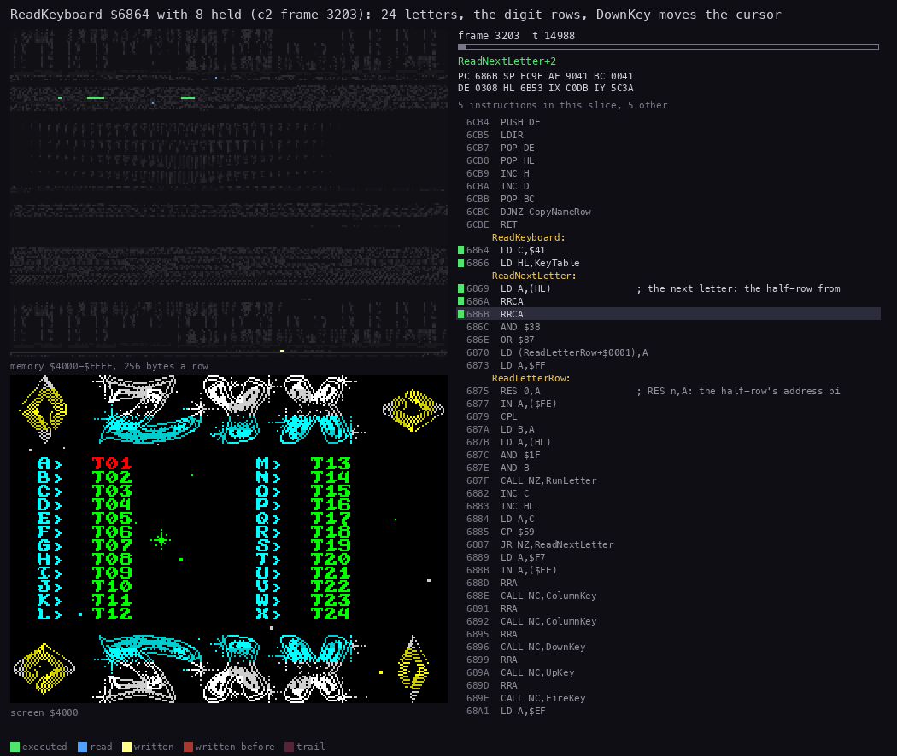

# 5. The keys

What this covers:

- the keyboard reader: when it runs, in what order it reads, what every key does (5.1);
- the letter keys A-X and the self-written `RES n,A` that picks each one's half-row (5.2);
- the digit rows: the two Sinclair joysticks, the column, down, up and fire (5.3);
- the cursor: where it is, how it moves, its colour cycle (5.4);
- the Kempston read the original silences with `LD A,$00` (5.5);
- SPACE, CAPS SHIFT and SYMBOL SHIFT: a new disk and the pages (5.6);
- what is known only from the code (5.7) and the point (5.8).

The names are those of `src/main/main.ann` (module keys). Vadim's 2010 decompilation
(`work/stage1/ZYXboot.utf8.mac`) reads this part well and is used here: his `ReadKeyboard`, `Keyboard`, `ChngColum`,
`PDown`, `PressUP`, `PressFire` and `CalcAttrAddr` are ReadKeyboard, KeyTable, ColumnKey, DownKey, UpKey, FireKey and
CursorAttrAddr here, and his per-key comments ("press 1", "press 0") match the code. He leaves the `LD A,0` at
`$68B9` without a comment; 5.5 explains it.

The recordings (WALKTHROUGH 1, Pentagon 128K):

| Recording | Disk | Keys | Used for |
| --- | --- | --- | --- |
| c1 | `orig/boot.scl` (NO EXE FILES !) | SPACE at frame 6430 | ReadKeyboard idle, SPACE |
| c2 | `tests/disks/many.scl` | SS, SS, CS, the cursor keys (frames 3195-3680), ENTER on T03 (frame 3763) | the cursor, the trace of frame 3203 |
| c3 | `tests/disks/many.scl` | SS at frame 1879, F at frame 2182 | a letter key (the stage-1 L1 `work/stage1/c3/l1.json`) |

The point: between them the three recordings press every kind of key: a letter, a digit, ENTER, SPACE, CS and SS.

## 5.1 The keyboard reader

ReadKeyboard `$6864` runs inside the interrupt, on the frames whose Frames value has bits 0-2 = 7
([doc 4, 4.5](04-program-cycle.md#45-the-interrupt)): every 8th frame, 6.25 times a second. It reads the keyboard
in a fixed order and acts on every key it finds down:

```text
ReadKeyboard:                                      # every 8th frame, in the interrupt
    for letter C = 'A' .. 'X':                     # KeyTable: the half-row and the bit of each
        if the key is down: RunLetter(C)           # runs the file with that letter (never returns if it exists)
    row 1-5:  1 ColumnKey, 2 ColumnKey, 3 DownKey, 4 UpKey, 5 FireKey
    row 6-0:  0 FireKey, 9 UpKey, 8 DownKey, 7 ColumnKey, 6 ColumnKey
    A = 0 (the Kempston read, silenced): its five CALL C never call
    if CAPS SHIFT is down and this is not the first page: ShowCatalogue (the first page); return
    if ENTER is down: FireKey
    if SPACE is down: read the catalogue again (IM 1), ShowCatalogue; return
    if SYMBOL SHIFT is down and there are more pages: show the next page
```





*The Spectrum keyboard with what each key does in the menu, its half-row port and its bit, the letters' KeyTable
bytes read from the image (`build/main.bin`). Made with `python3 tools/fig_keys.py`.*

How to read it:

- Blue: the 24 letters A-X, each with its port, bit and KeyTable byte. Y and Z (grey) do nothing: the table stops at
  X.
- Green, yellow, orange, red: the digits by their role (column, down, up, fire); ENTER is fire too.
- Purple: CS and SS, the pages; cyan: SPACE, a new disk.

The point: every key but Y and Z does something, and the 10 digits are two joysticks' worth of directions.

Cost, from the trace of c2 frames 1497-1752 ([doc 4, 4.5](04-program-cycle.md#the-256-frame-cycle)): 3 668 T when no
key is down, the same on all 32 reading frames of the cycle. Witness: c1, 909 calls in 7275 interrupts (stage-1 L1),
one in 8.

## 5.2 The letter keys

KeyTable `$6B53` holds a byte per letter A-X (`src/res/tables/keys.txt`): the half-row in bits 7-5 and the key's
bit in bits 4-0. The reader turns the half-row number into a `RES n,A` opcode and writes it into its own code, so
that `LD A,$FF` followed by that instruction gives the port's high byte:

```text
for C = 'A' .. 'X', HL = KeyTable:
    opcode at $6876 = $87 + 8 x row          # RES row,A
    A = $FF with bit row cleared             # the half-row's high byte
    if (IN A,($FE)) has the key's bit clear: RunLetter(C)
```

```text
6864  LD C,$41               ; 'A'
6866  LD HL,KeyTable
6869  LD A,(HL)              ; ReadNextLetter: row << 5 | mask
686A  RRCA
686B  RRCA                   ; row << 3
686C  AND $38
686E  OR $87                 ; RES row,A
6870  LD (ReadLetterRow+$0001),A
6873  LD A,$FF
6875  RES 0,A                ; ReadLetterRow: the opcode just written
6877  IN A,($FE)
6879  CPL                    ; a down key: 1
687A  LD B,A
687B  LD A,(HL)
687C  AND $1F                ; the key's bit
687E  AND B
687F  CALL NZ,RunLetter      ; C = the letter
6882  INC C
6883  INC HL
6884  LD A,C
6885  CP $59                 ; 'Y': done
6887  JR NZ,ReadNextLetter
```

Worked example, F: KeyTable's 6th byte is row 1, mask `%01000`, so `$28`. `$28` turned right twice is `$0A`; AND
`$38` is `$08`; OR `$87` is `$8F`: `RES 1,A`. `$FF` with bit 1 cleared is `$FD`, so the read is `IN A,($FE)` with
A = `$FD`: port `$FDFE`, the half-row A S D F G. F is its bit 3: `$08`. A down F reads as bit 3 clear; after `CPL`
it is set, the `AND` is non-zero, and RunLetter is called with C = `$46`.

The point: one table and one self-modified instruction read 24 keys on 6 half-rows with one loop (the letters sit on
half-rows 0, 1, 2, 5, 6 and 7; rows 3 and 4 are the digits, read apart in 5.3). The cost is a port read per letter:
24 reads where 6 would do.

RunLetter `$6A51` takes the letter as the position on the page: `C - $40` is 1 for A. It returns at once when that is
more than FileCount (the listed files from this page's first one on); otherwise it walks the listed entries from
PagePointer to that one and launches it ([doc 10, 10.2](10-launcher-and-notes.md#102-runletter-the-walk-and-the-command)), and never returns.

```text
6A51  LD A,(FileCount)       ; RunLetter
6A54  ADD A,$40
6A56  CP C
6A57  RET C                  ; no such letter on this page
6A58  LD B,$40
6A5A  EXX
6A5B  LD HL,(PagePointer)    ; the page's first entry
...
```

Worked example, c3: SS at frame 1879 shows page 2 (PagePointer `$9E90`, 7 names A-G). F at frame 2182: C = `$46`,
FileCount = 7, `$47 >= $46`, so RunLetter walks the listed entries `$9E90`, `$9EA0`, ... to the 6th, `$9EE0`: T30.
Witness: c3 stage-1 L1, RunLetter's single entry at frame 2182, reading the entries `$9E90-$9EE8`; the screen shows
`TEST 30` after it (WALKTHROUGH 1).

## 5.3 The digit rows: two Sinclair joysticks

The two digit half-rows are read whole, a bit at a time with `RRA` and `CALL NC`:

```text
6889  LD A,$F7               ; 1 2 3 4 5
688B  IN A,($FE)
688D  RRA
688E  CALL NC,ColumnKey      ; 1
6891  RRA
6892  CALL NC,ColumnKey      ; 2
6895  RRA
6896  CALL NC,DownKey        ; 3
6899  RRA
689A  CALL NC,UpKey          ; 4
689D  RRA
689E  CALL NC,FireKey        ; 5
68A1  LD A,$EF               ; 0 9 8 7 6
68A3  IN A,($FE)
68A5  RRA
68A6  CALL NC,FireKey        ; 0
68A9  RRA
68AA  CALL NC,UpKey          ; 9
68AD  RRA
68AE  CALL NC,DownKey        ; 8
68B1  RRA
68B2  CALL NC,ColumnKey      ; 7
68B5  RRA
68B6  CALL NC,ColumnKey      ; 6
```

The routines keep A (they push and pop AF), so the next `RRA` sees the next bit.

| Keys | Sinclair joystick | The menu |
| --- | --- | --- |
| 1, 6 | left | ColumnKey: the other column |
| 2, 7 | right | ColumnKey: the other column |
| 3, 8 | down | DownKey: the next name |
| 4, 9 | up | UpKey: the name before |
| 5, 0 | fire | FireKey: run the name under the cursor |

The point: the mapping is exactly the two Sinclair (Interface 2) joysticks, 1-5 left, right, down, up, fire and 6-0
the same. With two columns, left and right both mean "the other one". The stage-2 `.ann` comment called these "the
cursor keys of a Sinclair and a cursor joystick", which was half right: a cursor joystick (5 left, 6 down, 7 up,
8 right, 0 fire) would run the file on left and change the column on down and up. The module's header now names the
two Sinclair joysticks.

FireKey `$6A3F` does nothing when no file is listed; otherwise it makes the cursor's letter (`CursorIndex + $40`)
and falls into RunLetter: 5, 0 and ENTER are the letter under the cursor.

## 5.4 The cursor

The cursor is not a sprite: it is the attributes of the name's cells, repainted every 4th frame in the next colour
of a cycle. Its place is CursorRow `$B3B6` and CursorColumn (the next byte), its length CursorLength (8 for a name, 14
for NO EXE FILES !). ListCatalogue sets them for each page ([doc 7, 7.3](07-catalogue-and-menu.md#73-the-count-and-the-three-layouts)):

| The page | CursorRow, CursorColumn | CursorLength |
| --- | --- | --- |
| no file | 11, 9 (NO EXE FILES !) | 14 |
| 1-12 files: one column | 6, 14 | 8 |
| 13-24 files: two columns | 6, 6 | 8 |

The point: the cursor covers the name only, not the letter and the `>` before it.

In the interrupt (Frames bits 0-1 = 3):

```text
paint the CursorLength cells from CursorAttrAddr(CursorRow, CursorColumn) with CursorAttr
if CursorAttr is not bright: make it bright
else: not bright, ink + 1; ink 8 becomes ink 2
```

```text
678E  CALL CursorAttrAddr
6791  LD DE,(CursorLength)   ; E = cells, D = CursorAttr
6795  LD B,E
6796  LD (HL),D              ; PaintCursor
6797  INC HL
6798  DJNZ PaintCursor
679A  BIT 6,D
679C  SET 6,D                ; bright
679E  JR Z,StoreCursorAttr   ; it was not bright: done
67A0  RES 6,D
67A2  INC D                  ; the next ink
67A3  BIT 3,D
67A5  JR Z,StoreCursorAttr
67A7  INC D                  ; ink 8: 10, then
67A8  INC D
67A9  RES 3,D                ; ink 2
67AB  LD A,D
67AC  LD (CursorAttr),A
```



Worked example, c2 frames 1500-1548 (CursorAttr `$B3BF` read with TTD `memory_at` every 4 frames):
`$45 $06 $46 $07 $47 $02 $42 $03 $43 $04 $44 $05 $45`. Twelve steps, 48 frames, back to `$45`; ink 1 (and 0) never comes back:
ShowCatalogue starts the cycle at `$01`, and after `$47` the ink jumps to 2.

When the cursor moves, ColumnKey, DownKey and UpKey first put CursorSavedAttr (the colour under the name before the
cursor came) back into the old cells, then move CursorRow, CursorColumn and CursorIndex, then save the colour under
the new place. The moves wrap within a column:

```text
DownKey:  index = index + 1; past the column's last name: to its first (row 6)
UpKey:    index = index - 1; before the column's first name: to its last
ColumnKey (two columns only): the same row in the other column (index + or - ColumnOneCount);
          on column 1's last row when column 2 has no name there: column 1's first name (row 6)
MoveCursor (DownKey, UpKey): nothing with a single name (ColumnTwoCount 0, ColumnOneCount 0 or 1)
```

The positions run down column 1 (CursorIndex 1 to ColumnOneCount, CursorRow 6 on) and on down column 2 (CursorColumn
22). MoveCursor `$69C3` is DownKey with B = 0 and UpKey with B = 1; with E = ColumnOneCount, D = ColumnTwoCount, C =
CursorIndex and L = CursorRow it sets H (the new index) and A (the new row):

```text
69C3  LD A,(ColumnTwoCount)  ; MoveCursor
69C6  AND A
69C7  JR NZ,MoveCursorGo
69C9  LD A,(ColumnOneCount)  ; one column:
69CC  AND A
69CD  JR Z,KeyDone           ;   no name: nothing
69CF  DEC A
69D0  JR Z,KeyDone           ;   one name: nothing
69D2  PUSH BC                ; MoveCursorGo
69D3  CALL CursorAttrAddr
...                          ; CursorLength cells back to CursorSavedAttr
69E2  LD A,(CursorIndex)
69E5  LD C,A
69E6  LD DE,(ColumnOneCount) ; E = column 1's names, D = column 2's
69EA  LD A,(CursorRow)
69ED  LD L,A
69EE  LD A,(CursorColumn)
69F1  CP $16
69F3  JR Z,MoveColumnTwo
69F5  LD A,B                 ; column 1
69F6  AND A
69F7  JR NZ,MoveUpColumnOne
69F9  LD A,C
69FA  CP E                   ; down on column 1's last name?
69FB  LD A,$06
69FD  LD H,$01
69FF  JR Z,MoveSetRow        ;   yes: index 1, row 6
6A01  LD H,C                 ; MoveDownOne: index + 1, row + 1
6A02  INC H
6A03  LD A,L
6A04  INC A
6A05  JR MoveSetRow
6A07  LD A,C                 ; MoveUpColumnOne
6A08  CP $01
6A0A  JR NZ,MoveUpOne
6A0C  LD H,E                 ;   up on the first: index E,
6A0D  LD A,E
6A0E  JR MoveToLast          ;   row E + 5
6A10  LD H,C                 ; MoveUpOne: index - 1, row - 1
6A11  DEC H
6A12  LD A,L
6A13  DEC A
6A14  JR MoveSetRow
6A16  LD A,B                 ; MoveColumnTwo
6A17  AND A
6A18  JR NZ,MoveUpColumnTwo
6A1A  LD A,E
6A1B  ADD A,D
6A1C  CP C                   ; down on the last name (E + D)?
6A1D  JR NZ,MoveDownOne
6A1F  LD H,E                 ;   yes: index E + 1, row 6
6A20  INC H
6A21  LD A,$06
6A23  JR MoveSetRow
6A25  LD A,E                 ; MoveUpColumnTwo
6A26  INC A
6A27  CP C                   ; up on column 2's first (E + 1)?
6A28  JR NZ,MoveUpOne
6A2A  LD A,E                 ;   yes: index E + D,
6A2B  ADD A,D
6A2C  LD H,A
6A2D  LD A,D                 ;   row D + 5
6A2E  ADD A,$05              ; MoveToLast
6A30  LD (CursorRow),A       ; MoveSetRow
6A33  LD A,H
6A34  LD (CursorIndex),A
6A37  JP CursorMoved         ; save the colour under the new place
```

ColumnKey `$6967` returns at once with one column (ColumnTwoCount 0); otherwise it puts the old colour back and
decides on `CursorIndex - 1 - ColumnOneCount`:

```text
697E  LD A,(ColumnOneCount)
6981  LD B,A
6982  LD A,(CursorIndex)
6985  LD C,A
6986  DEC A
6987  SUB B                  ; index - 1 - ColumnOneCount
6988  JR NC,ToColumnOne      ; 0 or more: the cursor is in column 2
698A  CP $FF
698C  JR NZ,ToColumnTwo      ; not column 1's last name
698E  LD HL,(ColumnOneCount)
6991  LD A,H
6992  CP L
6993  JR Z,ToColumnTwo       ; the columns are as long: the same row exists
6995  LD A,$01               ; column 2 is one shorter:
6997  LD (CursorIndex),A     ;   index 1,
699A  LD A,$06
699C  LD (CursorRow),A       ;   row 6, the column unchanged: column 1's first name
699F  JR CursorMoved
69A1  LD A,C                 ; ToColumnTwo: index + ColumnOneCount, column 22
69A2  ADD A,B
69A3  LD (CursorIndex),A
69A6  LD A,$16
69A8  LD (CursorColumn),A
69AB  JR CursorMoved
69AD  LD A,C                 ; ToColumnOne: index - ColumnOneCount, column 6
69AE  SUB B
69AF  LD (CursorIndex),A
69B2  LD A,$06
69B4  LD (CursorColumn),A
```



Worked example, c2 frame 3203 (the trace `3203:14900-3203:20130`, 8 down): ColumnOneCount 12, ColumnTwoCount 12, so
MoveCursor goes on. It writes CursorSavedAttr `$44` back into `$58C6-$58CD` (row 6, column 6: T01's cells), then
reads C = CursorIndex 1, E = D = 12, L = CursorRow 6, CursorColumn 6: column 1, B = 0. `CP E` compares 1 with 12: not
equal, so MoveDownOne: H = 2, A = 7. CursorRow becomes 7 and CursorIndex 2 (`$6A30`, `$6A34` at T 19 261 and 19 278),
and CursorMoved saves the colour at `$58E6`, `$44`, as the new CursorSavedAttr.

The point: the cursor can never leave the listed names, and every move is one key press per read. With a single name
listed, 3, 4, 8 and 9 do nothing, and so do 1, 2, 6 and 7 with one column.



*c2 frames 3195-3680, every 5th frame, 4 x scale. Made with `python3 ../../kit/screen_anim.py --work work/docs/zbA/c2
--from 3195 --to 3680 --step 5 --scale 4 --delay 100 --hold 1500 docs/img/play/cursor.gif`.*

How to read it:

- The highlighted name changes colour on every picture or two (4 frames a colour).
- It steps down, up and to the other column as the keys are pressed (DownKey at frames 3203-3371, UpKey at 3435 and
  3659, ColumnKey at 3491 and 3595: the stage-1 L1 of c2).
- The name it leaves gets its own colour back at once.

The point: the cursor costs 8 attribute writes every 4th frame (14 on NO EXE FILES !) and never touches the pixels.



*ReadKeyboard `$6864` in c2 frame 3203 (T 14 900 to 20 130), 60 pictures. Left above: memory `$4000-$FFFF`; left
below: the screen; right: the listing at the PC. Made with `python3 ../../kit/routine_anim.py --work work/docs/zbA/c2
--window 3203:14900-3203:20130 --listing work/docs/zbA/all.lst --view screen --pc 6864-692F,6848-6862,69C0-6A3E
--range 4000-FFFF --pictures 60 --out docs/img/routines/ReadKeyboard.gif`.*

How to read it:

- The first two thirds: the letter loop, the listing jumping between `$6869` and `$6887`, KeyTable `$6B53` read a
  byte at a time.
- Then the digit rows; 8 is down, so DownKey runs: CursorAttrAddr, the old cells' attributes put back, the new place.
- DownKey gives T01 its own colour back and saves T02's: the last picture shows T01-T12 all green, no name
  highlighted. The cursor is gone from the screen until the next paint, 4 frames later (Frames bits 0-1 = 3), puts it
  on T02: in the interrupt the paint at `$678E` runs before InterruptExit's `CALL Z,ReadKeyboard` at `$6834`.

The point: a held key acts once per read; a key held for a second moves the cursor 6 names.

## 5.5 The Kempston read

After the digit rows comes a third block of five tests, in the same order of directions, but with `CALL C` (a
Kempston interface reads 1 for a pressed direction):

```text
68B9  LD A,$00               ; Joystick: where IN A,($1F) would be
68BB  RRA
68BC  CALL C,ColumnKey       ; right
68BF  RRA
68C0  CALL C,ColumnKey       ; left
68C3  RRA
68C4  CALL C,DownKey         ; down
68C7  RRA
68C8  CALL C,UpKey           ; up
68CB  RRA
68CC  CALL C,FireKey         ; fire
```

`LD A,$00` is `3E 00`, two bytes, the size of `IN A,($1F)` (`DB 1F`). With A = 0 every `RRA` gives carry 0, and none
of the five calls happens: the Kempston block is there but silenced.

The point: the original disk does not read port `$1F`. With no interface fitted, the port reads the floating bus,
often `$FF`: all five calls would then happen, FireKey last, and the menu would launch the file under the cursor at
its first keyboard read. Silencing the block makes the menu safe on every machine at the price of the joystick. Eight
of the variants put `IN A,($1F)` back (for example [zyxboot-01](../variants/zyxboot-01/README.md)).

Witness: the byte at `$68B9` in c1 (TTD `memory_at`, frame 1000) is `$3E`; no recording reads port `$1F` (c3's
ReadKeyboard reads only the eight keyboard half-rows, stage-1 L1).

## 5.6 SPACE, CS and SS: a new disk and the pages

```text
68CF  LD A,$FE               ; CAPS SHIFT Z X C V
68D1  IN A,($FE)
68D3  RRA
68D4  JR C,ReadEnter         ; not down
68D6  LD HL,(PagePointer)
68D9  LD BC,$9D01
68DC  AND A
68DD  SBC HL,BC
68DF  JR C,ReadEnter         ; the first page already
68E1  CALL ShowCatalogue     ; from Catalogue: the first page
68E4  RET
68E5  LD A,$BF               ; ReadEnter: ENTER H J K L
68E7  IN A,($FE)
68E9  RRA
68EA  CALL NC,FireKey
68ED  LD A,$7F               ; SPACE SS M N B
68EF  IN A,($FE)
68F1  RRA
68F2  JR C,ReadSymbolShift
...                          ; SPACE: IY, H'L', SoundOff, DI, IM 1, TrdosEntry, DI, IM 2
6911  CALL ShowCatalogue
6914  RET
6915  RRA                    ; ReadSymbolShift
6916  RET C
6917  LD A,(MorePages)
691A  AND A
691B  RET Z
691C  LD HL,(NextPagePointer)
691F  XOR A
6920  LD (MorePages),A
6923  LD (ShowCatalogueAt+$0002),HL   ; ShowCatalogue's own LD IX,nn
6926  CALL ShowCatalogue
6929  LD HL,Catalogue
692C  LD (ShowCatalogueAt+$0002),HL   ; back to the first page
692F  RET
```

| Key | When | What |
| --- | --- | --- |
| CS | PagePointer `$9D01` or more: not the first page | ShowCatalogue from Catalogue: the first page |
| SS | MorePages set: more than 24 files from this page on | ShowCatalogue from NextPagePointer, the entry after this page's 24th |
| SPACE | always | the catalogue read again with TR-DOS under IM 1, then the first page ([doc 7, 7.1](07-catalogue-and-menu.md#71-reading-the-catalogue)) |

The point: the pages only go forward and back to the first; SS on the last page and CS on the first do nothing. A
page change resets Frames to 0, so the glint and the spin restart with each page.

Worked example, c2: SS shows page 2 (PagePointer `$9E90`, frame 1810), so CS now passes the test (`$9E90` - `$9D01`
leaves no carry) and goes back to page 1 (frame 2804). Witness: ShowCatalogue's three entries in c2 at frames 536,
about 1810 and 2804 (stage-1 L1).

The page draw itself is in [doc 7, 7.5](07-catalogue-and-menu.md#75-the-pages).

## 5.7 Known only from the code

- The Kempston block with a live `IN A,($1F)`: no recording of the original reads it; its order of bits (right, left,
  down, up, fire) is the standard Kempston one and is read from the code.
- A cursor joystick, the Sinclair joysticks as hardware: the recordings press keys; the joystick mapping is the
  standard one for those key rows.
- The wrap of DownKey and UpKey at the ends of a column and ColumnKey on a row the other column lacks: read from the
  code; c2 moves inside the columns only.
- Two keys at once: the order of the reads decides, from the code: the letters A-X (a letter with a file launches it
  and nothing else is read), the digits 1-5 then 0-9 (each one down acts: 3 + 4 cancel, 1 + 2 swap the column twice),
  the silenced Kempston block, CS (on page 2 or later it shows page 1 and ends the read), ENTER, SPACE (ends the
  read), SS.

## 5.8 The point

The keys are read only every 8th frame inside the interrupt, which makes them repeat at 6.25 a second when held and
keeps the cost to 3 700 T in 8 frames. The design gives three ways to run a file: its letter, the cursor with the
digit rows (two Sinclair joysticks), or the cursor with ENTER; and a third joystick, the Kempston, is wired in but
silenced on the original disk.
