# 6. The graphics

What this covers:

- PrintSprite and the logo: four 40 x 40 sprites side by side (6.1);
- the reflection: the logo turned upside down by two turns and a mirror (6.2);
- the rhombi: 34 phases built at the start from one 40 x 40 sprite, by dropping columns, mirroring and turning (6.3);
- the star field: 60 records (30 stars), near stars of 2 x 2 pixels and far ones of 1, moved with self-written bit opcodes (6.4);
- the twinkle: a 16 x 16 sprite that grows and shrinks in a random place (6.5);
- the glint: two red diagonals that cross the logo once every 256 frames (6.6);
- the corner colours, Vadim's "FadeATTR" (6.7);
- ScreenCopy, the clean screen the effects restore from, and who writes what on a frame (6.8);
- what is known only from the code (6.9) and the point (6.10).

The names are those of `src/main/main.ann` (modules rhombi, stars, screen, logo, fade). Vadim's 2010 decompilation
(`work/stage1/ZYXboot.utf8.mac`) names most of these routines well and is used here: his `Print40x40`, `ScrInit`,
`PrStarsDownFly`, `Test60bits`, `Rotate90_to9c00`, `MirrorSprite`, `MirrorHorizon`, `PrintZYXdown`, `PrintStars` and
`FadeATTR` are PrintSprite, DrawScreen, MoveStars, SampleStars, RotateSprite, MirrorSprite, FlipSprite, DrawReflection,
TwinkleStar and ColourCorners here. Where the readings differ, the section says so.

The recordings: c1 (`orig/boot.scl`, NO EXE FILES !) and c2 (`tests/disks/many.scl`) of WALKTHROUGH 1, Pentagon
128K, reopened on this writer's own instance (port base 37440, muted). Frame numbers are c1's unless named.

## 6.1 PrintSprite and the logo

Every big picture of the menu is a 40 x 40 sprite: 200 bytes, 40 rows of 5 bytes, a row's bytes left to right, the
rows top to bottom. PrintSprite `$64F4` copies one to a character-aligned place on the screen, 5 cells wide and 5
high:

```text
PrintSprite(DE = sprite, HL = screen address of the top-left cell):
    repeat 5 cell rows:
        repeat 8 pixel lines:
            copy 5 bytes DE -> HL; HL = HL + 256 - 5        # the next pixel line of the cell row
        HL = HL - 2048 + 32                                 # back up 8 lines, down one cell row
```

```text
64F4  LD B,$05               ; 5 cell rows
64F6  PUSH BC                ; PrintSpriteCellRow
64F7  LD B,$08               ; 8 pixel lines
64F9  PUSH BC                ; PrintSpriteLine
64FA  LD BC,$0005
64FD  EX DE,HL
64FE  LDIR                   ; 5 bytes of the sprite
6500  EX DE,HL
6501  LD BC,$00FB            ; + 256 - 5: the next pixel line
6504  ADD HL,BC
6505  POP BC
6506  DJNZ PrintSpriteLine
6508  LD BC,-2048+32         ; the next cell row
650B  ADD HL,BC
650C  POP BC
650D  DJNZ PrintSpriteCellRow
650F  RET
```

It never crosses a third of the screen: every place it is called for (rows 0-4 and 19-23) lies inside one third.
Its cost, from the idle L1 (`work/docs/zbA/idle/l1.json`): 59.4 M own T-states (59 444 082) in 8234 calls, about 7 200 T a
sprite.

DrawScreen `$6510` prints the four rhombi in their phase 0 (RombSource) and the logo: Logo `$A900`, LogoPart2,
LogoPart3 and LogoPart4, 200 bytes apart, at columns 6, 11, 16 and 21 of rows 0-4. Then it copies LogoAttributes
`$AC20` (5 rows of 20) to the attributes, colours the corners (6.7), prints the help lines (doc 8) and saves the
screen to ScreenCopy (6.8).

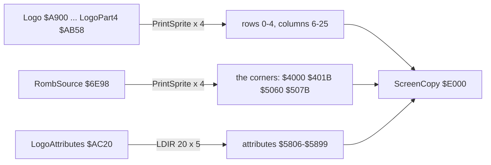

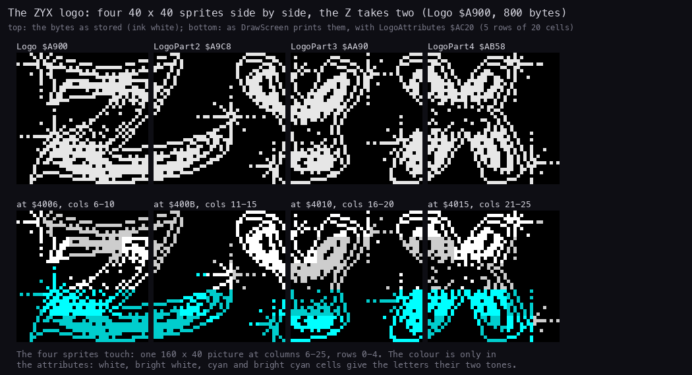

*The four logo sprites from the image (`build/main.bin`), plain and with LogoAttributes. Made with `python3
tools/fig_graphics.py --work work/docs/zbA/c1` (all of the figures of this document; the memory of c1 at frame 1000 is
kept in `work/docs/figcache/`).*

How to read it:

- Top: the bytes as stored, one sprite per box, with its address. The Z takes two sprites; Y and X one each.
- Bottom: as DrawScreen prints them, at `$4006`, `$400B`, `$4010` and `$4015`, with the attributes.
- The colour is only in the attributes: white, bright white, cyan and bright cyan cells give the letters their two
  tones.

The point: the logo is the same kind of object as a rhombus, a 40 x 40 sprite, so one 28-byte routine prints all
eight. The four parts are "phases" of nothing: they never change, except that DrawReflection turns them upside down
in place (6.2).

Worked example: LogoPart3 is at `$A900` + 2 x 200 = `$AA90`; its top-left cell is screen `$4000` + 16 = `$4010`.
The first line takes bytes `$AA90-$AA94` to `$4010-$4014`; the second, `$AA95-$AA99` to `$4110-$4114`; the ninth
(the second cell row) starts at `$4010` + 8 x 256 - 2048 + 32 = `$4030`.

Witness: DrawScreen's one call at c1 frame 532; the logo is on the screen after DrawScreen's own drawing (to c1
frame 536 in the L1; [screens](img/overview/screens.png) picture 1 shows it at frame 850).

## 6.2 The reflection: the logo upside down

DrawReflection `$6DC6` runs once, at the end of the set-up (c1 frames 824-890). It turns each logo sprite upside down
where it lies, prints the four into ScreenCopy at rows 19-23, copies the logo's attributes there row by row in
reverse order, and copies ScreenCopy's bottom third and attribute rows 19-23 to the screen. The help lines of rows
19-21 vanish under it, on the screen and in ScreenCopy alike.

FlipSprite `$6E35` makes the upside-down picture from routines that were already there: two quarter turns
(RotateSprite) make a half turn, and a left-right mirror (MirrorSprite onto itself) undoes the half turn's left-right
swap. What is left is a top-bottom flip.

```text
FlipSprite(HL = sprite):
    RotateSprite(HL); RotateSprite(HL)          # 180 degrees
    MirrorSprite(HL -> HL)                      # left-right: the net effect is top-bottom

DrawReflection:
    for each of Logo, LogoPart2, LogoPart3, LogoPart4: FlipSprite
    DI
    PrintSprite each into ScreenCopy row 19, columns 6, 11, 16, 21
    for row 0..4: attributes of ScreenCopy row (23 - row) = those of row (row), columns 6-25
    copy ScreenCopy pixels $F000-$F7FF -> $5000; attributes rows 19-23 -> $5A60
    EI
```

```text
6DC6  LD HL,Logo
6DC9  CALL FlipSprite        ; and LogoPart2, LogoPart3, LogoPart4
...
6DDE  DI
6DDF  LD DE,Logo
6DE2  LD HL,ScreenCopy+4198  ; row 19, column 6 of the copy
6DE5  CALL PrintSprite
...
6E03  LD B,$05
6E05  LD HL,ScreenCopy+6150  ; attribute row 0, column 6
6E08  LD DE,ScreenCopy+6886  ; attribute row 23, column 6
6E0B  PUSH BC                ; ReflectAttrRow
6E0C  LD BC,$0014
6E0F  LDIR                   ; 20 cells
6E11  LD C,$0C
6E13  ADD HL,BC              ; the next row down
6E14  LD C,$34
6E16  AND A
6E17  EX DE,HL
6E18  SBC HL,BC              ; the row above
6E1A  EX DE,HL
6E1B  POP BC
6E1C  DJNZ ReflectAttrRow
6E1E  LD HL,ScreenCopy+4096
6E21  LD DE,Screen+4096
6E24  LD BC,$0800
6E27  LDIR                   ; the bottom third
6E29  LD HL,ScreenCopy+6752
6E2C  LD DE,Attributes+608
6E2F  LD C,$A0
6E31  LDIR                   ; attribute rows 19-23
6E33  EI
6E34  RET
...
6E35  CALL RotateSprite      ; FlipSprite
6E38  CALL RotateSprite
6E3B  LD D,H
6E3C  LD E,L
6E3D  CALL MirrorSprite
6E40  RET
```

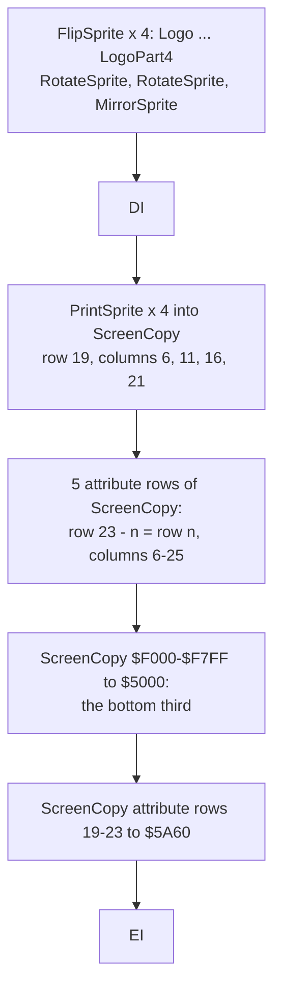

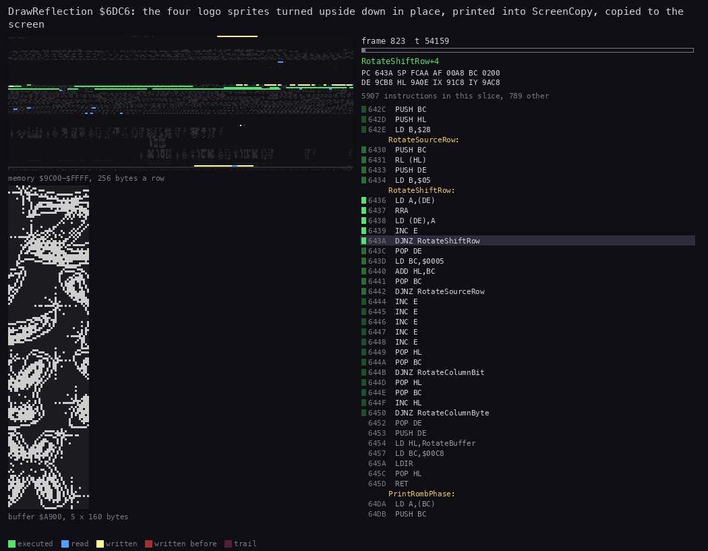

*DrawReflection `$6DC6` over c1 frames 823-891, 90 pictures. Left above: memory `$9C00-$FFFF`; left below: the
logo's buffer at `$A900` as 5 x 160 bytes (the four sprites one under another); right: the listing at the PC. Made
with `python3 ../../kit/routine_anim.py --work work/docs/zbA/c1 --window 823:0-891:0 --listing build/main.lst
--listing build/music.lst --view buffer:A900:5x160 --pc 6DC6-6E40,6422-645D,63D6-6421,64F4-6509 --range 9C00-FFFF
--pictures 90 --out docs/img/routines/DrawReflection.gif` and the title
`--title "DrawReflection $6DC6: the four logo sprites turned upside down in place, printed into ScreenCopy, copied to the screen"`.*

How to read it:

- The buffer view turns: each sprite is rotated a quarter, then another, then mirrored, one after the other from the
  top. RotateBuffer `$9C00` lights up in the map on every turn.
- At the end the writes move to `$F000-$F7FF` (ScreenCopy's bottom third), then to the screen in one copy.

The point: the reflection costs 4.7 M T, 1.3 s of the set-up, because it reuses two general routines (a 436 611 T
turn, 517 844 T including the interrupts it lets in, twice per sprite) where a direct flip (copy row 39 - y to row y) would take some 10 000 T. The help lines
printed at frame 533 are on the screen for 7 s only.

Witness: c1 frame 850 shows the help lines, c1 frame 1000 the reflection over them
([screens](img/overview/screens.png), pictures 1 and 2).

## 6.3 The rhombi: 34 phases from one sprite

Each corner holds a rhombus that turns about an axis: the top-left and bottom-right ones about the vertical axis
(set A), the other two about the horizontal one (set B). A turn is 32 steps, and every step shows a precomputed
phase: one of 17 sprites per set, at the set + phase x 256.

| Phases | What | How it is made |
| --- | --- | --- |
| 0 | the whole rhombus, face on | BuildRombPhases keeps all 40 columns |
| 1-7 | the face turning away: narrower and narrower | BuildRombPhases keeps 35, 30, ... 5 columns, packed and centred |
| 8 | edge on: empty | BuildRombPhases's edge pass (below) writes nothing |
| 9-16 | the back face: phases 0-7 mirrored, left-right in set A and top-bottom in set B (MirrorSprite runs before set B's last quarter turn) | MirrorSprite |

The point: one 200-byte sprite (RombSource `$6E98`, `src/res/graphics/rhombus.png`) becomes 34 sprites, 6.8 K, at
the start; the main loop only copies them.

### BuildRombPhases: dropping columns

A narrower phase keeps fewer pixel columns of the source, scattered across the picture so that it looks turned and
not cropped. RombColumnOrder `$6B74` (40 numbers, `src/res/tables/rhombus-columns.txt`) lists the columns in the
order they are dropped: phase k keeps the first 5 x (8 - k) of them, packed left to right in their own order of x,
starting at pixel RombPhaseOffsets[8 - k] (`$6B9C`, `src/res/tables/rhombus-offsets.txt`), so the narrower picture
stays centred.

```text
BuildRombPhases(DE = the set):
    for C = 8 down to 1:                         # phase k = 8 - C
        offset = RombOffsets[C]
        for each of the 40 rows of RombWork:
            mask = 40 zeros
            for the first 5 x C entries n of RombColumns: mask[n AND $3F] = 1
            ScaleRombLine: x_out = offset
                for x = 0..39: if mask[x]: pixel (x_out) of the phase row = pixel (x) of the source row; x_out += 1
        D = D + 1                                # the next phase, 256 bytes on
    the edge pass (phase 8): for each row n, if RombColumns[n] >= threshold: byte 2 of row n = $18
```

```text
62F1  LD IY,RombOffsets
62F5  LD C,$08               ; 8 phases
62F7  LD HL,RombWork         ; BuildPhase
62FA  LD B,$28               ; 40 rows
62FC  LD IX,RombColumns      ; BuildPhaseRow
6300  CALL ClearPhaseMask    ; mask = 0, PhaseOffset = RombOffsets[C]
6303  PUSH BC
6304  LD B,$05               ; MarkColumns: 5 columns a group, C groups
6306  LD A,(IX+$00)          ; MarkColumn
6309  AND $3F
630B  CALL MarkPhaseColumn   ; PhaseMask[A] = 1
...
6316  CALL ScaleRombLine     ; the marked pixels, packed from PhaseOffset
6319  DJNZ BuildPhaseRow
631B  INC D                  ; the next phase
631C  LD E,$00
631E  DEC C
631F  JR NZ,BuildPhase
6321  EX DE,HL               ; HL = phase 8
6322  LD DE,RombColumns
6325  LD A,(RombThreshold)   ; $40 for set A, $80 for set B
6328  LD B,A
6329  INC L                  ; EdgeOnRow: byte 2 of the row
632A  INC L
632B  LD A,(DE)
632C  CP B
632D  JR C,EdgeOnNext        ; below the threshold: nothing
632F  LD (HL),$18
...
```

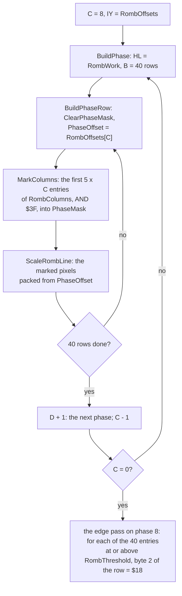

ScaleRombLine writes the pixels with self-written instructions: it builds `BIT n,(IX+0)` for the source pixel and
`SET n,(IY+0)` or `RES n,(IY+0)` for the target pixel (the opcode byte `$86 | n << 3`, plus `$40` for SET).

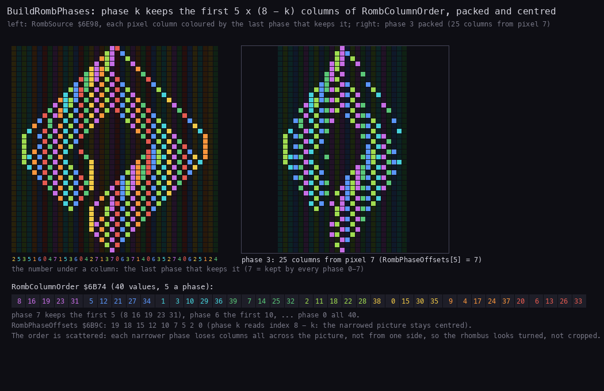

*RombSource with each pixel column coloured by the last phase that keeps it, phase 3 packed, and the two tables, from
the image. Made by `tools/fig_graphics.py` (the command under the logo figure).*

How to read it:

- Left: the source; the number under each column is the last phase that keeps it (7: kept by every phase 0-7).
- Right: phase 3, the 25 columns it keeps, packed from pixel 7.
- Below: RombColumnOrder in groups of 5, and RombPhaseOffsets.

Worked example, phase 3: it keeps the first 25 entries of RombColumnOrder (8 16 19 23 31 5 12 21 27 34 1 3 10 29 36
39 7 14 25 32 2 11 18 22 28). C = 8 - 3 = 5, so the offset is RombPhaseOffsets[5] = 7: the 25 kept pixels of each
row, in their order of x (1 2 3 5 7 8 10 ...), go to pixels 7-31 of the phase row, and pixels 0-6 and 32-39 stay
empty. 25 columns from pixel 7 to 31: centred within one pixel of the 40.

The point: the turn is an illusion made of thinner and thinner copies; scattering the dropped columns keeps the
rhombus's outline and its inner lines in proportion at every width.

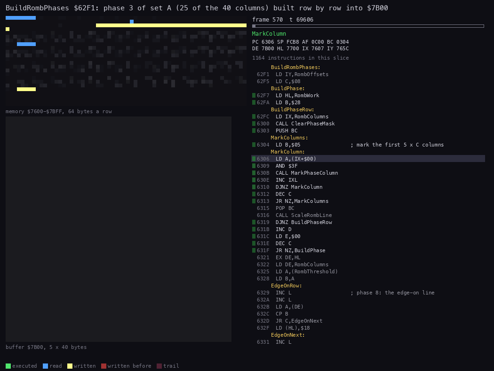

*BuildRombPhases `$62F1` over c1 frames 570-581 (frame 570 T 60 000 to frame 581 T 40 000), 80 pictures. Left
above: memory `$7600-$7BFF`; left below: phase 3 of set A at `$7B00` as 5 x 40 bytes; right: the listing at the PC.
Made with `python3 ../../kit/routine_anim.py --work work/docs/zbA/c1 --window 570:60000-581:40000 --listing
build/main.lst --view buffer:7B00:5x40 --pc 62F1-63D5 --range 7600-7BFF --pictures 80 --out
docs/img/routines/BuildRombPhases.gif`.*

How to read it:

- The buffer fills from the top, one row each few pictures: ScaleRombLine writes pixel by pixel, so a row grows from
  its left.
- In the map, PhaseMask `$7698` flashes on every row (cleared and marked again) and RombColumns `$7600` is read.

The point: a row costs about 14 000 T on average, interrupts included (8.95 M T for 16 phases of 40 rows; the mask
is rebuilt for each row, though it is the same for all 40 rows of a phase). The rows differ: phase 0 marks 40 columns
and writes 40 pixels a row, phase 7 marks and writes 5 (ScaleRombLine still tests all 40), so a phase-0 row costs
about twice a phase-7 row. A phase takes about 8 frames: set A's 8 phases run from frame 542 to 605.
The 156 frames 542-697 between BuildRombPhases's first and last call also hold set A's 8 mirrors (MirrorSprite from
frame 605) and the three turns of RombWork (RotateSprite from frame 613, 436 611 T a turn, 517 844 T with the interrupts that come in during it,
about 22 frames for the three) before set B (c1 stage-1 L1).

### The edge pass: a line that is never drawn

The edge pass would draw a 2-pixel vertical line (`$18` in byte 2: pixels 19-20) on the rows whose RombColumnOrder
entry is at or above the threshold (`$40` for set A, `$80` for set B). MarkColumn masks the entries with `AND $3F`,
so bits 6 and 7 could mark rows for the line without disturbing the columns. But every entry is 0-39: none reaches
`$40`. Phase 8 of both sets (`$8000` and `$9200`) stays all zeros (TTD `memory_at`, c1 frame 1000), and the rhombi
vanish for one step twice a turn.

### The mirrors, the turns and set B

```text
start (the rhombus part):
    RombWork = RombSource; RombThreshold = $40
    BuildRombPhases -> PhasesA $7800 (phases 0-8)
    for n = 0..7: MirrorSprite(PhasesA + n x 256 -> MirrorsA $8100 + n x 256)     # phases 9-16
    RotateSprite(RombWork) x 3                                                       # 270 degrees
    RombThreshold = $80
    BuildRombPhases -> PhasesB $8A00
    for n = 0..7: MirrorSprite(PhasesB + n x 256 -> MirrorsB $9300 + n x 256)
    for n = 0..16: RotateSprite(PhasesB + n x 256)                                   # 90 more: upright again
```

Set B is built from the source turned 270 degrees, so its columns are the source's rows: dropping them narrows the
picture top to bottom. The 17 phases are then turned another 90 degrees, back to the source's orientation. Set B's
mirrors are made before that last turn, so they turn with the phases: MirrorSprite maps (x, y) to (39 - x, y) and
RotateSprite (x, y) to (39 - y, x), so mirror then turn gives (39 - y, 39 - x), the turned phase flipped top to
bottom, as a turn about the horizontal axis needs. MirrorSprite
reverses each row's 5 bytes and the bits of each byte (MirrorByte: 8 x `RR C`, `RLA`). RotateSprite turns 90 degrees
one bit at a time: for each of the 40 source columns it shifts the bit out of every row (`RL (HL)`) into a 5-byte row
of RotateBuffer `$9C00` (`RRA` along the row), then copies the buffer back.

```text
6419  LD B,$08               ; MirrorByte: the bits of C reversed into A
641B  RR C                   ; MirrorByteBit: bit 0 of C out ...
641D  RLA                    ; ... and into bit 0 of A, A moving left
641E  DJNZ MirrorByteBit
6420  LD C,A
6421  RET

6422  PUSH HL                ; RotateSprite(HL)
6423  LD DE,RotateBuffer
6426  LD B,$05               ; 5 source bytes across
6428  PUSH BC                ; RotateColumnByte
6429  PUSH HL
642A  LD B,$08               ; 8 pixel columns a byte, the leftmost first
642C  PUSH BC                ; RotateColumnBit
642D  PUSH HL
642E  LD B,$28               ; 40 source rows, top to bottom
6430  PUSH BC                ; RotateSourceRow
6431  RL (HL)                ; the row's leftmost unread pixel into carry
6433  PUSH DE
6434  LD B,$05
6436  LD A,(DE)              ; RotateShiftRow: the carry in at the left of a
6437  RRA                    ; 40-pixel buffer row, the row moving right
6438  LD (DE),A
6439  INC E
643A  DJNZ RotateShiftRow
643C  POP DE
643D  LD BC,$0005
6440  ADD HL,BC              ; the next source row
6441  POP BC
6442  DJNZ RotateSourceRow
6444  INC E                  ; x 5: the next buffer row
...
6450  DJNZ RotateColumnByte
6452  POP DE
6453  PUSH DE
6454  LD HL,RotateBuffer
6457  LD BC,$00C8
645A  LDIR                   ; 200 bytes back over the sprite
645C  POP HL
645D  RET
```

RotateSprite turns clockwise. Source column x becomes buffer row x; its pixels enter at the row's left one by one and
move right, so source row 0's pixel ends at pixel 39 and row 39's at pixel 0: pixel (x, y) goes to (39 - y, x). The
top-left corner goes to the top right, the top-right to the bottom right: a quarter turn clockwise. Two turns are a
half turn, (x, y) to (39 - x, 39 - y), and MirrorSprite, (x, y) to (39 - x, y), then gives (x, 39 - y): the
top-bottom flip of FlipSprite.

Worked example, MirrorByte on `$28` (`%00101000`): `RR C` sends out bits 0, 1, 2 (0, 0, 0), then 1, 0, 1, 0, 0; `RLA`
shifts them into A from the right, so the first bit out ends in bit 7: A = `%00010100` = `$14`. In MirrorSprite the
5 bytes of a row change places too (byte 0 to 4, 1 to 3, 2 stays), so pixel 2 (in byte 0, bit 5) goes to pixel 37
(byte 4, bit 2). RotateSprite on one column: source column 0 holds the leftmost pixel of rows 0-39; after its 40
`RL`/`RRA` rounds, buffer row 0 holds row 39's pixel at the left and row 0's at the right.

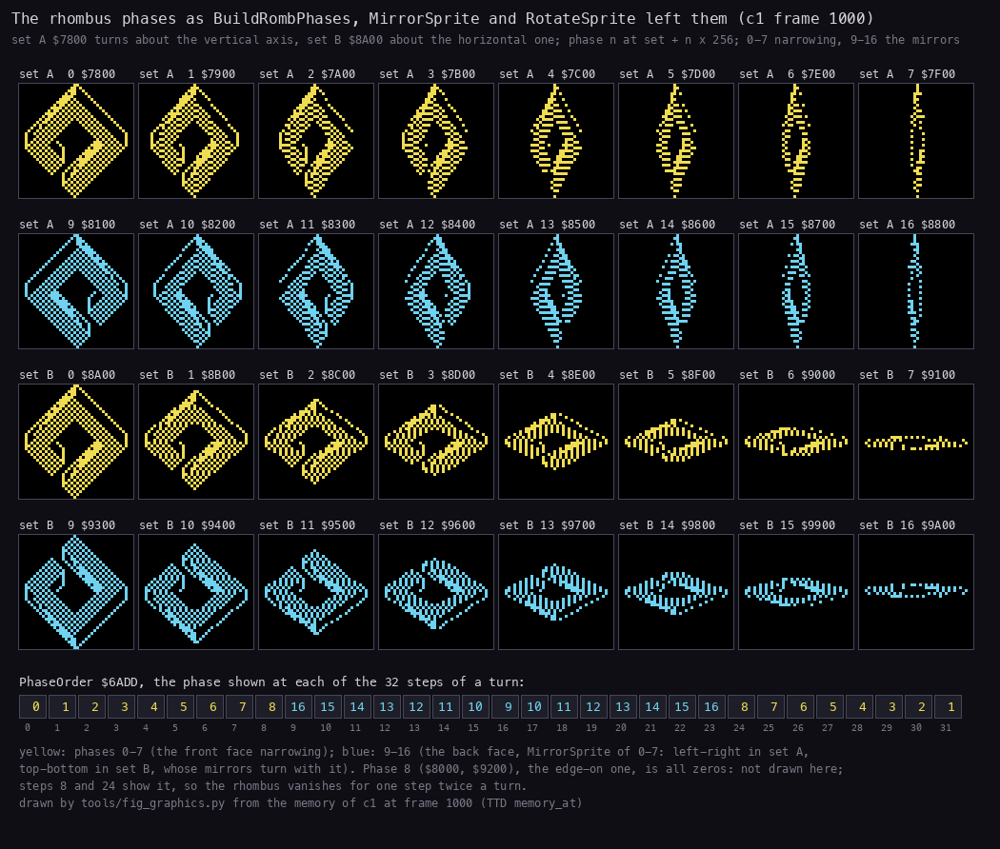

*The 16 non-empty phases of each set and PhaseOrder, from the memory of c1 at frame 1000 (`tools/fig_graphics.py`,
the command under the logo figure).*

How to read it:

- Two rows of 8 per set: phases 0-7 (yellow labels) narrow, phases 9-16 (blue) are their mirrors: left-right in set
  A, top-bottom in set B.
- Set A narrows left to right; set B top to bottom.
- Below: PhaseOrder `$6ADD`, the phase of each of the 32 steps of a turn.

The point: 32 steps from 17 phases. PhaseOrder runs 0-7 (the face turning away), 8 (edge on), 16 down to 10 (the back
face turning in: the mirrors of 7 to 1), 9 (the back face whole), 10-16 (turning away), 8, 7 down to 1, and back to
0: a full revolution, with only one picture per angle.

### PrintRombPhase

```text
PrintRombPhase(HL = screen place, DE = the set, BC = the step's variable):
    D = D + PhaseOrder[step]          # the phase's page
    PrintSprite(DE, HL)
    step = (step + 1) AND 31
```

```text
64DA  LD A,(BC)              ; the step 0-31
64DB  PUSH BC
64DC  LD C,A
64DD  LD B,$00
64DF  LD IX,PhaseOrder
64E3  ADD IX,BC
64E5  LD A,(IX+$00)          ; the phase
64E8  ADD A,D
64E9  LD D,A                 ; the set + phase x 256
64EA  CALL PrintSprite
64ED  POP HL
64EE  LD A,(HL)
64EF  INC A
64F0  AND $1F
64F2  LD (HL),A
64F3  RET
```

Worked example: Start sets PhaseTopRight to 5. On its first print (pass 3) PhaseOrder[5] = 5, so the top-right
rhombus shows set B phase 5 from `$8A00` + 5 x 256 = `$8F00` at screen `$401B`, and its step becomes 6.

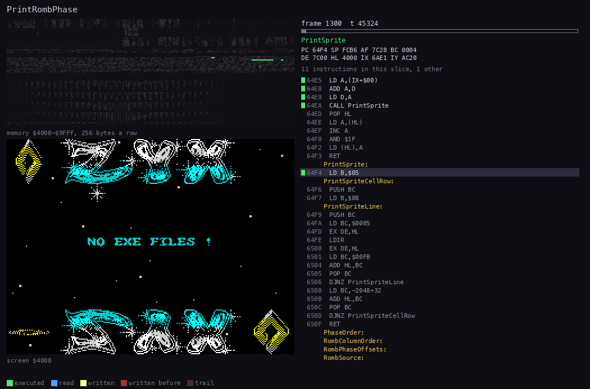

*PrintRombPhase `$64DA` in c1 frame 1300 (T 45 200 to 52 620): one call, 60 pictures. Left above: memory
`$4000-$9FFF` (the screen, then PhasesA `$7800` to MirrorsB); left below: the screen; right: the listing at the PC.
Made with `python3 ../../kit/routine_anim.py --work work/docs/zbA/c1 --window 1300:45200-1300:52620 --listing
build/main.lst --view screen --pc 64DA-650F --range 4000-9FFF --pictures 60 --title PrintRombPhase --out
docs/img/routines/PrintRombPhase.gif`.*

How to read it:

- First PhaseOrder `$6ADD` is read once (the step's phase), then PrintSprite's `LDIR` runs 40 times: a 5-byte read in
  the phases' page and a 5-byte write on the screen each.
- The top-left rhombus on the screen is rewritten from its top line down, a cell row at a time.

The point: a rhombus step is one 200-byte copy, about 7 400 T; the turning was paid for at the start.

The point: the four rhombi share two sets and start 0, 5, 8 and 14 steps apart, so they never look alike; the top
pair turns at twice the bottom pair's rate (4.4).

## 6.4 The star field

The stars are 60 records of 6 bytes in three tables of 20 (`src/res/tables/stars.txt`):

| Offset | What |
| --- | --- |
| +0, +1 | the screen address of the star's byte |
| +2 | the second byte of `RES n,(HL)`: `$86 + 8n` |
| +3 | the second byte of `SET n,(HL)`: `$C6 + 8n` |
| +4 | the second byte of `BIT n,(HL)`: `$46 + 8n` |
| +5 | the pixel under the star: 1 set, 0 clear |

The point: each star carries its bit as three ready-made opcode bytes, so moving it needs no shift or mask.

StarsB is StarsA one pixel row lower, and StarsA's records come in pairs at pixels x and x + 1. So A and B together
draw 10 near stars of 2 x 2 pixels; StarsC holds 20 far stars of 1 pixel. The main loop moves A and B two calls each
on every 2nd pass (1 row a pass) and C once on every 4th pass (a quarter row a pass): two layers at a speed ratio of
4, a parallax.

```text
MoveStars(IX = table):                          # the table is written into the LD IX,nn by MainLoop
    for each of 20 records:
        put back the pixel under the star: SET or RES n,(HL) by +5    # a self-written opcode
        HL = the address one pixel row down (from the bottom row: the top row, same column, H = $40)
        save HL in +0, +1
        SampleStar: +5 = BIT n,(HL)              # the pixel the star now covers
        SET n,(HL)                               # draw the star
```

```text
6482  LD IX,StarsA           ; the operand MainLoop writes
6486  LD B,$14               ; 20 records
6488  PUSH BC                ; MoveStarsNext
6489  LD L,(IX+$00)
648C  LD H,(IX+$01)
648F  LD D,(IX+$02)          ; RES n
6492  LD E,(IX+$03)          ; SET n
6495  LD A,(IX+$05)
6498  CP $01
649A  LD A,D
649B  JR NZ,MoveStarsRestore
649D  LD A,E                 ; the pixel under was set: SET
649E  LD (MoveStarsPutBack+$0001),A
64A1  RES 0,(HL)             ; MoveStarsPutBack: RES or SET n,(HL)
64A3  INC H                  ; one pixel row down
...                          ; the screen's thirds and the wrap to $40
64C1  LD (IX+$00),L
64C4  LD (IX+$01),H
64C7  LD B,$01
64C9  CALL SampleStar        ; +5 = the pixel under
64CC  LD A,(MoveStarsPutBack+$0001)
64CF  SET 6,A                ; RES n -> SET n
64D1  LD (MoveStarsDraw+$0001),A
64D4  SET 0,(HL)             ; MoveStarsDraw
64D6  POP BC
64D7  DJNZ MoveStarsNext
64D9  RET
```

Worked example: a record `00 40 86 C6 46 00` is a star at bit 0 of `$4000` (the 8th pixel of the screen's top line),
over a clear pixel. MoveStars writes `$86` (RES 0) at `$64A2` and clears the bit; moves to `$4100`; reads bit 0 of
`$4100` into +5; turns `$86` into `$C6` with `SET 6,A` and sets bit 0 of `$4100`. Eight moves later it is at `$4020`,
the next character row.

A star passes over the text and the logo without damage: it puts back what it covered. But anything another routine
writes under a star between two moves is lost when the star moves on (a twinkle frame, a new page's text); the next
pass restores the stale pixel. SampleStars, after each page draw, refreshes all 60 records.

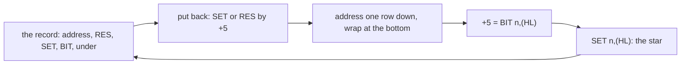

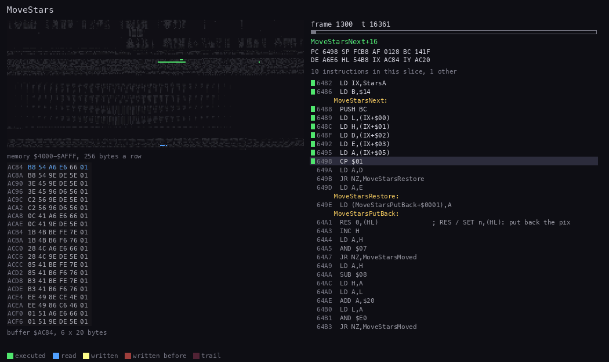

*MoveStars `$6482` on StarsA `$AC84` in c1 frame 1300 (T 16 200 to 25 830), one call, 60 pictures. Left above: memory
`$4000-$AFFF`; left below: the 20 records of StarsA, 6 bytes a line, as numbers; right: the listing at the PC. Made
with `python3 ../../kit/routine_anim.py --work work/docs/zbA/c1 --window 1300:16200-1300:25830 --listing
build/main.lst --view buffer:AC84:6x20:hex --pc 6482-64D9,645E-6481 --range 4000-AFFF --pictures 60 --title
MoveStars --out docs/img/routines/MoveStars.gif`.*

How to read it:

- The records change a line at a time, top to bottom: bytes +0, +1 (the address, one pixel row on) and +5 (the pixel
  now under the star) written, +2 to +4 only read.
- In the listing, `$64A1` (MoveStarsPutBack) and `$64D4` (MoveStarsDraw) are the two opcodes the routine writes before
  it runs them: the code panel shows them as `RES 0,(HL)` / `SET 0,(HL)`, the bytes as assembled; the map shows
  their operand bytes `$64A2` and `$64D5` written (by `$649E` and `$64D1`).
- In the screen part of the map, a dot written at the put-back and another one row lower at the draw, 20 times.

The point: a star costs about 480 T a move (9 630 T for 20 records), of which the self-written opcodes save the
shift and mask a bit-by-number draw would need.

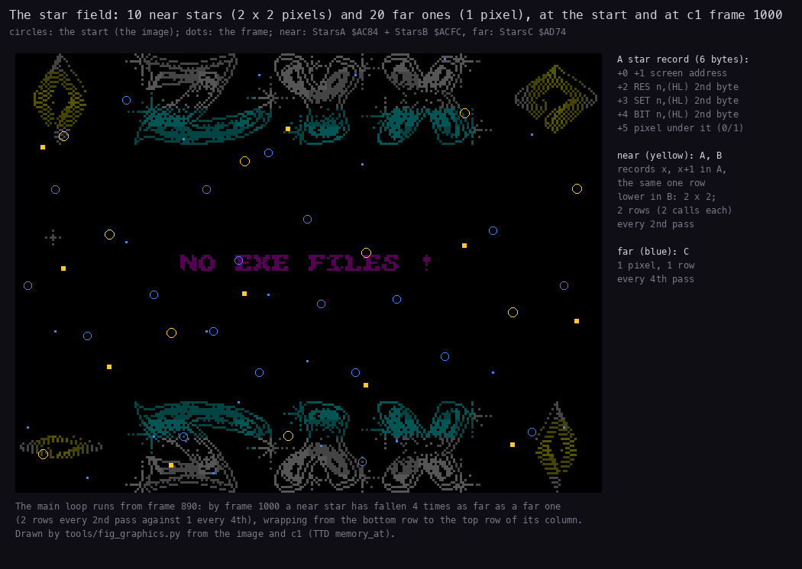

*The 30 stars' places from the image (circles) and in c1 frame 1000 (dots), with the record format
(`tools/fig_graphics.py`).*

How to read it:

- Yellow: the near stars, the pairs of StarsA with StarsB under them; blue: the far stars of StarsC.
- A near star has moved four times as far as a far one since frame 890, wrapping from the bottom to the top.

The point: the stars cost 67 % of the menu's CPU (4.6): 20 records a call, about 6 500 T own and 3 200 T in
SampleStar, 9 700 T a call, 18 calls in 8 passes.

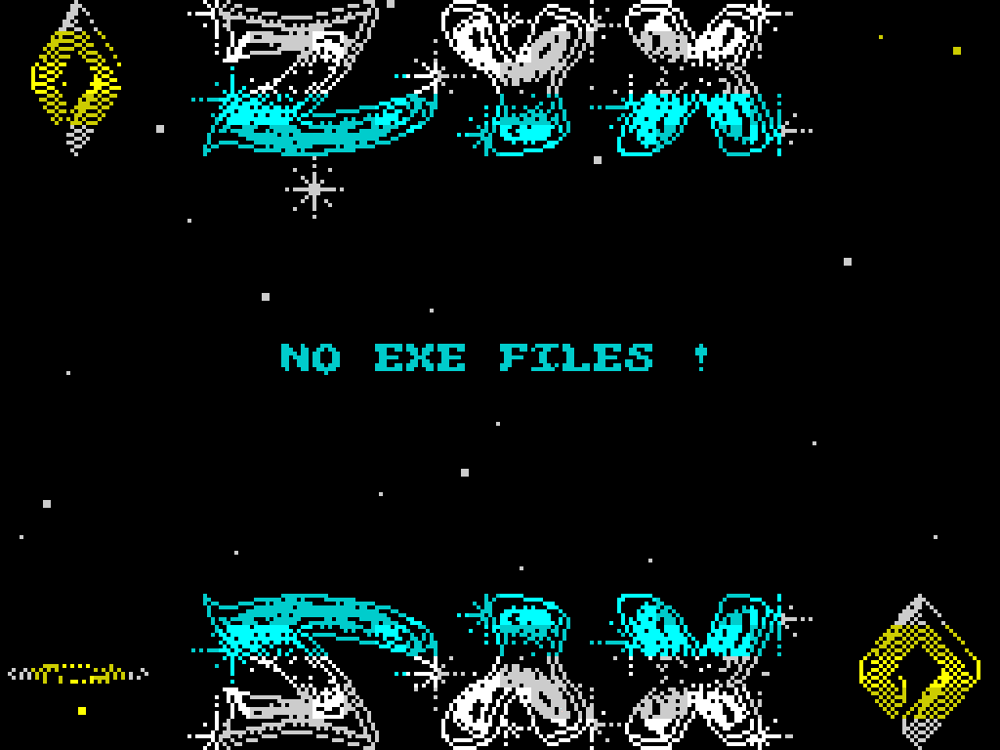

*c1 frames 1300-1430, every 2nd frame, 4 x scale. Made with `python3 ../../kit/screen_anim.py --work
work/docs/zbA/c1 --from 1300 --to 1430 --step 2 --scale 4 --delay 80 --hold 1000 docs/img/play/stars.gif`.*

How to read it:

- The 2 x 2 stars fall a row a pass (about 2 rows a frame); the single-pixel ones a quarter as fast.
- The corner rhombi turn: the top pair twice as fast as the bottom pair.
- Where a twinkle falls inside the window, it grows and shrinks over the logo, its reflection or the middle third.

The point: the movement is smooth but not steady: the passes do not line up with the frames, so a star moves 2 rows
on most frames and 1 or 3 on some.

## 6.5 The twinkle

The twinkle is a 16 x 16 star that grows and shrinks in one place, then goes out and comes back elsewhere. Its four
frames (TwinkleSprites `$6F60`, 32 bytes each, `src/res/graphics/twinkle.png`) are ORed onto the screen; the erase
copies the 2 x 2 cells back from ScreenCopy.

TwinkleStar `$6BA5` runs in the interrupt after TwinkleClock `$DEAC` has gained 2:

```text
TwinkleStar:
    if TwinkleClock = 0: NewRandoms(); return         # 8 new bytes from R, the ROM and MainTick
    if TwinkleClock AND $3F = $3E:                    # the end of a twinkle
        TwinklePause = (TwinklePause + 1) AND 7
        if TwinklePause != 0: TwinkleClock -= 2       # hold here for 8 frames in all
        erase the twinkle (DrawTwinkle with its draw patched to RET)
        return
    if TwinkleClock AND 7 != 2: return                # a new frame every 4 interrupts
    DrawTwinkle:
        place = Randoms pair (TwinkleClock bits 6-7)
        while the place is not allowed (CheckTwinkleSpot): NewRandoms()
        erase the old frame (EraseTwinkle, from ScreenCopy)
        frame = TwinkleClock bits 3-4, counted back down when bit 5 is set
        OR the frame's 16 rows onto the screen
```

```text
6BCB  LD A,(TwinkleClock)    ; TwinkleEnd
6BCE  AND $3F
6BD0  CP $3E
6BD2  JR NZ,TwinkleEvery4
6BD4  LD A,(TwinklePause)
6BD7  INC A
6BD8  AND $07
6BDA  LD (TwinklePause),A
6BDD  JR Z,TwinkleErase
6BDF  LD A,(TwinkleClock)
6BE2  SUB $02                ; hold the clock
6BE4  LD (TwinkleClock),A
6BE7  LD A,$C9               ; TwinkleErase: RET over the draw
6BE9  LD (DrawTwinkleSprite),A
6BEC  CALL DrawTwinkle
6BEF  LD A,$3A
6BF1  LD (DrawTwinkleSprite),A
6BF4  RET
6BF5  LD A,(TwinkleClock)    ; TwinkleEvery4
6BF8  AND $07
6BFA  CP $02
6BFC  RET NZ
6BFD  LD A,(TwinkleClock)    ; DrawTwinkle
6C00  RLCA
6C01  RLCA
6C02  RLCA
6C03  AND $06                ; clock bits 6-7: pair 0-3
...
6C0C  CALL CheckTwinkleSpot
6C0F  PUSH AF
6C10  CALL NC,NewRandoms
6C13  POP AF
6C14  JR NC,DrawTwinkle      ; not allowed: new places, try again
6C16  CALL EraseTwinkle
6C19  LD A,(TwinkleClock)    ; DrawTwinkleSprite
6C1C  AND $20
6C1E  LD C,$60
6C20  JR NZ,DrawTwinkleFrame
6C22  LD C,$00
6C24  LD A,(TwinkleClock)    ; DrawTwinkleFrame
6C27  RLCA
6C28  RLCA
6C29  XOR C                  ; bit 5 set: frames 3 2 1 0
6C2A  AND $60                ; the frame x 32
```

CheckTwinkleSpot `$6C56` (Vadim: `;???`) reads a pair as the low byte of a screen address and a byte whose bits 3-4 pick
the third. It refuses a place on the third's last character row (the low byte `$E0` or more: rows 7, 15 and 23), where
the twinkle's second cell row would wrap to the top of the same third, since the draw steps to the next cell row by
adding `$20` to L only (`$6C4F-$6C52`); and it limits the column: 6-25 in the top and bottom thirds (clear of the
rhombi; mostly over the logo and its reflection, but any character row 0-6 of a third passes, so the twinkle can also
cover rows 5-7 and 16-19, the list's rows 6-7 and 16-17, erased again from ScreenCopy, which holds the list) and 1-30 in
the middle one. Only the low byte and the column are tested (`$6C56-$6C70`): nothing looks at the menu's text. A third
bits `11` (no such third) becomes the middle third.

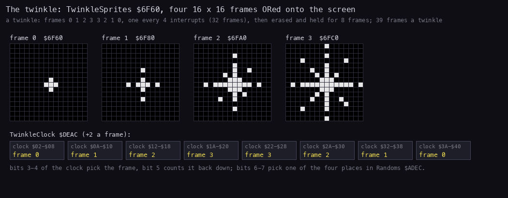

*TwinkleSprites from the image and the frame each clock value draws (`tools/fig_graphics.py`).*

How to read it:

- Top: the four frames, a dot growing into a star with rays.
- Below: TwinkleClock values `$02`-`$3A`, every 8 (4 frames), and the frame each draws: 0 1 2 3, then 3 2 1 0.

The point: a twinkle is 8 draws, lit for 30 frames (clock `$02` to `$3C`), then 9 frames dark (the erase at clock
`$3E`, held 8 frames, then clock `$40`, which draws nothing): 39 frames from one start to the next. The place
comes from 4 pairs refilled every 4 twinkles (at clock 0), from the R register, a walk through the ROM and MainTick.

Worked example, from the code: Randoms holds `44 64 6 72 212 120 73 80` (`src/res/tables/randoms.txt`). At clock
`$02` (pair 0): low byte 44 = `$2C`, third byte 64 = `$40`, bits 3-4 = 0: the top third; the column is 44 AND 31 = 12,
inside 6-25; the low byte is under `$E0`. Allowed: the twinkle is at `$402C`, row 1, column 12, over the logo's Z.

Witness: c1 idle, DrawTwinkle 2053 calls in 5000 frames: 16 a twinkle (8 draws and 8 erases) in 39 frames gives
5000 / 39 x 16 = 2051.

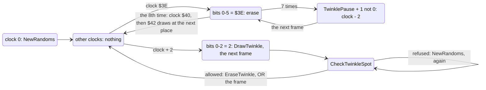

CheckTwinkleSpot refuses 2-3 % of the places tried, each refusal followed by NewRandoms and a new try; which places
were refused is not traced. The stage-1 L1 counts give it: CheckTwinkleSpot `$6C56` runs once a try, EraseTwinkle
`$6C71` once a place accepted.

| Recording | Tries | Accepted | Refused |
| --- | ---: | ---: | ---: |
| c1 | 3 061 | 2 981 | 80 (2.6 %) |
| c2 | 1 346 | 1 305 | 41 |
| c3 | 687 | 663 | 24 |
| c4 | 770 | 756 | 14 |
| idle (5000 frames) | 2 113 | 2 053 | 60 |

NewRandoms `$6BAB` runs 126 times in c1: the 80 retries and about 46 refills at clock 0 (frames 543-7879, one refill a
round of 4 twinkles, 156 frames: 47).

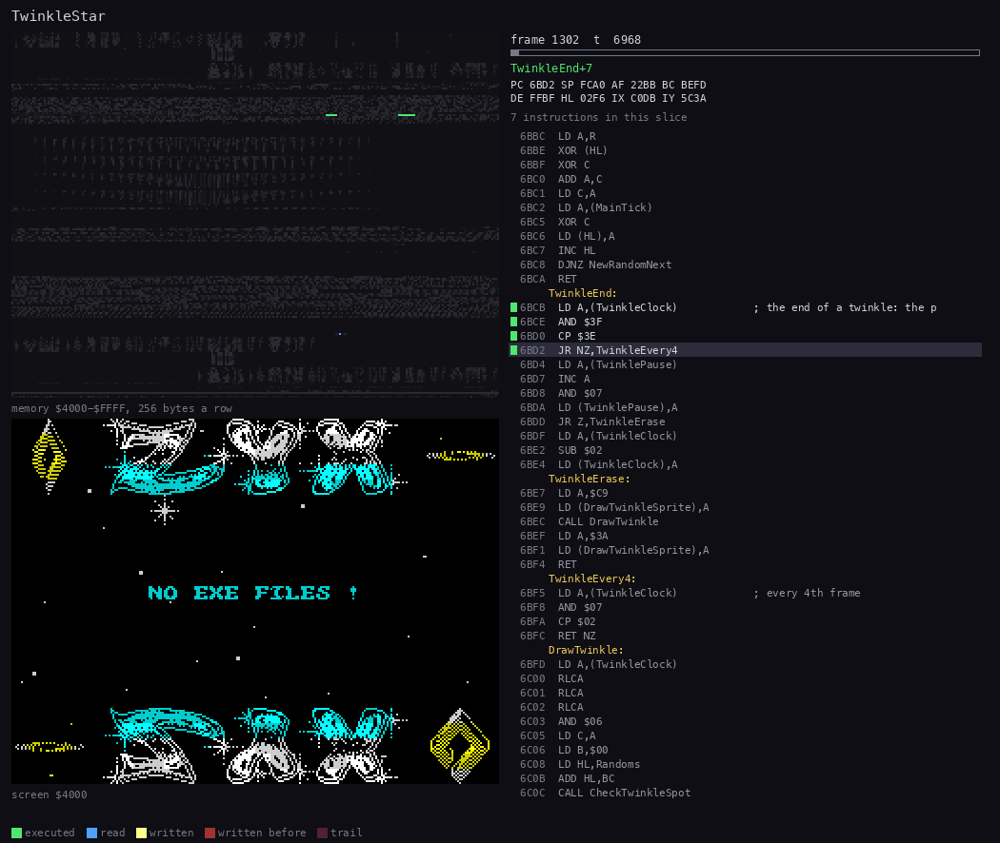

*TwinkleStar `$6BA5` in c1 frame 1302 (T 6 900 to 10 930), a draw frame: 60 pictures. Left above: memory
`$4000-$FFFF`; left below: the screen; right: the listing at the PC. Made with `python3 ../../kit/routine_anim.py
--work work/docs/zbA/c1 --window 1302:6900-1302:10930 --listing build/main.lst --view screen --pc 6BA5-6CBE --range
4000-FFFF --pictures 60 --title TwinkleStar --out docs/img/routines/TwinkleStar.gif`.*

How to read it:

- First the clock tests, then DrawTwinkle: Randoms `$ADEC` read (a blue dot in the map), CheckTwinkleSpot.
- EraseTwinkle copies the 2 x 2 cells' 16 rows from ScreenCopy `$E000` (reads high in the map) to the screen.
- DrawTwinkleRow ORs the frame's 32 bytes from TwinkleSprites `$6F60` onto the screen, row by row, below the logo's Z.

The point: a twinkle frame costs about 4 000 T in the interrupt (T 6 903 to 10 927): a check, a 32-byte copy and a
32-byte OR.

## 6.6 The glint

On Frames 0-52 of each 256-frame cycle, LogoGlint `$6D04` sweeps two red diagonals across the logo's attributes, one
from each side, crossing in the middle; on alternate cycles it does the same on the reflection.

```text
LogoGlint:
    if Frames low >= 64: return
    rows = 0-4 (the logo) if Frames high is even, 19-23 (the reflection) if odd    # self-written addresses
    if Frames low = 0: the logo's two outer top cells (columns 6 and 25) = red; return
    if Frames low is odd: return
    c = Frames low / 2; if c >= 27: return
    for each of the 5 rows, from the bottom up, c = c + 1 each row:
        put back the 3 cells at column c - 1 and their mirror at 31 - (c - 1) from ScreenCopy
        cells c, c + 1, c + 2 = red, bright red, red; the same mirrored at 31 - c   # only inside columns 6-25
```

```text
6D04  LD A,(Frames)
6D07  CP $40
6D09  RET NC
6D0A  LD HL,Attributes+6     ; the top logo's corners and rows
...
6D1C  LD A,(Frames+1)        ; GlintHalf
6D1F  AND $01
6D21  JR Z,GlintStart
6D23  LD HL,Attributes+614   ; the reflection's
...
6D44  AND $01                ; GlintStep
6D46  RET NZ
6D47  LD A,(Frames)
6D4A  RRCA
6D4B  AND $1F
6D4D  CP $1B
6D4F  RET NC
6D50  LD C,A
6D51  LD B,$05
6D53  LD HL,Attributes+128   ; GlintRowStart: the bottom logo row
6D56  DEC C                  ; GlintRow
6D57  CALL RestoreGlintCells
6D5A  INC C
6D5B  CALL DrawGlintRow
6D5E  INC C
...                          ; HL = HL - 32: the row above
6D67  DJNZ GlintRow
```

GlintRed and GlintBright write `$02` and `$42` (red ink, then bright red) only in columns 6-25, so the diagonal is
clipped to the logo.

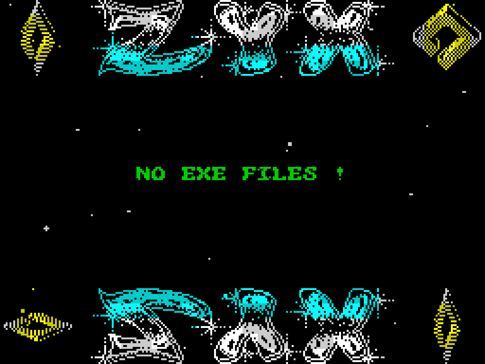

*c1 frames 1055-1112, every 2nd frame, 4 x scale: Frames low 255 to 56 of the cycle that starts at frame 1056 (Frames
`$0200`). Made with `python3 ../../kit/screen_anim.py --work work/docs/zbA/c1 --from 1055 --to 1112 --step 2 --scale
4 --delay 120 --hold 1500 docs/img/play/glint.gif`.*

How to read it:

- First the two top corners of the logo turn red (Frames 0).
- Then a red diagonal enters from each side, its top row 4 cells ahead of its bottom row, so the two lean inward
  like the sides of a roof; they meet in the middle and pass each other.
- At the end NO EXE FILES ! turns (the spin starts at Frames 50).

The point: a glint is 26 steps, Frames 2-52, after the corner cells at Frames 0, of pure attribute work: 4 368-4 968 T a
step (4 968 on the middle ones, Frames 12-38, where no cell is clipped; 4 488 at Frames 2 and 48, 4 368 at Frames 52; c2
interrupt profile, 4.5), no pixel touched. The last two steps are almost empty: Frames 50 paints two cells (row 4,
columns 25 and 6), Frames 52 none (GlintRed and GlintBright clip every cell at column 26 or more, or 5 or less) and only
puts back the step before.

Worked example, Frames low 20 (c = 10): the bottom row (row 4) gets red at columns 10 and 12, bright red at 11, and
the mirror at 21, 20 and 19; row 3 at 11-13 and 18-20; row 0 at 14-16 and 15-17 mirrored: the two stripes overlap on
the top row.

Witness: c1 frame 1075 (Frames low 19) shows the stripes ([screens](img/overview/screens.png), picture 3); c1 frame
1106 is Frames `$0232`, high byte 2: the top logo, and the next cycle (from frame 1312) the reflection.

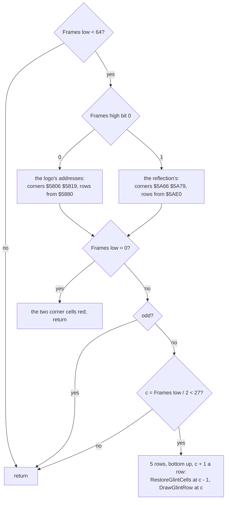

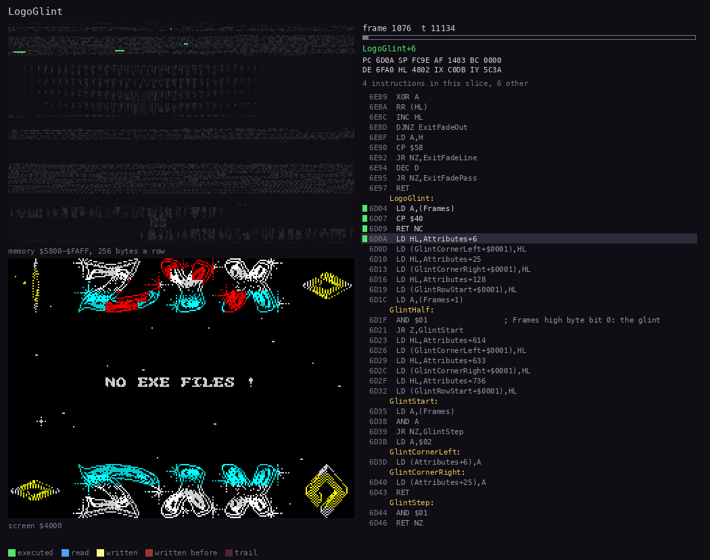

*LogoGlint `$6D04` in c1 frame 1076 (Frames `$0214`: low 20, c = 10), T 11 050 to 16 080, 60 pictures. Left above:
memory `$5800-$FAFF` (the attributes at the top, ScreenCopy's at the bottom); left below: the screen; right: the
listing at the PC. Made with `python3 ../../kit/routine_anim.py --work work/docs/zbA/c1 --window 1076:11050-1076:16080
--listing build/main.lst --view screen --pc 6D04-6DC5 --range 5800-FAFF --pictures 60 --title LogoGlint --out
docs/img/routines/LogoGlint.gif`.*

How to read it:

- Five rounds of the listing, one a row from row 4 up: RestoreGlintCells reads ScreenCopy's attributes (`$F800` on,
  at the bottom of the map) and writes the screen's, then DrawGlintRow writes red and bright red.
- On the screen the two stripes move one cell in from each side compared with the step before: the worked example's
  cells.

The point: this step takes about 5 000 T (T 11 101 to 16 069) of attribute reads and writes: 30 cells painted and 30
put back.

## 6.7 The corner colours

ColourCorners `$6CBF` (Vadim's `FadeATTR`) colours the 5 x 5 attribute cells under each rhombus from the five
CornerColours `$ADF4` (`$07 $06 $46 $06 $07`: white, yellow, bright yellow, yellow, white;
`src/res/tables/corner-colours.txt`):

```text
ColourCorners:
    ColourCornerRows($5800)       # top left: row n all CornerColours[n]
    ColourCornerRows($5A7B)       # bottom right
    ColourCornerColumns($581B)    # top right: every row the five colours, column n CornerColours[n]
    ColourCornerColumns($5A60)    # bottom left
```

```text
6CBF  LD HL,Attributes
6CC2  CALL ColourCornerRows
6CC5  LD HL,Attributes+635   ; $5A7B
6CC8  CALL ColourCornerRows
6CCB  LD DE,Attributes+27    ; $581B
6CCE  CALL ColourCornerColumns
6CD1  LD DE,Attributes+608   ; $5A60
6CD4  CALL ColourCornerColumns
6CD7  RET
6CD8  LD B,$05               ; ColourCornerRows
6CDA  LD DE,CornerColours
6CDD  LD C,$05               ; CornerRowsNext
6CDF  LD A,(DE)
6CE0  LD (HL),A              ; CornerRowsCell: 5 cells of one colour
...
6CEF  LD B,$05               ; ColourCornerColumns
6CF1  PUSH BC
6CF2  LD BC,$0005
6CF5  LD HL,CornerColours
6CF8  LDIR                   ; the 5 colours across
```

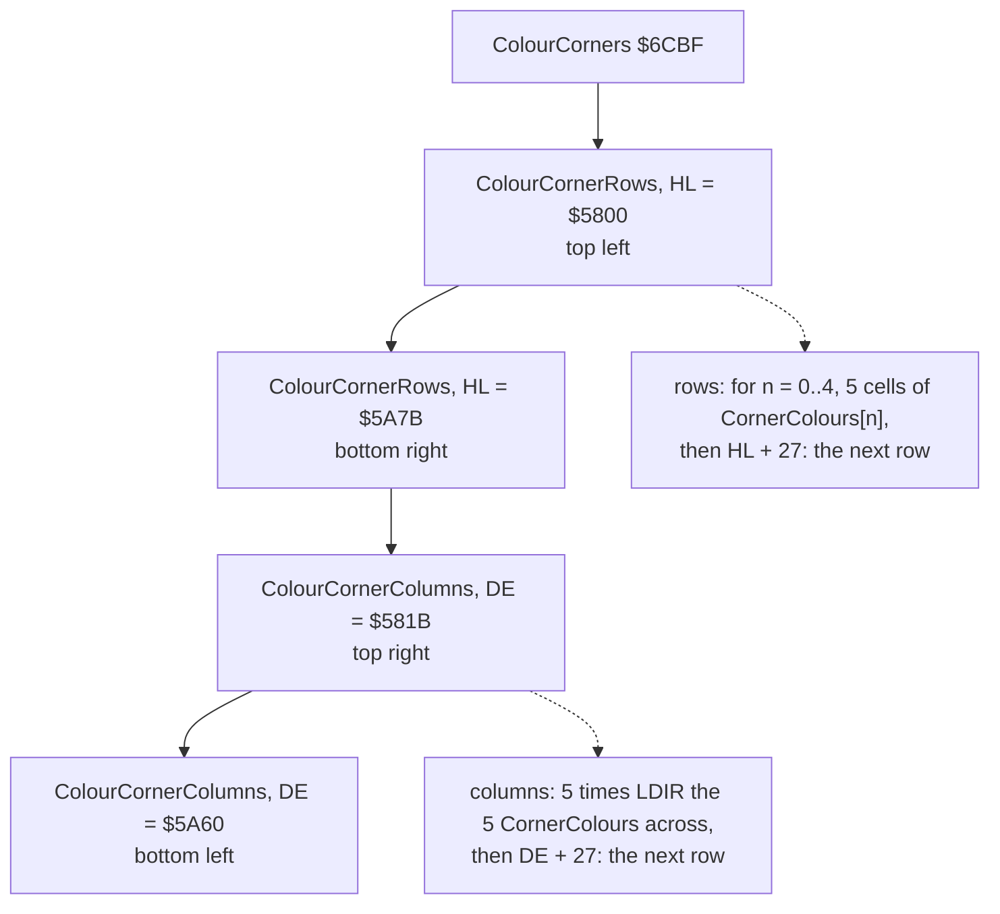

Worked example: the top-right corner starts at `$581B` (row 0, column 27). Its cell `$581D` is row 0, column 29, the
third cell of the first LDIR: CornerColours[2] = `$46`, bright yellow ink on black. The bottom-right corner starts at
`$5A7B` (row 19, column 27); its row 21 (`$5ABB-$5ABF`, n = 2) is all `$46`, and its row 19 all `$07` (white). So the
same middle colour runs down column 29 at the top right and across row 21 at the bottom right.

Witness: [corners](img/graphics/corners.png), read from c1 frame 1000: `$46` down the middle column of the top-right
and bottom-left corners and across the middle row of the other two; ColourCorners runs once, inside DrawScreen (c1
frame 533, stage-1 L1).

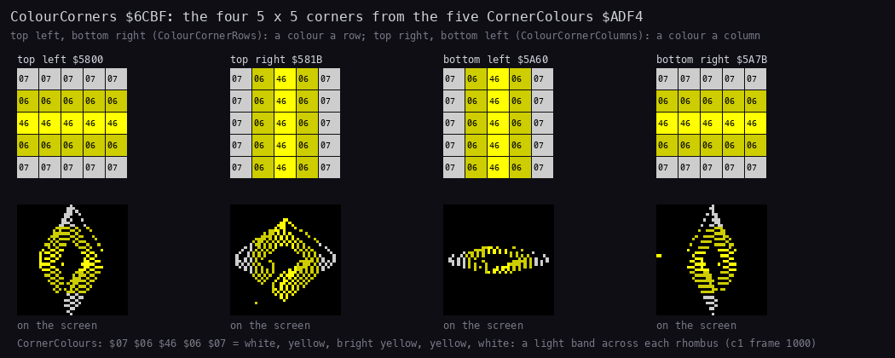

*The four corners' attributes in c1 frame 1000, each cell with its value, and as they look (`tools/fig_graphics.py`).*

How to read it:

- Top left and bottom right: a band of bright yellow across the middle row: the colour changes by row.
- Top right and bottom left: the band down the middle column: the colour changes by column.

The point: the bands follow the rhombi's axes. The set A rhombi (top left, bottom right) narrow left to right and get
a horizontal band; the set B ones narrow top to bottom and get a vertical band. Each band stays across the middle of
a turning rhombus.

The `.ann` header of module fade and the comment of `src/res/tables/corner-colours.txt` once said "the left corners
a colour a row, the right ones a colour a column". The code and Vadim's comments ("ATTR left up", "right down" for
Fade1ATTR) say rows for top left and bottom right, and both now say so.

## 6.8 ScreenCopy: the clean screen

ScreenCopy `$E000` (pixels `$E000-$F7FF`, attributes `$F800-$FAFF`) is the screen as DrawScreen and ShowCatalogue
made it: the logo, the reflection, the phase-0 rhombi, the corners, the page of names. The interrupt's effects (the
twinkle's erase, the glint's put-back, the spin) restore from it or work in it; the main loop's stars and rhombi
never touch it.

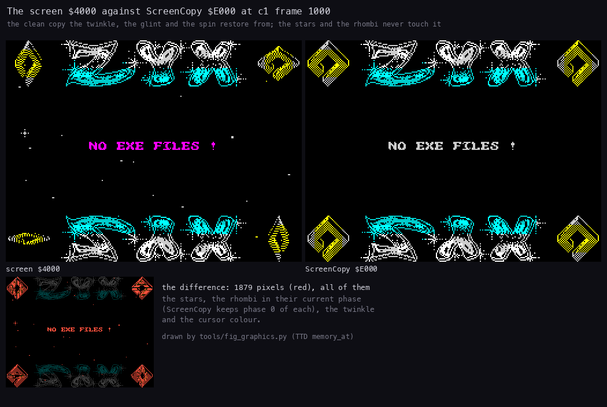

*The screen `$4000` and ScreenCopy `$E000` at c1 frame 1000, and the pixels whose colour differs (`tools/fig_graphics.py`).*

How to read it:

- Above: the screen and the copy; below: the red pixels are those whose colour differs between the screen and the
  copy (NO EXE FILES ! is in both: it differs only in its cursor colour).
- All the differences are the stars, the rhombi in their current phase (the copy keeps phase 0), the twinkle and the
  cursor colour.

The point: one 6.75 K buffer lets three effects that write over the text (the twinkle, the glint, the spin) undo
their own work without knowing what else is on the screen.

Who writes the screen over a few frames:

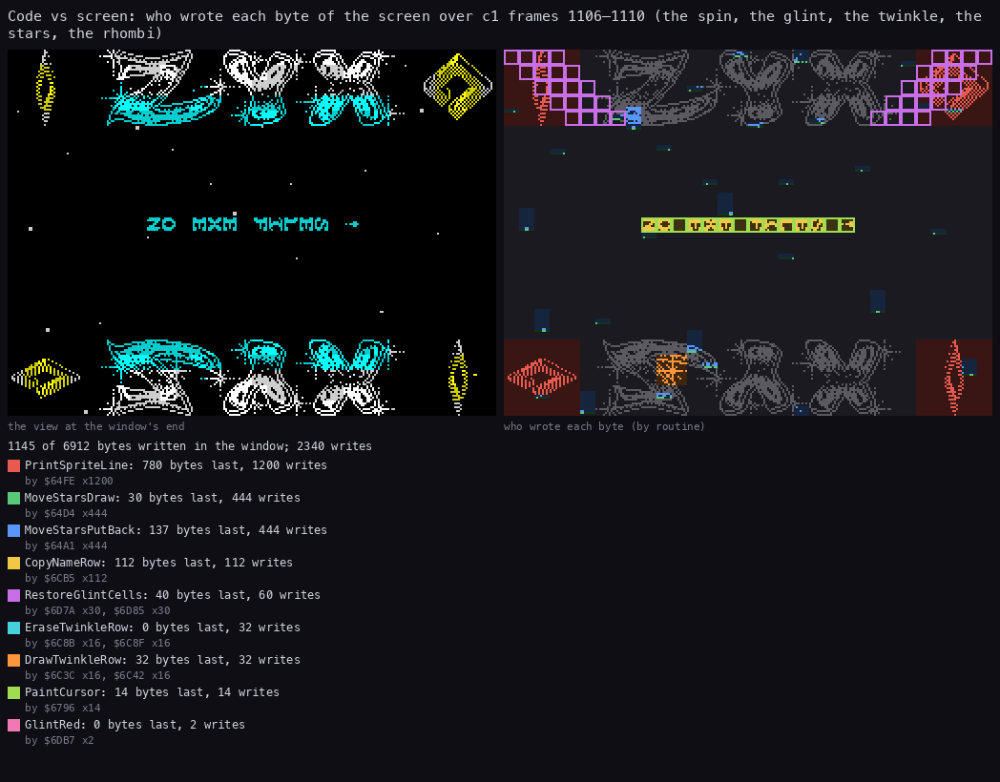

*Every screen byte written over c1 frames 1106-1110, coloured by the routine that wrote it last. Made with `python3
../../kit/writers_map.py --work work/docs/zbA/c1 --window 1105:71600-1110:71600 --listing build/main.lst
--listing build/music.lst --view screen --title "Code vs screen: who wrote each byte of the screen over c1 frames
1106–1110 (the spin, the glint, the twinkle, the stars, the rhombi)" --out docs/img/graphics/writers.png`.*

How to read it:

- Red, the corners: PrintSpriteLine, the rhombi (780 bytes, 1200 writes).
- Green and blue dots: MoveStarsDraw and MoveStarsPutBack, the stars falling (444 writes each).
- Yellow, the middle: CopyNameRow, NO EXE FILES ! turned a quarter (the spin of frame 1106).
- Purple, a staircase of cells along the top: RestoreGlintCells putting back the glint's last steps (Frames 50 and 52).
  The put-back is not clipped to columns 6-25 like the paint, so it also rewrites corner cells, with the values they
  already hold.
- Orange, in the reflection: DrawTwinkleRow; light green, the name's attributes: PaintCursor.

The point: in five frames nine routines share the screen with no double buffer: each owns its area or restores from
ScreenCopy.

## 6.9 Known only from the code

- The edge line of phase 8: never drawn by any of the recorded disks, since RombColumnOrder has no entry of `$40`
  or more; a variant with flagged entries would show it.
- The star wrap from the bottom row to the top row of the same column (`$40` + the column, `$64B5-$64BF`): seen as stars reappearing at the top in [stars.gif](img/play/stars.gif),
  not traced instruction by instruction.

## 6.10 The point

The graphics are a few general routines (PrintSprite, MirrorSprite, RotateSprite) applied to a handful of 40 x 40
sprites, with every costly step done once at the start: 34 rhombus phases and a reflected logo. What runs every frame
is cheap per object and leans on two tricks: stars that carry their own bit opcodes and remember the pixel they cover,
and a clean copy of the screen that every interrupt effect restores from.
