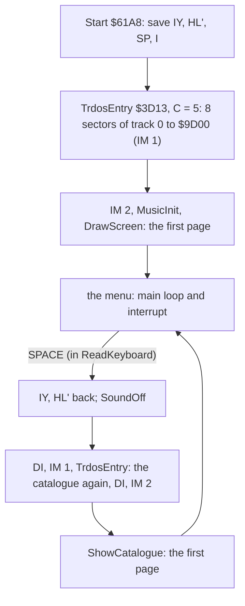
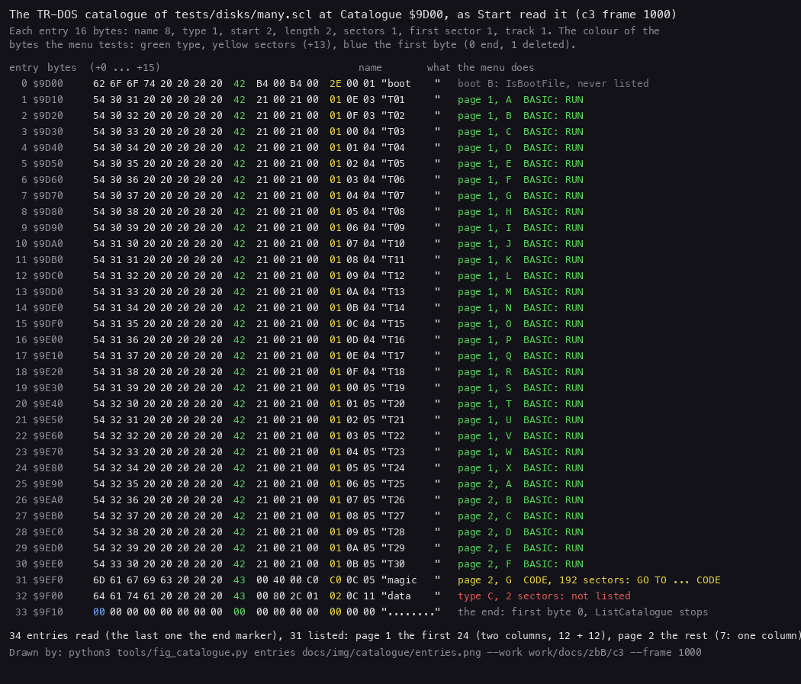
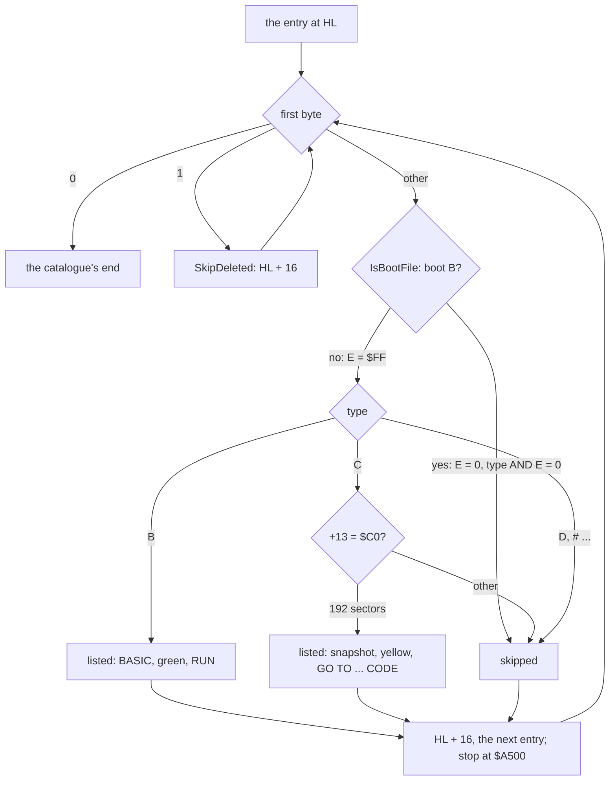
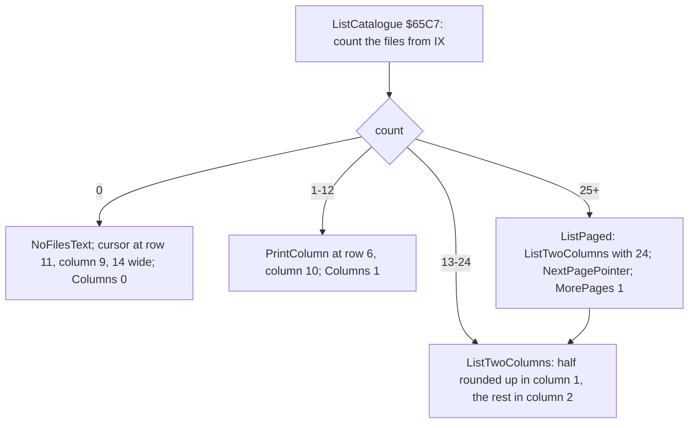
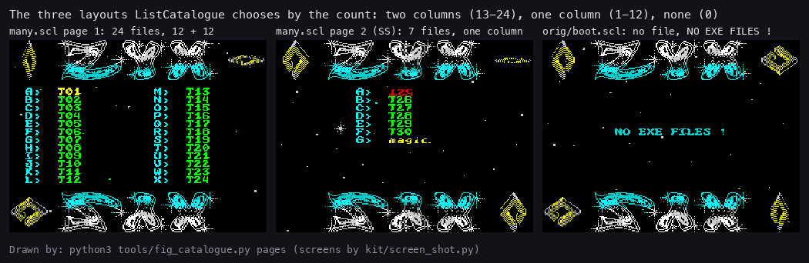
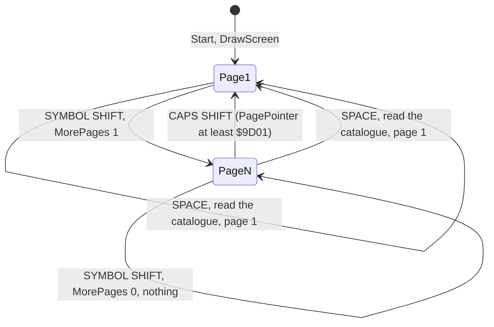
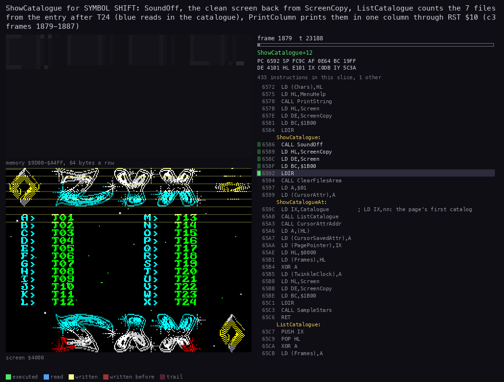
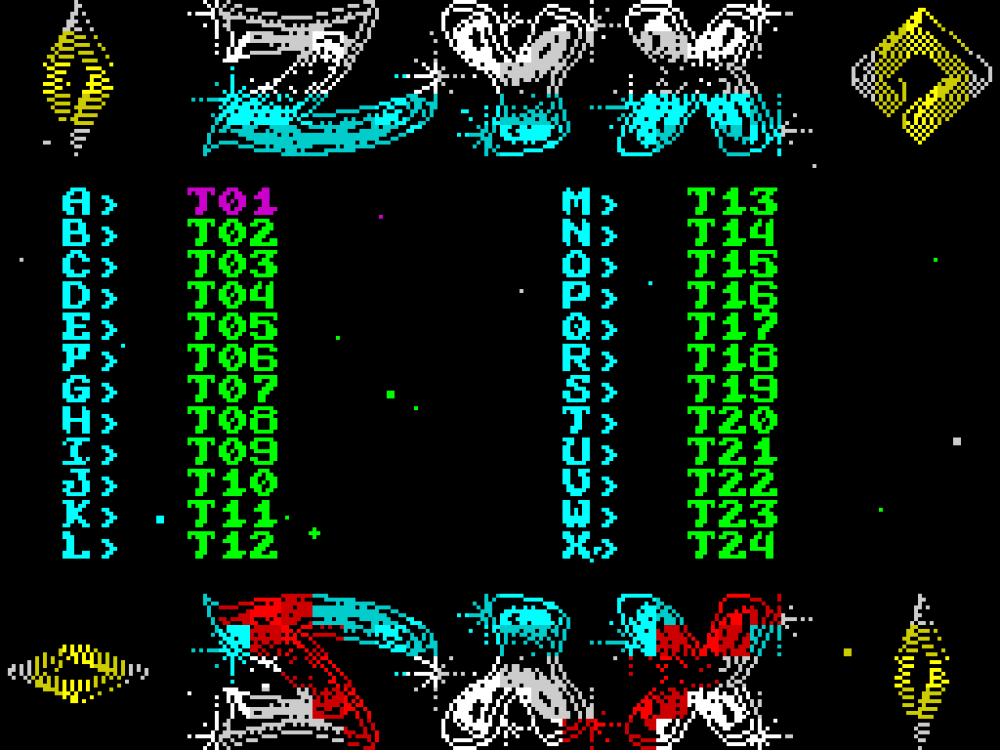
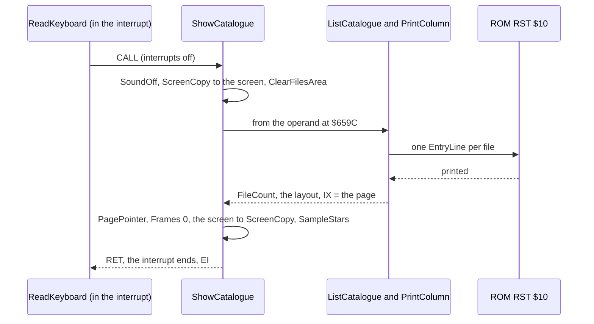
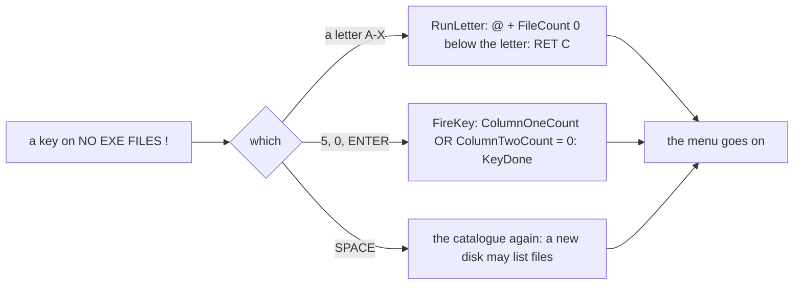

# 7. The catalogue and the menu

What this covers:

- how the menu reads the disk's TR-DOS catalogue, at the start and again for SPACE (7.1);
- which entries it lists: BASIC files, and CODE files of exactly 192 sectors, never `boot` (7.2);
- the count and the three layouts: no file, one column (1-12), two columns (13-24) (7.3);
- the catalogue line each name is printed as (7.4);
- the pages: 24 files a page, SYMBOL SHIFT for the next, CAPS SHIFT for the first (7.5);
- ShowCatalogue, the page draw, and what it costs (7.6);
- NO EXE FILES ! and the keys that then do nothing (7.7);
- what is known only from the code (7.8) and the point (7.9).

The names are those of `src/main/main.ann` (modules catalogue, screen, keys). Vadim's 2010 decompilation
(`work/stage1/ZYXboot.utf8.mac`) already reads this part well: his `ClcFilesPrintCAT`, `RowPrintFiles`, `RefreshScr`
and `bootB?` are ListCatalogue, PrintColumn, ShowCatalogueAt and IsBootFile here. One reading differs (7.2): his
comment at the `CP 0C0H` says "if length >= C000 then is a magic file"; the code tests the sector count for exactly
192.

The recordings are those of [WALKTHROUGH 1](../WALKTHROUGH.md#1-one-recording-from-power-on), on a Pentagon 128K,
reopened from their TTD sessions on this writer's own instance (port base 37450, muted):

- c1: `orig/boot.scl`, which holds only `boot`: NO EXE FILES !, SPACE at frame 6430;
- c2: `tests/disks/many.scl`: SYMBOL SHIFT, SYMBOL SHIFT again, CAPS SHIFT, the cursor keys, ENTER on T03;
- c3: `tests/disks/many.scl`: SYMBOL SHIFT at frame 1879 (page 2), then F at frame 2182 (T30);
- c4: `tests/disks/noexe.scl`: NO EXE FILES !, then A (frame 1879) and ENTER (frame 1983).

The test disks come from `tools/mktestdisk.py`. `many.scl` holds `boot`, 30 BASIC programs `T01`-`T30`, `magic` (CODE,
`$C000` bytes: 192 sectors) and `data` (CODE, 300 bytes: 2 sectors). `noexe.scl` holds `boot`, `screen` (CODE, 6912
bytes: 27 sectors) and `data` (CODE, 300 bytes).

## 7.1 Reading the catalogue

A TR-DOS disk keeps its catalogue on track 0, sectors 0-7: 128 entries of 16 bytes. Sector 8 holds the disk's own
data (free space, the number of files); the menu does not read it. An entry:

| Offset | Bytes | What | The menu reads it? |
| --- | ---: | --- | --- |
| +0 | 8 | the name, padded with spaces; a first byte 0 ends the catalogue, 1 marks a deleted file | yes |
| +8 | 1 | the type: `B` BASIC, `C` CODE, `D` data, `#` stream | yes |
| +9 | 2 | the start (CODE) or the program and variables length (BASIC) | no |
| +11 | 2 | the length in bytes | no |
| +13 | 1 | the length in sectors | yes, for CODE |
| +14 | 1 | the first sector | no |
| +15 | 1 | the first track | no |

Start reads the whole catalogue once, before it sets up IM 2, through the TR-DOS ROM's entry for machine code,
TrdosEntry `$3D13` with C = 5 (read sectors): B = 8 sectors, D = track 0, E = sector 0, HL = Catalogue `$9D00`.
It is still in IM 1 then, with the caller's IY and HL' in place, which the TR-DOS ROM and the 48K ROM's interrupt need.

SPACE reads it again (a new disk in the drive). The menu runs in IM 2 by then, and the key is read inside the
interrupt handler ([doc 5](05-keys.md)). So ReadKeyboard puts back IY and HL', silences the AY, and switches to IM 1
around the read, then back to IM 2. Then it draws the first page.

```text
Start:
    save IY, HL', SP, I
    trdos_read(track 0, sector 0, 8 sectors) -> Catalogue      ; IM 1, the caller's IY and HL'
    ... IM 2, the music, DrawScreen (which lists the first page)

ReadKeyboard, on SPACE:
    HL' = SavedHLAlt; IY = SavedIY
    SoundOff()
    DI; IM 1; trdos_read(track 0, sector 0, 8 sectors) -> Catalogue; DI; IM 2
    ShowCatalogue()                                              ; the first page of the new disk
```

```text
61B9  11 00 00     LD DE,$0000             ; Start: track 0, sector 0
61BC  21 00 9D     LD HL,Catalogue         ; $9D00
61BF  01 05 08     LD BC,$0805             ; B = 8 sectors, C = 5: read
61C2  CD 13 3D     CALL TrdosEntry         ; $3D13, still IM 1
...
68F4  2A CA AF     LD HL,(SavedHLAlt)      ; ReadKeyboard, SPACE pressed
68F7  D9           EXX
68F8  FD 2A C8 AF  LD IY,(SavedIY)         ; the ROM's IY and HL' back
68FC  CD 41 6E     CALL SoundOff
68FF  21 00 9D     LD HL,Catalogue
6902  11 00 00     LD DE,$0000
6905  01 05 08     LD BC,$0805
6908  F3           DI
6909  ED 56        IM 1                    ; the ROM's interrupt for TR-DOS
690B  CD 13 3D     CALL TrdosEntry
690E  F3           DI
690F  ED 5E        IM 2
6911  CD 86 65     CALL ShowCatalogue      ; the first page
```





*The catalogue of `tests/disks/many.scl` at Catalogue `$9D00` in c3 frame 1000, read with TTD `memory_at` on the
c3 instance. Command: `python3 tools/fig_catalogue.py entries docs/img/catalogue/entries.png --work work/docs/zbB/c3
--frame 1000`.*

How to read it:

- Each row is one 16-byte entry: its index, its address, its bytes, its name.
- The coloured bytes are the ones the menu tests: the type (+8, green), the sectors (+13, yellow) and a first byte 0
  or 1 (blue).
- The right column is the verdict of ListCatalogue and PrintColumn: the page and the letter for a listed file, or why
  the entry is skipped.

The point: the menu needs only bytes +0, +8 and +13 of an entry, and the name. Everything else in the catalogue
(starts, lengths, places on the disk) stays TR-DOS's business, used when TR-DOS runs the file.

Worked example, entry 1 at `$9D10`: `54 30 31 20 20 20 20 20` is `T01` and five spaces; `42` is `B`; `21 00` twice is
33 bytes (the program and the length); `01` is 1 sector; `0E 03` is sector 14 of track 3. Entry 31 at `$9EF0`: `magic`,
`43` (`C`), start `$4000`, length `$C000`, `C0` = 192 sectors.

Witness: c1 Start at frame 516 and MusicInit at 532, so the read lies between them; SPACE's second read in c1 ends
with ShowCatalogue's call at frame 6436 (L1: ShowCatalogue's two entries, frames 536 and 6436). The memory is c3's at
frame 1000.

## 7.2 Which files are listed

ListCatalogue, PrintColumn and RunLetter walk the catalogue with the same test. Each entry is either skipped or
listed:

- a first byte 0 ends the walk;
- a first byte 1 is a deleted file: SkipDeleted `$674D` steps 16 bytes and tries again;
- `boot    B` (BootName `$6B6B`, the name and the type) is the menu itself: never listed;
- type `B` is listed, in green: TR-DOS will RUN it;
- type `C` is listed only when byte +13 is `$C0`, 192 sectors, in yellow: TR-DOS will GO TO it as CODE
  ([doc 10](10-launcher-and-notes.md));
- every other entry (`C` of another size, `D`, `#`) is skipped.

A CODE file of 192 sectors is a 48K snapshot made with the Magic button of a Beta Disk interface: the `$4000-$FFFF`
image (48K = 192 x 256) saved with its registers, which TR-DOS's `GO TO "name" CODE` restores and runs.

IsBootFile `$6737` hides the boot without a branch at the call. It compares the 9 bytes of the name and type with
BootName and returns E = 0 if they match, `$FF` if not. The caller ANDs the type byte with E: for `boot` the type reads
0, which is neither `B` nor `C`. Vadim saw the same ("e=0 if boot.B, FF if any other name").

```text
listed(entry):
    if entry.name_and_type == "boot    B": return none     ; type AND 0 = 0
    if entry.type == 'B': return BASIC                       ; green, RUN
    if entry.type == 'C' and entry.sectors == 192: return SNAPSHOT   ; yellow, GO TO ... CODE
    return none

count_files(first):                                          ; ListCatalogue's loop
    count = 0
    entry = first
    loop:
        while entry.name[0] == 1: entry += 16                ; SkipDeleted
        if entry.name[0] == 0: break                         ; the catalogue's end
        if listed(entry): count += 1
        entry += 16
        if entry == $A500: break                             ; 128 entries
    return count
```

```text
65D0  7E           LD A,(HL)               ; CountNext: the entry's first byte
65D1  CD 4D 67     CALL SkipDeleted        ; 1: on to the next entry
65D4  A7           AND A
65D5  28 22        JR Z,CountDone          ; 0: the catalogue's end
65D7  CD 37 67     CALL IsBootFile         ; HL = +8 (the type), E = 0 for boot
65DA  7E           LD A,(HL)
65DB  A3           AND E                   ; the boot's type reads 0
65DC  FE 42        CP $42                  ; "B"
65DE  20 01        JR NZ,CountCode
65E0  14           INC D                   ; a BASIC file
65E1  FE 43        CP $43                  ; CountCode: "C"
65E3  F5           PUSH AF
65E4  01 05 00     LD BC,$0005
65E7  09           ADD HL,BC               ; HL = +13, the sectors
65E8  F1           POP AF
65E9  20 06        JR NZ,CountSkip
65EB  7E           LD A,(HL)
65EC  FE C0        CP $C0                  ; exactly 192 sectors
65EE  20 01        JR NZ,CountSkip
65F0  14           INC D                   ; a snapshot
65F1  23 23 23     INC HL x 3              ; CountSkip: the next entry (+16)
65F4  7C           LD A,H
65F5  FE A5        CP $A5                  ; past $A4FF: 128 entries read
65F7  20 D7        JR NZ,CountNext
...
6737  D5           PUSH DE                 ; IsBootFile
6738  0E 00        LD C,$00
673A  06 09        LD B,$09                ; 9 bytes: the name and the type
673C  11 6B 6B     LD DE,BootName          ; "boot    B"
673F  1A           LD A,(DE)
6740  BE           CP (HL)
6741  28 02        JR Z,IsBootSame
6743  0E FF        LD C,$FF                ; one byte differs: not the boot
6745  23           INC HL
6746  13           INC DE
6747  10 F6        DJNZ IsBootNext
6749  D1           POP DE
674A  59           LD E,C                  ; E = 0 for the boot, $FF for any other
674B  2B           DEC HL                  ; HL = +8, the type
674C  C9           RET
674D  FE 01        CP $01                  ; SkipDeleted
674F  C0           RET NZ
6750  01 10 00     LD BC,$0010
6753  09           ADD HL,BC
6754  7E           LD A,(HL)
6755  18 F6        JR SkipDeleted
```



Worked examples, from the figure above:

| Entry | Name | Type | +13 | Verdict |
| --- | --- | --- | --- | --- |
| 0 | `boot` | `42` B | `2E` (46) | IsBootFile: E = 0, type AND 0 = 0: skipped |
| 1 | `T01` | `42` B | `01` | listed, green, letter A of page 1 |
| 31 | `magic` | `43` C | `C0` (192) | listed, yellow, letter G of page 2 |
| 32 | `data` | `43` C | `02` | skipped |
| 33 | (zeros) | | | first byte 0: the end |

Where this case and Vadim differ: his comment at `$66AF` ("if length >= C000 then is a magic file") reads the test as
a length check. The test is `CP $C0` / `JR NZ` on byte +13, the sector count. So:

- a CODE file of 193 sectors or more is not listed;
- a CODE file of length `$BF01` to `$C000` is 192 sectors and is listed;
- the length field (+11) is never read.

Witness: c2 and c3 list T01-T30 and `magic` and not `data` (the figure, and the screens of 7.3). c4 lists nothing from
`noexe.scl`, whose `screen` (27 sectors) and `data` (2) are CODE files of other sizes (7.7). c5 (`tests/disks/deep.scl`,
WALKTHROUGH 6.0) holds a deleted entry: T05's first byte is `$01` (`$9D50`, TTD `memory_at` at c5 frame 1500), and page
1 lists T04 then T06 (the screen from c5 frame 1000): SkipDeleted steps over it. Its other use, by RunLetter, is seen
in c3 ([doc 10](10-launcher-and-notes.md)). c5 also lists `magic` on page 3 and runs it (10.6).

## 7.3 The count and the three layouts

ListCatalogue `$65C7` counts the listed files from the page's first entry to the catalogue's end, into FileCount
`$B3B5`. The count picks the layout:

| Count | Layout | Columns | Cursor | Letters |
| --- | --- | --- | --- | --- |
| 0 | NoFilesText at row 11, column 9 (7.7) | 0 | 14 cells on the text | none |
| 1-12 | PrintColumn at row 6, column 10 | 1 | row 6, column 14 | A ... |
| 13-24 | ListTwoColumns: column 1 at column 2, column 2 at column 18 | 2 | row 6, column 6 | A-L, then M-X |
| 25 or more | ListTwoColumns with 24, the rest on the next page (7.5) | 2 | row 6, column 6 | A-X |

ListTwoColumns `$6648` splits the count with one RRA. RRA halves A and leaves the dropped bit in the carry; ADC adds
it back, so column 1 takes the half rounded up:

```text
list_two_columns(n):                 ; n = 13 ... 24
    column_two = n // 2
    column_one = column_two + (n & 1)
    print_column(first, row 6, col 2, letters from 'A', column_one)   ; returns the entry after the last
    print_column(that,  row 6, col 18, letters going on,  column_two)
```

```text
6648  A7           AND A                   ; ListTwoColumns: carry 0
6649  1F           RRA                     ; A = n / 2, carry = n AND 1
664A  32 BC B3     LD (ColumnTwoCount),A
664D  CE 00        ADC A,$00               ; + the odd one
664F  32 BB B3     LD (ColumnOneCount),A
...
6669  01 06 02     LD BC,$0206             ; row 6, column 2
666C  1E 41        LD E,$41                ; the first letter, A
666E  3A BB B3     LD A,(ColumnOneCount)
6671  57           LD D,A
6672  CD 8E 66     CALL PrintColumn        ; E counts on in PrintColumn
6675  01 06 12     LD BC,$1206             ; row 6, column 18
6678  3A BC B3     LD A,(ColumnTwoCount)
667B  57           LD D,A
667C  CD 8E 66     CALL PrintColumn        ; HL goes on from column 1's last entry
```





*Left: c3 frame 1800, page 1 of `many.scl`. Middle: c3 frame 1950, page 2 after SYMBOL SHIFT. Right: c1 frame 1000
(`docs/img/play/menu-idle.png`), `orig/boot.scl`. The screens are TTD `memory_at` reads (`kit/screen_shot.py --work
work/docs/zbB/c3 page1=1800 page2=1950`). Command: `python3 tools/fig_catalogue.py pages docs/img/catalogue/pages.png
...`.*

How to read it: the cyan letters and `>` are the menu's, the names are green (BASIC) or yellow (a snapshot), and the
name under the cursor takes the cursor's colour (`T01` on page 1, `T25` on page 2).

The point: the layout follows the count alone. 13 files already make two columns, of 7 and 6.

Worked examples, the state after each page in c3 (`memory_at` of `$B3B5-$B3C4`):

| Moment | FileCount | Columns | ColumnOneCount | ColumnTwoCount | CursorRow, CursorColumn | MorePages | PagePointer | NextPagePointer |
| --- | ---: | ---: | ---: | ---: | --- | ---: | --- | --- |
| page 1 (frame 1800) | 31 | 2 | 12 | 12 | 6, 6 | 1 | `$9D00` | `$9E90` |
| page 2 (frame 1890) | 7 | 1 | 7 | 0 | 6, 14 | 0 | `$9E90` | `$9E90` (left over) |

- Page 1: FileCount counts to the catalogue's end, so it is 31 and not 24. ListPaged lists 24, and 24 RRA gives 12 and
  12.
- Page 2: 7 files make one column. Its letters are A-G, and G is `magic`.
- A count of 13 would give 6 in column 2 and 7 in column 1 (`13 RRA` = 6, carry 1).

## 7.4 The catalogue line

PrintColumn `$668E` prints D entries from HL, the first at the row and column in BC, with the letters from E. For each
listed entry it fills EntryLine `$B3CE`, a string for the printer of [doc 8](08-font-and-text.md) (PrintString
`$6720`, RST `$10` with the menu's font), ended by `$FF`:

| Bytes | What |
| --- | --- |
| `$16` row column | AT |
| `$13 $01` | BRIGHT 1 |
| `$10 $05` | INK 5 (cyan) |
| letter `>` space space | the key, from E |
| `$10` ink | INK 4 (green) for BASIC, INK 6 (yellow) for a snapshot |
| 8 bytes | the name; a byte below `$20` or from `$80` up is printed as `.` |
| `$FF` | the end |

After each line it adds 1 to the row in EntryLine and to the letter in E. It returns HL at the entry after the last one
printed, which ListTwoColumns hands to column 2 and ListPaged keeps as NextPagePointer.

```text
print_column(entry, row, col, letter, n):
    repeat n times:
        entry = next listed entry from here          ; the test of 7.2, skipping the others
        line = AT row,col BRIGHT 1 INK 5 letter ">  " INK (4 if BASIC else 6) printable(entry.name) $FF
        PrintString(line)
        entry += 16; row += 1; letter += 1
    return entry
```

```text
66BE  01 0D 00     LD BC,$000D             ; PrintColumnName: back from +13 to the name
66C1  A7           AND A
66C2  ED 42        SBC HL,BC
66C4  7A           LD A,D                  ; 4 for BASIC, 6 for a snapshot
66C5  32 DA B3     LD (EntryLine+12),A     ; the name's INK
66C8  11 DB B3     LD DE,EntryLine+13
66CB  06 08        LD B,$08
66CD  7E           LD A,(HL)               ; PrintNameChar
66CE  FE 20        CP $20
66D0  30 02        JR NC,PrintNameHigh
66D2  3E 2E        LD A,$2E                ; a control code: "."
66D4  FE 80        CP $80
66D6  38 02        JR C,PrintNameStore
66D8  3E 2E        LD A,$2E                ; a token or a graphic: "."
...
66E4  6B           LD L,E                  ; the letter
66E5  26 3E        LD H,$3E                ; ">"
66E7  22 D5 B3     LD (EntryLine+7),HL
```

Worked example: c3 frame 1890, after page 2, EntryLine holds the last line printed, `16 0D 0A 13 01 10 05 47 3E 20 20
10 06 6D 61 67 69 63 20 20 20 FF`. That is AT 13,10 (the row is already one on from row 12, where G was printed),
BRIGHT 1, INK 5, `G>  `, INK 6, `magic   `, end.

The point: a name with control codes or tokens in it cannot break the screen. The menu prints such bytes as `.`, where
a plain PRINT would act on them.

Witness: c2 and c3 (L1: PrintColumn 5 and 3 entries, frames 540-2802 and 540-1885). The `.` replacement is known only
from the code: no test name has such a byte.

## 7.5 The pages

A page shows at most 24 files. The menu keeps where the page starts and where the next one would start:

- PagePointer `$B3C1`: the page's first entry, which RunLetter walks from ([doc 10](10-launcher-and-notes.md));
- NextPagePointer `$B3C3`: the entry after the page's 24th file (ListPaged);
- MorePages `$B3B9`: 1 when 25 or more files remain from this page on.

ShowCatalogue lists from the operand of the `LD IX,nn` at ShowCatalogueAt `$659C`, which is self-modified code:

- SYMBOL SHIFT, when MorePages is 1: MorePages = 0, the operand = NextPagePointer, ShowCatalogue, then the operand
  back to Catalogue `$9D00`.
- CAPS SHIFT, when PagePointer is `$9D01` or more (not the first page): ShowCatalogue with the operand as it stands,
  `$9D00`: the first page.
- SPACE: the catalogue read again (7.1), then the first page.

ListCatalogue clears MorePages on every page: its `LD (Columns),HL` with HL = 0 writes Columns `$B3B8` and MorePages
`$B3B9` together. ListPaged sets it again when 25 or more files remain.

```text
on SYMBOL SHIFT:
    if MorePages == 0: return
    MorePages = 0
    ShowCatalogueAt.operand = NextPagePointer
    ShowCatalogue()                                  ; lists from there; MorePages again if 25+ remain
    ShowCatalogueAt.operand = Catalogue
on CAPS SHIFT:
    if PagePointer < $9D01: return                   ; already the first page
    ShowCatalogue()                                  ; operand = Catalogue: page 1
```

```text
68D6  2A C1 B3     LD HL,(PagePointer)     ; CAPS SHIFT pressed
68D9  01 01 9D     LD BC,$9D01
68DC  A7           AND A
68DD  ED 42        SBC HL,BC
68DF  38 04        JR C,ReadEnter          ; the first page: nothing to do
68E1  CD 86 65     CALL ShowCatalogue      ; the first page
68E4  C9           RET
...
6917  3A B9 B3     LD A,(MorePages)        ; SYMBOL SHIFT pressed
691A  A7           AND A
691B  C8           RET Z                   ; no next page
691C  2A C3 B3     LD HL,(NextPagePointer)
691F  AF           XOR A
6920  32 B9 B3     LD (MorePages),A
6923  22 9E 65     LD (ShowCatalogueAt+$0002),HL   ; the LD IX,nn's operand
6926  CD 86 65     CALL ShowCatalogue
6929  21 00 9D     LD HL,Catalogue
692C  22 9E 65     LD (ShowCatalogueAt+$0002),HL   ; back to the first page
```



The menu has no "previous page": CAPS SHIFT always goes back to the first. A disk of 49 or more listed files has a
third page, reached with SYMBOL SHIFT twice. c5 shows one: 52 listed names on `deep.scl`, page 2 drawn at frame 1883
(ListTwoColumns' last call), page 3 at frame 2185 (ListCatalogue's last call) with one column of 4 names, T50, T51,
T52 and `magic` (WALKTHROUGH 6.0).

Worked example, c2 on `many.scl`:

1. Page 1 lists T01-T24. NextPagePointer = `$9E90` (entry 25, T25) and MorePages = 1.
2. SYMBOL SHIFT lists from `$9E90`: 7 files, so MorePages stays 0.
3. SYMBOL SHIFT again: MorePages is 0, and nothing happens.
4. CAPS SHIFT: PagePointer `$9E90` is at least `$9D01`, so page 1 is drawn again.

L1 counts three ShowCatalogue calls in c2 (frames 536-2804) for one set-up and three page keys: the second SYMBOL
SHIFT drew nothing.



*The routine animation of ShowCatalogue in c3, from 1879:16200 to 1888:0 (TTD units; 90 pictures of 6 988 T). The view
is the screen. The memory grid is the catalogue `$9D00-$A4FF`, 64 bytes a row. The code is ShowCatalogue, ListCatalogue,
ListTwoColumns, PrintColumn, PrintString, IsBootFile, SkipDeleted, CursorAttrAddr, ClearFilesArea and SoundOff; the
ROM's printing counts as "other". Command, from the case folder after `. work/env.sh`: `python3
../../kit/routine_anim.py --work work/docs/zbB/c3 --window 1879:16200-1888:0 --listing build/main.lst --pc
6586-6756,6848-6863,6930-6960,6E41-6E63 --range 9D00-A4FF --pictures 90 --out docs/img/routines/ShowCatalogue.gif`.*

How to read the animation:

- First the screen is put back from ScreenCopy and rows 6-17 are cleared (ClearFilesArea).
- ListCatalogue reads one byte row of the catalogue for each entry from `$9E90` (the blue marks in the grid): 7
  files, then the 0 of entry 33.
- PrintColumn prints the 7 lines one by one. Most of the time goes to the ROM's RST `$10` ("other").



*The screen once a frame, c3 frames 1870-1892: page 1, SYMBOL SHIFT read at frame 1879, page 2. Command: `python3
../../kit/screen_anim.py --work work/docs/zbB/c3 --from 1870 --to 1892 --step 1 --scale 4 --delay 150 --hold 2000
docs/img/play/page-change.gif`.*

The point: the list area is cleared and redrawn line by line, and the rest of the screen (the logo, the rhombi, the
stars) stands still while it happens. The interrupt is busy with the page, so the main loop that moves them gets no
time either.

## 7.6 ShowCatalogue: the page draw and its cost

ShowCatalogue `$6586` is the one way a page reaches the screen. DrawScreen falls into it at the start, and
ReadKeyboard calls it for CAPS SHIFT, SYMBOL SHIFT and SPACE.

```text
ShowCatalogue():
    SoundOff()                                   ; the AY silent: the music stops for the page
    screen = ScreenCopy                          ; 6912 bytes: the menu's clean screen
    ClearFilesArea()                             ; rows 6-17 empty
    CursorAttr = 1
    ListCatalogue(from = ShowCatalogueAt.operand)    ; count, layout, print (7.3)
    CursorSavedAttr = attribute under the cursor
    PagePointer = the page's first entry
    Frames = 0; TwinkleClock = 0                 ; the name's spin and the twinkle start over
    ScreenCopy = screen                          ; the clean screen now holds the list
    SampleStars()                                ; the stars read the pixels under them again
```

```text
6586  CD 41 6E     CALL SoundOff
6589  21 00 E0     LD HL,ScreenCopy
658C  11 00 40     LD DE,Screen
658F  01 00 1B     LD BC,$1B00
6592  ED B0        LDIR                    ; the clean screen back
6594  CD 30 69     CALL ClearFilesArea
6597  3E 01        LD A,$01
6599  32 BF B3     LD (CursorAttr),A
659C  DD 21 00 9D  LD IX,Catalogue         ; ShowCatalogueAt: the operand is the page
65A0  CD C7 65     CALL ListCatalogue
...
65AA  DD 22 C1 B3  LD (PagePointer),IX
65AE  21 00 00     LD HL,$0000
65B1  22 78 5C     LD (Frames),HL
...
65B8  21 00 40     LD HL,Screen
65BB  11 00 E0     LD DE,ScreenCopy
65BE  01 00 1B     LD BC,$1B00
65C1  ED B0        LDIR                    ; the screen with the list is the new clean copy
65C3  CD 5E 64     CALL SampleStars
65C6  C9           RET
```



The key is read inside the interrupt handler, so the whole page is drawn with interrupts off. In c3 (the trace of
1879:16200-1888:0):

| Moment (c3) | What |
| --- | --- |
| 1879 T 16219 | ShowCatalogue called by ReadKeyboard (the interrupt of frame 1879) |
| 1882 T 44703 | ListCatalogue: the screen restored and the list area cleared |
| 1882 T 50939 | PrintColumn, the first of 7 lines |
| 1885 T 17354 | the second LDIR: the screen with the list to ScreenCopy |
| 1887 T 28518 | ShowCatalogue returns |
| 1887 T 71669 | the next interrupt |

The page takes 8.2 frames, about 590 000 T-states. The 8 interrupts that fall inside it are lost, and the music
silenced by SoundOff misses 8 frames. It goes on afterwards from where it stopped, 8 frames late
([doc 9](09-music-and-sound.md)). The 24-name first page of `many.scl` holds the music back the same way at the start:
DrawScreen lists it before the EI, and the first MusicPlay of c3 is 9 frames later than c1's, whose page is NO EXE
FILES ! (stage-1 L1: MusicPlay `$C00E` first at frame 552 against 543, Interrupt `$6757` at 551 against 542; Start
runs at frame 516 in both, so the 9 frames are the 24-name page). The model of doc 9 places c3's frame 963 at the
player's frame 410, which counts 553 by its own frame convention.

## 7.7 NO EXE FILES !

With no listed file, ListCatalogue prints NoFilesText `$6B41` (`src/res/texts/no-files.txt`: AT 11,9, the text) and
puts the cursor on it: CursorRow 11, CursorColumn 9, CursorLength 14. Columns, ColumnOneCount and ColumnTwoCount stay
0. The cursor still spins and changes colour ([doc 4](04-program-cycle.md)), but the keys that run a file find
nothing:

- FireKey `$6A3F` (5, 0, ENTER) ORs ColumnOneCount with ColumnTwoCount: 0, so it jumps to KeyDone.
- RunLetter `$6A51` (a letter) compares the letter with `@` + FileCount, that is `@` + 0: every letter is past it, so
  it returns at once (`RET C`).

```text
660C  21 41 6B     LD HL,NoFilesText       ; count 0
660F  CD 20 67     CALL PrintString
6612  21 0B 09     LD HL,$090B             ; CursorRow 11, CursorColumn 9
6615  22 B6 B3     LD (CursorRow),HL
6618  3E 0E        LD A,$0E                ; 14 cells: the length of the text
661A  32 BE B3     LD (CursorLength),A
...
6A40  3A BB B3     LD A,(ColumnOneCount)   ; FireKey
6A43  47           LD B,A
6A44  3A BC B3     LD A,(ColumnTwoCount)
6A47  B0           OR B
6A48  CA 6E 69     JP Z,KeyDone            ; no file: nothing to run
...
6A51  3A B5 B3     LD A,(FileCount)        ; RunLetter
6A54  C6 40        ADD A,$40               ; "@" + the count
6A56  B9           CP C                    ; C = the letter
6A57  D8           RET C                   ; past the page's files
```



Worked example, c4 on `noexe.scl`:

| Entry | Name | Type | +13 | Verdict |
| --- | --- | --- | --- | --- |
| 0 | `boot` | B | 46 | skipped (IsBootFile) |
| 1 | `screen` | C | 27 | skipped: not 192 sectors |
| 2 | `data` | C | 2 | skipped |
| 3 | | | | the end |

FileCount is 0. A at frame 1879: RunLetter runs 35 T-states (`$40` + 0 = `$40` < `$41`, RET C). ENTER at frame 1983:
FireKey runs 75 T-states and jumps to KeyDone. These are c4's L1 counts, and the menu stays on NO EXE FILES ! to the
end of the recording.

The point: an empty disk is a state of the same screen, not an error path. SPACE still reads a new disk, which is what
NO EXE FILES ! asks for.

## 7.8 Known only from the code

- The `.` for an unprintable byte in a name.
- SYMBOL SHIFT on a third page (c5 reaches page 3 but does not press SYMBOL SHIFT there).
- A CODE file of 193 sectors or more (not listed), and one of length `$BF01-$BFFF` (192 sectors, listed).
- A full catalogue of 128 entries, where the count stops at `$A500`.
- A deleted last entry: SkipDeleted `$674D` has no bound (only CountSkip tests `$A5` at `$65F5`), so a deleted entry
  127, or deleted entries up to the end, send the walk to `$A500`, FontBase, and on by what that memory holds. It holds
  zeros (`$A500-$A5FF` all 0 in c1 frame 1000 and c2 frame 1500, `work/docs/figcache/`): the byte 0 there ends the
  catalogue, so the count stops as if the catalogue ended. No recording has such a disk.

## 7.9 The point

The menu treats the TR-DOS catalogue as a list of runnable files. It reads it once, and again for SPACE. It lists BASIC
programs and 48K snapshots, recognised by their exact size of 192 sectors and not by the length Vadim's comment reads.
It hides itself with a mask instead of a branch. The pages are a window of 24 into that list, moved by one
self-modified operand. The price of drawing a page inside the interrupt is 8 frames with no music and no motion.
