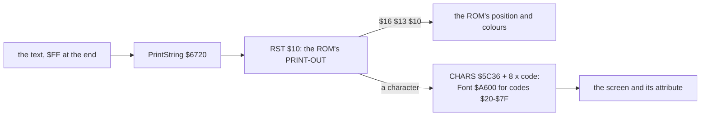
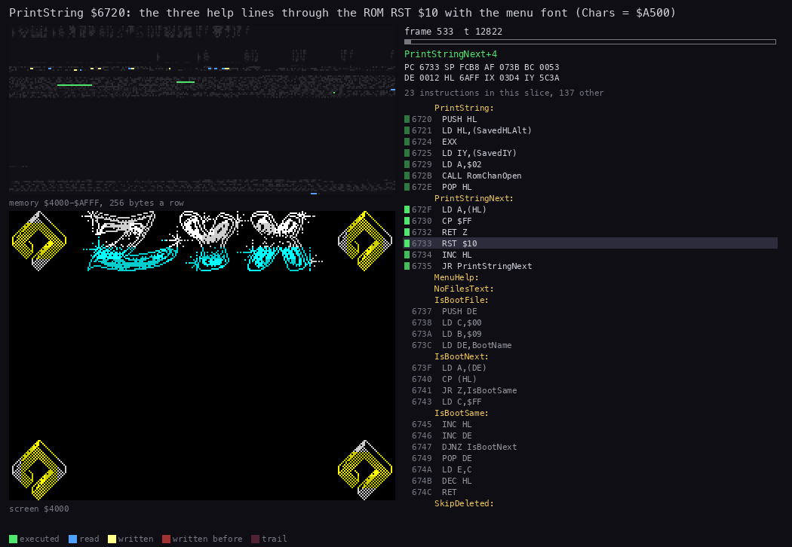
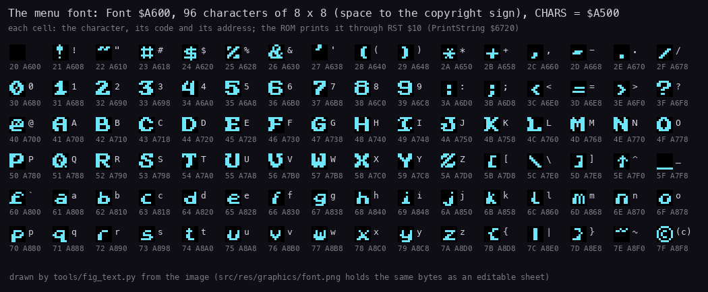
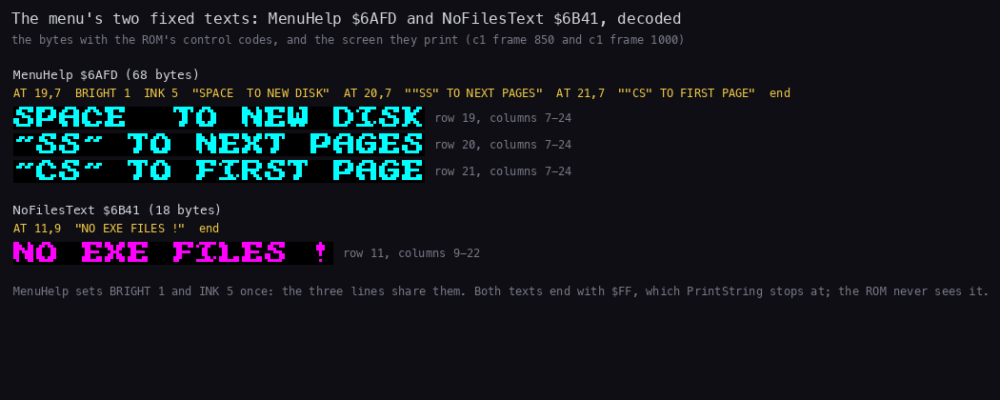
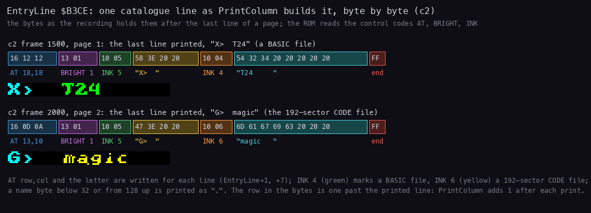
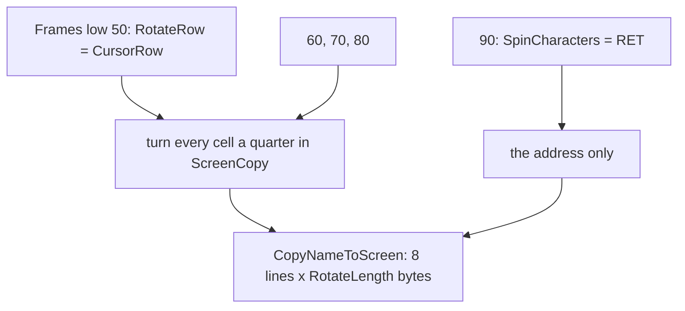
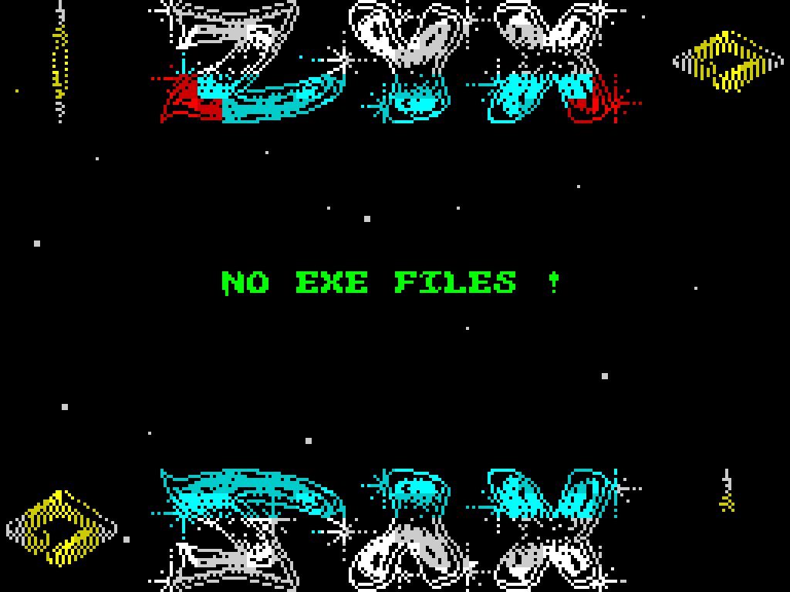

# 8. The font and the text

What this covers:

- the printer: PrintString, the ROM's RST `$10`, and why it puts back IY and H'L' (8.1);
- the font: 96 characters at Font `$A600`, set in CHARS for the menu and given back at the launch (8.2);
- the texts: the help lines and NO EXE FILES !, their bytes and their editable sources in `src/res/texts` (8.3);
- the menu layout: the catalogue line EntryLine and where each part of the screen is printed (8.4);
- the name spin: the cursor's text turned a quarter at a time, four times every 256 frames (8.5);
- what is known only from the code (8.6) and the point (8.7).

The names are those of `src/main/main.ann` (modules font, catalogue, interrupt). Vadim's 2010 decompilation
(`work/stage1/ZYXboot.utf8.mac`) is used here: his `PrString`, `CopyStringToScr_6CA2`, `ScrStringLen_B3EC` and
`RotateNxtChar` are PrintString, CopyNameToScreen, RotateLength and RotateNextChar here; his comment at `RL (HL)`,
"rotate 90 grad", is the spin of 8.5.

The recordings: c1 (`orig/boot.scl`, NO EXE FILES !) and c2 (`tests/disks/many.scl`) of WALKTHROUGH 1, Pentagon 128K,
reopened on this writer's own instance (port base 37440, muted).

## 8.1 The printer

All the menu's text goes through the ROM. PrintString `$6720` puts back the ROM's IY and H'L', opens channel 2 (the
upper screen) and sends each byte to RST `$10` until it meets `$FF`:

```text
PrintString(HL = text):
    H'L' = SavedHLAlt; IY = SavedIY        # RST $10 reads the system variables through IY
    CHAN-OPEN(2)                            # the ROM's $1601: print to the upper screen
    while (HL) != $FF: RST $10 (HL); HL = HL + 1
```

```text
6720  PUSH HL
6721  LD HL,(SavedHLAlt)
6724  EXX
6725  LD IY,(SavedIY)
6729  LD A,$02
672B  CALL RomChanOpen       ; $1601
672E  POP HL
672F  LD A,(HL)              ; PrintStringNext
6730  CP $FF
6732  RET Z
6733  RST $10
6734  INC HL
6735  JR PrintStringNext
```

The texts hold the ROM's own control codes: `$16 row col` (AT), `$13 n` (BRIGHT), `$10 n` (INK). The ROM keeps the
print position and the colours between calls and draws each character from the 8 bytes at CHARS + 8 x code.





*PrintString `$6720` in c1 frames 533-534 (frame 533 T 11 300 to frame 534 T 30 900), the three help lines of
DrawScreen, 60 pictures. Left above: memory `$4000-$AFFF`; left below: the screen; right: the listing at the PC. Made
with `python3 ../../kit/routine_anim.py --work work/docs/zbA/c1 --window 533:11300-534:30900 --listing build/main.lst
--view screen --pc 6720-6736 --range 4000-AFFF --pictures 60 --out docs/img/routines/PrintString.gif`.*

How to read it:

- The listing stays on `$672F-$6735`; the time goes in the ROM (no listing there), one RST `$10` per character.
- The lines appear at rows 19, 20 and 21, a character at a time; the map shows Font `$A600-$A8FF` read, 8 bytes per
  character.

The point: the ROM's printer costs about 91 000 T for the 54 characters and 13 control bytes of the help lines,
some 1 700 T a character, but it needs no code of the menu's own. It is used only when a page is drawn, never per
frame.

Witness: PrintString from c1 frame 533 T 11 344 to frame 534 T 30 837 (the trace of those frames). Chars `$5C36`
holds `$3C00` at the start of frame 533 (the trace `533:0-537:0` begins at T 20 with it) and `$A500` from T 11 321 of
frame 533, when DrawScreen's `LD (Chars),HL` at `$6572` writes `00 A5`, 43 T before PrintString starts.

## 8.2 The font

Font `$A600` holds 96 characters of 8 x 8 pixels, codes `$20` (space) to `$7F` (the copyright sign), 768 bytes
(`src/res/graphics/font.png`). DrawScreen sets CHARS `$5C36`, the ROM's pointer to the font less 256, to FontBase
`$A500`; RunLetter sets it back to `$3C00`, the ROM's own font, before it returns to BASIC.

```text
656F  LD HL,FontBase         ; $A500: Font - 256
6572  LD (Chars),HL          ; the ROM prints with the menu's font from now on
...
6ACD  LD HL,$3C00            ; RunLetter: the ROM's font back
6AD0  LD (Chars),HL
```



*Font `$A600` from the image (`build/main.bin`), each character with its code and address. Made with `python3
tools/fig_text.py --c1 work/docs/zbA/c1 --c2 work/docs/zbA/c2` (all three figures of this document; the moments are
kept in `work/docs/figcache/`).*

How to read it:

- Six rows of 16: punctuation and digits, the capitals, the small letters, and the copyright sign last.
- The strokes are 2 pixels wide (the ROM's are 1): the font reads as bold.
- The quote `$22` is a wave, so `"SS"` prints as two waves around SS.

The point: the menu font is a whole 96-character set, so any catalogue name prints in it. Worked example: `T` is code
`$54`; its 8 bytes are at `$A500` + 8 x `$54` = `$A7A0`, the same as Font + 8 x (`$54` - `$20`).

## 8.3 The texts

The menu has two fixed texts, both in `src/res/texts` as UTF-8 with the controls written out:

| Text | Address | Source | Printed at |
| --- | --- | --- | --- |
| MenuHelp | `$6AFD`, 68 bytes | `menu-help.txt` | rows 19-21, column 7, by DrawScreen |
| NoFilesText | `$6B41`, 18 bytes | `no-files.txt` | row 11, column 9, by ListCatalogue when no file is listed |

```text
menu-help.txt:
{AT 19,7}{BRIGHT 1}{INK 5}SPACE  TO NEW DISK
{AT 20,7}"SS" TO NEXT PAGES
{AT 21,7}"CS" TO FIRST PAGE{END}

no-files.txt:
{AT 11,9}NO EXE FILES !{END}
```

The point: the help is printed once, at the start, and covered by the reflection 7 s later (6.2 in
[doc 6](06-graphics.md#62-the-reflection-the-logo-upside-down)); only NO EXE FILES ! and the catalogue lines are
printed again on every page.



*MenuHelp and NoFilesText from the image, decoded, and the screen they print in c1 frame 850 (the help lines) and
frame 1000 (NO EXE FILES !), from `tools/fig_text.py`.*

How to read it:

- The yellow line under each name: the bytes as the ROM reads them, the control codes by name.
- Below: the printed cells, 3 x scale, with their rows and columns.

Worked example, MenuHelp's first bytes: `16 13 07` is AT 19,7; `13 01` BRIGHT 1; `10 05` INK 5 (cyan); then
`SPACE  TO NEW DISK`, 18 characters at columns 7-24. The next `16 14 07` moves to row 20; BRIGHT and INK carry over.
The text ends with `$FF`, which PrintString stops at.

## 8.4 The menu layout

The screen has fixed areas ([doc 1, 1.2](01-overview.md#12-the-screen-and-its-parts)):

| Rows | Columns | What | Drawn by |
| --- | --- | --- | --- |
| 0-4 | 0-4, 27-31 | the top rhombi | DrawScreen, then PrintRombPhase |
| 0-4 | 6-25 | the logo | DrawScreen |
| 6-17 | 0-31 | the page of names, cleared to ink 7 first | ClearFilesArea, PrintColumn |
| 11 | 9-22 | NO EXE FILES ! (no file) | ListCatalogue |
| 19-21 | 7-24 | the help lines, until the reflection covers them | DrawScreen |
| 19-23 | 6-25 | the reflection | DrawReflection |
| 19-23 | 0-4, 27-31 | the bottom rhombi | DrawScreen, then PrintRombPhase |

The point: the names live in rows 6-17, a band of 12 rows between the logo and its reflection; that band is why a
column holds 12 names and a page 24.

Each name is printed from EntryLine `$B3CE`, a 22-byte line that PrintColumn `$668E` fills and hands to PrintString:

| Bytes | Value | What |
| --- | --- | --- |
| 0-2 | `16 row col` | AT row, column of the letter |
| 3-4 | `13 01` | BRIGHT 1 |
| 5-6 | `10 05` | INK 5: the letter in bright cyan |
| 7 | `41`-`58` | the letter A-X |
| 8-10 | `3E 20 20` | `>` and two spaces |
| 11-12 | `10 ink` | INK 4 (green): BASIC; INK 6 (yellow): a 192-sector CODE file |
| 13-20 | the name | 8 bytes; a byte under `$20` or from `$80` up printed as `.` |
| 21 | `FF` | the end |

```text
PrintColumn(HL = the first entry, B = column, C = row, D = count, E = the first letter):
    EntryLine[1..2] = row, column
    for each of D listed entries:
        EntryLine[12] = 4 (BASIC) or 6 (CODE); EntryLine[13..20] = the name, unprintable bytes as "."
        EntryLine[7] = the letter; the fixed bytes
        PrintString(EntryLine)
        row = row + 1; letter = letter + 1
```

The letter sits at column 10 for one column, columns 2 and 18 for two; the name 4 columns on, at 14, 6 and 22.



*EntryLine as c2 holds it after the last line of a page: frame 1500 (page 1, `X>  T24`) and frame 2000 (page 2,
`G>  magic`), with the printed line under each, from `tools/fig_text.py`.*

How to read it:

- Each coloured box is one item: the bytes on top, what the ROM makes of them below.
- The printed strip shows the letter in bright cyan and the name in green (BASIC) or yellow (CODE).

Worked example, c2 frame 1500: `16 12 12 13 01 10 05 58 3E 20 20 10 04 54 32 34 20 20 20 20 20 FF`. The row byte
reads `$12` = 18, one past the printed row 17, because PrintColumn adds 1 after each line; the column is `$12` = 18,
the second column's letter. `58` is X, the 24th letter; INK 4, BASIC; the name is `T24` and five spaces. At c2 frame
2000 the line is AT 13,10 (one column) with `G` and INK 6 `magic`: page 2's 7th name, the 192-sector CODE file.

The point: the line is rebuilt and printed for every name with the ROM's AT and INK, so the menu needs no code to
place or colour a name; a whole page of 24 names costs 24 calls of PrintString
([doc 7, 7.6](07-catalogue-and-menu.md#76-showcatalogue-the-page-draw-and-its-cost)).

## 8.5 The name spin

Once every 256 frames the cursor's text turns: at Frames low 50, 60, 70 and 80 each of its characters is turned a
quarter clockwise in its own cell, and at 80 they are upright again. At 90 the text is copied once more. ScreenCopy
holds the name as well, so the turn is done there and then copied to the screen in one burst.

```text
RotateCursorName:                              # Frames low 50: RotateRow = CursorRow, RotateLength = CursorLength
    HL = RotateAddr = the name's first cell in ScreenCopy (from RotateRow by CursorAttrAddr)
    for each of RotateLength cells:            # SpinCharacters: patched to RET at Frames 90
        CharBuffer = the cell's 8 lines
        for line j = 0..7:
            line j of the cell = column j of CharBuffer, read top to bottom into bits 0..7
CopyNameToScreen:                              # RotateLength bytes x 8 lines, ScreenCopy -> the screen
```

```text
67C2  LD HL,RotateRow        ; RotateCursorName
67C5  LD (CursorAttrAddr+$0002),HL   ; CursorAttrAddr reads RotateRow for one call
67C8  CALL CursorAttrAddr
67CB  LD HL,(CursorAttrOffset)
67CE  LD A,H
67CF  RLCA
67D0  RLCA
67D1  RLCA                   ; the attribute offset's third, as a pixel address
67D2  OR ScreenCopy>>8
67D4  LD H,A
67D5  LD (RotateAddr),HL
67D8  LD A,(RotateLength)    ; SpinCharacters
67DB  LD B,A
67DC  PUSH BC                ; RotateNextChar
67DD  PUSH HL
67DE  LD DE,CharBuffer
67E1  PUSH DE
67E2  LD B,$08
67E4  LD A,(HL)              ; RotateCopyRow: the cell's 8 lines to CharBuffer
67E5  LD (DE),A
67E6  INC H
67E7  INC DE
67E8  DJNZ RotateCopyRow
67EA  POP HL                 ; HL = CharBuffer
67EB  POP DE                 ; DE = the cell in ScreenCopy
67EC  PUSH DE
67ED  LD B,$08
67EF  LD C,$08               ; RotateColumn
67F1  PUSH HL
67F2  RL (HL)                ; RotateColumnShift: the leftmost pixel of a line
67F4  RRA                    ; into A, the first line ending in bit 0
67F5  INC HL
67F6  DEC C
67F7  JR NZ,RotateColumnShift
67F9  LD (DE),A              ; one line of the turned cell
67FA  INC D
67FB  POP HL
67FC  DJNZ RotateColumn
67FE  POP HL
67FF  INC HL                 ; the next cell
6800  POP BC
6801  DJNZ RotateNextChar
6803  LD HL,CursorRow
6806  LD (CursorAttrAddr+$0002),HL   ; CursorAttrAddr back to the cursor
6809  CALL CopyNameToScreen
```



Worked example, the top line of a turned cell: line 0 of the result takes the leftmost pixel of each of the 8 source
lines. RL (HL) moves line 0's leftmost pixel into carry and RRA puts it into bit 7 of A; after 8 lines it has moved
down to bit 0, the rightmost pixel, and line 7's pixel is in bit 7, the leftmost. So the source's left column becomes
the top line, read from bottom to top left to right: a quarter turn clockwise.



*c1 frames 1104-1148, every 2nd frame, 4 x scale: Frames low 48 to 92. Made with `python3 ../../kit/screen_anim.py
--work work/docs/zbA/c1 --from 1104 --to 1148 --step 2 --scale 4 --delay 150 --hold 1500 docs/img/play/name-spin.gif`.*

How to read it:

- Frame 1106 (Frames 50): every letter lies on its side.
- 1116: upside down; 1126: on its other side; 1136: upright again. Each pose holds for 10 frames.
- The glint's last steps (to Frames 52) show on the logo at the start.

The point: the spin turns each letter in its own cell, not the word: the word stays readable in its place, and the
letters tumble.

The cost: 29 740-29 773 T for an 8-letter name (c2 trace, [doc 4, 4.5](04-program-cycle.md#the-256-frame-cycle)),
about 3 700 T a cell; NO EXE FILES ! (14 cells) runs from T 9 944 to T 58 467 of c1 frame 1106, 48 500 T. The copy
alone at Frames 90 is 2 539 T. Witness: RotateCursorName's 145 entries in c1 (stage-1 L1), 5 every 256 frames (the copy at 90 included) from
frame 592 on; the beam timeline of frame 1106 in [doc 4, 4.6](04-program-cycle.md#46-the-cost-per-frame).

## 8.6 Known only from the code

- A name byte under `$20` or from `$80` up printed as `.`: none of the test disks has one; read from PrintColumn.
- The cursor moving between Frames 50 and 90: the spin keeps turning the name at RotateRow, set at 50, and the
  cursor's colour goes on at the new place; no recording moves the cursor in that window.

## 8.7 The point

The menu prints all its text through the ROM with its own bold font, from byte strings that hold the ROM's control
codes, so placing and colouring a line is data, not code. The one text effect, the spin, works on pixels: it turns
the cursor's letters in ScreenCopy and copies them out, and it is the heaviest single job of any frame.
