# 9. Music and sound

What this covers:

- the sound system: one AY, three writers (9.1);
- what the player costs, and what the menu takes from it (9.2);
- the player's entries and its set-up, InitPlayer (9.3);
- PlayFrame: the delay, the rows, the rule that starts the next position (9.4);
- the module format byte by byte, with pattern 0 decoded by hand (9.5);
- the samples and the ornaments (9.6);
- ChannelSound and WriteAY: from a channel's record to the 14 AY registers (9.7);
- the tune itself: its positions, its channels and its length (9.8);
- SoundOff and PlayBell, the menu's own two sounds (9.9);
- the audio files (9.10), what is known only from the code (9.11), and the point (9.12).

The music is a module of ASC Sound Master, the AY tracker by Andrew Sendetski (ASC). Its compiled player sits at
`$C000-$D5FF` (the music part, `src/music/player.asm` and `src/music/tune.asm`). The player's text at `$C014` reads
"ASM COMPILATION OF DISCO MUSIC BY ANT P BY ANDREW SENDETSKI ASC". The module itself is the resource
`src/res/music/disco.txt` (its format: [src/res/music/README.md](../src/res/music/README.md)). The names are those of
`src/music/music.ann` and `src/main/main.ann` (module sound).

The recordings are those of [WALKTHROUGH 1](../WALKTHROUGH.md#1-one-recording-from-power-on), on a Pentagon 128K
(AY clock 1 750 000 Hz), reopened from their TTD sessions on this writer's own instance (port base 37450, muted):

- c1: `orig/boot.scl`: the music from frame 543 to 7879 (L1: 7274 MusicPlay calls);
- c3: `tests/disks/many.scl`: traces of frames 963-1009 (the player at work), 1879-1888 (a page) and 2182-2205 (the
  bell and the launch).
- c2 (`tests/disks/many.scl`) and c4 (`tests/disks/noexe.scl`): MusicInit's L1 count (9.3);
- c6: `orig/boot.scl` idle for 16 566 frames, into the tune's third loop (9.8); made at the integration.

Beside the recordings there is a model: `tools/sound_sim.py` runs `build/music.bin` in SkoolKit's Z80 simulator,
MusicInit once and then MusicPlay once a frame, as the menu does. It keeps each frame's AY writes, the 14 registers
after the frame, the T-states and the player's state. The model is checked against c3 in 9.7: 48 frames out of 48 agree
write for write. Every number below that is not from a recording comes from the model, and its command is given.

## 9.1 The sound system

The menu makes sound on the AY only; it never touches the beeper (the menu's code has no OUT to port `$FE`). Three
routines write the AY, and the menu's own WriteAY `$6E4F` and the player's WriteAY `$C15F` are two different routines:

| Who | When | What it writes | Through |
| --- | --- | --- | --- |
| MusicInit `$C00B` | once, in Start (c1 frame 532) | all 14 registers 0, then the mixer `$FF` (silence) | the player's WriteAY `$C15F` |
| MusicPlay `$C00E` | once an interrupt, from the IM 2 handler at `$676D` | registers 12 to 0, and 13 when a pattern sets a shape | the player's WriteAY `$C15F` |
| SoundOff `$6E41` | before each page (ShowCatalogue) and before SPACE's disk read | 14 zeros, read from `$7530` | the menu's WriteAY `$6E4F` |
| PlayBell `$6E48` | once, in RunLetter, before the launch | the 14 bytes of ExitSound `$6E64` | the menu's WriteAY `$6E4F` |

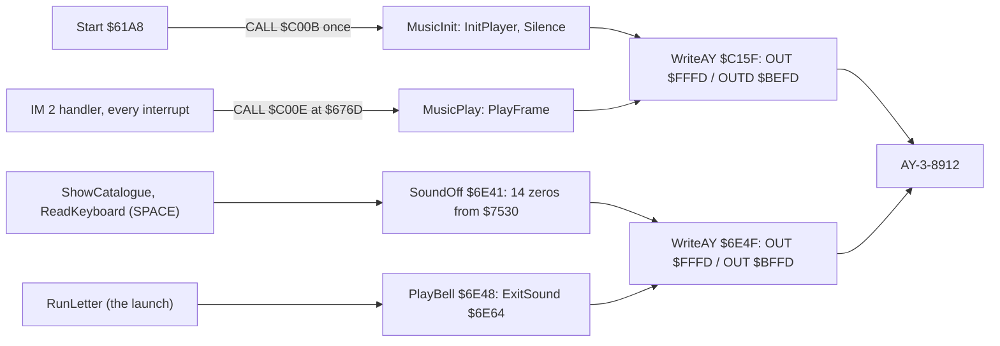

```text
6E41  21 30 75     LD HL,30000             ; SoundOff: $7530, inside the zeroed Unused1
6E44  CD 4F 6E     CALL WriteAY
6E47  C9           RET
6E48  21 64 6E     LD HL,ExitSound         ; PlayBell: the bell's 14 bytes
6E4B  CD 4F 6E     CALL WriteAY
6E4E  C9           RET
6E4F  AF           XOR A                   ; WriteAY (the menu's): register 0 first
6E50  01 FD FF     LD BC,$FFFD             ; WriteAYNext
6E53  ED 79        OUT (C),A               ; select register A
6E55  F5           PUSH AF
6E56  7E           LD A,(HL)
6E57  01 FD BF     LD BC,$BFFD
6E5A  ED 79        OUT (C),A               ; write its value
6E5C  23           INC HL
6E5D  F1           POP AF
6E5E  3C           INC A
6E5F  FE 0E        CP $0E                  ; 14 registers
6E61  C8           RET Z
6E62  18 EC        JR WriteAYNext
```

```text
SoundOff():  WriteAY($7530)          ; 14 zeros on the original's disk (9.9)
PlayBell():  WriteAY(ExitSound)      ; the bell, 9.9

WriteAY(table):                      ; the menu's, $6E4F: registers 0-13 in order, R13 last
    for r in 0 .. 13:
        OUT $FFFD, r                 ; select
        OUT $BFFD, table[r]          ; write (R13 restarts the envelope)
```

Worked example: the IM 2 handler calls MusicPlay at `$676D` on every interrupt, so the tune runs at the interrupt
rate, 50 Hz on the Pentagon. The first tune loop is 7704 frames (9.8), 154.1 s at 50 Hz.

Witness: L1 of c1 counts MusicInit once (frame 532), MusicPlay 7274 times (frames 543-7879), MusicStop never; SoundOff
three times (frames 536, 6430 and 6436: the first page, SPACE, the new first page), 1519 T each; PlayBell never (c1
never launches). In c3 PlayBell runs once, at 2182:14196, also 1519 T.

The point: the music has the AY to itself, except at two moments: a page draw, which silences it, and the launch, which
replaces it with the bell. Neither the menu nor the player ever stops the music in any other way.

## 9.2 Timing and cost

MusicPlay runs inside the IM 2 handler, so its cost comes out of every frame of the menu. The model gives it over the
first tune loop (7704 frames):

| Calls | Mean T | Max T | Share of a Pentagon frame (71 680 T) |
| --- | ---: | ---: | ---: |
| all 7704 frames | 6781 | 12 204 | 9.5 % mean, 17.0 % max |
| the 1284 row frames (every 6th) | 7897 | 12 204 | 11.0 % mean |
| the 6420 other frames | 6557 | 6974 | 9.1 % mean |
| MusicInit, once | 3139 | | |

Command: `python3 tools/sound_sim.py costs`. The cheapest frame in the tune loop takes 1597 T.

The recordings agree: in c1 MusicPlay and all it calls take 49 741 659 T over 7274 calls, 6838 T a call. That is 0.8 %
more than the model's mean because c1 plays a different stretch of the tune: positions 0-20 with the SPACE re-read in
between, never the whole tune loop.

The menu takes two things from the player's timing:

- **the start**: MusicInit runs at c1 frame 532, the first MusicPlay at 543. The first page is drawn in between
  (ShowCatalogue at frame 536), with interrupts off. c1's page is NO EXE FILES !; c3's is 24 names, and its first
  MusicPlay comes 9 frames later, at 552 (L1);
- **a page costs 8 frames of music**: ShowCatalogue runs inside the interrupt with interrupts off. In c3 it runs from
  1879:16219 to 1887:28518, about 8.2 frames, so the interrupts of 8 frames are lost and 8 MusicPlay calls never
  happen. SoundOff has silenced the AY first, so the tune goes quiet for those 8 frames and then carries on where it
  was, 8 frames late ([doc 7, 7.6](07-catalogue-and-menu.md#76-showcatalogue-the-page-draw-and-its-cost)).

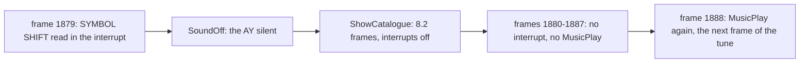

Worked example: before the page change, c3's AY writes at recording frame F are the model's at frame F - 553 (9.7).
After the page, 8 interrupts later, the tune's next frame comes 8 frames later too: the offset becomes 561. The cut can
be heard in `docs/audio/soundoff-page.wav` (9.10).

Witness: the c3 trace `1879:16200-1888:0` (the ShowCatalogue animation of
[doc 7](07-catalogue-and-menu.md#75-the-pages)); MusicPlay's L1 count in c1 and its 49 741 659 T. The new offset:
`python3 tools/sound_sim.py check --work work/docs/zbB/c3 --window 1900:0-1904:0` finds recording frames 1900-1903
equal to model frames 1339-1342 (offset 561), 4 of 4 frames write for write. (It also lists model frame 955, offset
945: positions 3 and 4 both play pattern 3, so their frames repeat.)

The point: the player takes about a tenth of every frame and the menu does not mind; the only audible cost of the menu
is the 8-frame gap at a page change.

## 9.3 The entries and InitPlayer

The compiled player starts with a header: four addresses (MusicInit, MusicPlay, WriteAY, AYRegisters) for a program
that wants to find them, three bytes `$80 $54 $1E` nobody reads, and three jumps:

| Entry | Jumps to | Who calls it |
| --- | --- | --- |
| MusicInit `$C00B` | InitPlayer `$C053` | Start at `$61E7`, once |
| MusicPlay `$C00E` | PlayFrame `$C104` | the IM 2 handler at `$676D` |
| MusicStop `$C011` | Silence `$C095` | nobody (known only from the code) |

InitPlayer clears the three channel records (75 bytes from ChannelA `$C0A9`), sets the delay counter and the three row
counters to 1, so the very first MusicPlay reads a row, and then reads the module's header at TuneHeader `$C478` into
the operands of its own instructions. Six instructions of the player are patched this way, so the frame code never
has to look the tables up again. It falls into Silence, which clears the register image and writes it.

```text
InitPlayer():
    ChannelA..ChannelC = 0                        ; 3 records of 25 bytes
    PositionOp.operand = 0                        ; the first position
    DelayCounter = 1; A.row_counter = B.row_counter = C.row_counter = 1
    DelayOp.operand          = header[0]          ; 6: frames a row
    PatternTableOp.operand   = TuneHeader + word(header[1])
    SampleTableOp.operand    = TuneHeader + word(header[3])
    CommandOrnament.operand  = TuneHeader + word(header[5])
    PositionCountOp.operand  = header[7]          ; 22 positions
    NextPosition.operand     = TuneHeader + 8     ; the positions
Silence():
    AYRegisters[0..13] = 0; AYMixer = $FF          ; all tones and noises off
    WriteAY()                                      ; register 13 too: the shape byte is 0, not $FF
```

```text
C053  AF           XOR A                   ; InitPlayer
C054  21 A9 C0     LD HL,ChannelA
C057  11 AA C0     LD DE,ChannelA+$0001
C05A  01 4A 00     LD BC,$004A
C05D  77           LD (HL),A
C05E  ED B0        LDIR                    ; the three records = 0
C060  32 95 C1     LD (PositionOp+$0001),A
C063  3C           INC A
C064  32 03 C1     LD (DelayCounter),A     ; 1: a row at the first call
C067  32 B3 C0     LD (ChannelA+$000A),A   ; the row counters = 1
C06A  32 CC C0     LD (ChannelB+$000A),A
C06D  32 E5 C0     LD (ChannelC+$000A),A
C070  11 78 C4     LD DE,TuneHeader
C073  42           LD B,D
C074  4B           LD C,E                  ; BC = the module's base
C075  1A           LD A,(DE)
C076  13           INC DE
C077  32 0B C1     LD (DelayOp+$0001),A    ; the delay
C07A  CD 89 C1     CALL ReadOffsetDE       ; HL = BC + the next word
C07D  22 A9 C1     LD (PatternTableOp+$0001),HL
C080  CD 89 C1     CALL ReadOffsetDE
C083  22 5F C2     LD (SampleTableOp+$0001),HL
C086  CD 89 C1     CALL ReadOffsetDE
C089  22 6C C2     LD (CommandOrnament+$0001),HL
C08C  1A           LD A,(DE)
C08D  13           INC DE
C08E  32 9B C1     LD (PositionCountOp+$0001),A
C091  ED 53 92 C1  LD (NextPosition+$0001),DE   ; the positions follow the header
C095  AF           XOR A                   ; Silence
C096  21 F4 C0     LD HL,AYRegisters
C099  11 F5 C0     LD DE,AYRegisters+$0001
C09C  01 0D 00     LD BC,$000D
C09F  77           LD (HL),A
C0A0  ED B0        LDIR
C0A2  3D           DEC A
C0A3  32 FB C0     LD (AYMixer),A          ; $FF: everything off
C0A6  C3 5F C1     JP WriteAY
```

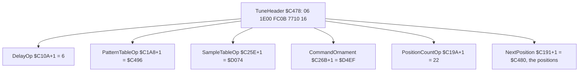

Worked example, the header's 8 bytes `06 1E 00 FC 0B 77 10 16`:

- `06`: a row every 6 frames;
- `1E 00`: the pattern table at `$C478 + $001E = $C496`;
- `FC 0B`: the sample table at `$C478 + $0BFC = $D074`;
- `77 10`: the ornament table at `$C478 + $1077 = $D4EF`;
- `16`: 22 positions, at `$C480`.

Witness: MusicInit's L1 count is 1 in each of c1-c4; its cost in the model is 3139 T. The six operands after
MusicInit can be read in any recording's memory: `$C10B` holds `06`, `$C1A9` holds `96 C4`.

The point: the player is a generic one, compiled with the tune. Everything it knows about this tune it takes from the
module's 8-byte header at the start, and it keeps it inside its own code.

## 9.4 PlayFrame: the delay, the rows and the next position

Every frame, PlayFrame counts DelayCounter down. On the frame it reaches 0 (a "row frame", every 6th frame), it
reloads the delay, maybe starts the next position, and lets each channel read its pattern stream. Then, every frame,
ChannelSound builds the channel's registers (9.7), the mixer is assembled, and WriteAY sends it all.

Each channel has a 25-byte record (ChannelA `$C0A9`, ChannelB `$C0C2`, ChannelC `$C0DB`):

| Offset | What |
| --- | --- |
| +`$00` | flags: bit 0 the stream has more events, bit 1 the sample ended, bit 2 a note is on, bit 3 released, bit 4 envelope mode, bit 5 this sample row is on the envelope |
| +`$01` | the mixer bits of the current sample row (bit 0 tone off, bit 3 noise off) |
| +`$02` | the note (0-`$55`, moved by the ornament) |
| +`$03` | the tone offset, 16 bits, summed from the sample rows |
| +`$05`, +`$06` | the noise base (`nN`) and the current noise period |
| +`$07` | the volume for the AY (0-15) |
| +`$08` | the channel volume (`vN`) |
| +`$09`, +`$0A` | the row length (`lenN`) and the row counter |
| +`$0B` | the stream pointer |
| +`$0D`, +`$0F`, +`$11` | the sample's start, its current row, its loop row |
| +`$13`, +`$15`, +`$17` | the ornament's start, its current row, its loop row |

ChannelRow decrements the channel's row counter and does nothing until it runs out; then it reads the stream: commands
(bytes `$80-$FF`) until a byte below `$80`, the row's event. A note (`$00-$55`) restarts the sample and the ornament; `$56-$7D` keeps
the current note; `$7E` releases it; `$7F` silences the channel. The counter is reloaded with the row length. Last,
if the next byte is `$FF`, the channel clears bit 0 of its flags: it has read its last event in this pattern.

The rule that starts the next position is in PlayFrame, not in ChannelRow: on a row frame, if bit 0 is clear in all
three records, NextPosition runs before the three ChannelRow calls. It does not wait for the last events to finish:
a channel whose row counter still runs keeps playing its last event, and reads the new pattern's stream only when its
counter runs out.

```text
PlayFrame():
    DelayCounter -= 1
    if DelayCounter == 0:                           ; a row frame
        DelayCounter = 6                            ; DelayOp's operand
        if not (A.more or B.more or C.more):        ; all three read their last event
            NextPosition()
        for ch in A, B, C: ChannelRow(ch)
    for n, ch in (0, A), (1, B), (2, C): ChannelSound(n, ch)
    AYMixer = C.mix << 2 | B.mix << 1 | A.mix
    WriteAY()

NextPosition():
    pattern = positions[PositionOp]
    PositionOp = PositionOp + 1 if PositionOp + 1 < 22 else 0     ; no loop byte: back to position 0
    A.stream, B.stream, C.stream = PatternTable + the 3 offsets at PatternTable + 6 * pattern
    A.more = B.more = C.more = 1

ChannelRow(ch):
    ch.row_counter -= 1
    if ch.row_counter != 0: return                  ; the last event goes on
    repeat: b = next byte; if b >= $80: PatternCommand(b)  until b < $80
    if b < $56: start the note b (sample and ornament from their starts, tone offset 0)
    elif b == $7E: ch.released = 1
    elif b == $7F: ch.note_on = 0
    ch.row_counter = ch.row_length
    if next byte == $FF: ch.more = 0
```

```text
C104  21 03 C1     LD HL,DelayCounter      ; PlayFrame
C107  35           DEC (HL)
C108  20 27        JR NZ,PlayFrameSound    ; not a row frame
C10A  36 06        LD (HL),$06             ; DelayOp: the delay (self-modified)
C10C  3A A9 C0     LD A,(ChannelA)
C10F  21 C2 C0     LD HL,ChannelB
C112  B6           OR (HL)
C113  21 DB C0     LD HL,ChannelC
C116  B6           OR (HL)
C117  CB 47        BIT 0,A                 ; any stream with events left?
C119  CC 91 C1     CALL Z,NextPosition     ; none: the next position
C11C  DD 21 A9 C0  LD IX,ChannelA
C120  CD CE C1     CALL ChannelRow
...
C191  21 00 00     LD HL,$0000             ; NextPosition: the positions (self-modified)
C194  11 00 00     LD DE,$0000             ; PositionOp: the position index (self-modified)
C197  19           ADD HL,DE
C198  1C           INC E
C199  7B           LD A,E
C19A  FE 01        CP $01                  ; PositionCountOp: 22 (self-modified)
C19C  9F           SBC A,A                 ; $FF if E < 22, else 0
C19D  A3           AND E                   ; past the last: 0
C19E  32 95 C1     LD (PositionOp+$0001),A
C1A1  7E           LD A,(HL)               ; the pattern number
C1A2  87           ADD A,A
C1A3  5F           LD E,A
C1A4  87           ADD A,A
C1A5  83           ADD A,E                 ; x 6
...
C238  DD 7E 09     LD A,(IX+$09)           ; RowDone: the row counter = the row length
C23B  DD 77 0A     LD (IX+$0A),A
C23E  DD 73 0B     LD (IX+$0B),E
C241  DD 72 0C     LD (IX+$0C),D
C244  1A           LD A,(DE)
C245  3C           INC A                   ; the next byte $FF?
C246  C0           RET NZ
C247  DD CB 00 86  RES 0,(IX+$00)          ; yes: no more events in this pattern
C24B  C9           RET
```

```mermaid
flowchart TD
    F["PlayFrame: DelayCounter - 1"] -->|"not 0"| SND
    F -->|"0: a row frame"| R["DelayCounter = 6"]
    R --> Q{"bit 0 clear in A, B and C?"}
    Q -->|"yes"| NP["NextPosition: 3 stream pointers, bits 0 set"]
    Q -->|"no"| CR
    NP --> CR["ChannelRow A, B, C: counter - 1; at 0 read the next event"]
    CR --> SND["ChannelSound A, B, C: sample row, ornament row, period, volume"]
    SND --> MX["mixer = C, B, A bits"]
    MX --> W["WriteAY $C15F"]
```

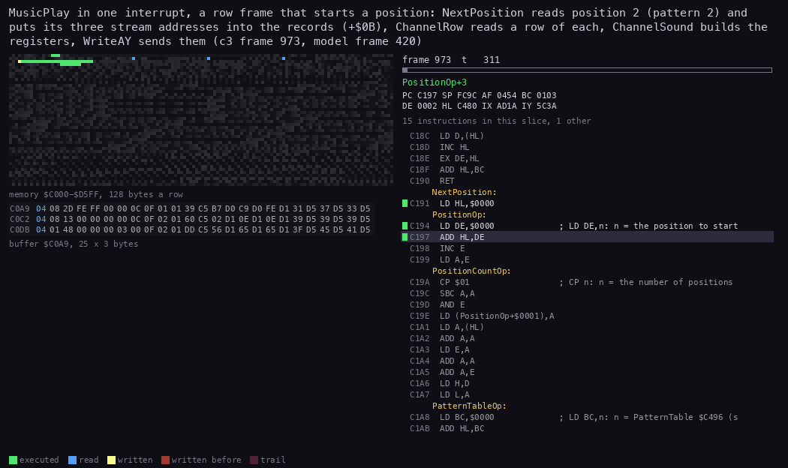

*The routine animation of MusicPlay in c3 frame 973 (model frame 420), from 973:150 to 973:13000 (TTD units; 80
pictures). The view is the three channel records `$C0A9`, 25 bytes a row; the memory grid is the music part
`$C000-$D5FF`. Command, from the case folder after `. work/env.sh`: `python3 ../../kit/routine_anim.py --work
work/docs/zbB/c3 --window 973:150-973:13000 --listing build/music.lst --view buffer:C0A9:25x3:hex --pc C000-C3C9 --range
C000-D5FF --pictures 80 --out docs/img/routines/PlayFrame.gif` (with a `--title`).*

How to read the animation:

- It is a row frame, and all three bits 0 are clear: NextPosition reads position 2, pattern 2, and writes the three
  stream addresses into bytes +`$0B`/+`$0C` of the records (yellow in the view).
- ChannelRow then reads one event for each channel (blue reads in the grid, in the stream area).
- ChannelSound reads a sample row and an ornament row for each channel (blue reads in the sample and ornament area at
  the bottom of the grid) and updates the record.
- WriteAY's OUTD loop is the last stretch.

Worked example, the position change at the end of the tune. Pattern 14 (position 21) ends with `len11 rel` in channel
A (read at row 53) and `len26 rel` in B and C (read at row 38). At row 53 all three have read their last event, so at
row 54 (frame 7380 + 324 = 7704) NextPosition starts position 0 again: position 21 lasted only 54 rows. But A's counter
still has 10 rows to run, B's and C's as well. Pattern 0's streams wait for them: they start 10 rows into position 0,
so on every later tune loop position 0 lasts 6 + 10 = 16 rows (96 frames) instead of 6 (36).

Witness: the c3 trace `973:150-973:13000` (the animation); the model's position starts, `python3 tools/sound_sim.py
loop` (9.8).

The point: a position ends when every channel has read its last event, not when the last event ends. The difference
is carried into the next position as a delay, so the tune's real timing is not the sum of its patterns' lengths.

## 9.5 The module format, and pattern 0 by hand

The module runs from TuneHeader `$C478` to `$D592` (4379 bytes). In order:

| Block | Address | What |
| --- | --- | --- |
| the header | `$C478` | delay, three table offsets, the number of positions (9.3) |
| the positions | `$C480` | 22 pattern numbers: `00 01 02 03 03 04 04 05 05 06 06 07 08 09 09 0A 0B 0C 0D 0F 01 0E` |
| the pattern table | `$C496` | 16 patterns of 3 words: the offsets of the A, B and C streams from the table |
| the streams | `$C4F6` | 48 byte streams, each ending in `$FF` |
| the sample table | `$D074` | 32 words: the offsets of the samples from the table |
| the samples | `$D0B4` | rows of 3 bytes |
| the ornament table | `$D4EF` | 32 words |
| the ornaments | `$D52F` | rows of 2 bytes |

A stream is a sequence of row events, each with the commands that change the channel before it. PatternCommand
`$C24C` decodes a command byte by ranges:

| Byte | `disco.txt` | What it does |
| --- | --- | --- |
| `$00-$55` | `C-4`, ... | a note: the sample and the ornament restart (an event) |
| `$56-$7D` | `---` | the note goes on (an event) |
| `$7E` | `rel` | release: the sample's loop no longer loops (an event) |
| `$7F` | `off` | the channel silent (an event) |
| `$80-$9F` | `sN` | sample N |
| `$A0-$BF` | `oN` | ornament N |
| `$C0` | `env` | envelope mode: each note is followed by a byte for register 11 |
| `$C1-$CF` | `vN` | the channel volume, and envelope mode off |
| `$D0-$EF` | `nN` | the noise base 0-31 |
| `$F0 nn` | `lenN` | the row length: each following event lasts nn rows |
| `$F1-$FF` | `shapeN` | the envelope shape, written at the next WriteAY |
| `$FF` | `end` | the end of the stream (seen only by RowDone's look-ahead) |

`$FF` is both "shape 15" and "end": the player never meets it as a command, because RowDone looks one byte ahead after
each event and stops reading the stream when it sees `$FF`.

PatternCommand finds the range by subtracting the start of the highest range and adding back the width of the next
one down: the carry says the byte was in the range just passed, and A is left as the offset into it.

```text
C24C  D6 F0        SUB $F0                 ; PatternCommand: $F0-$FF?
C24E  30 44        JR NC,CommandLength     ; A = 0-15
C250  C6 20        ADD A,$20               ; $D0-$EF?
C252  38 3C        JR C,CommandNoise       ; A = 0-31
C254  C6 10        ADD A,$10               ; $C0-$CF?
C256  38 2B        JR C,CommandVolume      ; A = 0-15, Z for $C0
C258  C6 20        ADD A,$20               ; $A0-$BF?
C25A  38 0F        JR C,CommandOrnament    ; A = 0-31
C25C  C6 20        ADD A,$20               ; $80-$9F: A = 0-31, the sample
C25E  01 00 00     LD BC,$0000             ; SampleTableOp: InitPlayer sets SampleTable $D074
C261  CD 78 C2     CALL TableEntry         ; HL = BC + word at BC + 2A
C264  DD 75 0D     LD (IX+$0D),L
C267  DD 74 0E     LD (IX+$0E),H           ; the channel's sample
C26A  C9           RET
...
C283  DD CB 00 E6  SET 4,(IX+$00)          ; CommandVolume: envelope mode
C287  C8           RET Z                   ; $C0: that is all
C288  DD CB 00 A6  RES 4,(IX+$00)          ; $C1-$CF: mode off
C28C  DD 77 08     LD (IX+$08),A           ; the channel volume 1-15
C28F  C9           RET
C290  DD 77 05     LD (IX+$05),A           ; CommandNoise: the noise base
C293  C9           RET
C294  28 04        JR Z,CommandLengthByte  ; CommandLength: $F0 takes a byte
C296  32 01 C1     LD (AYEnvelopeShape),A  ; $F1-$FF: the shape, written at WriteAY
C299  C9           RET
C29A  1A           LD A,(DE)               ; CommandLengthByte
C29B  13           INC DE
C29C  DD 77 09     LD (IX+$09),A           ; the row length
C29F  C9           RET
```

```text
PatternCommand(b, ch):                   ; b = $80-$FF, ch = the channel's record IX
    if b >= $F0:                         ; CommandLength
        if b == $F0: ch.length = next(stream)
        else: AYEnvelopeShape = b - $F0   ; written (envelope restarted) at this frame's WriteAY
    elif b >= $D0: ch.noise_base = b - $D0
    elif b >= $C0:                       ; CommandVolume
        if b == $C0: ch.flags |= ENVELOPE
        else: ch.flags &= ~ENVELOPE; ch.volume = b - $C0
    elif b >= $A0: ch.ornament = OrnamentTable + word(OrnamentTable + 2 x (b - $A0))
    else:          ch.sample   = SampleTable   + word(SampleTable   + 2 x (b - $80))
```

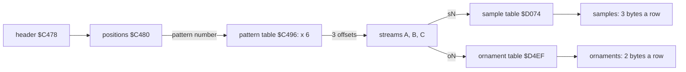

Worked example, pattern 0 decoded by hand. Its pattern table entry, `$C496`: `60 00 6D 00 71 00`, so the three
streams are at `$C496 + $60 = $C4F6`, `$C503` and `$C507`.

Channel A, `$C4F6`: `81 A1 CF D0 F0 01 2A 2D 2F 32 31 2D FF`:

| Bytes | Means |
| --- | --- |
| `81` | sample 1 |
| `A1` | ornament 1 |
| `CF` | channel volume 15 |
| `D0` | noise base 0 |
| `F0 01` | row length 1 |
| `2A` | note 42: E-4, the first event (row 0) |
| `2D 2F 32 31 2D` | G-4, A-4, C-5, B-4, G-4: rows 1-5 |
| `FF` | the end; RowDone sees it after G-4 and clears bit 0 |

Channels B, `$C503`, and C, `$C507`: `F0 06 7F FF`: row length 6, `off`, end. Both are silent for the 6 rows, and both
clear bit 0 at once, after row 0. A clears it after row 5. On the row frame of row 6 (model frame 36) all three are clear
and position 1 starts: pattern 0 is 6 rows, 36 frames.

Note 42 is PeriodTable[42] = `$0150` = 336, so E-4 sounds at 1 750 000 / (16 x 336) = 325.5 Hz (E4 is 329.6 Hz:
the table is tuned for the 128K's 1.7734 MHz). Sample 1 (`$D0B7`) starts with rows `00 01 C8`, `00 01 D8`,
`00 FF F8`, `00 FF E8`, `00 FF C8`, `00 FF C8`: tone deltas +1, +1, -1, -1, -1, -1; volumes 12, 13, 15, 14, 12, 12;
mixer tone on, noise off. Ornament 1 (`$D531`) is `00 00`, `80 0C`, `00 F4`, `60 00`: +0, then a loop of +12 (the loop
row), -12, +0 (loop back).

What the first 6 frames send, worked out and compared with the model (`python3 tools/sound_sim.py regs --from 0 --frames
14`):

| Frame | Ornament: note | Sample: tone offset | Period | R1 R0 | Sample volume x 16 / 16 | R8 | R7 |
| ---: | --- | ---: | --- | --- | ---: | --- | --- |
| 0 | +0: 42 | +1 | 336 + 1 = 337 | `01 51` | 12 | `0C` | `08` |
| 1 | +12: 54 | +2 | 168 + 2 = 170 | `00 AA` | 13 | `0D` | `08` |
| 2 | -12: 42 | +1 | 336 + 1 = 337 | `01 51` | 15 | `0F` | `08` |
| 3 | +0: 42 | 0 | 336 | `01 50` | 14 | `0E` | `08` |
| 4 | +12: 54 | -1 | 168 - 1 = 167 | `00 A7` | 12 | `0C` | `08` |
| 5 | -12: 42 | -2 | 336 - 2 = 334 | `01 4E` | 12 | `0C` | `08` |

The ornament's loop gives the octave arpeggio (42, 54, 42, 42, 54, 42, ...) and the sample's deltas a slight vibrato
around it. R7 = `$08`: A's noise off; B and C have their mixer bits 0 but volume 0. Frame 6 is the next row frame: G-4,
note 45, period `$011B` + 1 = `$011C`, and the sample and the ornament start again.

Witness: the model's registers above; the c3 trace check (9.7) proves the model on recorded frames.

The point: a stream is compact (13 bytes for six notes) because the sample, ornament, volume and row length stay set
until a command changes them, and the arpeggio and vibrato come from the sample and the ornament, not from the notes.

## 9.6 The samples and the ornaments

A sample is a list of 3-byte rows, one played every frame from the note's start:

| Byte | Bits | What |
| --- | --- | --- |
| 0 | 7 | S: this row is the loop row |
| 0 | 6 | L: after this row go back to the loop row (unless released) |
| 0 | 5 | X: the sample ends after this row: the channel goes silent |
| 0 | 4-0 | the noise delta, -16 to 15 |
| 1 | 7-0 | the tone delta, -128 to 127, added to the tone offset |
| 2 | 7-4 | the volume 0-15 |
| 2 | 3 | noise off |
| 2 | 1 | E: on the envelope (in envelope mode) |
| 2 | 0 | tone off |

An ornament is a list of 2-byte rows: byte 0 as for a sample (S, L, and the noise delta), byte 1 the note delta.

The volume is scaled by the channel volume: SampleVolume adds the row's volume to itself chvol times and keeps the top
4 bits, so the AY gets vol x (chvol + 1) / 16.

```text
SampleStep(ch):                                  ; once a frame, while a note is on
    row = ch.sample_row; ch.sample_row += 3
    if row.S: ch.sample_loop = row
    if row.L and not ch.released: ch.sample_row = ch.sample_loop
    elif row.X: ch.sample_ended = 1                ; silent from the next frame
    ch.tone_offset += signed(row.tone)
    ch.mix = row.byte2 & $09
    ch.on_envelope = row.byte2 bit 1
    ch.volume = (row.vol * (ch.chvol + 1)) >> 4
    ch.noise = (ch.noise + signed5(row.noise)) & 31

OrnamentStep(ch):
    row = ch.ornament_row; ch.ornament_row += 2
    if row.S: ch.ornament_loop = row
    if row.L: ch.ornament_row = ch.ornament_loop  ; an ornament always loops
    ch.note += signed(row.note)
    ch.noise = (ch.noise + signed5(row.noise)) & 31
```

SampleStep's three ways on from a row:

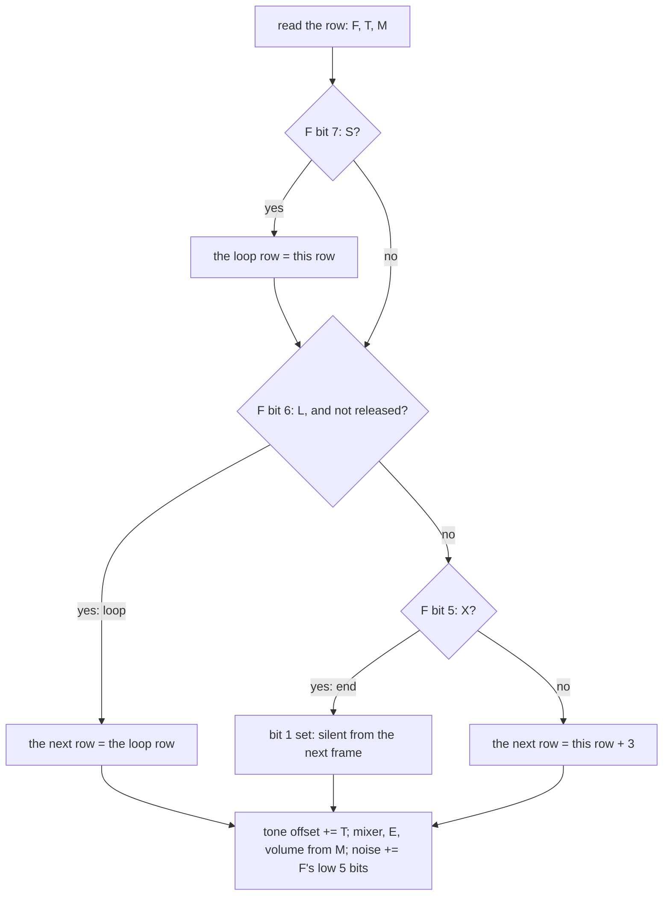

The `rel` event sets the released bit, so a looping sample runs on through its L row to the rows after it, and ends at
its X row: this is how a note fades out after a release.

```text
C36B  78           LD A,B                  ; SampleVolume: the row's byte 2
C36C  0F 0F 0F 0F  RRCA x 4
C370  E6 0F        AND $0F                 ; the row's volume
C372  57           LD D,A
C373  DD 46 08     LD B,(IX+$08)           ; the channel volume
C376  7A           LD A,D
C377  82           ADD A,D                 ; SampleVolumeLoop
C378  10 FD        DJNZ SampleVolumeLoop   ; vol x (chvol + 1)
C37A  E6 F0        AND $F0
C37C  0F 0F 0F 0F  RRCA x 4                ; / 16
C380  DD 77 07     LD (IX+$07),A
```

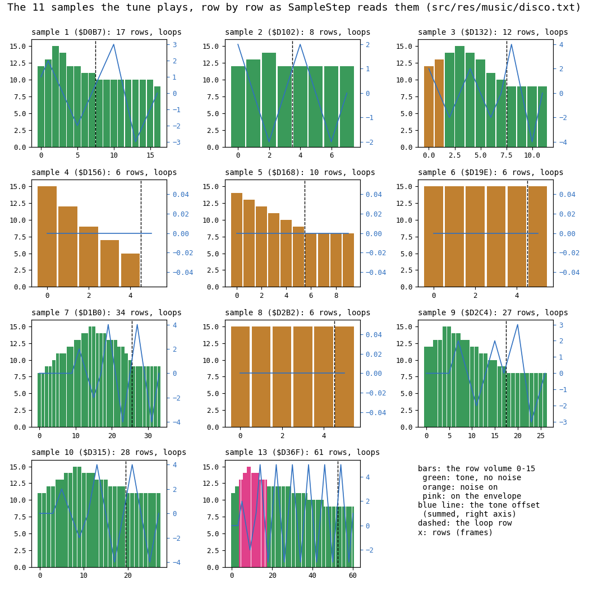

*The 11 samples the tune plays, row by row, as SampleStep reads them from the module. Bars: the row's volume (green
tone only, orange noise on, pink on the envelope); the blue line: the summed tone offset; dashed: the loop row. Command:
`python3 tools/sound_sim.py fig-samples docs/img/sound/samples.png`.*

How to read it:

- Melodic samples (1, 2, 7, 9, 10) are green: tone only, with a vibrato in the blue line and a sustained loop.
- Drum samples (3, 4, 5, 6, 8) are orange: noise on, with falling volumes for the hits.
- Sample 13 is the only one with envelope rows (pink, rows 4-16): it plays on the AY's envelope in patterns 6-9.

Worked example, the volume of sample 1's row 2 (volume 15) in a channel at `v8`: 15 x 9 = 135 = `$87`; AND `$F0` = `$80`;
/ 16 = 8. At `v15` the same row gives 15 x 16 / 16 = 15.

Witness: the c3 trace `973:150-973:13000` reads the sample and ornament rows (the PlayFrame animation's grid); the
model's registers agree with the recording (9.7).

The point: the sound of each instrument lives in its sample and ornament, frame by frame; the streams only choose them.

## 9.7 ChannelSound and WriteAY: the registers

ChannelSound `$C2A0` turns a record into registers. If a note is on and its sample has not ended, it steps the sample
and the ornament, takes the noise period, looks the note up in PeriodTable `$C3CA` (86 words, notes 0 to `$55`; the resource `src/res/tables/note-periods.txt`), adds the tone offset,
and stores the tone period (R0-R5) and the volume (R8-R10) into the register image AYRegisters `$C0F4`. A note past
`$55` is clamped: below 0 to 0, above `$55` to `$55`. If the channel is in envelope mode and the sample row has E, the
volume gets bit 4: the AY plays the envelope. Otherwise (no note, or the sample ended) only the volume is written, as
0.

```text
ChannelSound(n, ch):                             ; $C2A0, n = 0-2
    if ch.sample_ended or not ch.note_on: R[8+n] = 0; return
    SampleStep(ch); OrnamentStep(ch)
    if not ch.row_noise_off: AYNoise = ch.noise
    note = ch.note
    if note > $55: note = 0 if note >= $80 else $55   ; below 0 (an ornament's minus) or too high
    period = PeriodTable[note] + ch.tone_offset
    R[2n] = period & $FF; R[2n+1] = (period >> 8) & $0F
    vol = ch.volume
    if ch.envelope_mode and ch.row_E: vol |= $10     ; the AY's envelope bit
    R[8+n] = vol
```

The two places the pseudocode hides, the clamp without a branch per case and the test of two bits at once:

```text
C2C2  DD 7E 02     LD A,(IX+$02)           ; ChannelSoundNote: the note
C2C5  FE 56        CP $56
C2C7  38 05        JR C,ChannelSoundPeriod ; 0-$55: as it is
C2C9  17           RLA                     ; bit 7 into the carry: negative?
C2CA  9F           SBC A,A                 ; $FF if negative, else 0
C2CB  2F           CPL                     ; 0 if negative, else $FF
C2CC  E6 55        AND $55                 ; 0 or $55
...
C2F0  DD 7E 00     LD A,(IX+$00)           ; the flags
C2F3  2F           CPL
C2F4  E6 30        AND $30                 ; Z only when bit 4 (mode) and bit 5 (row E) are both 1
C2F6  DD 7E 07     LD A,(IX+$07)           ; the volume (LD keeps the flags)
C2F9  20 02        JR NZ,ChannelSoundVolume
C2FB  F6 10        OR $10                  ; on the envelope
```

WriteAY `$C15F` then writes the image to the AY, from the top register down, with OUTD: B is `$BF` before OUTD
decrements it, so the data goes to port `$BEFD`. Register 13 (the envelope shape) is written only when a `shapeN`
command set AYEnvelopeShape `$C101` in this frame: writing R13 restarts the envelope, so it must not be written every
frame. After the loop A is `$FF`, and that is stored as "no new shape".

```text
WriteAY():
    if AYEnvelopeShape != $FF: r = 13            ; a new shape: write R13 too
    else: r = 12
    for r down to 0:
        OUT ($FFFD), r; OUT ($BEFD), AYRegisters[r]
    AYEnvelopeShape = $FF
```

```text
C15F  21 01 C1     LD HL,AYEnvelopeShape   ; WriteAY
C162  11 BF FF     LD DE,$FFBF             ; D: the select port's high byte, E: $BF for OUTD
C165  0E FD        LD C,$FD
C167  7E           LD A,(HL)
C168  3C           INC A                   ; $FF: no new shape
C169  3E 0D        LD A,$0D
C16B  20 02        JR NZ,WriteAYLoop       ; a shape: from register 13
C16D  3D           DEC A                   ; none: from register 12
C16E  2B           DEC HL
C16F  42           LD B,D                  ; WriteAYLoop
C170  ED 79        OUT (C),A               ; select register A at $FFFD
C172  43           LD B,E
C173  ED AB        OUTD                    ; B = $BE, OUT ($BEFD),(HL), HL - 1
C175  3D           DEC A
C176  F2 6F C1     JP P,WriteAYLoop
C179  32 01 C1     LD (AYEnvelopeShape),A  ; A = $FF
C17C  C9           RET
```

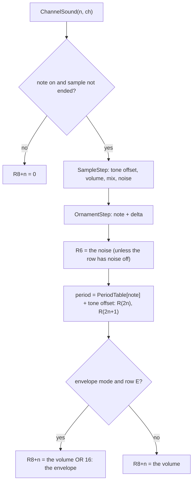

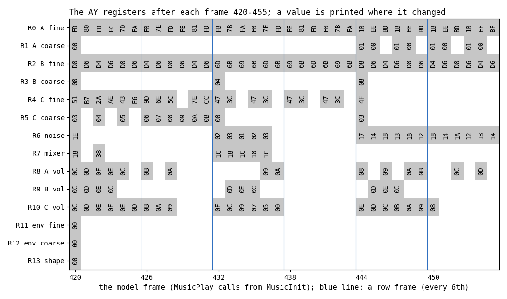

*The 14 registers after model frames 420-455 (c3 frames 973-1008), a value printed where it changed; the blue lines
are row frames. Command: `python3 tools/sound_sim.py fig-regs docs/img/sound/registers.png --from 420 --frames 36`.*

How to read it:

- R0/R1 (channel A) change every frame: the ornament's octave jumps and the sample's vibrato.
- R4/R5 (channel C) slide down between row frames: a drum hit with a falling ornament.
- R6 and R7 change only around the drum hits: the noise period and the mixer.
- R11-R13 stay 0: pattern 2, which all these frames play, does not use the envelope. R13 is the AY's own value, last
  written (0) by MusicInit's Silence; the image byte AYEnvelopeShape is `$FF` at that moment (the animation below).

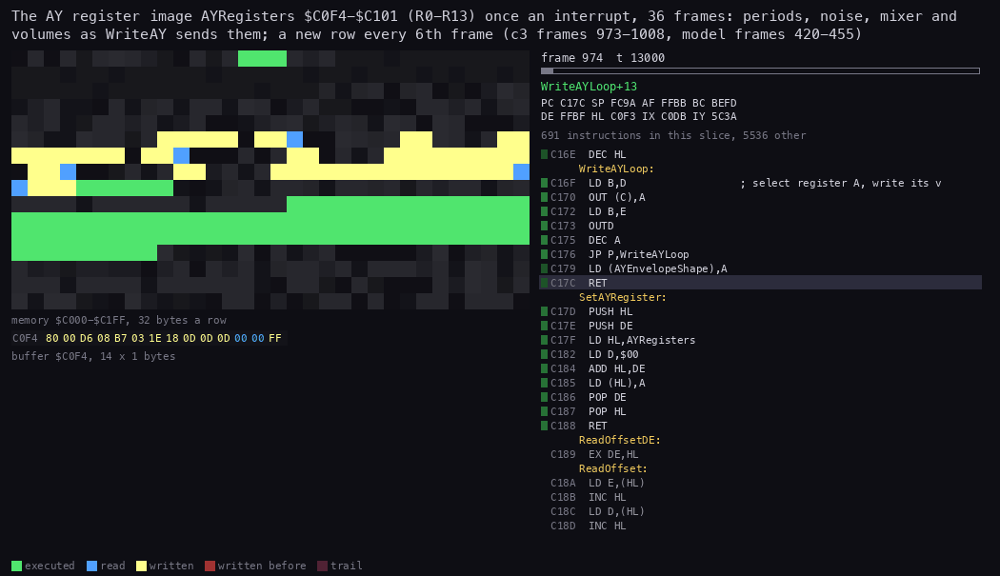

*The routine animation of the player, one picture an interrupt, c3 from 973:13000 to 1009:13000 (TTD units; step
71 680 T, 36 pictures). The view is AYRegisters `$C0F4-$C101` (R0-R13); the memory grid is `$C000-$C1FF`, 32 bytes a
row. Command: `python3 ../../kit/routine_anim.py --work work/docs/zbB/c3 --window 973:13000-1009:13000 --listing
build/music.lst --view buffer:C0F4:14x1:hex --pc C000-C3C9 --range C000-C1FF --step 71680 --delay 300 --hold 2000
--out docs/img/routines/WriteAY.gif` (with a `--title`).*

How to read the animation:

- Each picture is the state at the end of a frame's MusicPlay: the register image as WriteAY sent it.
- The last byte, AYEnvelopeShape `$C101`, is always `FF` at that moment.
- A new row every 6th picture: the bytes of R0-R10 change more at once.

Worked example, the model against the recording. The command
`python3 tools/sound_sim.py check --work work/docs/zbB/c3 --window 963:0-975:0`
reads the AY writes from the c3 trace (`OUT ($FFFD)` and `OUTD` to `$BEFD`):

```text
recording frames 963-974: 156 AY writes in 12 frames
model frame 410 (recording frame 963 = model frame + 553): 12 of 12 frames write for write
```

and on the window `973:13000-1009:13000`: 468 writes in 36 frames, 36 of 36 equal to model frames 421-456. 13 writes a
frame: R12 down to R0, no R13. So c3's music is the model's shifted by 553 frames, register for register.

Witness: the two c3 traces above, 48 frames.

The point: the AY gets 13 registers every frame, the same whether they changed or not, and the envelope shape only on
the frame a pattern asks for it.

## 9.8 The tune

"Disco music" by Ant P: 22 positions over 16 patterns, a row every 6 frames (8.33 rows a second). Channel A plays the
melody (samples 1, 7, 9, 10, 13; drum hits of sample 6 in pattern 14), B the bass (sample 2, with octave jumps; sample 8
in patterns 2 and 14), C the drums (samples 3, 4, 5: noise rows and falling ornaments). Patterns 6-9 open with sample 13 on the envelope (`env shape14`: the triangle, `ep` from `$23`
to `$3F` per note).

The positions and their lengths, from the model (`python3 tools/sound_sim.py loop`):

| Position | Pattern | Tune loop 1: start, frames | Later tune loops: frames |
| ---: | ---: | --- | ---: |
| 0 | 0 | 0, 36 | 96 |
| 1, 2 | 1, 2 | 36, 384; 420, 384 | 384 |
| 3 | 3 | 804, 378 | 378 |
| 4-8 | 3, 4, 4, 5, 5 | 1182 ... 2718, 384 each | 384 |
| 9 | 6 | 3102, 390 | 390 |
| 10-18 | 6, 7, 8, 9, 9, 10, 11, 12, 13 | 3492 ... 6564, 384 each | 384 |
| 19 | 15 | 6948, 48 | 48 |
| 20 | 1 | 6996, 384 | 384 |
| 21 | 14 | 7380, 324 | 324 |

```text
tune loop 1: 7704 frames, tune loop 2: 7764 frames, tune loop 3: 7764 frames
registers of tune loop 3 = tune loop 2 in 7764 of 7764 frames
```

So the first tune loop, from MusicInit, is 7704 frames (154.1 s); every later tune loop is 7764 frames (155.3 s) and repeats
exactly. The patterns' streams add up to 1294 rows (7764 frames). The first tune loop is 10 rows shorter because position 21
ends 10 rows early (9.4), and the next tune loop's position 0 is where those rows are played. The other odd lengths come
from the same rule: pattern 3's A reads its last event (`len10 G-5`) at row 54 and B and C theirs at row 62, so
position 3 changes at row 63 (378 frames), while A's note still runs to row 64; the 1-row delay stays until pattern 6
(position 9), which waits one row more (390 frames) for its last 1-row event.

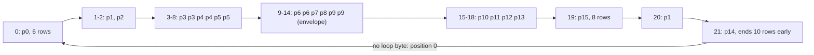

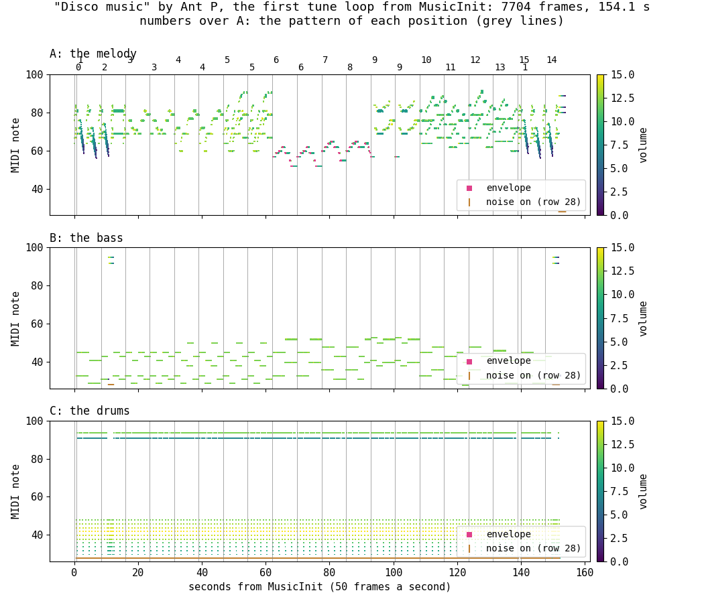

*The tune over the first tune loop, from MusicInit: each channel's tone period as a MIDI note, frame by frame, coloured by
the volume; pink: on the envelope; the grey lines and numbers: the position starts and their patterns. Command:
`python3 tools/sound_sim.py fig-tune docs/img/sound/tune.png`.*

How to read it:

- A, the melody, is the busy top panel: the arpeggios show as vertical streaks. The low lines in patterns 6-9 are sample 13 on the envelope: 62-93 s
  (positions 9-12), and the first 1.2 s of each pattern 9 (93 s and 101 s), which goes on with sample 9 off the
  envelope.
- B, the bass, alternates a note and its octave in 2-row steps.
- C, the drums, is the dense band at the bottom (noise hits) and the high line (the hi-hat tone).

Worked example, the frame of position 2's start: position 0 lasts 36 frames, position 1 384, so position 2 starts at
model frame 420, c3 frame 973. The PlayFrame animation (9.4) is that frame.

Witness: c1 plays frames 543-7879 (7274 calls), reaching position 20 (model frame 6996) but not position 21 (7380).
c6 (`orig/boot.scl` idle for 16 566 frames, WALKTHROUGH 6.0) plays three tune loops' starts: PositionOp's operand
`$C195` (the next position) becomes 1 at frames 544, 8249 and 16013 (TTD `memory_at` at T 0 of each frame), 7705 and
7764 frames apart, and 2 at 580 and 8345: position 0 lasts 36 frames the first time and 96 the second. Position 21
starts at frame 7926 (the operand `$15` to 0) and lasts 323 frames to 8249. Against the model the three changes sit
544, 546 and 545 frames late (positions 0, 21 and the second loop's 0: model frames 0, 7380, 7704): within 1 frame of
the model. Sampling at T 0 sees a change only in the frame after the handler's MusicPlay made it, and MusicPlay does
not run at the same T in every frame, so the 7705 against the model's 7704 and the 323 against its 324 are that
sampling jitter, not lost or extra frames; the 7764 of the later loops matches exactly.

The point: the menu's music is a 2.5-minute tune that never stops; the first time round it is a minute fraction
shorter than every later time, because of the position rule.

## 9.9 SoundOff and PlayBell

The menu has two sounds of its own, both written with the menu's WriteAY `$6E4F`, 14 registers from a table:

- **SoundOff** `$6E41` writes 14 bytes from `$7530` (30000 in the source). That is inside Unused1, which the loader
  clears and nobody writes, so all 14 are 0: no volume, and R13 = 0. ShowCatalogue calls it before each page,
  ReadKeyboard before SPACE's disk read. That holds for the original's loader; zyxermbt loads code at `$7530`, and its
  SoundOff buzzes ([doc 13, 13.7](13-variants.md#137-the-own-loaders)).
- **PlayBell** `$6E48` writes ExitSound `$6E64`, once, from RunLetter, after the launch line is written
  ([doc 10](10-launcher-and-notes.md)).

ExitSound's 14 bytes, decoded:

| Register | Value | Means |
| --- | --- | --- |
| R0, R1 | 48, 0 | A's period 48: 1 750 000 / (16 x 48) = 2279 Hz |
| R2, R3 | 1, 0 | B's period 1: 109 kHz, above hearing |
| R4, R5 | 80, 0 | C's period 80: 1367 Hz |
| R6 | 0 | the noise (unused) |
| R7 | 56 = `%00111000` | tones A, B, C on, noise off |
| R8-R10 | 16 | all three on the envelope |
| R11, R12 | 196, 80 | the envelope period `$50C4` = 20 676 |
| R13 | 1 | shape 1: one fall, then silence |

One fall of the envelope takes 256 x 20 676 / 1 750 000 = 3.02 s. Nothing writes the AY after PlayBell: ExitFade,
the loader and TR-DOS run while the bell dies away. In c3 TEST 30 starts 104 frames (2.08 s) after PlayBell, after 11
of the envelope's 16 steps (level 4 of 15), so the bell sounds on for another 0.94 s under the launched program. The
AY stays as ExitSound left it: its periods and mixer, the three channels on the envelope, which ends at 0.

```text
6AD3  CD 48 6E     CALL PlayBell           ; RunLetter, the launch line written
6AD6  CD 72 6E     CALL ExitFade           ; 22 frames; the bell rings on
...
6E64  30 00 01 00 50 00 00 38 10 10 10 C4 50 01   ; ExitSound: R0 ... R13
```

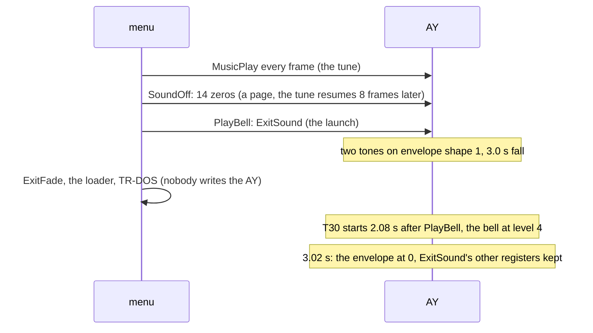

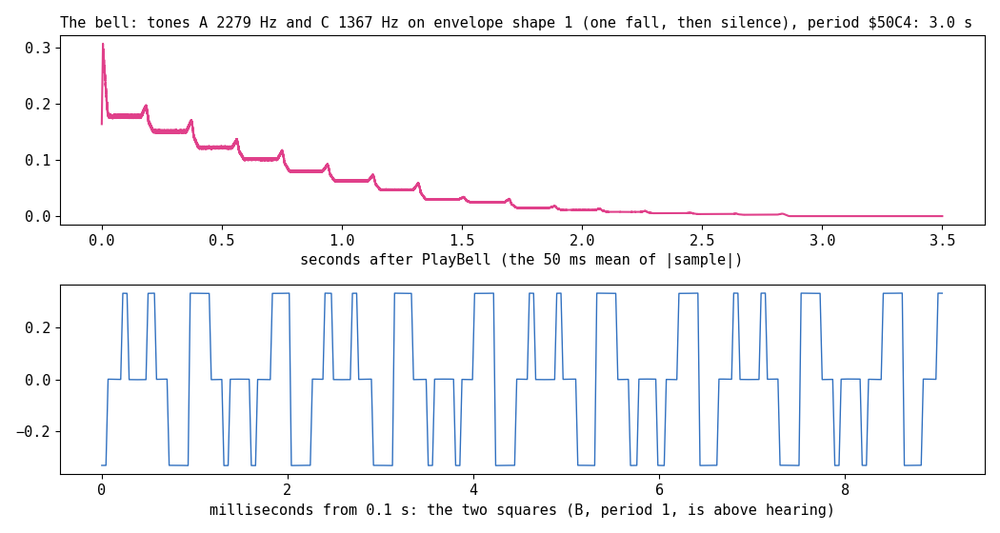

*The bell rendered from ExitSound's registers (the AY's tone counters and envelope at 1.75 MHz): top, the loudness over
3.5 s; bottom, 9 ms of the wave from 0.1 s. Command: `python3 tools/sound_sim.py fig-bell docs/img/sound/bell.png`.*

How to read it:

- The top curve is the envelope's fall: 16 steps of about 0.19 s, so it falls in visible stairs.
- The bottom shows two square waves added: A at 2279 Hz and C at 1367 Hz; B's 109 kHz square averages out.

Worked example: the bell's first step lasts 20 676 x 16 / 1 750 000 = 0.19 s, the stair width in the top curve.

Witness: c3: RunLetter at 2182:9016, PlayBell at 2182:14196, ExitFade from 2182:15732, TEST 30's first pixels at
frame 2286 ([doc 10, 10.6](10-launcher-and-notes.md#106-the-loaders-end-and-tr-dos)). SoundOff before the page:
ShowCatalogue at 1879:16219 (the trace `1879:16200-1888:0`).

The point: the bell is a chord on a falling envelope, set once and left to the AY: it costs the menu 14 OUTs, and it
covers the time the launch takes, and a little more.

## 9.10 The audio files

The WAV files are renders of the model's registers (`render_ay` in `tools/sound_sim.py`: the AY's tone counters,
noise and envelope at 1.75 MHz, the three channels mixed linearly). They were written, never played, by `python3
tools/sound_sim.py wavs docs/audio`:

| File | What | Length |
| --- | --- | --- |
| [disco-music.wav](audio/disco-music.wav) | the tune's first tune loop from MusicInit, 22 050 Hz | 154.08 s |
| [disco-music.mp3](audio/disco-music.mp3) | the same, MP3 128 kbit/s | 154.08 s |
| [bell.wav](audio/bell.wav) | the bell, ExitSound held for 175 frames | 3.5 s |
| [soundoff-page.wav](audio/soundoff-page.wav) | 2 s of the tune (from model frame 1336), SoundOff's 8 silent frames, then the tune again | 4.16 s |

The point: the files let a reader hear the tune, the gap at a page and the bell without the emulator.

## 9.11 Known only from the code

- MusicStop `$C011` and Silence after set-up: no recording calls them. The menu never stops the music; the bell
  replaces it.
- Envelope mode: the `env` command, `ep` bytes and shape 14 run in patterns 6-9, model frames 3102-5412. c1 plays them
  (frames 3645-5955), but no trace of them was examined; the model gives their registers.
- A page during patterns 6-9: SoundOff writes R13 = 0 (and R11 = R12 = 0), which restarts the envelope with shape
  0: one very short fall, then silence. The player writes R13 only for a `shapeN` command, and patterns 6-9 set the shape only at their first
  row. So after a page change in patterns 6-9, sample 13's envelope rows (4-16 of each note) play silence until the next
  pattern starts. No recording turns a page there.
- The header's three bytes `$80 $54 $1E` and its four addresses: nobody reads them.
- `$FF` as "shape 15": unreachable, because RowDone's look-ahead ends the stream first.

## 9.12 The point

The menu's music is a stock ASC Sound Master module with its compiled player, called once an interrupt and left
alone. Its cost is a tenth of a frame; its only interruptions are the 8 silent frames of a page draw and the bell at
the launch. The player patches its own instructions with the tune's tables at set-up, writes 13 registers a frame,
and starts each position as soon as every channel has read its last event, which makes the first tune loop 7704 frames
and every later one 7764.
