# 10. The launcher, and notes on the code

What this covers:

- the chain from a key to the chosen program running (10.1);
- RunLetter: the catalogue walk, the deleted marks, the command it writes into line 1 (10.2);
- the keys that lead to it: a letter, or ENTER, 5 or 0 on the cursor (10.3);
- what is put back before the menu returns: SP, IY, HL', I, CHARS, FRAMES, IM 1 (10.4);
- the bell and ExitFade, the screen's fade (10.5);
- the loader's end and TR-DOS running the file (10.6);
- the notable features of the code: self-modifying code, tricks, bugs and quirks (10.7);
- what is known only from the code (10.8), and the point (10.9).

The names are those of `src/main/main.ann` (modules launcher, keys, sound, fade) and `src/basic/basic.ann`. Vadim's
2010 decompilation (`work/stage1/ZYXboot.utf8.mac`) reads RunLetter the same way, including the deleted marks it
leaves in the catalogue.

The recordings are those of [WALKTHROUGH 1](../WALKTHROUGH.md#1-one-recording-from-power-on), on a Pentagon 128K,
reopened from their TTD sessions on this writer's own instance (port base 37450, muted):

- c2: `tests/disks/many.scl`: ENTER on T03 (the cursor on the third file of page 1) at frame 3763;
- c3: `tests/disks/many.scl`: SYMBOL SHIFT at frame 1879 (page 2), then F at frame 2182: T30 runs;
- c4: `tests/disks/noexe.scl`: NO EXE FILES !, then A (frame 1879) and ENTER (frame 1983), which do nothing.
- c5: `tests/disks/deep.scl`: two SYMBOL SHIFTs to page 3, then D at frame 2490: `magic`, the GO TO ... CODE path (10.6,
  10.8); made at the integration.

c3 has traces of the launch: `2182:9000-2182:15800` (RunLetter) and `2182:15700-2205:0` (ExitFade).

## 10.1 The chain from a key to the program

The menu never loads a file. It writes a TR-DOS command into line 1 of its own BASIC program, puts the machine back
as BASIC left it, and returns. BASIC then runs line 1, and TR-DOS runs the command.

The keys are read inside the IM 2 handler ([doc 5](05-keys.md)), so the whole launch, up to its last `RET`, runs inside
an interrupt that never ends with `RETI`: RunLetter puts back the SP that Start saved, and its `RET` leaves the
interrupt's stack frame behind for good.

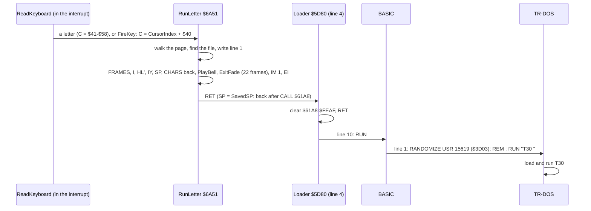

The timeline in c3 (frame:T-state):

| When | What |
| --- | --- |
| 2182:9016 | RunLetter, called by ReadKeyboard for the letter F |
| 2182:14196 | PlayBell: line 1 is written, the registers are back |
| 2182:15732 | ExitFade starts |
| 2204:3403 | ExitFade's last pass ends; IM 1, EI, RET |
| 2205 | FRAMES counts again from 0 (1 at frame 2206) |
| 2205 | line 1 reads `RANDOMIZE USR VAL "15619": REM : RUN "T30     " ` |
| 2286 | the first pixels of TEST 30, the program T30's own screen |

Two TR-DOS entries meet here, and they are different. The menu reads the catalogue through `$3D13` (TrdosEntry, a
machine-code call with C = 5, [doc 7](07-catalogue-and-menu.md#71-reading-the-catalogue)). Line 1 calls `$3D03` (15619),
TR-DOS's entry for a BASIC line: it executes the TR-DOS command that follows the `REM :` in the same line.

Witness: L1 of c3: RunLetter once (frames 2182-2204, 1 571 390 T with all it calls), PlayBell once (frame 2182), ExitFade
once (frames 2182-2204, 1 564 652 T). Line 1 and the screen: TTD `memory_at` on c3 at frames 2205, 2250 and 2286.

The point: the launch is a handover to BASIC and TR-DOS. The menu's last job is to leave BASIC a line to run and a
machine in the state BASIC expects.

## 10.2 RunLetter: the walk and the command

RunLetter `$6A51` takes a letter in C (`$41` A to `$58` X) and finds the file with that letter on the current page. It
walks the catalogue from PagePointer `$B3C1` (the page's first entry) with the same test as ListCatalogue
([doc 7, 7.2](07-catalogue-and-menu.md#72-which-files-are-listed)), and counts the listed files in B of the second
register set, from `$40`.

The walk has one trick. SkipDeleted `$674D`, called at the top of each step, steps over entries whose first byte is 1
(deleted). After a listed file that is not the chosen one, RunLetter sets that entry's first byte to 1 and goes back
to the top with HL still on the entry: SkipDeleted then steps over it. The chosen entry gets its first byte back; the
ones before it on the page stay marked. The marks are in the catalogue's copy in memory only, never on the disk, and
the loader clears that memory anyway (10.6). Entries that are not listed are stepped over by adding 3 to HL, which
points at +13 at that moment.

When the letter is found, RunLetter writes three places in line 1 of the BASIC program (`$5D3B`):

| Address | Name | Written |
| --- | --- | --- |
| `$5D4C` | LaunchToken | `$F7` RUN for a BASIC file, `$EC` GO TO for a 192-sector CODE file |
| `$5D4E-$5D55` | LaunchName | the 8 bytes of the file's name |
| `$5D57` | LaunchSuffix | a space after RUN, `$AF` CODE after GO TO |

```text
RunLetter(letter):                                ; C = $41 'A' ... $58 'X'
    if FileCount + $40 < letter: return           ; past the page's files
    n = $40                                       ; B' 
    entry = PagePointer
    loop:
        while entry[0] == 1: entry += 16          ; SkipDeleted: deleted, or marked by this walk
        kind = entry.type AND (0 if entry is "boot    B" else $FF)
        if kind == 'B': token = RUN
        elif kind == 'C' and entry.sectors == 192: token = GO TO
        else: entry += 16; continue               ; not listed
        n += 1
        first = entry[0]; entry[0] = 1            ; mark it: the next SkipDeleted steps over it
        if n != letter: continue
        entry[0] = first                          ; the chosen one: unmarked
        LaunchToken = token
        LaunchName = entry.name                   ; 8 bytes
        LaunchSuffix = ' ' if token == RUN else CODE
        put back the machine, bell, fade, IM 1, EI (10.4, 10.5)
        return                                    ; to the loader
```

```text
6A51  3A B5 B3     LD A,(FileCount)        ; RunLetter
6A54  C6 40        ADD A,$40
6A56  B9           CP C
6A57  D8           RET C                   ; the letter is past the files
6A58  06 40        LD B,$40                ; the counter, in the other set
6A5A  D9           EXX
6A5B  2A C1 B3     LD HL,(PagePointer)
6A5E  7E           LD A,(HL)               ; RunNextEntry
6A5F  CD 4D 67     CALL SkipDeleted        ; first byte 1: step over it
6A62  1E FF        LD E,$FF                ; (redundant: IsBootFile sets E)
6A64  CD 37 67     CALL IsBootFile         ; HL = +8, E = 0 for boot
6A67  16 EC        LD D,$EC                ; GO TO
6A69  7E           LD A,(HL)
6A6A  A3           AND E
6A6B  FE 42        CP $42                  ; "B"
6A6D  28 14        JR Z,RunBasic
6A6F  FE 43        CP $43                  ; "C"
...
6A7A  FE C0        CP $C0                  ; 192 sectors
6A7C  28 0B        JR Z,RunCheckLetter
6A7E  23 23 23     INC HL x 3              ; RunSkipEntry: +13 to +16
6A81  18 DB        JR RunNextEntry
6A83  01 05 00     LD BC,$0005             ; RunBasic
6A86  09           ADD HL,BC
6A87  16 F7        LD D,$F7                ; RUN
6A89  01 0D 00     LD BC,$000D             ; RunCheckLetter
6A8C  A7           AND A
6A8D  ED 42        SBC HL,BC               ; back to +0
6A8F  D9           EXX
6A90  04           INC B                   ; one more listed file
6A91  78           LD A,B
6A92  B9           CP C                    ; the letter?
6A93  D9           EXX
6A94  7E           LD A,(HL)
6A95  36 01        LD (HL),$01             ; mark it deleted
6A97  20 C5        JR NZ,RunNextEntry      ; not yet: SkipDeleted steps over it
6A99  77           LD (HL),A               ; the chosen one: unmarked
6A9A  D5           PUSH DE                 ; D = the token
6A9B  E5           PUSH HL
6A9C  21 4C 5D     LD HL,LaunchToken
6A9F  72           LD (HL),D
6AA0  23 23        INC HL x 2              ; past the quote
6AA2  EB           EX DE,HL
6AA3  E1           POP HL
6AA4  01 08 00     LD BC,$0008
6AA7  ED B0        LDIR                    ; the name into LaunchName
6AA9  13           INC DE                  ; past the closing quote
6AAA  0E 20        LD C,$20                ; a space
6AAC  E1           POP HL
6AAD  7C           LD A,H
6AAE  FE F7        CP $F7
6AB0  28 02        JR Z,RunWriteSuffix
6AB2  0E AF        LD C,$AF                ; CODE
6AB4  79           LD A,C                  ; RunWriteSuffix
6AB5  12           LD (DE),A
```

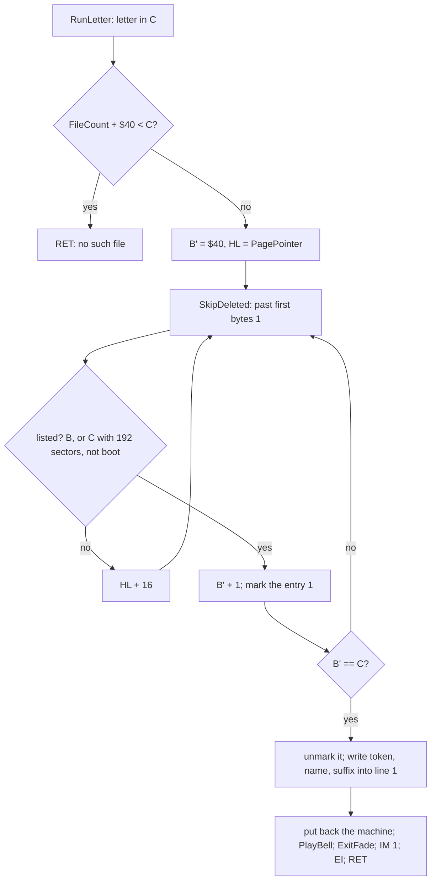

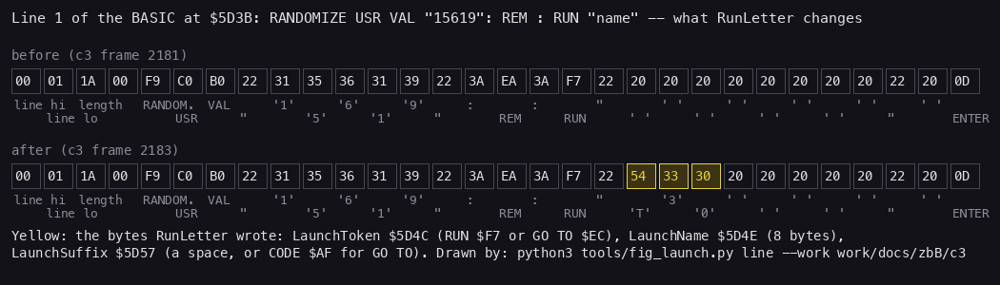

*Line 1 of the BASIC program at `$5D3B`, 30 bytes, in c3 at frame 2181 (before) and 2183 (after), read with TTD
`memory_at`; each byte with its meaning, the bytes RunLetter changed in yellow. Command: `python3 tools/fig_launch.py
line docs/img/launch/line.png --work work/docs/zbB/c3 --before 2181 --after 2183`.*

How to read it:

- The line is `RANDOMIZE USR VAL "15619": REM : RUN "        " `: line number `00 01`, length `1A 00` (26), the
  tokens, `0D` at the end.
- Only the name changes here, from 8 spaces to `T30` and 5 spaces: the token is already `F7` (RUN) and the suffix
  already a space, as the program was saved.

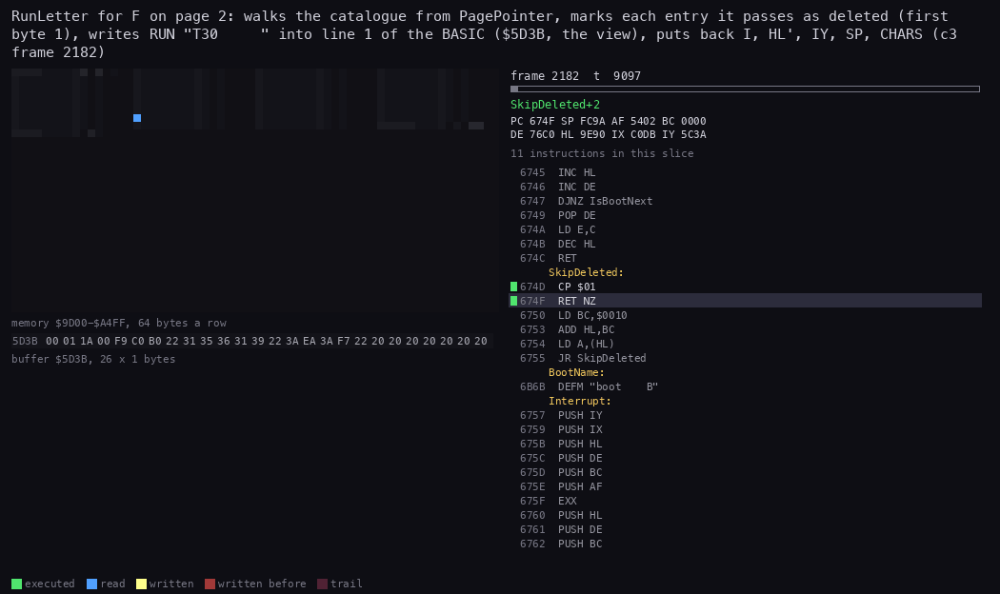

*The routine animation of RunLetter in c3, from 2182:9000 to 2182:15800 (TTD units; 70 pictures). The view is line 1
at `$5D3B`, 26 bytes; the memory grid is the catalogue `$9D00-$A4FF`, 64 bytes a row. Command, from the case folder
after `. work/env.sh`: `python3 ../../kit/routine_anim.py --work work/docs/zbB/c3 --window 2182:9000-2182:15800
--listing build/main.lst --view buffer:5D3B:26x1:hex --pc 6A3F-6AFC,6737-6756,6E41-6E71 --range 9D00-A4FF --pictures
70 --out docs/img/routines/RunLetter.gif` (with a `--title`).*

How to read the animation:

- The grid's blue marks walk down page 2 of the catalogue from `$9E90`: one entry at a time, its name compared with
  BootName (IsBootFile), then its type.
- Each passed entry gets a red mark at its first byte: the deleted mark.
- At T30 the view's name bytes turn to `54 33 30`, then the registers are put back and PlayBell runs.

Worked example, c3, F on page 2. PagePointer is `$9E90`, entry 25. FileCount for page 2 is 7, so `$47` is not below `$46`
(F): the walk starts. T25 (`$9E90`) is listed: B' = `$41`, not F: marked. T26, T27, T28 and T29 follow: B' = `$42`
to `$45`, each marked. T30 (`$9EE0`, entry 30) is listed: B' = `$46` = F: its first byte `54` goes back. The token
stays `F7`, the name becomes `54 33 30 20 20 20 20 20`, the suffix a space. After the launch, TTD `memory_at` on c3
shows entries 25-29 with first byte `01` and entry 30 with `54`.

Witness: the c3 trace `2182:9000-2182:15800`; RunLetter's L1 in c3; line 1 and the catalogue by `memory_at` at
frames 2181 and 2183.

The point: RunLetter turns a letter into a TR-DOS command with nothing but the catalogue in memory and three writes
into a BASIC line that was saved for it; marking the passed entries as deleted lets it reuse SkipDeleted to advance.

## 10.3 The keys that launch

Two ways reach RunLetter, both from ReadKeyboard in the interrupt ([doc 5](05-keys.md)):

- **a letter key**: ReadKeyboard scans the 24 letters A-X with KeyTable `$6B53` and calls RunLetter with C = the
  letter's code, `$41`-`$58`;
- **ENTER, 5 or 0** (5 and 0 are the fire of the two Sinclair joysticks, `$689E` and `$68A6`; the Kempston fire at
  `$68CC` is never read, 10.7): FireKey `$6A3F` returns if the page has no files (ColumnOneCount OR ColumnTwoCount is
  0), else it sets C = CursorIndex + `$40` and falls into RunLetter.

```text
FireKey():
    if ColumnOneCount == 0 and ColumnTwoCount == 0: return   ; NO EXE FILES !
    C = CursorIndex + $40                                     ; CursorIndex counts from 1
    RunLetter(C)
```

```text
6A3F  F5           PUSH AF                 ; FireKey
6A40  3A BB B3     LD A,(ColumnOneCount)
6A43  47           LD B,A
6A44  3A BC B3     LD A,(ColumnTwoCount)
6A47  B0           OR B
6A48  CA 6E 69     JP Z,KeyDone            ; no files
6A4B  3A C0 B3     LD A,(CursorIndex)
6A4E  C6 40        ADD A,$40
6A50  4F           LD C,A                  ; falls into RunLetter
```

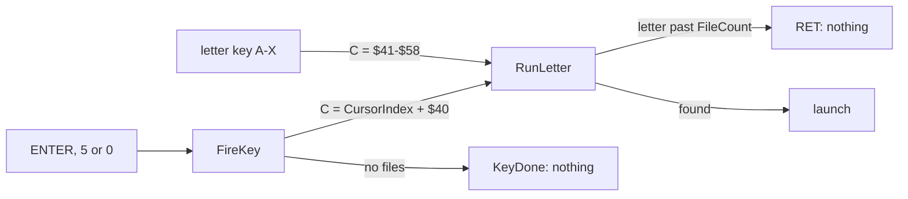

Worked examples:

- c2, ENTER at frame 3763 with the cursor on T03: CursorIndex = 3, C = `$43` (C), the third file of page 1. RunLetter
  marks T01 and T02 and writes `RUN "T03     "`. c2 ends with TEST 03 on the screen.
- c4, `noexe.scl`, no listed file: A at frame 1879 calls RunLetter, which returns at once since FileCount + `$40` =
  `$40` is below `$41` (35 T). ENTER at frame 1983: FireKey sees both columns empty and jumps to KeyDone (75 T).

Witness: L1 of c2 (FireKey once, frames 3763-3785, 1 569 813 T: the walk, the bell and the fade); L1 of c4 (RunLetter
35 T at frame 1879, FireKey 75 T at frame 1983).

The point: ENTER is a letter key in disguise: the cursor's index becomes a letter, and the same walk finds the file.

## 10.4 What is put back

Start saved four things before it took the machine over ([doc 7, 7.1](07-catalogue-and-menu.md#71-reading-the-catalogue)):
IY, HL', SP and I. RunLetter puts them back, with two system variables, and leaves IM 2 for IM 1:

| What | Value in c3 | Why |
| --- | --- | --- |
| FRAMES `$5C78` | 0 | the menu used it as its clock (the cursor spin, the twinkles); from the EI on the ROM's interrupt counts it again, so the launched program finds it counting from the launch (`$15`, 21, when T30 starts in c3, 10.6) |
| I | SavedI `$AFCE` = `$00` | the menu set I = `$FD` for its IM 2 table |
| HL' | SavedHLAlt `$AFCA` = `$2758` | the 48K ROM expects HL' = `$2758` when BASIC resumes |
| IY | SavedIY `$AFC8` = `$5C3A` | the ROM's interrupt and BASIC address the system variables through IY |
| SP | SavedSP `$AFCC` = `$FF2A` | the loader's stack: the `RET` returns after the loader's `CALL $61A8` |
| CHARS `$5C36` | `$3C00` | the ROM's font (the menu printed with its own, [doc 8](08-font-and-text.md)) |
| the interrupt mode | IM 1, EI | the ROM's interrupt at `$0038`; the IM 2 table and Im2Jump are about to be cleared |

The order matters at the end: IM 1 must come before EI. I already holds its saved value (`$00` in c3, from `$6ABF`), so
an IM 2 interrupt would no longer use the menu's table at `$FD00`: it would vector through the ROM's word at
I x 256 + `$FF`, `$00FF`. The menu's table would not help either: the loader clears `$61A8-$FEAF` after the menu
returns, Im2Table `$FD00` and Im2Jump `$FCFC` with it.

```text
6AB6  21 00 00     LD HL,$0000
6AB9  22 78 5C     LD (Frames),HL          ; FRAMES = 0
6ABC  3A CE AF     LD A,(SavedI)
6ABF  ED 47        LD I,A
6AC1  2A CA AF     LD HL,(SavedHLAlt)
6AC4  D9           EXX                     ; HL' = $2758
6AC5  FD 2A C8 AF  LD IY,(SavedIY)
6AC9  ED 7B CC AF  LD SP,(SavedSP)         ; the interrupt's stack frame is abandoned
6ACD  21 00 3C     LD HL,$3C00
6AD0  22 36 5C     LD (Chars),HL           ; the ROM's font
6AD3  CD 48 6E     CALL PlayBell
6AD6  CD 72 6E     CALL ExitFade           ; 22 frames, interrupts still off
6AD9  ED 56        IM 1
6ADB  FB           EI
6ADC  C9           RET                     ; to the loader
```

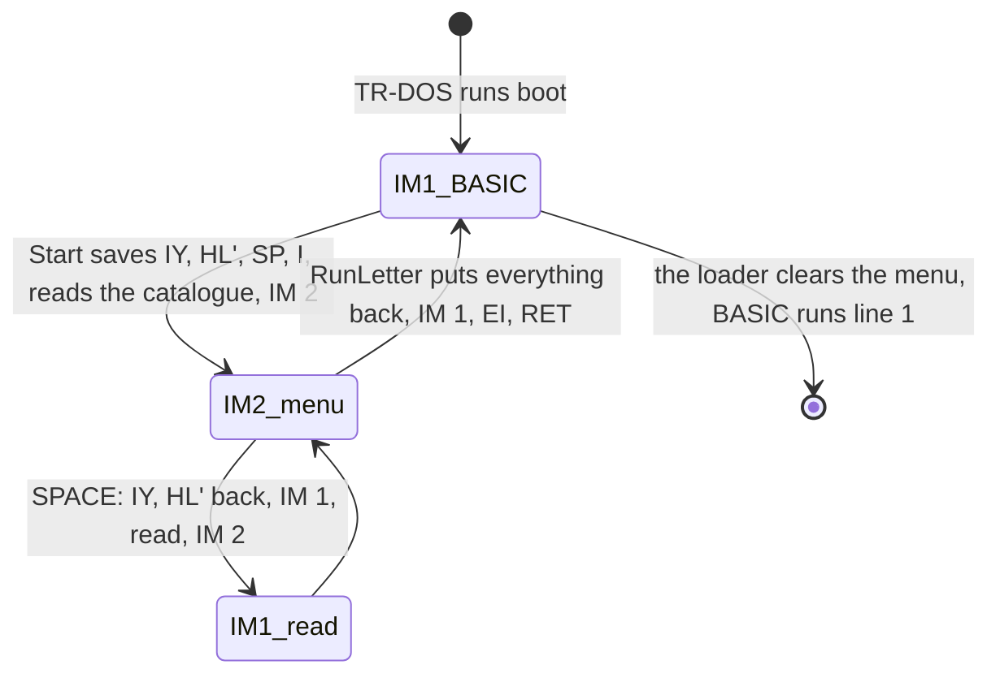

Worked example, c3 at frame 2183: `$AFC8-$AFCE` read `3A 5C 58 27 2A FF 00`: SavedIY `$5C3A`, SavedHLAlt `$2758`,
SavedSP `$FF2A`, SavedI `$00`. The RunLetter animation's register line shows SP `FF2A` and IY `5C3A` from `$6AC9` on.
The word at `$FF2A` is `B7 5D`: `$5DB7`, the instruction after the loader's `CALL MenuStart` at `$5DB4`, so the `RET`
lands in the loader.

Witness: the c3 trace `2182:9000-2182:15800` (the registers in the animation); `memory_at` on c3 of `$AFC8-$AFCE`
and `$FF2A` at frame 2183; `build/basic.lst` for the `CALL` at `$5DB4`.

The point: the menu borrows the machine and returns it as BASIC expects it. The lasting changes are line 1, the bell
still ringing (the AY holds ExitSound's registers), a black bitmap under the menu's colours (ExitFade, 10.5) and
`$61A8-$FEAF` zeroed by the loader (10.6).

## 10.5 The bell and ExitFade

PlayBell writes ExitSound to the AY: a chord on a falling envelope, 3.0 s long
([doc 9, 9.9](09-music-and-sound.md#99-soundoff-and-playbell)). Nothing writes the AY after it, so it rings on over
ExitFade, the loader and TR-DOS.

ExitFade `$6E72` then clears the screen's bitmap in 8 passes. Each pass moves every bit of every byte one place, with
0 shifted in (`XOR A` clears the carry before each shift). The bytes go in pairs, 16 pairs a 32-byte line. On lines
at even multiples of 32 bytes (even character rows) the pair moves in: the first byte right (`RR`), the second left
(`RL`), towards the pair's middle. On the other lines (odd character rows) the pair moves out: `RL` the first, `RR` the
second. A bit that reaches the byte's edge falls off. After 8 passes every byte is 0; the attributes stay.

```text
ExitFade():
    repeat 8 times:                              ; D
        hl = $4000
        while hl < $5800:
            repeat 16: (hl) >>= 1; (hl+1) <<= 1; hl += 2     ; in: an even character row
            repeat 16: (hl) <<= 1; (hl+1) >>= 1; hl += 2     ; out: an odd character row
```

```text
6E72  16 08        LD D,$08                ; ExitFade: 8 passes
6E74  0E 10        LD C,$10                ; ExitFadePass: 16 pairs a line
6E76  21 00 40     LD HL,Screen
6E79  41           LD B,C                  ; ExitFadeLine
6E7A  AF           XOR A                   ; ExitFadeIn: carry 0
6E7B  CB 1E        RR (HL)
6E7D  23           INC HL
6E7E  AF           XOR A
6E7F  CB 16        RL (HL)
6E81  23           INC HL
6E82  10 F6        DJNZ ExitFadeIn
6E84  41           LD B,C
6E85  AF           XOR A                   ; ExitFadeOut
6E86  CB 16        RL (HL)
6E88  23           INC HL
6E89  AF           XOR A
6E8A  CB 1E        RR (HL)
6E8C  23           INC HL
6E8D  10 F6        DJNZ ExitFadeOut
6E8F  7C           LD A,H
6E90  FE 58        CP $58                  ; the bitmap's end
6E92  20 E5        JR NZ,ExitFadeLine
6E94  15           DEC D
6E95  20 DD        JR NZ,ExitFadePass
6E97  C9           RET
```

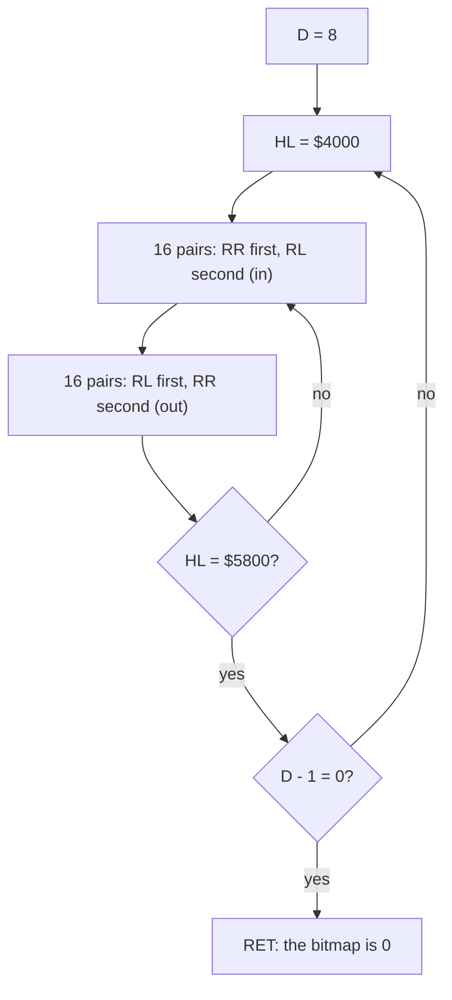

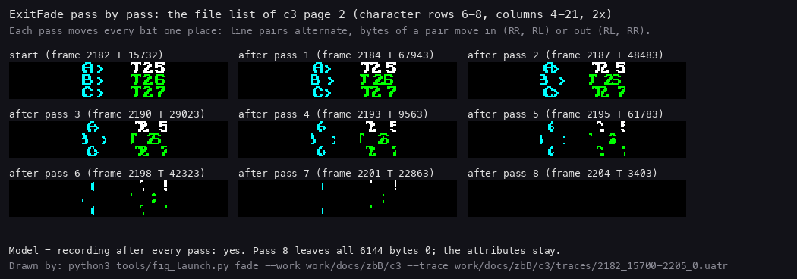

*The file list of c3 page 2 (character rows 6-8, columns 4-21, 2x) at ExitFade's start and after each pass, from the
recording (TTD `memory_at` at each `DEC D`, `$6E94`, of the trace); a Python copy of ExitFade's loops gives the same
6144 bytes after every pass. Command: `python3 tools/fig_launch.py fade docs/img/launch/fade.png --work
work/docs/zbB/c3 --trace work/docs/zbB/c3/traces/2182_15700-2205_0.uatr`.*

How to read it:

- Rows 6 and 8 (A and C) are even character rows: their 16-pixel pairs squeeze towards the middle of each pair.
- Row 7 (B) is odd: its pairs spread to the pair's edges.
- Pass 8 leaves nothing; the colours (the attributes) are not touched.

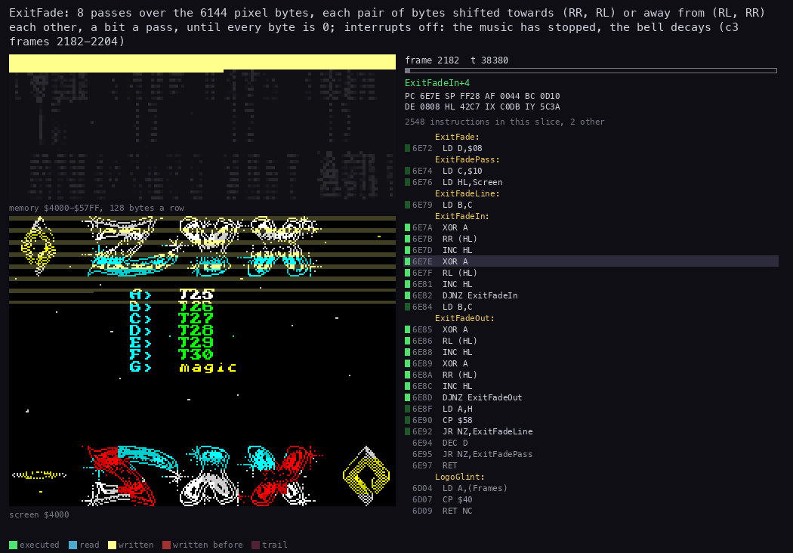

*The routine animation of ExitFade in c3, from 2182:15700 to 2205:0 (TTD units; 72 pictures). The view is the screen;
the memory grid is the bitmap `$4000-$57FF`. Command, from the case folder after `. work/env.sh`: `python3
../../kit/routine_anim.py --work work/docs/zbB/c3 --window 2182:15700-2205:0 --listing build/main.lst --pc 6E72-6E97
--range 4000-57FF --pictures 72 --delay 120 --out docs/img/routines/ExitFade.gif` (with a `--title`).*

How to read the animation:

- The written marks sweep down the bitmap once a pass, 8 times.
- The screen loses its pixels in steps of 2.7 frames, the time of one pass.

Worked example, one pair on an even row: `3C 3C` (`..XXXX....XXXX..`). Pass 1: `1E 78`; pass 2: `0F F0`; pass 3:
`07 E0`: the two blocks meet in the middle and start to fall off there; pass 6: `00 00`. On an odd row the same pair
goes `78 1E`, `F0 0F`, `E0 07`, ... and falls off at the outer edges.

Cost: 1 564 652 T (L1, c2 and c3 alike: the work does not depend on the picture), 195 582 T a pass, 21.8 frames of a
Pentagon's 71 680 T; in c3 from 2182:15732 to 2204:3403. Interrupts are off the whole time, so the music has stopped
and the menu's animations with it.

Witness: the c3 trace `2182:15700-2205:0`; the model check "model = recording after every pass: yes" printed by
`tools/fig_launch.py fade`.

The point: a cheap, data-independent wipe that gives the bell time to ring and the eye something to watch, in 38
bytes of code.

## 10.6 The loader's end and TR-DOS

After the `RET`, the loader ([doc 3, 3.3](03-build-and-load.md#33-the-loader-how-the-code-arrives-in-memory)) clears
`$61A8-$FEAF` again: the menu, the catalogue with its deleted marks, the IM 2 table, the music. It returns to BASIC,
whose line 10 ends with `RUN`. RUN clears the variables and starts the program at line 1:

```basic
  1 RANDOMIZE USR VAL "15619": REM : RUN "T30     "
```

`RANDOMIZE USR 15619` enters TR-DOS at `$3D03`, which executes the rest of the line as a TR-DOS command: `RUN "T30"`
loads the BASIC program T30 and runs it. For a 192-sector CODE file the line would read `GO TO "magic   " CODE`: TR-DOS
loads a snapshot saved with the Magic button and runs it from its saved registers.

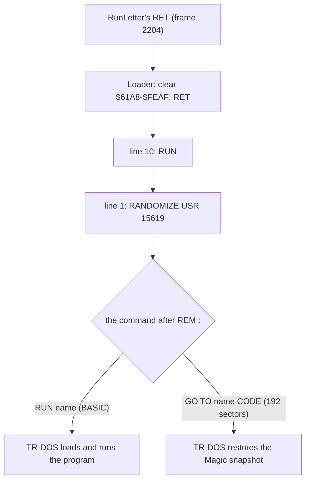

The GO TO path is witnessed in c5 (`tests/disks/deep.scl`, WALKTHROUGH 6.0): D on page 3 runs RunLetter at frame 2490,
and line 1 then reads `$EC 22 6D 61 67 69 63 20 20 20 22 AF` from `$5D4C`: GO TO, `"magic   "`, CODE (TTD
`memory_at` at frame 2513; at frame 2489 it was still `RUN "        "`). TR-DOS then loads the 192 sectors; the test
file is zeros, so the machine resets into the 128 menu (the screen from c5 frame 2851).

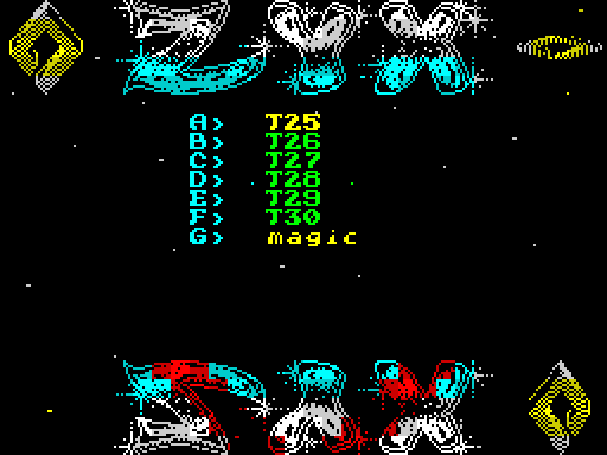

*The screen every second frame, c3 frames 2178-2296: the menu's page 2, the F pressed at 2182, ExitFade, the black
screen while TR-DOS reads the disk, the first lines of TEST 30. Command: `python3 ../../kit/screen_anim.py --work
work/docs/zbB/c3 --from 2178 --to 2296 --step 2 --scale 4 --delay 120 --hold 2000 docs/img/play/launch.gif`.*

How to read it:

- Until 2182 the menu runs: the stars fall, the cursor blinks.
- 2182-2204: the fade; the colours stay, the pixels go.
- 2205-2285: a black screen: the loader, BASIC and TR-DOS's disk reads.
- 2286 on: T30's own screen, TEST 30.

Worked example, the BASIC area in c3 by `memory_at`: at frame 2205 `$5D3B` still holds line 1 (`00 01 1A 00 F9 C0 B0
...`). At frame 2250 the same addresses hold catalogue entries (`... 42 21 00 21 00 01 0E 03 54 30 32 20 ...`: the tail of
T01's entry and T02's name): TR-DOS uses the area while it looks for T30. At frame 2300 they hold T30's own
program (`00 0A ... "TEST 30"`). FRAMES reads 0 at 2205, `$11` from 2230 to 2240 (the disk reads run with interrupts off), `$15` at 2286.

Witness: c3 by `memory_at` at frames 2205-2300; c2 ends the same way with TEST 03 ([launched](img/play/launched.png)).

The point: from the `RET` on, nothing of the menu is left in memory: the program runs from a clean BASIC, as if typed
by hand.

## 10.7 Notable features of the code

**Self-modifying code.** The menu and the player patch their own instructions instead of keeping variables:

| Where | Patched by | What changes |
| --- | --- | --- |
| ShowCatalogueAt `$659C`+2 | ReadKeyboard `$6923`, `$692C` | the first entry of the page to list (`LD IX,nn`) |
| ReadLetterRow `$6875`+1 | ReadKeyboard `$6870` | the opcode of `RES n,A`: the keyboard half-row of the letter |
| CursorAttrAddr `$6848`+2 | `$67C5`, `$6806` | the cursor's attribute address |
| SpinCharacters `$67D8` | `$6820`, `$6828` | its first byte: `RET` (`$C9`) to stop the name's spin, `$3A` to run it |
| MoveStars `$6482`+2 | `$628F`, `$629B`, `$62C8` | the star table's address |
| SampleStarBit `$6471`+1, MoveStarsPutBack `$64A1`+1, MoveStarsDraw `$64D4`+1 | `$646D`, `$649E`, `$64D1` | the `BIT`/`RES`/`SET` opcodes: which pixel bit |
| ClearPhaseIndex `$634D`+2, MarkPhaseWrite `$635D`+2, ScaleTestBit `$6392`+3, ScaleWriteBit `$63AD`+3 | `$634A`, `$635A`, `$638E`, `$63AA` | the rhombus phase builder's index and bit opcodes |
| GlintCornerLeft `$6D3D`+1, GlintCornerRight `$6D40`+1, GlintRowStart `$6D53`+1 | `$6D0D`-`$6D32` | the glint's corners and row |
| DelayOp, PatternTableOp, SampleTableOp, CommandOrnament, PositionCountOp, NextPosition | InitPlayer `$C053` | the tune's delay, tables, position count and positions ([doc 9, 9.3](09-music-and-sound.md#93-the-entries-and-initplayer)) |
| PositionOp `$C194`+1 | NextPosition `$C19E` | the current position |

**Tricks.**

- The deleted mark as a cursor: RunLetter marks the passed entries as deleted so the shared SkipDeleted advances it
  (10.2).
- IsBootFile hides the boot by returning E = 0, so the type ANDed with E is neither `B` nor `C`
  ([doc 7, 7.2](07-catalogue-and-menu.md#72-which-files-are-listed)).
- ENTER becomes a letter: FireKey adds `$40` to the cursor's index and falls into RunLetter (10.3).
- The launch is a BASIC line saved with the program and patched in three places; TR-DOS does the loading (10.6).
- SoundOff silences the AY by writing 14 bytes from `$7530`, a part of the code file's never-loaded gap that the loader
  zeroes ([doc 9, 9.9](09-music-and-sound.md#99-soundoff-and-playbell)). It holds for the original's loader only:
  zyxermbt loads code there and its SoundOff buzzes ([doc 13, 13.7](13-variants.md#137-the-own-loaders)).
- The player writes R13 only when a pattern sets a shape, keeping `$FF` as "none" in the same byte
  ([doc 9, 9.7](09-music-and-sound.md#97-channelsound-and-writeay-the-registers)).

**Bugs and quirks.**

| What | Where | Code | Effect |
| --- | --- | --- | --- |
| the Kempston read is `LD A,$00` | Joystick `$68B9` | `68B9 3E 00 LD A,$00` (not `IN A,($1F)`) | the five `CALL C` after it never call: no joystick (variants with `IN A,($1F)` read it) |
| `LD E,$FF` before IsBootFile | `$6A62` | `6A62 1E FF LD E,$FF` | redundant: IsBootFile sets E itself |
| ColumnsSpare `$B3BA` | ListCatalogue | `6603 22 BA B3 LD (ColumnsSpare),HL` | cleared with Columns, never read |
| the keys are read inside the interrupt | ReadKeyboard | `6834 CC 64 68 CALL Z,ReadKeyboard` (in the IM 2 handler) | a page draw or the launch runs with interrupts off: 8 frames lost per page, 22 for the fade |
| MusicStop is never called | `$C011` | `C011 C3 95 C0 JP Silence` (no `CALL`/`JP` to it) | the music is never stopped; the bell replaces it |
| the length test is "exactly 192 sectors" | `$65EC`, `$6A7A` | `65EC FE C0 CP $C0`, then `JR NZ` | a CODE file of any other size is not listed; Vadim's comment says "length >= C000" |
| a page in patterns 6-9 | SoundOff | `6586 CD 41 6E CALL SoundOff` (R13 = 0) | R13 = 0 cuts the envelope until the next pattern (known only from the code: [doc 9, 9.11](09-music-and-sound.md#911-known-only-from-the-code)) |
| the position rule | PlayFrame `$C117` | `C117 CB 47 BIT 0,A` / `C119 CC 91 C1 CALL Z,NextPosition` (bit 0 of the three records ORed) | a position ends when the last events are read, not finished: the first tune loop is 7704 frames, later ones 7764 ([doc 9, 9.4](09-music-and-sound.md#94-playframe-the-delay-the-rows-and-the-next-position)) |
| no "previous page" | ReadKeyboard | `6929 21 00 9D LD HL,Catalogue` / `692C 22 9E 65 LD (ShowCatalogueAt+2),HL` | CAPS SHIFT goes to the first page, not one back ([doc 7, 7.5](07-catalogue-and-menu.md#75-the-pages)) |

**What the authors left.** Bytes that are in the files but that nothing uses:

- The BASIC sector's tail, SectorTail `$5DF3` (72 bytes): `oot27" LINE 10`, the end of a `SAVE "boot27" LINE 10`
  that was in memory when the program was saved, then number bytes and zeros. TR-DOS does not load it and the Loader
  starts at the next sector; most variants carry another name there (`boot12`, `boot32`).
- BASIC lines 2 and 3 (`$5D59`, `$5D6C`): `RANDOMIZE USR VAL "15619": REM : RUN` (run "boot" again) and `RANDOMIZE
  USR VAL "15616"` (TR-DOS's command line). The program reaches them only if line 1's command came back to BASIC
  without an error; no recording does.
- The player's text, PlayerText `$C014` (63 bytes): "ASM COMPILATION OF DISCO MUSIC BY ANT P BY ANDREW SENDETSKI
  ASC". The menu never prints it, and no instruction reads it.
- The compilation header's three bytes `$80 $54 $1E` at `$C008`: no instruction reads them; their meaning is not known.
- The gaps in the work area: Unused1 `$70A8-$75FF` (1368 bytes, of which SoundOff reads 14 at `$7530`), Unused2
  `$76C1-$76FF` (63), Unused3 `$77C8-$77FF` (56), Unused4 `$8900-$89FF` (256), Unused5 `$9B00-$9BFF` (256), Unused6
  `$9CC8-$9CFF` (56): room between buffers aligned to 256 bytes, cleared by the Loader and never written.

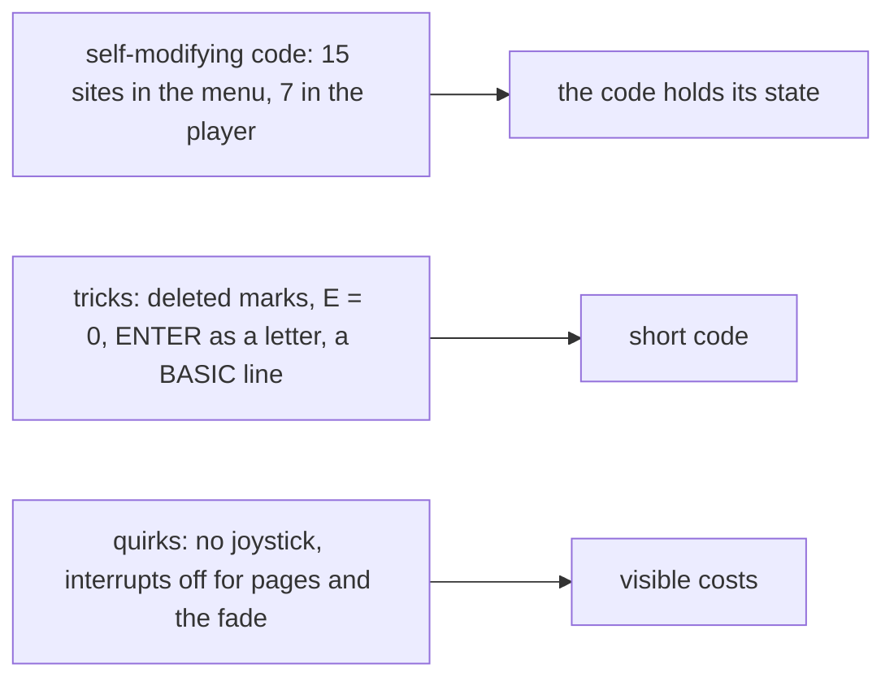

Worked example, ReadLetterRow: each KeyTable byte holds a letter's half-row number n in its top 3 bits and the key's
mask in its low 5. ReadKeyboard turns n into the opcode of `RES n,A` (`$87` OR n x 8) and stores it at `$6876`, so
`LD A,$FF; RES n,A; IN A,($FE)` reads exactly that half-row, and the low 5 bits pick the key.

Witness: the patched bytes are in the recordings' memory. ShowCatalogueAt's operand, for example, is `$9E90` (page 2)
only while SYMBOL SHIFT's page is drawn; ReadKeyboard writes `$9D00` back after it, and `memory_at` on c3 at frame
1900 reads `DD 21 00 9D` at `$659C`. The L1 writes of each patching instruction.

The point: the code is small and tight, written by someone who knew the ROMs well; its few flaws (the dead joystick,
the work inside the interrupt) cost nothing a user of the menu would notice except the pause at a page.

## 10.8 Known only from the code

- TR-DOS's snapshot load itself: c5 runs `magic`, but its body is zeros, so what TR-DOS restores is not a real
  snapshot (the machine resets); the GO TO path up to TR-DOS is witnessed (10.6).
- The letter check on page 1: FileCount counts the listed files to the catalogue's end (31 on `many.scl`), not only the
  page's 24, so every letter A-X passes the first test on a full page; the walk always finds the file.
- A deleted entry on the disk (first byte 1) in front of the chosen file: c5's deleted T05 lies on page 1, before
  the page RunLetter walks from; SkipDeleted handles it as it handles the marks.

## 10.9 The point

The launcher is 158 bytes (FireKey and RunLetter, `$6A3F-$6ADC`), and ExitFade 38 more. It finds a file on the page by walking the catalogue once, writes a three-part TR-DOS
command into a BASIC line saved for the purpose, gives the machine back exactly as BASIC left it, rings a bell and
wipes the screen while it rings, and leaves the loading to TR-DOS. Around it the code shows the habits of its time:
instructions patched in place of variables, a ROM-aware handover, and one dead joystick read.
