# 13. The variants

ZYX boot was copied, redrawn and re-scored for years. The owner's collection holds 56 boot files built on the same
menu program (`work/candidates/owner-boots_zyx`: 38 images, and 18 boots on `zyxboot.scl`). This document shows what
the copies changed, how each one is built from this case's source, and which tune each plays.

What this covers:

- the family: two code layouts, the code switches, the own loaders (13.1);
- all 56 in one table: who, layout, what differs, the tune, the build (13.2);
- the menus side by side (13.3), the logos and the rhombi (13.4);
- layout B and every code switch, with its asm (13.5, 13.6);
- the own loaders: pieces, parts, residue (13.7);
- the players and the tunes, with an MP3 of each distinct tune (13.8);
- the three hardest: a packed image, an encrypted loader, a rewritten menu, and the RLE and LZ packers and the R-cipher
  in full (13.9);
- how to build and check them (13.10).

Each variant is a folder `variants/NAME` that holds only what differs from the original
([variants/README.md](../variants/README.md)); `tools/build.sh --variant NAME` builds it from `src/` plus that
folder and compares the result with the candidate file byte for byte.

**56 of 56 build identical**, and every tune is text.

## 13.1 The family

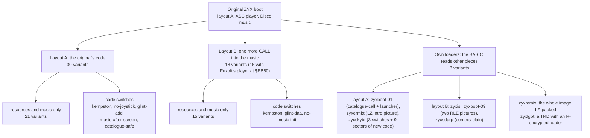

*Figure 13.1. The family tree of the 56 boots. How to read: every box below the original is a way of changing it; the
counts are variants. The point: one program; the copies differ in drawings, music, a handful of code switches and
a few parts of their own, never in a second copy of the code.*

The counts: layout A with the original's loader is 30 boots (9 of them with a code switch), layout B 18 (3 with a
switch), the own loaders 8 (zyxsdgrp, zyxisl and zyxboot-09 run layout B code, the others layout A). zyxtvmbt keeps
the original's loader (with other sector counts) and adds a routine of its own in a part, so it counts under
layout A.

## 13.2 All 56

Group: the name the variant's logo or rhombus shows (Figures 13.6 and 13.7); "-" when it keeps the original's
drawings. What differs: the resource files (same names and formats as `src/res`: font, logo, logo colours, rhombus,
corner colours, help text, "NO EXE" text, twinkle, stars, phase order, rhombus columns, keys), the code switches (13.6)
and the moved work areas (`MenuStack`, the IM 2 table). Tune: title, author, year when the tune names one; then the player.
Identification and the readable form of each piece: `src/res/music/README.md` and 13.8.

| Variant | Group | Layout | What differs | Tune; player | Build |
| --- | --- | --- | --- | --- | --- |
| [zyxae](../variants/zyxae/README.md) | A.E. Service | B | rhombus | Tune 12 (Fuxoft); Fuxoft (F. Fuka) | identical |
| [zyxalex](../variants/zyxalex/README.md) | Aleks, Tsaritsyno market (row 3, place 9), 1993 | B | font, logo, logo colours, rhombus, IM 2 table moved | Hydrofool - In-Game (AY) (Rob Hubbard); game rip: Hydrofool (Rob Hubbard) | identical |
| [zyxalex2](../variants/zyxalex2/README.md) | A. Obertyshev, Tsaritsyno | A | rhombus | The Lyra 2 Demo 04 (Ziutek (Ethanol)), 1992; Sound Tracker (compiled) | identical |
| [zyxamebt](../variants/zyxamebt/README.md) | AMT | B | logo, logo colours, rhombus | Tune 5 (Fuxoft); Fuxoft (F. Fuka) | identical |
| [zyxarbt](../variants/zyxarbt/README.md) | - | A | moved MenuStack | E.S.I. (Ziutek); Sound Tracker (compiled) | identical |
| [zyxawbt](../variants/zyxawbt/README.md) | A.W. Studio, Taganrog, 1993 | A | BASIC, help text, logo, rhombus | Altered Beast (Paul Hiley), 1989; game rip: Altered Beast | identical |
| [zyxboot-01](../variants/zyxboot-01/README.md) | - | A | own loader, BASIC, stars, code of its own (`parts/`), `kempston`, `catalogue-call` | Techno Project II (Heather), 1994; ASC Sound Master 1.x layout | identical |
| [zyxboot-02](../variants/zyxboot-02/README.md) | - | B | tune only | Indiana Jones 3 - Title (AY) (Frantisek Fuka); Fuxoft (F. Fuka) | identical |
| [zyxboot-03](../variants/zyxboot-03/README.md) | - | B | `kempston`, `glint-daa` | Terra Cresta (Frantisek Fuka); Fuxoft (F. Fuka) | identical |
| [zyxboot-04](../variants/zyxboot-04/README.md) | - | B | `kempston` | F.I.R.E. (a variant of the rip) (Frantisek Fuka), 1988; Fuxoft (F. Fuka) | identical |
| [zyxboot-05](../variants/zyxboot-05/README.md) | - | A | BASIC | Platoon Tunnel Network (David Whittaker); game rip: Platoon (David Whittaker) | identical |
| [zyxboot-06](../variants/zyxboot-06/README.md) | - | B | tune only | Magnetic Fields IV (Frantisek Fuka); Fuxoft (F. Fuka) | identical |
| [zyxboot-07](../variants/zyxboot-07/README.md) | - | B | tune only | E.T. Flying (Frantisek Fuka); Fuxoft (F. Fuka) | identical |
| [zyxboot-08](../variants/zyxboot-08/README.md) | - | A | BASIC | Platoon; game rip: Platoon (David Whittaker) | identical |
| [zyxboot-09](../variants/zyxboot-09/README.md) | - | B | own loader, BASIC, code of its own (`parts/`) | Feud (Frantisek Fuka); Fuxoft (F. Fuka) | identical |
| [zyxboot-10](../variants/zyxboot-10/README.md) | - | A | `no-joystick` | Fantasy World Dizzy (David Whittaker); game rip: Fantasy World Dizzy (David Whittaker) | identical |
| [zyxboot-11](../variants/zyxboot-11/README.md) | - | A | BASIC | Stormbringer Title/In-Game (David Whittaker); game rip: Stormbringer (David Whittaker) | identical |
| [zyxboot-12](../variants/zyxboot-12/README.md) | - | A | `no-joystick` | Subway Vigilante Title (Ian Sheridan); game rip: Subway Vigilante (Ian Sheridan) | identical |
| [zyxboot-13](../variants/zyxboot-13/README.md) | - | B | tune only | Magnetic Fields V (Frantisek Fuka); Fuxoft (F. Fuka) | identical |
| [zyxboot-14](../variants/zyxboot-14/README.md) | - | A | BASIC | AXEL-FORCE (OLEG KRASNOBAEV OKO); ASC Sound Master (later compilation) | identical |
| [zyxboot-15](../variants/zyxboot-15/README.md) | - | A | BASIC | Great Commandment (Roman Samoilov, 1993, the player's text; the music index: ASC + OKO (New Edge)); ASC Sound Master (later compilation) | identical |
| [zyxboot-16](../variants/zyxboot-16/README.md) | - | A | BASIC | N.S Beat (Ilya Pozdnyakov, 1993, the player's text; the music index: "Ritm4_II", ASC); ASC Sound Master (later compilation) | identical |
| [zyxboot-17](../variants/zyxboot-17/README.md) | - | A | BASIC | RIPPED BY D.O.C. (ANDREW SENDETSKI ASC); ASC Sound Master (later compilation) | identical |
| [zyxboot-18](../variants/zyxboot-18/README.md) | - | A | BASIC | LET'S DANCE, BABY ! (ANDREW SENDETSKI ASC); ASC Sound Master (later compilation) | identical |
| [zyxdebt](../variants/zyxdebt/README.md) | Dima ("programs on disks") | A | help text, "NO EXE" text, logo, rhombus | The Lyra 2 Demo 05 (Ziutek (Ethanol)), 1992; Sound Tracker (compiled) | identical |
| [zyxdimob](../variants/zyxdimob/README.md) | DIMO | B | BASIC, help text, logo, rhombus, twinkle, `kempston`, `no-music-init` | Mega Apocalypse (Rob Hubbard / J.C. Brookes); game rip: Mega Apocalypse | identical |
| [zyxermbt](../variants/zyxermbt/README.md) | - | A | own loader, BASIC, help text, stars, code of its own (`parts/`) | Disco music (Ant P); ASC Sound Master (the original's) | identical |
| [zyxfp](../variants/zyxfp/README.md) | FP | A | rhombus | Disco music (Ant P); ASC Sound Master (the original's) | identical |
| [zyxfp3bt](../variants/zyxfp3bt/README.md) | Fikus Pikus | A | corner colours, font, logo, logo colours, rhombus, twinkle | Marauder (Dave Rogers), 1988; game rip: Marauder | identical |
| [zyxfp4bt](../variants/zyxfp4bt/README.md) | Paradise (Aleksei) | A | corner colours, logo, logo colours, rhombus, phase order, `kempston` | Part V (Ziutek of ESI); own player (Part V, Ziutek of ESI) | identical |
| [zyxfzbt](../variants/zyxfzbt/README.md) | - | A | BASIC, help text, "NO EXE" text, rhombus, rhombus columns, `music-after-screen` | FREEZERO (Ironman); Sound Tracker (compiled) | identical |
| [zyxgambt](../variants/zyxgambt/README.md) | GAM Graphics Ltd | B | corner colours, font, glint colours, help text, logo, logo colours, twinkle | Magnetic Fields IV (Frantisek Fuka); Fuxoft (F. Fuka) | identical |
| [zyxhsbt](../variants/zyxhsbt/README.md) | Logros; Hacker SMIR 1995-1999 | A | logo, logo colours, rhombus, `kempston`, `glint-add` | The Lyra 2 Demo 08 (Ziutek (Ethanol)), 1992; Sound Tracker (compiled) | identical |
| [zyxisl](../variants/zyxisl/README.md) | - | B | own loader, BASIC, code of its own (`parts/`) | Feud (Frantisek Fuka); Fuxoft (F. Fuka) | identical |
| [zyxkisbt](../variants/zyxkisbt/README.md) | - | B | help text | Axel F. Theme (Frantisek Fuka); Fuxoft (F. Fuka) | identical |
| [zyxkombt](../variants/zyxkombt/README.md) | KISSoft, Barnaul | A | font, logo, rhombus | The Lyra 2 Demo 04 (Ziutek (Ethanol)), 1992; Sound Tracker (compiled) | identical |
| [zyxlebt](../variants/zyxlebt/README.md) | Logros; Elite | A | logo, logo colours, rhombus, `kempston` | The Lyra 2 Demo 08 (Ziutek (Ethanol)), 1992; Sound Tracker (compiled) | identical |
| [zyxlesbt](../variants/zyxlesbt/README.md) | LES Ltd | A | "NO EXE" text, logo, logo colours, rhombus | MIKROPOL (ST COMPILE); Sound Tracker (compiled) | identical |
| [zyxlgbt](../variants/zyxlgbt/README.md) | Lotus Group | A | own loader, BASIC, logo, logo colours, rhombus, code of its own (`parts/`), moved MenuStack | E.S.I. (Ziutek); Sound Tracker (compiled) | identical |
| [zyxlogrb](../variants/zyxlogrb/README.md) | Logros | A | logo, logo colours, `kempston`, `glint-add` | The Lyra 2 Demo 08 (Ziutek (Ethanol)), 1992; Sound Tracker (compiled) | identical |
| [zyxm94bt](../variants/zyxm94bt/README.md) | Music Soft, 1994 | A | help text, "NO EXE" text, logo, rhombus | Kent (Kent); Sound Tracker (compiled) | identical |
| [zyxmassb](../variants/zyxmassb/README.md) | MAS Soft, Tula | A | font, help text, logo, logo colours, rhombus | Disco music (Ant P); ASC Sound Master (the original's) | identical |
| [zyxmegbt](../variants/zyxmegbt/README.md) | Mega Soft | B | rhombus | Magnetic Fields IV (Frantisek Fuka); Fuxoft (F. Fuka) | identical |
| [zyxmixmb](../variants/zyxmixmb/README.md) | - | B | help text | Monty On The Run (Frantisek Fuka); Fuxoft (F. Fuka) | identical |
| [zyxremix](../variants/zyxremix/README.md) | Code Gangsters ("ZYX boot remixed by Alex") | A | own loader, BASIC, font, logo, logo colours, rhombus, stars, code of its own (`parts/`) | KSA (Ksa); Sound Tracker (compiled), inside the packed image | identical |
| [zyxrover](../variants/zyxrover/README.md) | Roversoft | A | help text, "NO EXE" text, rhombus | Pacmania; game rip: Pac-Mania (Ben Daglish) | identical |
| [zyxrusbt](../variants/zyxrusbt/README.md) | ZYX logo redrawn | A | font, help text, "NO EXE" text, logo, rhombus, twinkle, moved MenuStack | E.S.I. (Ziutek); Sound Tracker (compiled) | identical |
| [zyxsdbot](../variants/zyxsdbot/README.md) | 1997 (rhombus) | B | help text, rhombus | Magnetic Fields IV (Frantisek Fuka); Fuxoft (F. Fuka) | identical |
| [zyxsdgrp](../variants/zyxsdgrp/README.md) | SD-Group | B | own loader, BASIC, font, logo, logo colours, rhombus, `corners-plain` | Where Time Dropped Dead (Frantisek Fuka); Fuxoft (F. Fuka) | identical |
| [zyxsiriu](../variants/zyxsiriu/README.md) | - | A | help text, keys (its KeyTable), `no-joystick` | In-Game (David Whittaker); game rip: Fantasy World Dizzy (David Whittaker) | identical |
| [zyxskitb](../variants/zyxskitb/README.md) | SKIT (Bobi) | A | help text, "NO EXE" text, logo, logo colours, rhombus, stars | The Lyra 2 Demo 05 (Ziutek (Ethanol)), 1992; Sound Tracker (compiled) | identical |
| [zyxskybt](../variants/zyxskybt/README.md) | Skynet Games | A | own loader, BASIC, corner colours, help text, logo, logo colours, rhombus, code of its own (`parts/`), `sky-rotate-buffer`, `sky-stars`, `sky-screen` | Stracker (Jaroslaw Byrczynski), 1990; Sound Tracker (compiled) | identical |
| [zyxslbt](../variants/zyxslbt/README.md) | SLand | B | font, logo, rhombus | F.I.R.E. (Frantisek Fuka); Fuxoft (F. Fuka) | identical |
| [zyxtribt](../variants/zyxtribt/README.md) | Trio Company | B | rhombus | Magnetic Fields IV (Frantisek Fuka); Fuxoft (F. Fuka) | identical |
| [zyxtvmbt](../variants/zyxtvmbt/README.md) | TVM | A | rhombus, code of its own (`parts/`), `catalogue-safe` | MARK 800 (notes); Sound Tracker (compiled), LZ-packed | identical |
| [zyxzxtbt](../variants/zyxzxtbt/README.md) | - | B | help text | Fugue (Frantisek Fuka); Fuxoft (F. Fuka) | identical |

## 13.3 The menus side by side

Each variant booted (unreal-qt, Pentagon 128K, muted) a disk made of its boot file and the same 32 other files
(`tests/disks/many.scl`), so every menu lists the same catalogue; the shot is about 600 frames after the menu is drawn
(`tools/fig_variants.py shots`, then `sheets`).

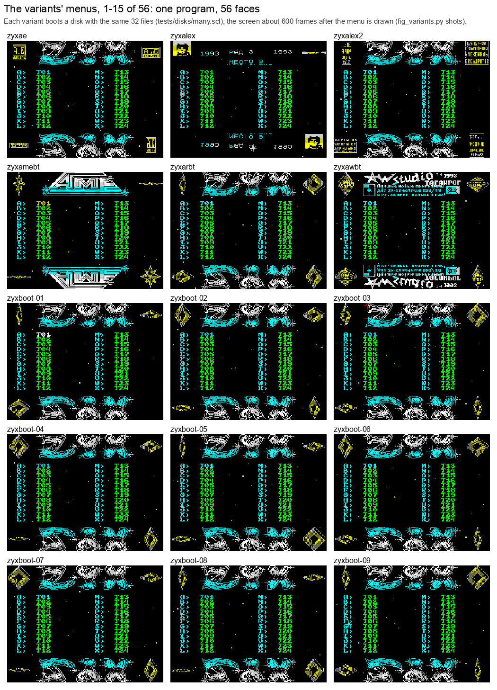

*Figure 13.2. Variants 1-15. How to read: one tile a variant, its name above; the catalogue is the same in every tile
but zyxlgbt's (it runs from its own TRD, Figure 13.4), so what changes is the variant's own: the logo (rows 0-4), the
corner rhombi, the colours, the help text. The point: the layout of the menu (the logo, two columns of names, the
rhombi in the corners, the reflection) stays in all 56; zyxskybt puts its picture and scroller where the reflection
was, and a logo drawn in paper only (Figure 13.6, "(all paper)") leaves its rows black.*

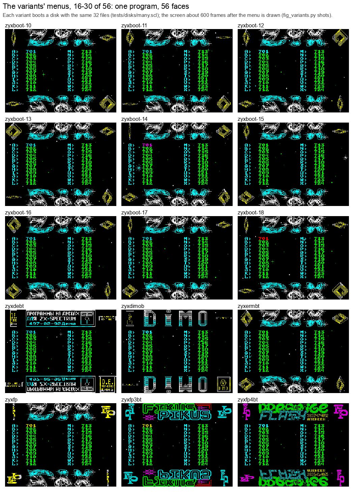

*Figure 13.3. Variants 16-30. How to read: as Figure 13.2. The point: the zyxboot-NN boots (one collection disk)
keep the ZYX logo and change the tune and the rhombus.*

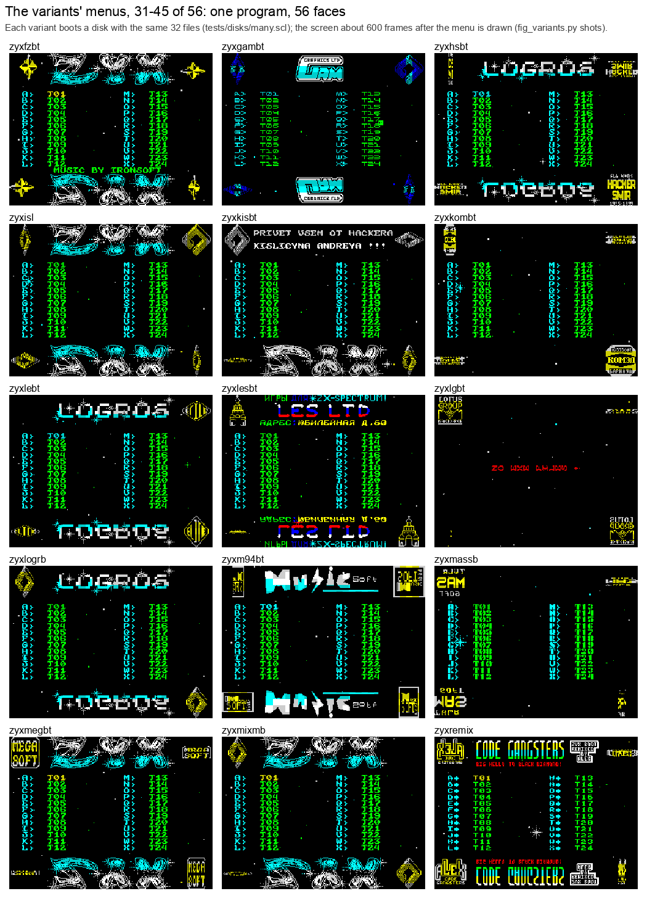

*Figure 13.4. Variants 31-45. How to read: as Figure 13.2. zyxlgbt shows the Lotus Group menu with "NO EXE FILES !":
its TRD holds only the boot. The point: the sellers' and groups' copies put their name in the logo and their phone or
address in the help text.*

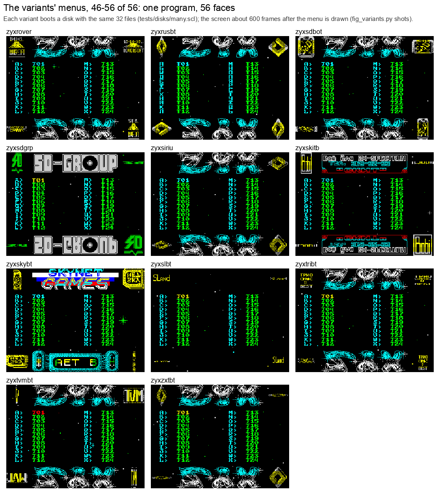

*Figure 13.5. Variants 46-56. How to read: as Figure 13.2. zyxskybt (Skynet Games) has its picture and the scroller at
the bottom, zyxsdgrp its plain green corners. The point: even the own loaders end in the same menu.*

## 13.4 The logos and the rhombi

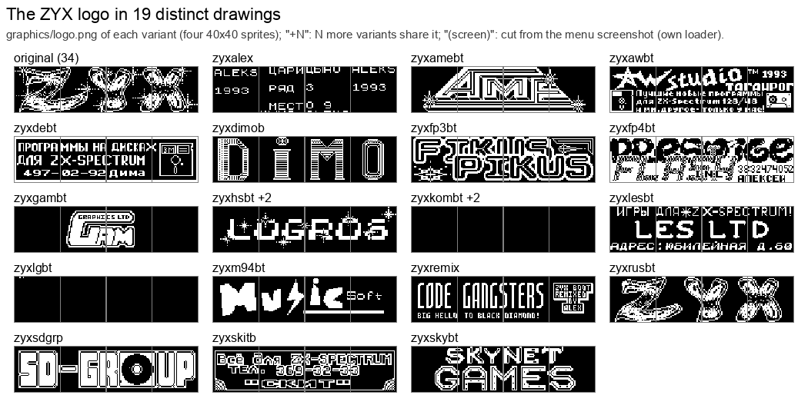

*Figure 13.6. Every distinct `graphics/logo.png` (four 40x40 sprites). How to read: one tile a drawing, labelled with
the first variant that has it and "+N" for the others; "(all paper)" is a logo resource with no ink. The point: the
logo is the signature: each drawing besides the original's names a seller or a group.*

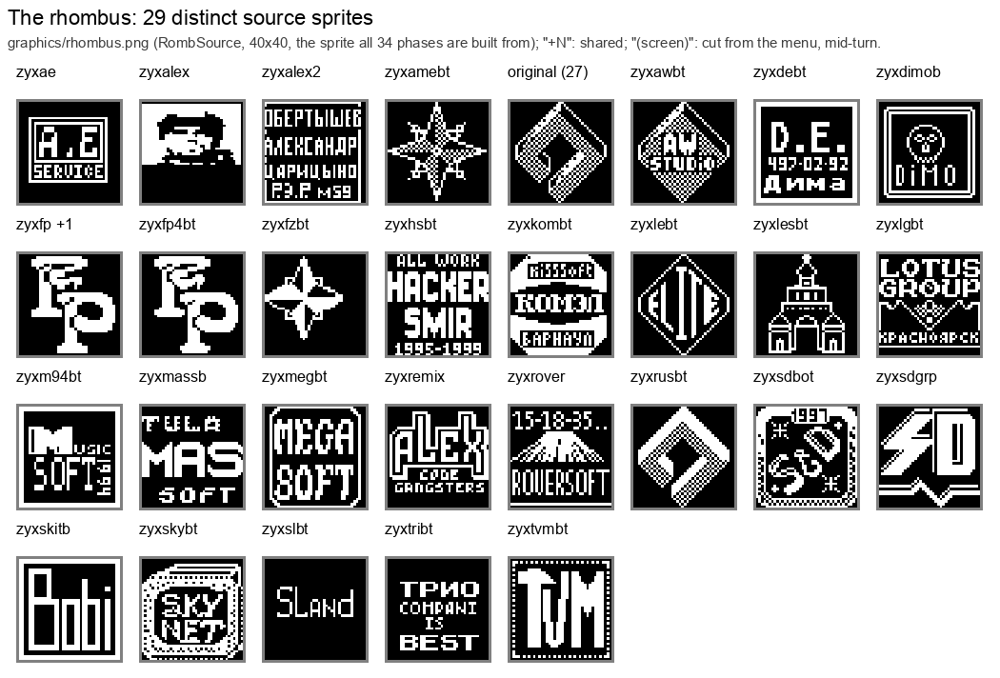

*Figure 13.7. Every distinct `graphics/rhombus.png` (RombSource, the 40x40 sprite all 34 turning phases are built
from by BuildRombPhases). How to read: as Figure 13.6. The point: the rhombus is the second signature; many copies kept
the ZYX logo and put their name only here (A.E. Service, Mega Soft, Roversoft, Trio Company, TVM).*

## 13.5 Layout B

Layout B adds one CALL after the music's init. It is the 3 bytes a player with two entries needs: Fuxoft's player
(its init at `$EB53` sets the tune, its start at `$EB50` resets the channels) in 16 of the 18 and in the three own
loaders below, zyxalex's Hydrofool rip (`MusicInit` `$F42A`, `MusicStart` `$F42D`); zyxdimob's Mega Apocalypse rip
at `$E505` needs no init, and `no-music-init` turns both CALLs into 6 zero bytes. Every later address of the code
piece moves by 3:

```asm
; src/main/setup.asm, layout A (the original)       ; layout B (tools/variants.py add_start)
  CALL MusicInit          ; $C00B                     CALL MusicInit          ; $EB53
  CALL DrawScreen                                     CALL MusicStart         ; $EB50
                                                      CALL DrawScreen         ; 3 bytes later
```

`add_start` inserts the CALL and moves every `ORG` of the code piece after Start by 3; the labels follow, so
the rest of the source is unchanged. Every B variant (the 18 and the three own loaders on layout B: zyxisl,
zyxboot-09, zyxsdgrp) also moves two work areas to make room for the player at
`$EB50-$F01B` and its data from `$F01C`: the stack (`MenuStack` `$BF68` for `$FCBC`) and the screen copy
(`ScreenCopy` `$C000`, `ScreenCopyHigh` `$80`). zyxalex also moves the IM 2 table (`Im2Table`, `Im2Jump`),
zyxgambt the glint's colours (`GlintEdge`, `GlintCentre`: the attributes of its outer and middle cells). These are `equ` values in `variant.json`, not code.

## 13.6 The code switches

A code switch is a named edit of `src/main/*.asm` that a variant lists in `variant.json` `code`
(`tools/variants.py` `CODE_SWITCHES`: a regular expression and its replacement, one or several modules). No
variant has its own copy of the code.

| Switch | Variants | What it does |
| --- | --- | --- |
| `kempston` | zyxboot-01, -03, -04, zyxdimob, zyxfp4bt, zyxhsbt, zyxlebt, zyxlogrb | reads the Kempston joystick |
| `no-joystick` | zyxboot-10, -12, zyxsiriu | the dormant joystick block is zeros |
| `glint-add` | zyxhsbt, zyxlogrb | the glint's half tested with ADD |
| `glint-daa` | zyxboot-03 | one damaged byte in LogoGlint |
| `no-music-init` | zyxdimob | the music is never initialised |
| `music-after-screen` | zyxfzbt | the music starts after DrawScreen |
| `catalogue-call` | zyxboot-01 | the catalogue read moved into a routine before Start |
| `corners-plain` | zyxsdgrp | the corners in one colour |
| `catalogue-safe` | zyxtvmbt | the catalogue read through an error trap |
| `sky-rotate-buffer`, `sky-stars`, `sky-screen` | zyxskybt | Skynet's picture, scroller and Cyrillic font (13.9) |

**kempston.** The original reads no joystick: Joystick `$68B9` loads 0 and the five `CALL C` after it (ColumnKey
twice, DownKey, UpKey, FireKey) never call. Eight variants read port `$1F`, so a Kempston joystick moves the cursor and
its fire runs the file (the addresses below are layout A's; in the layout B zyxboot-03, -04 and zyxdimob each
`CALL C` sits 3 bytes higher, `$68BF-$68CF`):

```asm
Joystick:
  IN A,($1F)              ; variant (original: LD A,$00)
  RRA
  CALL C,ColumnKey        ; $68BC bit 0: right
  RRA
  CALL C,ColumnKey        ; $68C0 bit 1: left
  RRA
  CALL C,DownKey          ; $68C4 bit 2: down
  RRA
  CALL C,UpKey            ; $68C8 bit 3: up
  RRA
  CALL C,FireKey          ; $68CC bit 4: fire
```

**no-joystick.** The 22 bytes of that block are zeros: the menu runs through 22 NOPs (`DEFS 22`).

**glint-add.** GlintHalf `$6D1F` picks the logo (Z: even) or its reflection (NZ: odd) by bit 0 of the frame
counter's high byte; LogoGlint is entered only in the frames `$xx00-$xx3F` and draws in Frames 0-52 of them (at 54 its column count
reaches 27 and it returns). `ADD A,$01` in place of `AND $01` gives Z only when the byte is `$FF`, so the logo itself
glints only in frames `$FF00-$FF34` (the glint's Frames 0-52 within that block), practically never (Frames is reset by
every page and reaches `$FF00` after 21.8 minutes), and the reflection glints in every 256-frame block:

```asm
  LD A,(Frames+1)
GlintHalf:
  ADD A,$01               ; variant (original: AND $01): Z only for $FF
  JR Z,GlintStart         ; Z: the logo's addresses (Attributes+6, +25, +128)
  LD HL,Attributes+614    ; NZ: the reflection's (+614, +633, +736)
```

**glint-daa.** One bit off at `$6D66` in LogoGlint (zyxboot-03 is layout B; `$6D63` in layout A): `DAA` (`$27`) for `AND A` (`$A7`), likely a damaged byte. The
carry before `SBC HL,BC` is then not always clear, so the glint sometimes lands one byte off:

```asm
  LD BC,$0020
  DAA                     ; variant (original: AND A)
  SBC HL,BC
```

**no-music-init.** The two CALLs at `$61E7` (MusicInit, MusicStart in layout B) are 6 zero bytes; the game-rip player
of zyxdimob needs no init (`DEFS 6`).

**music-after-screen.** The two CALLs swapped: the tune starts after the screen is drawn:

```asm
  CALL DrawScreen         ; variant (original: CALL MusicInit first)
  CALL MusicInit
```

**catalogue-call** (zyxboot-01). The catalogue read becomes a 13-byte routine just before Start, so the code piece
starts at `$619B`. Start calls it only while the launcher's flag at `$FF14` is 0 (the launcher, `parts/launcher.ann`,
sets it when it comes back to the menu with the catalogue already read):

```asm
  ORG $619B
ReadCatalogue:
  LD DE,$0000             ; track 0, sector 0
  LD HL,Catalogue         ; $9D00
  LD BC,$0805             ; 8 sectors, C = 5: read
  CALL TrdosEntry         ; $3D13
  RET
Start:
  ...
  LD A,($FF14)            ; the launcher's flag
  OR A
  JR NZ,CatalogueRead
  CALL ReadCatalogue
  NOP
  NOP
  NOP
CatalogueRead:
```

**corners-plain** (zyxsdgrp). ColourCorners colours all four corners through ColourCornerRows (the original colours
the top-right and bottom-left corners through ColourCornerColumns) with one attribute, `$04`, green ink on black paper,
and never reads CornerColours: the rhombi in the corners show in green. The 3-byte `LD DE,CornerColours` becomes
`LD A,$04` and a `NOP`, and the `LD A,(DE)` of each row a second `NOP`:

```asm
ColourCorners:
  LD HL,Attributes
  CALL ColourCornerRows
  LD HL,Attributes+635
  CALL ColourCornerRows
  LD HL,Attributes+27     ; variant (original: LD DE,Attributes+27 / CALL ColourCornerColumns)
  CALL ColourCornerRows
  LD HL,Attributes+608    ; variant (original: LD DE,Attributes+608 / CALL ColourCornerColumns)
  CALL ColourCornerRows
  RET
ColourCornerRows:
  LD B,$05
  LD A,$04                ; variant (original: LD DE,CornerColours, 3 bytes)
  NOP
CornerRowsNext:
  LD C,$05
  NOP                     ; variant (original: LD A,(DE))
```

**catalogue-safe** (zyxtvmbt). Four edits. Start inits the music first, then reads the catalogue through
ReadCatalogueSafe at `$6FE0` (in the menu's spare bytes; `variants/zyxtvmbt/parts/safe.ann`), which traps disk
errors through ERR_SP and stops the drive after the read; the second init before DrawScreen is gone; the interrupt
plays the music before it loads IY; SPACE (re-read the catalogue) goes through the same routine:

```asm
; setup.asm
  CALL MusicInit          ; variant: the music first
  DI
  CALL $6FE0              ; ReadCatalogueSafe
  DEFS 5
  ...
  DEFS 3                  ; variant: no second init
  CALL DrawScreen
; interrupt.asm
  CALL MusicPlay          ; variant: the music before IY is set
  LD IY,(SavedIY)
; keys.asm, the SPACE handler
  DI
  IM 1
  CALL $6FE0
  DI
  IM 2
  CALL ShowCatalogue
  RET
  DEFB $2D,$2D,$52,$45,$52,$45,$41,$44,$20  ; "--REREAD ": leftover text, not read
```

**sky-rotate-buffer** (zyxskybt). Four edits in RotateSprite: the rhombus is turned in a buffer at `$60E0`, below the
code piece, since RotateBuffer `$9C00` holds the Cyrillic font copy; the 200-byte buffer crosses a page there, so
every `INC E` becomes `INC DE`:

```asm
RotateSprite:
  PUSH HL
  LD DE,$60E0             ; $6423 variant (original: LD DE,RotateBuffer)
  ...
RotateShiftRow:
  LD A,(DE)
  RRA
  LD (DE),A
  INC DE                  ; $6439 variant (original: INC E); also the five INC E after RotateSourceRow
  DJNZ RotateShiftRow
  ...
  LD HL,$60E0             ; variant (original: LD HL,RotateBuffer): the copy back
```

**sky-stars** (zyxskybt). Seven edits. MoveStars' first step jumps to SkyStarClip `$A86D` (`parts/sky.ann`), which
loads the star's address and sends a star over the logo or the picture to MoveStarsHidden (moved, not drawn); the
star's row step becomes StarStep at `$6720`, where PrintString was; PrintString moves into the first 28 bytes of
DrawReflection `$6DC6`, which Start no longer calls; the twinkle's spot test is SkyTwinkleSpot `$A89E`:

```asm
MoveStarsNext:
  PUSH BC
  JP $A86D                ; $6489 variant (original: LD L,(IX+$00)): SkyStarClip loads HL
  ...
  CALL StarStep           ; $64A3 variant: the star one pixel row down
  CALL SampleStar
  JP MoveStarsMoved+11
MoveStarsHidden:          ; $64AC SkyStarClip comes here: over the picture, no draw
  CALL StarStep
  CALL SampleStar
  JP MoveStarsDraw+2
StarStep:                 ; $6720 variant: in PrintString's place
  CALL $A7FF              ; SkyRowDown
  LD A,H
  AND $18
  CP $18                  ; past the bitmap's last third?
  JR NZ,StarStepStore
  LD H,$40                ; back to the top
StarStepStore:
  LD (IX+$00),L
  LD (IX+$01),H
  LD B,$01
  RET
DrawReflection:           ; $6DC6 variant: never called
PrintString:              ; the original's 28 bytes, moved here
  ...
; setup.asm
  DEFS 3                  ; $625E variant (original: CALL DrawReflection)
; stars.asm
  CALL $A89E              ; $6C0C variant (original: CALL CheckTwinkleSpot)
EraseTwinkle:
  NOP                     ; $6C71 variant (original: INC HL): SkyTwinkleSpot stepped HL
```

**sky-screen** (zyxskybt). Five edits. DrawScreen sets CHARS to the font SkySetup moves to `$A984` and calls SkySetup
`$78DD` where it printed the help text; the interrupt calls SkyFrame `$A85C` (the scroller, the markers, the bars, then
MusicPlay); ShowCatalogue starts with 3 zero bytes in place of `CALL SoundOff`, and SPACE calls `ShowCatalogue+3`, so
a page no longer silences the AY (SPACE's own `CALL SoundOff` at `$68FC`, before its disk read, stays); the bottom
rhombi turn on passes with bits 0 and 2 set, 2 passes of 8 instead of 1:

```asm
; screen.asm, DrawScreen
  LD HL,$A884             ; $656F variant (original: LD HL,FontBase)
  LD (Chars),HL
  LD HL,MenuHelp
  CALL $78DD              ; $6578 variant (original: CALL PrintString): SkySetup
ShowCatalogue:
  DEFS 3                  ; $6586 variant (original: CALL SoundOff)
; keys.asm, SPACE
  CALL SoundOff           ; $68FC: kept
  ...
  IM 2
  CALL ShowCatalogue+3    ; variant (original: CALL ShowCatalogue)
; interrupt.asm
  CALL $A85C              ; $676D variant (original: CALL MusicPlay): SkyFrame
; setup.asm, MainEvery8
  LD A,(MainTick)
  AND $05                 ; $62D1 variant (original: AND $07)
  CP $05                  ; (original: CP $07)
  JR NZ,MainLoop
```

## 13.7 The own loaders

Eight boots replace the BASIC sector's loader: its REM code reads other pieces than the original's three (code
`$61A8` x 15, graphics `$A600` x 8, music `$C000`). Their BASIC is text (`basic.txt`, `tools/res_basic.py`: the listing,
the hidden numbers, the REM code as `code` lines with their disassembly), and `variant.json` `pieces` lists what the
loader reads, in file order; the build assembles the menu with the variant's switches, then cuts the same pieces
from the whole memory image:

| Variant | Pieces (address x sectors) | Own code (`parts/`) | Residue |
| --- | --- | --- | --- |
| zyxboot-01 | `$619B` x 16, `$A600` x 8, `$C000` x 21, `$FF14` x 1 | `launcher.ann`: a launcher at `$FF14` (its last piece runs past `$FFFF`) | 5 self-modified operands of the stars |
| zyxermbt | `$7530` x 3, `$61A8` x 15, `$A600` x 8, `$C000` x 22 | `intro.ann`: an LZ depacker that puts a loading picture on the screen (`graphics/intro-picture.png`) | 17: code operands and the ASC player's state |
| zyxisl, zyxboot-09 | `$61A8` x 15, `$A600` x 8, `$EB50` x 9, `$C350` x 21 | `pictures.ann`: two RLE screens (`$9D` escapes), each waiting for a key (`graphics/rle-picture-1.png`, `-2.png`), then a diagonal attribute wipe at `$5DEE` (128 frames) before the menu | none |
| zyxsdgrp | `$61A8` x 15, `$A5F8` x 9, `$EB48` x 9 | none (`corners-plain`) | none |
| zyxskybt | `$61A8` x 24, `$A600` x 8, `$BFFB` x 20 | `sky.ann`: the picture, the bars, the scroller, the set-up (13.9) | none |
| zyxremix | `$61A8` x 55 (packed) | `depack.ann`: the LZ depacker head (13.9) | 9, and 4 state files: a snapshot of the running menu |
| zyxlgbt | by track and sector (a TRD) | `loader.ann`, `stage2.ann`: the decrypted loader and its second stage (13.9) | none |
| zyxtvmbt (the original's loader, other counts) | `$61A8` x 15, `$A600` x 8, `$C000` x 8 in the file (the loader reads 10) | `safe.ann`: ReadCatalogueSafe at `$6FE0` | none |

A part is a `.ann` description of a variant's own code, assembled by `kit/mkgame.py` like the game itself
(`variants/NAME/parts/NAME.json`); the build places its binary at its address. Residue is bytes the saved file
kept from a run: zyxboot-01 and zyxermbt were saved from memory after the menu had run, so the stars'
self-modified operands hold run-time values, and zyxermbt's ASC player holds the state of a tune that had played
(`variant.json` `residue`: label+offset, bytes, why). zyxtvmbt's BASIC reads 10 sectors of music (the unpacked
tune's size, `$C000-$C9D6`; the original reads 22) while the file holds the 8 of the packed one: the read takes 2
sectors past the file's end.

Loading code at `$7530` costs one variant its silence. The menu's SoundOff writes the 14 bytes at `$7530` to the AY,
zeros in the original because its loader clears that gap ([doc 09, 9.9](09-music-and-sound.md#99-soundoff-and-playbell)). zyxermbt's loader reads IntroPicture there
and never clears it, so every page and every SPACE writes `F3 CD 52 00 3B 3B C1 21 97 00 09 EB 21 66`: mixer `$21`,
channel A on the envelope with noise, channel C a 38 Hz tone (period `$B3B`) at volume 9, the envelope period `$21EB`
with shape 6 (one 1.27 s rise, then 0). A buzz instead of silence, for the 8 frames of a page draw and for the disk
read after SPACE. Witness: c7 (`tests/inputs/c7.txt`): TTD reads `$7530-$753D` as those bytes at frames 624, 1625
and 1700, and L1 counts the menu's WriteAY `$6E4F` reading `$7530-$753D` 3 times in frames 624-1625. zyxskybt's code
piece covers `$7530` too, but its SkyScrollSetup clears `$6FE0-$9BFF` (`LD BC,$2C1F` / `LDIR` at `$A84E`) while
DrawScreen runs, before any key; its ShowCatalogue no longer calls SoundOff (`sky-screen`), and SPACE's
`CALL SoundOff` (`$68FC`) reads zeros.

The packed loading pictures are resources too: the variant keeps each as a 256x192 PNG in the Spectrum's colours
(`tools/res_screens.py`; each cell's attribute rides in the PNG's text chunk, so flash and same-colour cells survive),
and the build packs it again. zyxisl's and zyxboot-09's RLE packer: a run of 3 or more equal bytes, and every `$9D`
byte, is a `$9D` run of up to 256; the rest are themselves. zyxermbt's LZ packer is `tools/lzpack.py --format intro`
(4-bit lengths 3-18, 11-bit distances), run over the screen in the order PutByte writes it (a cell's 8 rows, the cells
down each column of a third, then the attributes): greedy, the farthest of the longest matches, a match starting only
where a literal or a match went or a fill starts, a fill winning an equal match. Those rules make 196 of the stream's 204
tokens; the other 8 (5 matches and 3 fills, 16 of the 547 bytes) are the original packer's choices, kept as hints in
`tools/lzpack.py` (output position, token), used only while they still describe the bytes there; without them the
rules pack the picture to 546 bytes. All three pack back byte for byte (`tools/res_formats.py check`). The formats, both directions, the first tokens of
each real stream and the animations of the real runs: 13.9.

## 13.8 The players and the tunes

The variants did not only change tunes; they changed players. Four families, all called by the same menu interrupt
(Figure 13.8):

- ASC Sound Master: the original's (kept by zyxermbt, zyxfp, zyxmassb), and two other compilations (zyxboot-14 ...
  -18 with a later command set, zyxboot-01 with an ASC 1.x module layout): 9 variants;
- Sound Tracker, compiled ("SONG BY ST COMPILE", the module at +1084): 16 variants, the Lyra 2 demos of Ziutek
  among them (zyxtvmbt's packed, zyxremix's inside its packed image, zyxlgbt's behind its encrypted loader);
- Frantisek Fuka's (Fuxoft's) player at `$EB50` (layout B): 19 variants;
- one-off players ripped with their tune from games: David Whittaker's driver in three versions (Platoon, Fantasy
  World Dizzy, Stormbringer; 6 variants with zyxremix's second piece), Ian Sheridan, Ben Daglish, Rob Hubbard
  (Hydrofool, Mega Apocalypse), Paul Hiley (Altered Beast), Dave Rogers (Marauder), and Ziutek's Part V.

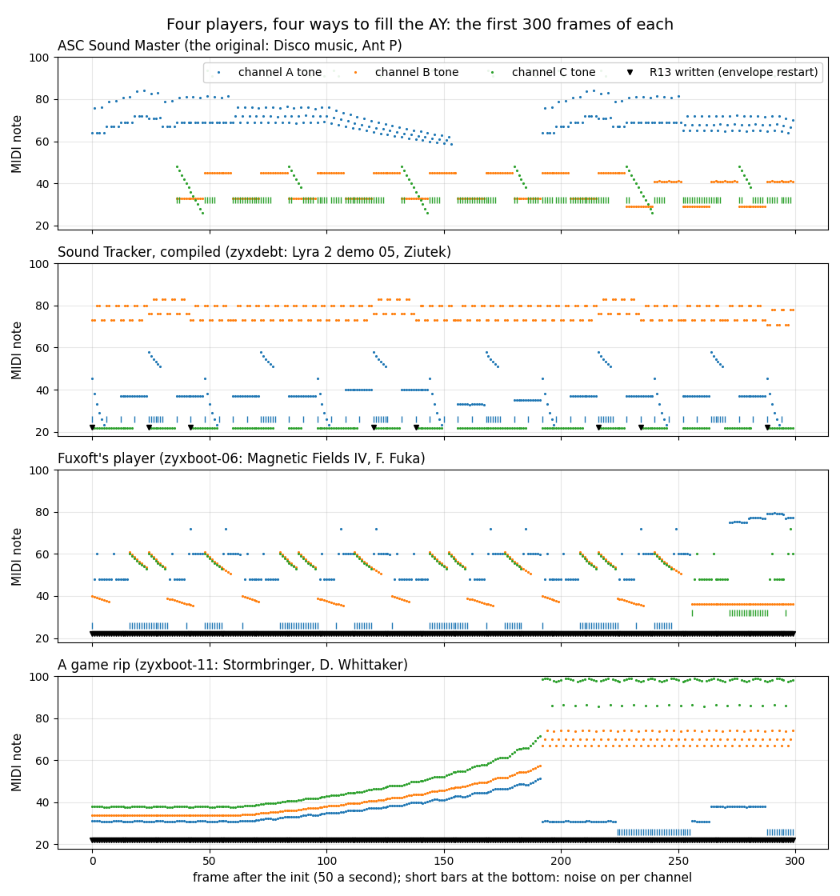

*Figure 13.8. The first 300 frames of four players run by `tools/ay_render.py`: the original (ASC), zyxdebt (Sound
Tracker), zyxboot-06 (Fuxoft), zyxboot-11 (a Whittaker rip). How to read: dots are each channel's tone as a note when
it sounds; bars at the bottom mark noise; triangles mark frames that write R13 (an envelope restart). The point: four
ways of driving the AY behind one CALL a frame.*

Each tune was identified by running its own player in the Z80 simulator (`tools/ay_render.py`), fingerprinting the
AY register stream as the music index does and looking it up (`fp_exact`: the same register stream; `fp_notes`: the
same notes; the ASC compilations also name the tune in their text); the rest by a byte search of the music
collection (zxart.ee rips): zyxawbt is Altered Beast (Paul Hiley, 1989), zyxfp3bt Marauder (Dave Rogers, 1988),
zyxskybt "Stracker" (Jaroslaw Byrczynski, 1990), zyxboot-04 F.I.R.E. (Fuxoft, 1988; 59 of 87 pieces match, so a
slightly different copy).

Every tune is text, in its player's own format, with a two-way converter; every player is a shared `.ann` part in
`variants/players/KIND`, assembled identical by `kit/mkgame.py`:

| Player | Text | Converter | Variants |
| --- | --- | --- | --- |
| ASC Sound Master | `asc.txt`, `asc1.txt` | `tools/res_music.py` (the disco.txt format; `commands v2`, `layout asc1`) | zyxboot-14 ... -18, zyxboot-01 |
| Sound Tracker | `stc.txt` | `tools/res_stc.py` | 16 |
| Fuxoft | `fuxoft.txt` | `tools/res_fuxoft.py` | 19 |
| Whittaker (3 versions) | `whittaker.txt` | `tools/res_whittaker.py` | zyxboot-05, -08, -10, -11, zyxsiriu, zyxremix |
| Sheridan | `sheridan.txt` | `tools/res_sheridan.py` | zyxboot-12 |
| Daglish | `daglish.txt` | `tools/res_daglish.py` | zyxrover |
| Hubbard, Hiley, Rogers, Ziutek rips | `hydrofool.txt`, `megaapoc.txt`, `awbt.txt`, `fp3bt.txt`, `ziutek.txt` | `tools/res_rip.py` | zyxalex, zyxdimob, zyxawbt, zyxfp3bt, zyxfp4bt |

Each variant's `music/player.txt` lists the player's bytes that differ from the shared source (saved variables,
self-modified operands). The formats: `src/res/music/README.md`. Every one round-trips
(`python3 tools/res_formats.py check`).

One MP3 for each distinct tune (30 s, 22.05 kHz mono, VBR `lame -V 4`, the AY model of `tools/ay_render.py`; the original's tune,
which zyxermbt, zyxfp and zyxmassb play, is [disco-music.wav](audio/disco-music.wav) in doc 09):

| MP3 | Tune | Author | Variants |
| --- | --- | --- | --- |
| [`zyxae.mp3`](audio/variants/zyxae.mp3) | Tune 12 | Fuxoft (F. Fuka) | zyxae |
| [`zyxalex.mp3`](audio/variants/zyxalex.mp3) | Hydrofool, in-game | Rob Hubbard | zyxalex |
| [`zyxalex2.mp3`](audio/variants/zyxalex2.mp3) | The Lyra 2 Demo 04 | Ziutek (Ethanol), 1992 | zyxalex2, zyxkombt |
| [`zyxamebt.mp3`](audio/variants/zyxamebt.mp3) | Tune 5 ("ZUB") | Fuxoft (F. Fuka) | zyxamebt |
| [`zyxarbt.mp3`](audio/variants/zyxarbt.mp3) | E.S.I. | Ziutek | zyxarbt, zyxrusbt, zyxlgbt |
| [`zyxawbt.mp3`](audio/variants/zyxawbt.mp3) | Altered Beast | Paul Hiley, 1989 | zyxawbt |
| [`zyxboot-01.mp3`](audio/variants/zyxboot-01.mp3) | Techno Project II | Heather, 1994 | zyxboot-01 |
| [`zyxboot-02.mp3`](audio/variants/zyxboot-02.mp3) | Indiana Jones 3, title | Frantisek Fuka | zyxboot-02 |
| [`zyxboot-03.mp3`](audio/variants/zyxboot-03.mp3) | Terra Cresta | Frantisek Fuka | zyxboot-03 |
| [`zyxboot-04.mp3`](audio/variants/zyxboot-04.mp3) | F.I.R.E. (another copy) | Frantisek Fuka, 1988 | zyxboot-04 |
| [`zyxboot-05.mp3`](audio/variants/zyxboot-05.mp3) | Platoon, tunnel network | David Whittaker | zyxboot-05 |
| [`zyxboot-06.mp3`](audio/variants/zyxboot-06.mp3) | Magnetic Fields IV | Frantisek Fuka | zyxboot-06, zyxgambt, zyxmegbt, zyxsdbot, zyxtribt |
| [`zyxboot-07.mp3`](audio/variants/zyxboot-07.mp3) | E.T. Flying | Frantisek Fuka | zyxboot-07 |
| [`zyxboot-08.mp3`](audio/variants/zyxboot-08.mp3) | Platoon | David Whittaker | zyxboot-08 |
| [`zyxboot-09.mp3`](audio/variants/zyxboot-09.mp3) | Feud (notes) | Frantisek Fuka | zyxboot-09, zyxisl |
| [`zyxboot-10.mp3`](audio/variants/zyxboot-10.mp3) | Fantasy World Dizzy | David Whittaker | zyxboot-10 |
| [`zyxboot-11.mp3`](audio/variants/zyxboot-11.mp3) | Stormbringer | David Whittaker | zyxboot-11 |
| [`zyxboot-12.mp3`](audio/variants/zyxboot-12.mp3) | Subway Vigilante, title | Ian Sheridan | zyxboot-12 |
| [`zyxboot-13.mp3`](audio/variants/zyxboot-13.mp3) | Magnetic Fields V | Frantisek Fuka | zyxboot-13 |
| [`zyxboot-14.mp3`](audio/variants/zyxboot-14.mp3) | Axel-Force | Oleg Krasnobaev (OKO) | zyxboot-14 |
| [`zyxboot-15.mp3`](audio/variants/zyxboot-15.mp3) | Great Commandment | Roman Samoilov, 1993 (the player's text; the music index: ASC + OKO (New Edge)) | zyxboot-15 |
| [`zyxboot-16.mp3`](audio/variants/zyxboot-16.mp3) | N.S Beat | Ilya Pozdnyakov, 1993 (the player's text; the music index: "Ritm4_II", ASC) | zyxboot-16 |
| [`zyxboot-17.mp3`](audio/variants/zyxboot-17.mp3) | Ripped by D.O.C. | Andrew Sendetski (ASC) | zyxboot-17 |
| [`zyxboot-18.mp3`](audio/variants/zyxboot-18.mp3) | Let's Dance, Baby! | Andrew Sendetski (ASC) | zyxboot-18 |
| [`zyxdebt.mp3`](audio/variants/zyxdebt.mp3) | The Lyra 2 Demo 05 | Ziutek (Ethanol), 1992 | zyxdebt, zyxskitb |
| [`zyxdimob.mp3`](audio/variants/zyxdimob.mp3) | Mega Apocalypse | Rob Hubbard / J.C. Brookes | zyxdimob |
| [`zyxfp3bt.mp3`](audio/variants/zyxfp3bt.mp3) | Marauder | Dave Rogers, 1988 | zyxfp3bt |
| [`zyxfp4bt.mp3`](audio/variants/zyxfp4bt.mp3) | Part V | Ziutek of ESI | zyxfp4bt |
| [`zyxfzbt.mp3`](audio/variants/zyxfzbt.mp3) | Freezero | Ironman | zyxfzbt |
| [`zyxhsbt.mp3`](audio/variants/zyxhsbt.mp3) | The Lyra 2 Demo 08 | Ziutek (Ethanol), 1992 | zyxhsbt, zyxlebt, zyxlogrb |
| [`zyxkisbt.mp3`](audio/variants/zyxkisbt.mp3) | Axel F. theme | Frantisek Fuka | zyxkisbt |
| [`zyxlesbt.mp3`](audio/variants/zyxlesbt.mp3) | Mikropol | ? (ST Compile) | zyxlesbt |
| [`zyxm94bt.mp3`](audio/variants/zyxm94bt.mp3) | Kent | Kent | zyxm94bt |
| [`zyxmixmb.mp3`](audio/variants/zyxmixmb.mp3) | Monty On The Run | Frantisek Fuka | zyxmixmb |
| [`zyxremix.mp3`](audio/variants/zyxremix.mp3) | KSA | Ksa | zyxremix |
| [`zyxrover.mp3`](audio/variants/zyxrover.mp3) | Pac-Mania | Ben Daglish | zyxrover |
| [`zyxsdgrp.mp3`](audio/variants/zyxsdgrp.mp3) | Where Time Dropped Dead | Frantisek Fuka | zyxsdgrp |
| [`zyxsiriu.mp3`](audio/variants/zyxsiriu.mp3) | Fantasy World Dizzy, in-game | David Whittaker | zyxsiriu |
| [`zyxskybt.mp3`](audio/variants/zyxskybt.mp3) | Stracker | Jaroslaw Byrczynski, 1990 | zyxskybt |
| [`zyxslbt.mp3`](audio/variants/zyxslbt.mp3) | F.I.R.E. | Frantisek Fuka | zyxslbt |
| [`zyxtvmbt.mp3`](audio/variants/zyxtvmbt.mp3) | MARK 800 (notes) | ? | zyxtvmbt |
| [`zyxzxtbt.mp3`](audio/variants/zyxzxtbt.mp3) | Fugue | Frantisek Fuka | zyxzxtbt |

## 13.9 The three hardest

- **zyxskybt** (Skynet Games). Its loader reads `$61A8` x 24, `$A600` x 8, `$BFFB` x 20 (the music: compiled Sound
  Tracker, init `$BFFB`, play `$C001`). Three code switches change the menu in place: `sky-rotate-buffer`
  (RotateSprite works in a buffer at `$60E0`, since the Cyrillic font takes `$9C00`), `sky-stars` (MoveStars keeps
  the stars off the logo and the picture through SkyStarClip `$A86D`; PrintString moves to the unused start of
  DrawReflection, `$6720` to `$6DC6`), `sky-screen` (the font base `$A884`, DrawScreen calls SkySetup `$78DD`, the
  interrupt SkyFrame `$A85C`). The 9 new sectors are `parts/sky.ann`: a 160x40 picture and the routines that draw it,
  a 32-letter Cyrillic font, bars that wave the logo's 24 pixel rows (run at `$FE0D`), and a scroller (run at
  `$A500`) whose enciphered advert must sum to `$AA` or it hangs. The picture, the font and the scroll text are
  resources (`graphics/sky-picture.png`, `graphics/font-cyrillic.png`, `texts/sky-scroll.txt`; `tools/res_variants.py`).
- **zyxremix** (Code Gangsters, "ZYX boot remixed by Alex"). The loader reads 55 sectors to `$61A8`; the first
  USR 25000 runs an LZ depacker (`parts/depack.ann`) that unpacks the whole memory `$61A8-$FFFE`. The image is the
  original menu (layout A, no switch) with its own drawings, saved while it ran: 9 residue entries (operands,
  stacks, counters) and 4 state files (the rhombus phases, the catalogue, the screen copy, the IM 2 table). Its
  music is two pieces: Whittaker's Stormbringer driver at `$C000` (only its init is called) and compiled Sound
  Tracker at `$CB20`, "KSA" by Ksa, which the interrupt plays through `$CB26`. The build packs the image with
  `tools/lzpack.py`, which gives the original stream back byte for byte with no hints: greedy, a match of 3-10
  bytes no longer than its distance, window 4094, the farthest of the longest matches, a fill (3-66 equal bytes)
  when it is longer than the best match, literal runs of up to 63 bytes. zyxtvmbt's packed music uses the same
  packer.
- **zyxlgbt** (Lotus Group, a TRD). Two layers decrypt themselves with the refresh register R (R XOR the byte XOR
  the address register XOR the counter; the key depends only on the instructions the loop runs). The BASIC's REM
  copies 256 bytes to `$9C40`; they decrypt `$9C7D-$A07C` (`parts/loader.ann`), read track 0 raw to check the last
  gap (the byte goes to `$FFFF`), then read track 5 sector 0 to `$FDE8`; that stage (`parts/stage2.ann`) decrypts
  itself and loads the menu (`$61A8` x 15, `$A600` x 8, music `$C0B7` x 24: "E.S.I." by Ziutek, Sound Tracker) and,
  later, the chosen file, decrypting it with a key from `$FFFF` and the file name's first letter. The menu is the ZYX
  code in layout A with the Lotus Group logo and rhombus. `tools/lotus.py` encrypts in the build: it runs each
  decryption loop in the simulator in lockstep, so the source stays plain, and lays out the whole 640 KB TRD with
  its own catalogue (and its stale entry and leftover sectors, kept as bytes).

The three transforms of these variants, the two packers and the cipher, in detail:

### The RLE pictures (zyxisl, zyxboot-09)

Each of the two pictures at `$C350` and `$CD75` (`variants/zyxisl/parts/pictures.ann`) is a 53-byte unpacker followed
by its stream; the loader calls the first, waits for a key, calls the second, waits again, then `$5DEE` wipes the
screen diagonally (128 frames: a `HALT` each, E from `$F8`; `$5DFB` / `$5E17` paint a band of attributes stepped
`$47` down to `$40`) before the menu at `$61A8`. The unpacker finds its own address
through `CALL RomRet` (a `RET` in the ROM, `$1792`), so it runs wherever it is loaded, and writes `$1B00` bytes (the
bitmap and the attributes) straight to `$4000` in address order.

| Stream bytes | Means |
| --- | --- |
| `bb` (any byte but `$9D`) | the byte `bb` itself |
| `9D bb nn` | the byte `bb`, `nn` times (`nn` = 0 is 256) |

```text
unpack(stream):                                  ; ShowFirstPicture $C350
    out = $4000; left = $1B00; run = 0
    while left > 0:
        if run == 0:
            b = next(stream)
            if b == $9D: value = next(stream); run = next(stream)   ; a run (0: 256)
            else: write(out, b); out += 1; left -= 1; continue
        run -= 1; write(out, value); out += 1; left -= 1

pack(screen):                                    ; tools/res_screens.py rle_pack
    p = 0
    while p < 6912:
        run = the bytes equal to screen[p] from p on, at most 256
        if run >= 3 or screen[p] == $9D: emit $9D, screen[p], run AND $FF; p += run
        else: emit screen[p]; p += 1
```

```text
C367  D9           EXX                     ; UnpackFirst: the next output byte
C368  78           LD A,B                  ; B' = the run left
C369  FE 00        CP $00
C36B  20 0C        JR NZ,$C379             ; a run in progress
C36D  1A           LD A,(DE)               ; DE' = the stream
C36E  FE 9D        CP $9D
C370  13           INC DE
C371  20 08        JR NZ,$C37B             ; a plain byte
C373  1A           LD A,(DE)
C374  4F           LD C,A                  ; C' = the run's byte
C375  13           INC DE
C376  1A           LD A,(DE)
C377  47           LD B,A                  ; B' = its count
C378  13           INC DE
C379  05           DEC B
C37A  79           LD A,C
C37B  D9           EXX
C37C  77           LD (HL),A               ; to the screen
C37D  23           INC HL
C37E  0B           DEC BC
C37F  78           LD A,B
C380  B1           OR C
C381  20 E4        JR NZ,UnpackFirst       ; $1B00 bytes
```

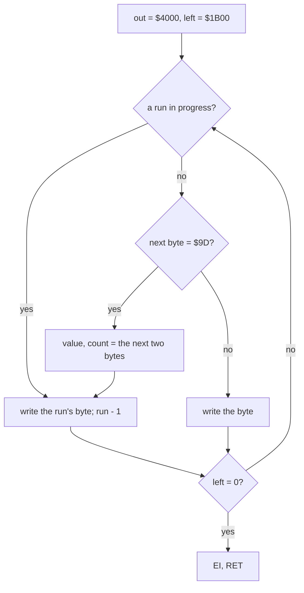

Worked example, the first picture's stream at `$C385`: `9D 00 65 08 00 00 02 9D 00 05 08 9D 00 04 08 02 9D 00 17`:
101 (`$65`) zeros, `08`, `00`, `00`, `02` (two zeros are no run: the packer runs only 3 or more), 5 zeros, `08`, 4
zeros, `08`, `02`, 23 zeros: the first 140 bytes of the bitmap. The 6912 bytes take 2544 in the stream.

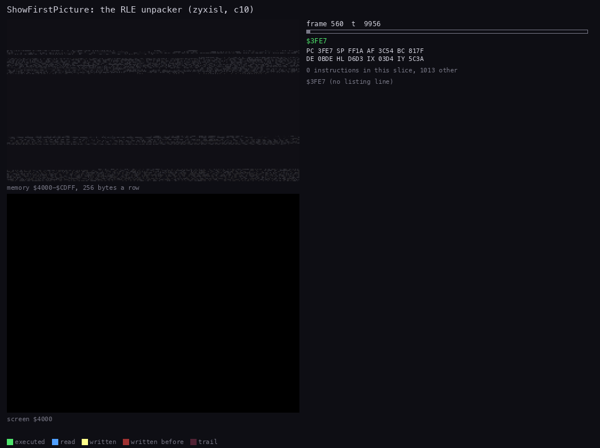

*The routine animation of ShowFirstPicture in c10, frames 560-569 (72 pictures). The view is the screen; the memory
grid `$4000-$CDFF` shows the screen written in address order and the stream read at `$C385-$CD74`. Command, from the
case folder after `. work/env.sh` and `sh tools/build.sh $SJASMPLUS --variant zyxisl`: `python3 ../../kit/routine_anim.py
--work work/stage1/c10 --window 560:0-570:0 --listing build/variants/zyxisl/part-pictures/pictures.lst --pc C350-C384
--range 4000-CDFF --pictures 72 --delay 120 --hold 2000 --out docs/img/routines/ShowFirstPicture.gif` (with a
`--title`).*

How to read the animation:

- The screen fills line by line in address order: in each third, pixel line 0 of all eight rows, then line 1, so the
  letters build up in eight passes; the empty lines between the paragraphs are runs and go by in a few pictures.
- The stream (blue, read) moves along at its own pace: fast where the text is dense, slow where a `9D` run writes many
  bytes from 3 stream bytes.
- The attributes come last: the heading turns magenta and red, the text cyan.

Witness: c10 (`tests/inputs/c10.txt`, the variant's own disk `build/variants/zyxisl/variant.scl`): L1 counts
ShowFirstPicture (`$C350`) once, frames 560-569, 587 445 T, reading `$C385-$CD74` (2544 bytes) and writing
`$4000-$5AFF` (6912); after SPACE, ShowSecondPicture (`$CD75`) once, frames 1068-1076, 586 247 T, reading
`$CDAA-$D75A` (2481 bytes). `python3 tools/res_formats.py check` unpacks and packs both pictures byte for byte. The
pictures themselves are `variants/zyxisl/graphics/rle-picture-1.png` and `-2.png`.

The point: a packer for screens with large flat areas; `$9D`, a rare byte in a screen, is the escape, and a real `$9D`
pays 3 bytes.

### The loading picture's LZ (zyxermbt)

IntroPicture `$7530` (`variants/zyxermbt/parts/intro.ann`) unpacks a 547-byte stream into the 6912 bytes of the
screen while the loader waits. It also finds its own address through `CALL RomRet` and patches its three `CALL`s to
PutByte (on the disk they hold `$74A6`, the address the code was assembled at). The output is counted linearly in DE
from `$4000`; PutByte writes each byte at the next place of the screen in column order (a cell's 8 pixel rows, then
the next cell down the column of a third, the 32 columns, the next third, then the 768 attributes in address order),
and a copy's source, the linear position minus the distance, is turned into a screen address by the same rule.

| Byte(s) | Bits | Means |
| --- | --- | --- |
| `0llllhhh` `oooooooo` | `llll`, `hhhoooooooo` | copy `llll` + 3 bytes (3-18) from `hhhoooooooo` bytes back (1-2047) |
| `10nnnnnn` + n bytes | `nnnnnn` 1-63 | n literal bytes |
| `11nnnnnn` `bb` | `nnnnnn` | the byte `bb`, `nnnnnn` + 3 times (3-66) |
| `80` | | the end |

```text
unpack(stream):                                  ; IntroPicture $7530
    pos = $4000                                  ; linear: DE
    loop:
        b = next(stream)
        if b < $80:                              ; a copy
            n = (b >> 3) + 3; dist = (b AND 7) << 8 | next(stream)
            repeat n: PutByte(read(screen_address(pos - dist))); pos += 1
        elif b == $80: return
        elif b AND $40: v = next(stream); repeat (b AND $3F) + 3: PutByte(v); pos += 1
        else: repeat b AND $3F: PutByte(next(stream)); pos += 1

screen_address(q):                               ; $757E-$7597
    if q AND $5800 == $5800: return q            ; an attribute: as it is
    i = q - $4000                                ; i = third * 2048 + column * 64 + row * 8 + line
    third, column, row, line = i >> 11, i >> 6 AND 31, i >> 3 AND 7, i AND 7
    return $4000 + third * 2048 + line * 256 + row * 32 + column

pack(screen):                                    ; tools/lzpack.py --format intro
    d = the screen in PutByte's order
    p = 0
    while p < 6912:
        match = the longest earlier copy of d[p...] (3-18 bytes, no longer than its distance, 1-2047 back),
                the farthest of equals, starting only where a literal or a match went or a fill started
        run = the bytes equal to d[p], at most 66
        if a hint names this position: take the hinted token     ; 8 of 204 tokens
        elif run >= 3 and run >= match: emit a fill
        elif match >= 3: emit the copy
        else: add d[p] to the literal run (63 at most)
    emit $80
```

```text
7564  7E           LD A,(HL)               ; UnpackLoop: the next control byte
7565  CB 7F        BIT 7,A
7567  20 3A        JR NZ,UnpackLiteral
7569  E6 07        AND $07
756B  4F           LD C,A                  ; C = the distance's high 3 bits
756C  7E           LD A,(HL)
756D  0F 0F 0F     RRCA x 3
7570  E6 0F        AND $0F
7572  C6 03        ADD A,$03
7574  47           LD B,A                  ; B = the length, 3-18
7575  23           INC HL
7576  7B           LD A,E
7577  96           SUB (HL)                ; the distance's low byte
7578  23           INC HL
7579  E5           PUSH HL
757A  6F           LD L,A
757B  7A           LD A,D
757C  99           SBC A,C
757D  67           LD H,A                  ; HL = the linear position - the distance
757E  E5           PUSH HL                 ; then $757F-$7597 turn HL into its screen address
...
7598  7E           LD A,(HL)
7599  CD A6 74     CALL $74A6              ; patched to PutByte $75CB at run time
759C  E1           POP HL
759D  23           INC HL
759E  10 DE        DJNZ $757E
...
75A3  E6 7F        AND $7F                 ; UnpackLiteral
75A5  28 1D        JR Z,$75C4              ; $80: the end
75A7  23           INC HL
75A8  CB 77        BIT 6,A
75AA  20 0A        JR NZ,$75B6             ; $C0-$FF: a fill
```

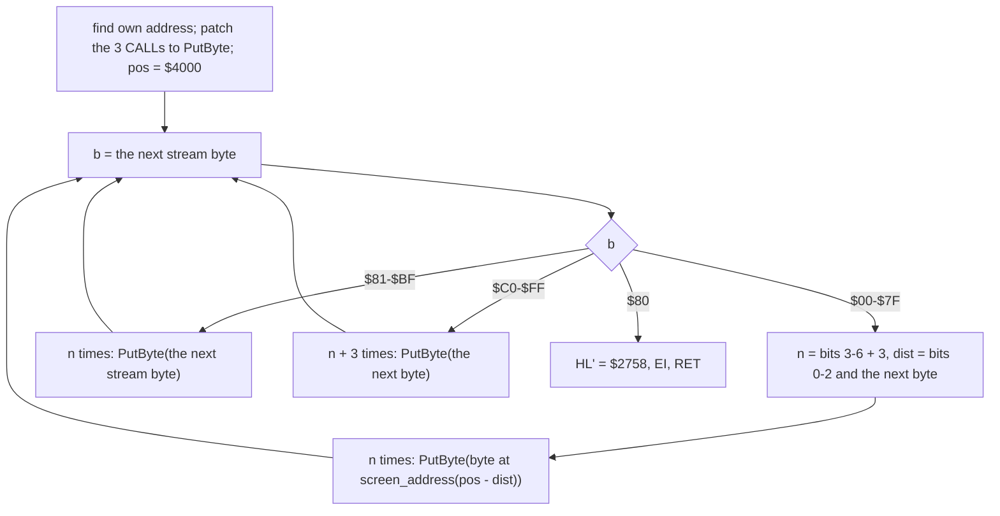

Worked example, the stream at `$7658`, where the first letters begin (the 42 fills before it are mostly the black
background):

| Stream | Token | Output (linear) | Screen | Bytes |
| --- | --- | --- | --- | --- |
| `87` + 7 | 7 literals | 2695-2701 | `$4F0A`, `$482A` ... `$4D2A` | `1F 0C 0C 0F 0C 0C 1E` |
| `C2 00` | fill 5 x `00` | 2702-2706 | `$4E2A` ... `$4A4A` | `00 00 00 00 00` |
| `00 3F` | copy 3 from 63 back (`0000` + 3, `000 00111111`) | 2707-2709 | `$4B4A` ... `$4D4A` | `01 03 03`, from 2644-2646 |
| `C2 83` | fill 5 x `83` | 2710-2714 | `$4E4A` ... `$4A6A` | `83 83 83 83 83` |
| `C1 C3` | fill 4 x `C3` | 2715-2718 | `$4B6A` ... `$4E6A` | `C3 C3 C3 C3` |

The copy at 2707 (`$4B4A`: column 10, pixel line 3) reads 63 positions back, 2644, which is `$4C49`: column 9, one
pixel line lower. A distance of 63 is one column minus one line in the screen's column order. The whole stream: 133 fills, 44 literal runs, 27 copies, 547 bytes for 6912.

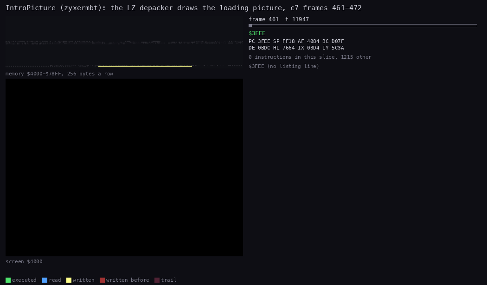

*The routine animation of IntroPicture in c7, frames 461-472 (72 pictures). The view is the screen; the memory grid
`$4000-$78FF` shows the screen written in column order and the stream read at `$75F2-$7814`. Command, from the case
folder after `. work/env.sh` and `sh tools/build.sh $SJASMPLUS --variant zyxermbt`: `python3 ../../kit/routine_anim.py --work work/stage1/c7 --window 461:0-473:0
--listing build/variants/zyxermbt/part-intro/intro.lst --pc 7530-75F1 --range 4000-7814 --pictures 72 --delay 120
--hold 2000 --out docs/img/routines/IntroPicture.gif` (with a `--title`).*

How to read the animation:

- The picture builds column by column, each column of a third top to bottom: the order PutByte writes.
- The black fills go fast; the letters of "Published by" and "Alex Ermakov" take the literals and copies.
- The attributes come last: the colours of the text appear in the final pictures.

Witness: c7 (`tests/inputs/c7.txt`, the variant's own disk `build/variants/zyxermbt/variant.scl`): L1 counts
IntroPicture once, frames 461-472, 730 927 T with PutByte (6912 calls, 475 680 T); its only writes into itself are the
three patched `CALL` operands (`$759A`, `$75AF`, `$75BD`).

The point: the stream is in the screen's column order because a picture's columns repeat more than its lines do;
the unpacker pays for that with an address conversion on every copied byte.

### The image LZ (zyxremix, zyxtvmbt)

zyxremix's 55 sectors are a 130-byte head (`variants/zyxremix/parts/depack.ann`) and a 13 946-byte stream that
unpacks to the 40 535 bytes `$61A8-$FFFE`: the whole menu, its music and its work areas as they were when the image
was saved. The output overwrites the head and the stream itself, so the head first copies its last 100 bytes
(DepackCopy) to the printer buffer `$5B8D` and runs them there; they move the stream up with `LDDR` so that it ends at
`$FFFE`, and unpack forward from `$61A8`: the output runs up behind the read position and never catches it.
zyxtvmbt's music (`$C000-$C9D6`) uses the same format behind the same head. In both variants DepackPatch is 9 zeros:
the three patch writes put 0 at `$0000` (ROM) and change nothing (c9's L1 shows the 1-byte write to `$0000`).
zyxtvmbt's `MusicInit` is the head at `$C000`, so the menu's `CALL MusicInit` unpacks the tune and the Sound Tracker
init at `$C00B` is never called. The tune needs none: the image was saved after its init had run. Running the init on
the unpacked bytes in the simulator changes none of `$C000-$C9D6`, and 600 frames of MusicPlay `$C00E` write the
same AY values with and without it (`work/review/fixC2/tvminit.py`).

| Byte(s) | Bits | Means |
| --- | --- | --- |
| `0lllhhhh` `oooooooo` | `lll`, `hhhhoooooooo` | copy `lll` + 3 bytes (3-10) from `hhhhoooooooo` bytes back (1-4095) |
| `10nnnnnn` + n bytes | `nnnnnn` 1-63 | n literal bytes |
| `11nnnnnn` `bb` | `nnnnnn` | the byte `bb`, `nnnnnn` + 3 times (3-66) |
| `80` | | the end; then 3 patches (address, byte) are written |

```text
Depack():                                        ; $61A8, called by the loader
    CALL hook                                    ; a RET after the stream
    save SP; copy DepackCopy (100 bytes) to $5B8D; jump there
    move the stream (13 946 bytes) up so it ends at $FFFE   ; LDDR
    src = $C985; dst = $61A8
    loop:
        b = (src)
        if b < $80: n = (b >> 4) + 3; dist = (b AND $0F) << 8 | (src + 1); src += 2
                    copy n bytes from dst - dist to dst                ; LDIR
        elif b == $80: break
        elif b AND $40: repeat (b AND $3F) + 3: (dst++) = (src + 1); src += 2
        else: copy b AND $3F bytes from src + 1 to dst; src += 1 + n  ; LDIR
    3 times: (address) = byte, from DepackPatch  ; 9 zeros in both variants: 0 to $0000 (ROM), no change
    restore SP; EI; return through the ROM's RET at $0052

pack(image):                                     ; tools/lzpack.py
    p = 0
    while p < len(image):
        match = the longest earlier copy (3-10 bytes, no longer than its distance, at most 4094 back),
                the farthest of equals
        run = the bytes equal to image[p], at most 66
        if run >= 3 and run > match: emit a fill
        elif match >= 3: emit the copy
        else: add image[p] to the literal run (63 at most)
    emit $80
```

```text
61C6  ED B8        LDDR                    ; DepackCopy (at $5B8D): the stream up to $FFFE
61C8  21 85 C9     LD HL,$C985             ; its first byte
61CB  11 A8 61     LD DE,Depack            ; the output starts over the head
61CE  06 00        LD B,$00
61D0  7E           LD A,(HL)               ; DepackNext
61D1  CB 7F        BIT 7,A                 ; DepackTest
61D3  20 1D        JR NZ,$61F2
61D5  E6 0F        AND $0F                 ; a copy: the distance's high 4 bits
61D7  47           LD B,A
61D8  ED 6F        RLD                     ; A = lll, from the byte's top nibble
61DA  C6 03        ADD A,$03
61DC  4F           LD C,A                  ; C = the length
61DD  23           INC HL
61DE  7B           LD A,E
61DF  96           SUB (HL)                ; DE - the distance
61E0  23           INC HL
61E1  F9           LD SP,HL                ; SP keeps the stream position
61E2  66           LD H,(HL)               ; (the next control byte, for later)
61E3  6F           LD L,A
61E4  7A           LD A,D
61E5  98           SBC A,B
61E6  44           LD B,H
61E7  67           LD H,A
61E8  78           LD A,B                  ; A = the next control byte
61E9  06 00        LD B,$00
61EB  ED B0        LDIR                    ; the copy
61ED  60           LD H,B
61EE  69           LD L,C
61EF  39           ADD HL,SP               ; HL = the stream position again
61F0  18 DF        JR DepackTest
61F2  E6 7F        AND $7F
61F4  28 19        JR Z,DepackEnd          ; $80
61F6  23           INC HL
61F7  CB 77        BIT 6,A
61F9  20 05        JR NZ,$6200             ; a fill
61FB  4F           LD C,A
61FC  ED B0        LDIR                    ; the literals
61FE  18 D0        JR DepackNext
```

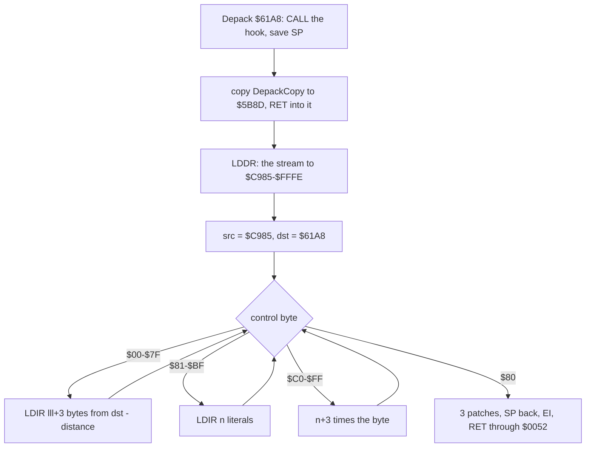

Worked example, the first tokens of zyxremix's stream (the file's byte 130 on):

| Stream | Token | Output | Bytes |
| --- | --- | --- | --- |
| `BF` + 63 | 63 literals | `$61A8-$61E6` | `FD 22 C8 AF D9 22 CA AF ED 73 CC AF ED 57 ...`: Start (`LD (SavedIY),IY`, ...) |
| `90` + 16 | 16 literals | `$61E7-$61F6` | `CD 00 C0 CD 10 65 FB 21 98 6E 11 00 77 01 C8 00` |
| `00 23` | copy 3 from 35 back (`000` + 3, `0000 00100011`) | `$61F7-$61F9` | `ED B0 21`, from `$61D4` (an earlier `LDIR` / `LD HL,`) |
| `87` + 7 | 7 literals | `$61FA-$6200` | `74 6B 11 00 76 0E 28` |
| `00 2D` | copy 3 from 45 back | `$6201-$6203` | `ED B0 21` again |
| `50 28` | copy 8 (`101` + 3) from 40 back (after four more tokens) | `$623A-$6241` | `32 8E 76 CD F1 62 21 00` |

The stream as a whole: 1178 literal runs, 1882 copies, 467 fills. The packer gives it back byte for byte with no
hints (`python3 tools/lzpack.py check`).

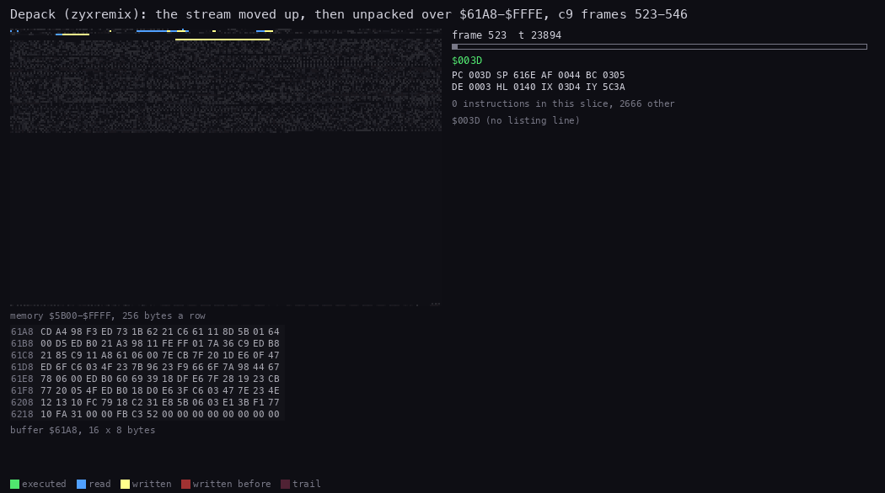

*The routine animation of the depacker in c9, frames 523-546 (72 pictures). The view is `$61A8-$6227` in hex, the
start of the output; the memory grid is `$5B00-$FFFF`. The code panel shows no listing lines: the token loop runs from
its copy at `$5B8D`, and the listing has it at its load address. Command, from the case folder after
`. work/env.sh` and `sh tools/build.sh $SJASMPLUS --variant zyxremix`: `python3 ../../kit/routine_anim.py --work
work/stage1/c9 --window 523:0-547:0 --listing build/variants/zyxremix/part-depack/depack.lst --pc
5B8D-5BF0,61A8-6229 --range 5B00-FFFF --view buffer:61A8:16x8:hex --pictures 72 --delay 120 --hold 2000 --out
docs/img/routines/Depack.gif` (with a `--title`).*

How to read the animation:

- The first pictures: `LDDR` reads the stream (blue) from the top down and writes it (yellow) so that it ends at
  `$FFFE`; the bytes at `$61A8` are still the head's own code.
- Then the token loop: the output grows up from `$61A8` (the hex view turns into Start's code, the bytes of the
  worked example) while the read position moves up through the moved stream ahead of it.
- The output (yellow) climbs behind the read position (blue) and closes on it only near the top: in frame 536 the
  output is at `$B123`, the stream at `$E1CF`.

Witness: c9 (`tests/inputs/c9.txt`, a copy of `build/variants/zyxremix/variant.scl` with the file renamed `boot`):
L1 counts the token loop at `$5B8D` once, frames 523-546, 1 674 046 T, writing `$61A8-$FFFE`; the head at `$61A8`
copied it to `$5B8D-$5BF0` (100 bytes) first. `tools/build.sh --variant zyxremix` builds the 55 sectors identical.

The point: a whole-memory packer that unpacks over itself: the stream is moved out of the output's way first, and the
last 100 bytes of the depacker run in the printer buffer, the one place the output never reaches.

### The R-cipher (zyxlgbt)

Three loops of the Lotus Group boot decrypt with the refresh register R. R counts instruction fetches (its low 7
bits; `LD R,A` sets all 8, and bit 7 then stays). Each loop sets R once with `LD R,A` and reads it with `LD A,R` on
every byte, so the key it reads depends only on how many fetches the loop made, not on the data: the loop is its own
key schedule. A monitor that runs the loop through its own code, or a patch that adds or removes one instruction,
gives other R values and garbage.

| Loop | Bytes | Key byte for the byte at address a |
| --- | --- | --- |
| the loader, `$9C40` (`parts/loader.ann`) | `$9C7D-$A07C`, 1024 | R XOR a's high byte XOR a's low byte (IX) XOR `$40` XOR `$4C` (SP = `$404C`) XOR the count's high and low bytes (DE, `$0400` down) |
| stage 2, `$FDE8` (`parts/stage2.ann`) | `$FE02-$FF01`, 256: 26 bytes past its own sector `$FDE8-$FEE7` | R XOR a's high and low bytes (HL) XOR the count's (DE, `$0100` down) |
| the chosen file, `$FE4A` | the loaded program from Prog `$5D3B`, in whole sectors (`INC B`, `C` = 0: (high byte of the length + 1) x 256) | R (set from TrackKey `$FFFF`) XOR the file name's first letter |

R starts at 2 in the loader and steps by 22 a byte (22 fetches a pass, bit 7 stays 0); in stage 2 it starts at `$DE`
and steps by 13 (bit 7 stays 1). The cipher is an XOR, so encrypting runs the same loop. Two ranges overrun their
data: stage 2's loop also XORs `$FEE8-$FF01`, 26 bytes its sector did not load, and the file layer decrypts whole
sectors: it XORs the program's length rounded up to the next multiple of 256 (256 more when the length already is
one), so the bytes past the program's end are XORed too.

```text
decrypt(first, count):                           ; the loader, $9C40-$9C7C
    R = 2                                        ; LD R,A, once
    a = first; n = count                         ; IX = $9C7D, DE = $0400
    repeat:
        key = R XOR hi(a) XOR lo(a) XOR $40 XOR $4C XOR hi(n) XOR lo(n)   ; R as LD A,R reads it
        mem[a] = mem[a] XOR key
        a += 1; n -= 1                           ; and R has moved on by 22
    until n == 0

encrypt(plain):                                  ; tools/lotus.py, in SkoolKit's Z80 simulator
    run the same loop instruction by instruction; before each read set mem[a] = 0, so the loop computes
    the bare key; the disk byte is key XOR plain[a]; let the loop store plain[a] and go on
```

```text
9C54  DD 21 7D 9C  LD IX,DecryptLoop+$001A ; the first byte: the JR NZ's own offset
9C58  11 00 04     LD DE,$0400             ; 1024 bytes
9C5B  3E 02        LD A,$02
9C5D  D3 FE        OUT ($FE),A             ; a red border
9C5F  ED 5E        IM 2
9C61  ED 4F        LD R,A                  ; R = 2
9C63  ED 5F        LD A,R                  ; DecryptLoop
9C65  DD AE 00     XOR (IX+$00)            ; the byte
9C68  DD AC        XOR IXH                 ; the address
9C6A  DD AD        XOR IXL
9C6C  21 00 00     LD HL,$0000
9C6F  39           ADD HL,SP               ; SP = $404C
9C70  AC           XOR H
9C71  AD           XOR L
9C72  AA           XOR D                   ; the count
9C73  AB           XOR E
9C74  DD 77 00     LD (IX+$00),A
9C77  DD 23        INC IX
9C79  1B           DEC DE
9C7A  7A           LD A,D
9C7B  B3           OR E
9C7C  20 E5        JR NZ,DecryptLoop       ; $9C7D: E5 only after the first pass
```

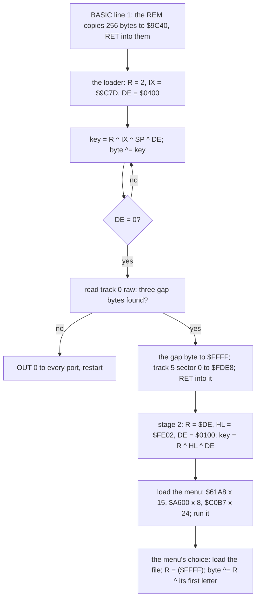

Worked example, the first bytes of each layer (`tools/lotus.py`'s simulator, the candidate TRD):

| Layer | Address | Disk byte | R read | Other terms | Key | Plain | Instruction |
| --- | --- | --- | --- | --- | --- | --- | --- |
| loader | `$9C7D` | `08` | `$04` | IX `9C 7D`, SP `40 4C`, DE `04 00` | `ED` | `E5` | the JR NZ's offset (-27) |
| loader | `$9C7E` | `FB` | `$1A` | IX `9C 7E`, SP `40 4C`, DE `03 FF` | `08` | `F3` | `DI` |
| loader | `$9C7F` | `CF` | `$30` | IX `9C 7F`, SP `40 4C`, DE `03 FE` | `22` | `ED` | `IM 1` (`ED 56`) |
| stage 2 | `$FE02` | `EF` | `$E0` | HL `FE 02`, DE `01 00` | `1D` | `F2` | the JR NZ's offset (-14) |
| stage 2 | `$FE03` | `1C` | `$ED` | HL `FE 03`, DE `00 FF` | `EF` | `F3` | `DI` |

The first row by hand: `04 XOR 9C XOR 7D XOR 40 XOR 4C XOR 04 XOR 00 = ED`, and `08 XOR ED = E5`. R is `$04`, not 2,
because `LD A,R` has made its own two fetches before it reads; the next pass reads `$04 + 22 = $1A`. Both layers start
by decrypting their own loop's `JR NZ` offset: on the disk the branch back points nowhere, and only the first pass,
which runs straight through, makes it a loop.

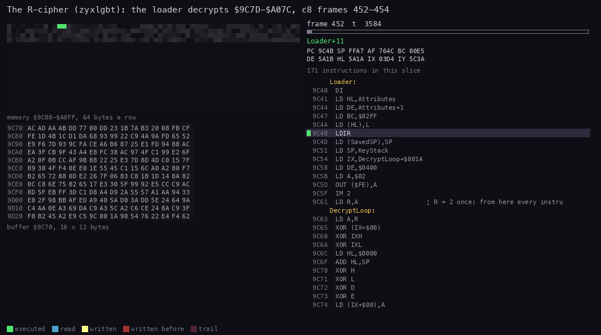

*The routine animation of the loader's DecryptLoop in c8, frames 452-454 (60 pictures). The view is `$9C70-$9D2F` in
hex: the loop's own tail and the first bytes it decrypts; the memory grid is `$9C00-$A0FF`, 64 bytes a row. Command,
from the case folder after `. work/env.sh` and `sh tools/build.sh $SJASMPLUS --variant zyxlgbt`: `python3
../../kit/routine_anim.py --work work/stage1/c8 --window 452:0-455:0 --listing
build/variants/zyxlgbt/part-loader/loader.lst --pc 9C40-9D36 --range 9C00-A0FF --row-bytes 64 --view
buffer:9C70:16x12:hex --pictures 60 --delay 150 --hold 2000 --out docs/img/routines/DecryptLoop.gif` (with a
`--title`).*

How to read the animation:

- The hex view starts with the disk bytes (`08 FB CF FE` at `$9C7D`); each pass of the 16 instructions turns one into
  plain code, `E5 F3 ED 56`: the `JR NZ` offset first, then `DI`, `IM 1`.
- The written band in the grid grows from `$9C7D` up to `$A07C`, one byte a pass, 1024 passes.
- The code panel stays on the 16 instructions: the only branch is the loop's own.

Witness: c8 (`tests/inputs/c8.txt`, the variant's TRD `build/variants/zyxlgbt/variant.trd`): at frame 452
`$9C7D` still holds `08 FB CF FE`, in frame 453 the plain `E5 F3 ED 56`; L1 counts the loader (`$9C40`) in frames 451-458,
writing `$9C7D-$A07C` (1024 bytes), and stage 2's loop (`$FDE8`) in frames 505-506, writing `$FE02-$FF01` (256);
`python3 tools/lotus.py check` decrypts the candidate and encrypts it back ("loader round-trips, stage 2
round-trips"). The file layer is known only from the code: c8's TRD holds no other file.

The point: R makes the key a property of the code, not of a table: there is nothing to copy out, and the only way to
decrypt is to run the exact instructions, which is also how `tools/lotus.py` encrypts the plain source in the build.

## 13.10 Building and checking

```sh
tools/build.sh                      # the original: identical to orig/boot.scl
tools/build.sh --variant NAME       # one variant, compared with its candidate file
tools/build.sh --all                # all 56: "56 of 56 identical"
python3 tools/variants.py index     # variants/README.md and the own loaders' README.md
python3 tools/res_formats.py check  # every resource, tune and BASIC text round-trips
python3 tools/fig_variants.py shots|sheets|logos|audio|players   # this document's figures and MP3s
```

`tools/variants.py extract` wrote the first folders from the candidates; the own loaders' `pieces`, `parts` and
`residue` were written by hand from their loaders' REM code. A change to `src/` must keep `tools/build.sh` and all
56 identical.
